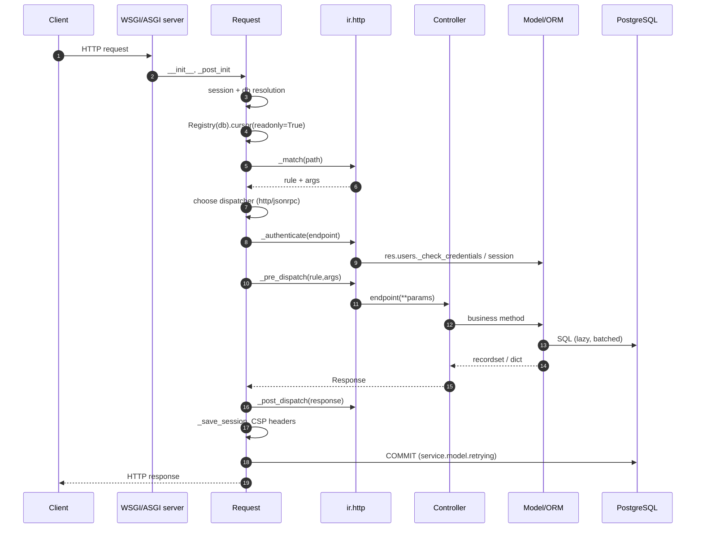

# Architecture and Runtime Model

> **Scope.** Odoo 19.0 Enterprise (`odoo-19.0+e.20260826`). Every statement here was checked against the source tree; official 20.0 docs are referenced only to mark drift.

---

## 1. Executive summary

Odoo is a **monolithic, registry-driven, metadata-heavy ORM application server** with a PostgreSQL backing store. It is not a microservice platform, not a Spring-style dependency-injection container, and not an MVC framework in the web sense. Its architecture is best understood as five concentric layers:

```
┌─────────────────────────────────────────────────────────────┐
│ 5. Presentation: OWL SPA, website, portal, POS, mobile      │
├─────────────────────────────────────────────────────────────┤
│ 4. Transport: WSGI/ASGI, HTTP controllers, JSON-RPC, bus    │
├─────────────────────────────────────────────────────────────┤
│ 3. Application: models, wizards, cron, actions, automation  │
├─────────────────────────────────────────────────────────────┤
│ 2. ORM kernel: registry, environment, fields, cache, SQL    │
├─────────────────────────────────────────────────────────────┤
│ 1. Data: PostgreSQL schema + filestore + module metadata     │
└─────────────────────────────────────────────────────────────┘
```

The dominant architectural facts:

- **One registry per database**, built once and shared by all workers through a copy-on-write mechanism plus registry signalling.
- **One cursor per request**, wrapped in an `Environment` that carries `cr`, `uid`, `context`, `su`, and a `Transaction` holding the record cache and pending recomputations.
- **Models are classes assembled at runtime** from all installed module definitions via Python MRO. There is no runtime "service registry" separate from the model registry.
- **Business logic lives in model methods**, not in controllers. Controllers are thin adapters that deserialize, authenticate, call a model, and serialize.
- **The database schema is generated from Python field definitions** unless a model opts out with `_auto = False` or uses `_table_query`.
- **Everything is metadata-driven**: views, actions, security, reports, menus, and cron jobs are rows in the database, editable at runtime.

---

## 2. Process and deployment topology

### 2.1 Runtime processes

| Process | Entry point | Responsibility |
|---|---|---|
| HTTP server (threaded or gevent) | `odoo/http.py`, `odoo/service/server.py` | Serve web, JSON-RPC, XML-RPC, longpolling/websocket |
| Cron worker | `odoo/addons/base/models/ir_cron.py` | Claim and execute `ir.cron` jobs in dedicated transactions |
| Message bus / websocket | `odoo/addons/bus/` | PostgreSQL `NOTIFY` → websocket push |
| Filestore | local or S3-compatible | Binary attachments outside PostgreSQL |
| PostgreSQL | external | All relational data, JSONB translations, company-dependent values |

The server can run in **prefork** mode (`--workers=N`) or **threaded** mode. In prefork mode, each worker is a separate process with its own registry object; registry consistency is maintained by **registry signalling** (`Registry.check_signaling`, `signal_changes`, PostgreSQL `NOTIFY`).

### 2.2 Request lifecycle (HTTP)



Key source anchors:

| Step | Location |
|---|---|
| `Request` class | `http.py:1793` |
| DB/session resolution | `http.py:1810` (`_get_session_and_dbname`) |
| read-only cursor strategy | `http.py:2267` (`_serve_db`) |
| route matching | `ir.http._match`, `addons/base/models/ir_http.py` |
| authentication | `ir.http._authenticate` |
| retry + commit | `service/model.py:160` (`retrying`) |
| dispatchers | `http.py:2447` (`HttpDispatcher`), `http.py:2520` (`JsonRPCDispatcher`) |

### 2.3 The read-only fast path [V19]

Odoo 19 opens a **read-only cursor** first, matches the route, and only upgrades to a read/write cursor if the route is not `readonly` or a `ReadOnlySqlTransaction` is raised. This is a meaningful performance and safety feature:

- Routes declared `readonly=True` never take write locks.
- A write attempted on a read-only route raises, is logged, and the request is retried with a RW cursor.
- Do not rely on this as a security boundary; it is an optimisation with a fallback.

```python
@http.route('/report/pdf/<int:report_id>', type='http', auth='user', readonly=True)
def report_pdf(self, report_id):
    ...
```

**[WARNING]** Long-running read-only routes still hold a PostgreSQL snapshot. On a busy database this contributes to bloat and can block vacuum. Keep report endpoints bounded and paginated.

---

## 3. The registry

### 3.1 What it is

`odoo.orm.registry.Registry` is a `Mapping[str, type[BaseModel]]` with exactly one instance per database (per process). It owns:

- the assembled model classes,
- field dependency graphs (`field_depends`, `field_depends_context`),
- computed-field trigger trees,
- many2many relation metadata,
- caches (`_REGISTRY_CACHES`),
- module loading state,
- schema readiness flags.

Creation path:

```
Registry(db_name)
  -> Registry.new()
     -> load_modules()
        -> ModuleGraph(cr, mode='load'|'update')
        -> for each module in phase order: registry.load(package)
        -> model_classes.add_to_registry()
        -> registry._setup_models__()
        -> registry.init_models()  # schema sync
```

### 3.2 Model class assembly [INTERNAL but essential]

Odoo distinguishes **model definitions** (classes written in modules) from **model classes** (classes in the registry). The registry class for `sale.order` inherits, in reverse module order, from every definition that contributed to it:

```
Model
 ├── SaleOrder (sale)
 ├── SaleOrder (sale_stock)
 ├── SaleOrder (sale_mrp)
 └── ...
        ↓
   registry['sale.order']  (single dynamic class)
        ↓
   recordset instances
```

Consequences:

- `super()` inside a model method walks the **module load order**, not the order in which you wrote your module.
- The MRO is deterministic but **not obvious**; it depends on dependency topology and module names within the same phase.
- A method override can be silently skipped if two modules do not depend on each other and both override the same method. The one loaded later wraps the earlier.
- Field definitions are merged; a field redefined in a later module replaces attributes but keeps its identity in the cache.

Source: `orm/model_classes.py:1-140` (the canonical explanation), `orm/model_classes.py:152` (`add_to_registry`), `orm/registry.py:375` (`load`).

### 3.3 Registry lifecycle events

| Event | Trigger | Effect |
|---|---|---|
| Registry build | first request or `odoo-bin` start | load modules, build classes, sync schema |
| Module install/upgrade | `-i`, `-u`, Apps UI | partial registry rebuild, schema migration |
| Registry signalling | other worker commits a module change | `check_signaling` reloads registry |
| Registry reset | `env.transaction.reset()` | clears caches, rebinds registry |
| Worker recycle | `--max-cron-threads`, `--limit-request` | new process rebuilds registry |

**[INVARIANT]** Never hold a reference to a model class across a registry reload. Use `env['model.name']`, not a cached class. A stale class points to a stale registry and produces `MissingError` or writes to the wrong schema version.

---

## 4. Environment, cursor, and transaction

### 4.1 Environment composition

```python
env = Environment(cr, uid, context, su=False)
env['sale.order']          # empty recordset
env(ref='base.main_company')
env(user=2, context={'lang': 'fr_FR'})   # new or reused env
env.su                     # superuser mode flag
env.company                # current company from context
env.companies              # allowed companies
```

`Environment` is a `Mapping` and is **immutable once created**. `env(...)` returns a new or cached environment. Environments are cached per transaction keyed by `(cr, uid, su, context)` (`orm/environments.py:66`).

Critical implications:

- `with_user()` and `with_context()` do **not** mutate the current environment; they return a derived one.
- Derived environments share the same `Transaction`, hence the same cache and pending computations.
- `sudo()` sets `su=True` but **does not change `uid`**. Audit fields (`create_uid`, `write_uid`) still record the original user unless you also `with_user(SUPERUSER_ID)`.
- `env.context` is a `frozendict`; mutating it raises or silently does nothing depending on the path. Always use `with_context`.

### 4.2 Transaction object

`Transaction` (`orm/environments.py:552`) is the per-cursor state container:

| Attribute | Purpose |
|---|---|
| `field_data` | `{field: {record_id: value}}` cache |
| `field_dirty` | values changed in cache but not yet written |
| `field_data_patches` | deferred x2many additions |
| `tocompute` | `{field: ids}` pending recomputations |
| `protected` | fields temporarily immune to recompute |
| `envs` | weak set of environments sharing the transaction |
| `default_env` | environment used for flushing |

The cursor owns `precommit`, `postcommit`, `prerollback`, `postrollback` callback queues (`sql_db.py:160`). These are not ORM hooks; they are transaction lifecycle hooks used by bus, mail, and attachment storage.

### 4.3 Environment and transaction rules

- **[INVARIANT]** All recordsets passed to the same business operation should share one environment and one cursor. Mixing cursors produces invisible writes and cache incoherence.
- **[INVARIANT]** Never call `cr.commit()` inside a model method. It breaks the request transaction, commits half a business operation, and defeats retry logic.
- Use `with env.cr.savepoint():` for operations that may fail without aborting the whole request (e.g. optional unique insert).
- `env.flush_all()` forces pending computes and writes to SQL. Call it before raw SQL that reads ORM-modified columns.
- `env.invalidate_all()` discards the cache; use only after bulk SQL or external changes.

---

## 5. The ORM as a business-logic runtime

### 5.1 Recordsets are the unit of work

Everything is a recordset: `self` in a method can contain 0, 1, or N records. The framework's performance model depends on **batch operations**:

```python
# Good: one SQL query for all partners
partners = self.env['res.partner'].browse(ids)
names = partners.mapped('name')

# Bad: N queries
for pid in ids:
    name = self.env['res.partner'].browse(pid).name
```

**[WARNING]** `ensure_one()` inside a loop over `self` is a common performance and correctness bug. It either raises on multi-record calls or forces per-record processing. Prefer vectorised code; call `ensure_one()` only at true API boundaries (button actions, wizards, report methods).

### 5.2 Field machinery

Every field is a descriptor that mediates cache, database, compute, inverse, related, and translation behaviour. The important field categories:

| Category | Storage | Recomputation | Typical pitfall |
|---|---|---|---|
| Regular stored | column | only if `compute` | defaults applied at create, not at write |
| Computed stored | column | dependency-triggered | stale if dependency is not declared |
| Computed non-stored | cache only | on access | cannot be searched/sorted efficiently |
| Related stored | column | dependency-triggered | chain of related fields can explode recompute |
| Related non-stored | cache only | on access | access rights evaluated on target |
| Company-dependent | `jsonb` column | per company | SQL queries need `->company_id` |
| Translated | `jsonb` column | per language | indexing only trigram |
| Binary | attachment or column | — | `bin_size` context changes representation |
| Properties | `jsonb` | per definition | schema is data, not code |

Source: `orm/fields.py:781` (`column_type`), `orm/fields.py:1138` (`update_db`), `orm/fields_relational.py:576` (x2many cache), `orm/fields_textual.py:291` (translated text cache).

### 5.3 Compute, inverse, and search

A computed field has up to three callables:

```python
total = fields.Monetary(compute='_compute_total', inverse='_inverse_total', search='_search_total')
```

- `compute` runs when the field is read and missing, or when a dependency changes.
- `inverse` runs when the field is written; it must write the underlying stored fields.
- `search` translates a domain on the computed field into a domain on stored fields.

**[INVARIANT]** A non-stored computed field without `search` cannot be used in a domain, an `order`, a group-by, or a record rule. Odoo raises `NotImplementedError` or silently ignores it depending on context.

### 5.4 Cache and recomputation

The cache is **transactional and per-field**:

```
Transaction.field_data[field][record_id] = value
Transaction.field_dirty[field] = {ids changed but not flushed}
Transaction.tocompute[field] = {ids needing recompute}
```

When you write a field:

1. `write()` validates access and values.
2. Field descriptors write to cache and mark dirty.
3. `modified()` walks the trigger tree and marks dependent stored fields in `tocompute`.
4. On flush (commit, search, or explicit `flush_all`), recomputation runs to a fixpoint (max 10 iterations, `MAX_FIXPOINT_ITERATIONS`).
5. Dirty values are written in batched `UPDATE ... FROM (VALUES ...)` statements.

Source: `orm/models.py:4334` (`write`), `orm/models.py:6756` (`modified`), `orm/environments.py:380` (`flush_all`), `orm/models.py:6934` (`_recompute_recordset`).

Consequences:

- Reading a computed stored field can trigger a write. A "read" endpoint is not necessarily read-only.
- Recompute order is dependency-driven, not declaration order.
- A missing `@api.depends` does not fail loudly; it produces stale values that may persist until restart.
- `@api.depends_context('lang')` creates a separate cache entry per context value; it cannot be stored.

---

## 6. Module loading and schema synchronisation

### 6.1 Loading phases

`ModuleGraph` (`modules/module_graph.py`) computes a phase and depth for every module. In **load** mode:

```
phase 0: base
phase 1: every other module, sorted by (depth, name)
```

In **update** mode, phases alternate between modules that need schema init and those that do not, so dependencies are loaded before dependents. Test modules are ordered immediately after their last dependency.

### 6.2 Per-module pipeline

For each module in phase order (`modules/loading.py:115`):

1. `load_openerp_module()` — import the Python package, registering model definitions in `MetaModel`.
2. `registry.load(package)` — instantiate model classes from definitions.
3. `registry._setup_models__()` — incremental field setup.
4. `registry.init_models()` — create/alter tables, columns, indexes, constraints; reflect `ir.model*`.
5. `load_data()` — parse XML/CSV data files in manifest order.
6. `load_demo()` — demo data if enabled.
7. `migrate_module('post')` — run migration scripts.
8. `post_init_hook` — optional Python hook.
9. `module.write({'state': 'installed'})` — commit.

**[WARNING]** Data files are loaded with `noupdate` semantics controlled by XML. A record with `noupdate="1"` is **not updated** on module upgrade, even if you change the XML. This is the single most common cause of "my change didn't apply" in production.

### 6.3 Schema synchronisation

`init_models()` is idempotent and additive:

- Creates missing tables (`CREATE TABLE`).
- Adds missing columns (`ALTER TABLE ADD COLUMN`).
- Creates indexes declared with `index=True`.
- Adds SQL constraints declared via `models.Constraint` / `_sql_constraints`.
- **Never drops columns** when a field is removed. It logs a warning; the column remains.
- Renames are not detected; a renamed field creates a new column and leaves the old one.

Source: `orm/models.py:3170` (`_auto_init`), `orm/registry.py:750` (`init_models`), `orm/registry.py:829` (`check_indexes`).

**[INVARIANT]** Because columns are never dropped automatically, every production upgrade needs an explicit migration plan for removed/renamed fields. See `03-database/05-migrations.md`.

---

## 7. HTTP, RPC, and controller contracts

### 7.1 Route declaration

```python
from odoo import http
from odoo.http import request

class MyController(http.Controller):

    @http.route('/my/endpoint', type='jsonrpc', auth='user', methods=['POST'])
    def endpoint(self, **kwargs):
        records = request.env['my.model'].search([])
        return {'count': len(records)}
```

Route attributes that matter:

| Attribute | Effect |
|---|---|
| `type` | `http`, `jsonrpc`, `websocket`; selects dispatcher |
| `auth` | `user`, `public`, `none`; controls session authentication |
| `methods` | HTTP verbs; default all |
| `readonly` | use RO cursor fast path [V19] |
| `csrf` | CSRF validation for `http` POST; default `True` |
| `cors` | CORS policy |
| `save_session` | whether session changes are persisted |
| `max_content_length` | upload limit |

### 7.2 JSON-RPC contract

Odoo's JSON-RPC differs from the spec:

- HTTP path selects the method; the JSON `method` field is ignored.
- `params` must be an object, not a positional array.
- Errors are returned as `{"error": {"code", "message", "data"}}` with HTTP 200.
- `context` in params replaces the session context for that call.

Source: `http.py:2500-2600`.

**[WARNING]** JSON-RPC returns HTTP 200 for application errors. Monitoring based on HTTP status will miss business failures. Parse the `error` member.

### 7.3 The `retrying` wrapper

`service/model.py:160` wraps every RPC call:

- retries on `SerializationFailure`, `DeadlockDetected`, `LockNotAvailable`, `IntegrityError` (converted to `ValidationError`),
- up to 5 attempts with exponential backoff,
- rolls back and resets the transaction between attempts,
- commits once at the end,
- runs `postcommit` callbacks after commit.

**[WARNING]** Side effects executed before a serialization failure are **not** rolled back if they escape the transaction: files written to the filestore, emails sent, HTTP calls to external systems, `cr.commit()` calls. Make external side effects idempotent or defer them to `postcommit`.

---

## 8. Asynchronous machinery

### 8.1 Cron

`ir.cron` is an `ir.actions.server` delegate. The scheduler:

1. Claims a job with `SELECT ... FOR UPDATE SKIP LOCKED` (`_acquire_one_job`).
2. Runs it in a **new cursor and transaction**.
3. Supports progress reporting (`ir.cron.progress`) and partial completion.
4. Reschedules on success, backs off and eventually deactivates on repeated failure.
5. Commits progress separately from the main job transaction.

Source: `addons/base/models/ir_cron.py:187-500`.

**[INVARIANT]** A cron job must be idempotent. It can run multiple times concurrently on different workers if the lock is lost or the job is triggered manually. Use advisory locks or state guards for destructive jobs.

### 8.2 Bus / websocket

`bus.bus` is a PostgreSQL-backed message table plus `NOTIFY`:

- `_sendone(target, type, message)` appends to `cr.precommit.data['bus.bus.values']`.
- A precommit hook inserts rows.
- A postcommit hook sends `NOTIFY imbus` with channel payloads.
- Websocket workers poll `bus.bus` and push to clients.
- Old messages are garbage-collected by `_gc_messages` (default retention configurable).

Source: `addons/bus/models/bus.py:88-200`.

**[WARNING]** Bus notifications are **at-most-once**. A disconnected client misses messages; the UI must resynchronise on reconnect.

### 8.3 Mail

`mail.thread` is a mixin that adds messaging, followers, activities, and tracking to any model. It is not a separate service. `message_post()` writes `mail.message`, updates followers, and schedules email/websocket notifications. Email sending is asynchronous by default (`mail.mail` queue + cron).

**[WARNING]** `message_post()` inside a loop is a classic performance killer. Batch it or use `message_post_with_source` with a template and explicit recipients.

---

## 9. Persistence and storage

### 9.1 PostgreSQL

- One schema per database, usually `public`.
- Tables are named after the model with dots replaced by underscores (`sale.order` → `sale_order`).
- Primary keys are `SERIAL` integers.
- Foreign keys are created for many2one and many2many relations, with `ON DELETE` semantics derived from the field.
- No database-level tenant isolation; each tenant is a separate database.
- `unaccent`, `pg_trgm`, and `btree_gin` extensions are used for search.

### 9.2 Filestore

Binary fields can be stored:

- in the database (`attachment=True` default for most fields),
- in the filestore (`attachment=True` plus `bin_size` handling),
- as a computed/external reference.

The filestore path is derived from the database name and attachment SHA. **Database backups without the filestore are incomplete.** This is the most common disaster-recovery failure in Odoo deployments.

### 9.3 JSONB columns

Two important uses:

- **Translations**: `name` is `jsonb` `{"en_US": "...", "fr_FR": "..."}` when `translate=True`.
- **Company-dependent fields**: `jsonb` keyed by company id (`{"1": value, "2": value}`).

Queries must use the right operator:

```sql
-- translated value for current language
SELECT name->>'en_US' FROM product_template;

-- company-dependent value with fallback
SELECT COALESCE(property_account_income_id->'1', 'null'::jsonb)
FROM product_category;
```

---

## 10. Architectural invariants checklist

- **[INVARIANT]** One cursor, one transaction, one environment per business operation.
- **[INVARIANT]** Never commit inside model code.
- **[INVARIANT]** Never cache a model class or a recordset across requests.
- **[INVARIANT]** Every stored computed field needs a complete `@api.depends`.
- **[INVARIANT]** Every schema change needs a migration; Odoo will not drop or rename columns.
- **[INVARIANT]** Every external side effect must be idempotent or post-commit.
- **[INVARIANT]** Record rules are evaluated in SQL; `sudo()` bypasses them, `with_user()` does not.
- **[WARNING]** Module load order determines override order; declare dependencies for every module whose behaviour you extend.
- **[WARNING]** `noupdate="1"` data is never refreshed on upgrade.
- **[WARNING]** Long transactions block vacuum and sequence allocation; keep requests short.

---

## 11. Where official documentation stops

The official 20.0 developer docs cover:

- model/field API basics, views, actions, menus, security groups,
- controllers, HTTP routing, JSON-RPC,
- module manifest basics, data files, assets, testing,
- upgrade scripts and CLI.

They do **not** adequately cover:

- registry class assembly and MRO consequences,
- transactional cache/recompute internals,
- `retrying` and serialization semantics,
- company-dependent and translated JSONB querying,
- schema synchronisation limits (no drops/renames),
- cron progress API, job claiming, and concurrency,
- bus delivery guarantees,
- the 18→19 architectural removals,
- performance implications of computed stored fields and prefetch,
- accounting hash chain and sequence locking,
- enterprise-only module behaviour.

Those gaps are the reason for this manual. Continue with `01-business-logic/01-orm-runtime.md`.
