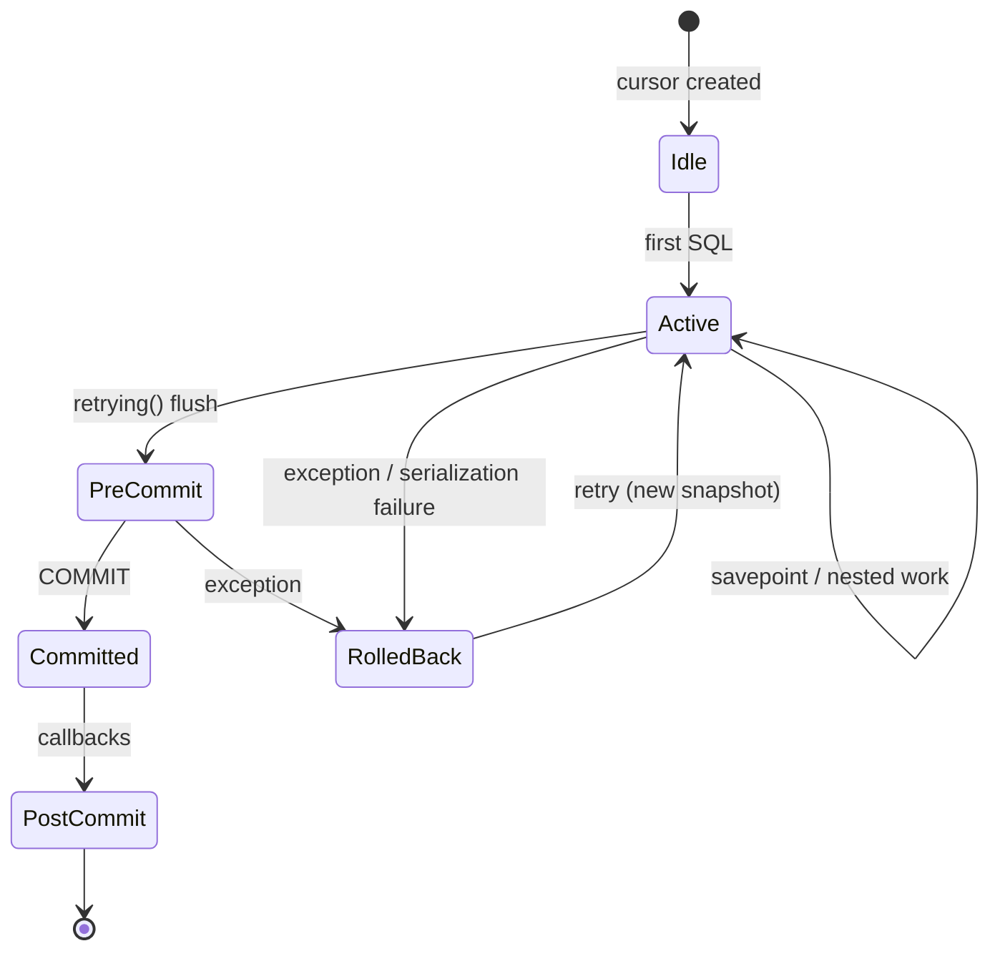

# Business Logic Layer II — Transactions, Concurrency, and Data Integrity

> **Version.** Odoo 19.0 Enterprise. Transaction semantics are among the least documented and most consequential parts of the platform.

---

## 1. The transaction contract

Every Odoo unit of work is a **PostgreSQL transaction** bound to a cursor. The platform makes four guarantees and one non-guarantee:

| Guarantee | Mechanism |
|---|---|
| Atomicity of a request | one cursor, commit at the end of `service.model.retrying` |
| Consistent cache | `Transaction` invalidates/recomputes within the same cursor |
| Isolation | `REPEATABLE READ` (snapshot isolation) |
| Automatic retry on serialization/deadlock | `retrying()` up to 5 attempts |
| **Not guaranteed:** exactly-once external side effects | no distributed transaction, no outbox by default |

### 1.1 Isolation level

Odoo sets `ISOLATION_LEVEL_REPEATABLE_READ` on every connection (`sql_db.py:373`). PostgreSQL maps this to snapshot isolation:

- a transaction sees a consistent snapshot from its first query,
- concurrent updates to the same row cause a serialization failure at commit,
- reads do not block writes and writes do not block reads,
- `SELECT ... FOR UPDATE` takes row locks explicitly.

**[INVARIANT]** Under `REPEATABLE READ`, a long-running request sees stale data by design. If you need the latest committed value mid-transaction, you must use `SELECT ... FOR UPDATE` or start a new transaction. `env.invalidate_all()` only clears the ORM cache; it does not refresh the PostgreSQL snapshot.

### 1.2 Transaction lifecycle



Source: `service/model.py:160` (`retrying`), `sql_db.py:207` (`commit`), `sql_db.py:217` (`savepoint`), `tools/misc.py:1110` (`Callbacks`).

---

## 2. Cursor and transaction API

### 2.1 Cursor creation

```python
with registry.cursor() as cr:          # commits on success, rolls back on exception
    env = api.Environment(cr, uid, {})
    ...

with registry.cursor(readonly=True) as cr:   # read-only transaction
    ...
```

`Cursor` wraps a pooled `psycopg2` connection. `close()` returns the connection to the pool; if the connection is in a failed state, it is discarded. Leaked cursors exhaust the pool and hang the server.

### 2.2 Commit and rollback

```python
cr.commit()     # runs precommit, COMMIT, postcommit
cr.rollback()   # runs prerollback, ROLLBACK, postrollback
```

**[INVARIANT]** Application code must not call `cr.commit()` or `cr.rollback()` inside a model method. The only legitimate places are:

- the outer request/job wrapper,
- migration scripts,
- `ir.cron` progress commits,
- explicitly documented long-running batch jobs that manage their own transaction.

Committing inside a business method breaks the request's atomicity: a later exception cannot undo the earlier commit, and the retry wrapper will re-execute the method on a partially committed state.

### 2.3 Savepoints

```python
try:
    with env.cr.savepoint():
        env['my.model'].create({...})
except IntegrityError:
    # the savepoint was rolled back; the outer transaction is still usable
    ...
```

`env.cr.savepoint(flush=True)` flushes pending ORM changes before creating the savepoint. On rollback it also **clears the ORM cache** (`_FlushingSavepoint.rollback`), because cache entries may reflect the rolled-back changes.

Rules:

- A savepoint does not give you a new snapshot; it only allows partial rollback.
- A savepoint rollback does not undo external side effects.
- Nested savepoints are supported by PostgreSQL but Odoo code uses them sparingly; each one has a cost.
- `savepoint(flush=False)` is faster but can leave the cache inconsistent with the database if the body writes ORM data. Use only for read-only or raw-SQL probes.

### 2.4 Pre/post commit hooks

```python
env.cr.precommit.add(fn)     # runs before COMMIT, inside the transaction
env.cr.postcommit.add(fn)    # runs after COMMIT, outside the transaction
```

Use cases:

- `precommit`: insert bus messages, flush caches, validate invariants that must abort the commit.
- `postcommit`: send bus `NOTIFY`, invalidate external caches, enqueue emails, call webhooks.

**[WARNING]** A postcommit callback runs after the transaction is committed. If it raises, the data is already durable and the exception cannot roll it back. Make postcommit callbacks non-throwing and idempotent.

### 2.5 Cursor context manager

```python
with cr:
    cr.execute(...)
# commits if no exception, rolls back otherwise, then closes
```

This is convenient in scripts and tests but **must not** wrap a request that expects the retry wrapper to manage the transaction.

---

## 3. The retry wrapper

`service.model.retrying()` is the outermost transaction manager for RPC calls:

```python
for attempt in range(1, 6):
    try:
        result = func()
        env.cr.flush()
        break
    except (IntegrityError, OperationalError, ConcurrencyError) as exc:
        env.cr.rollback()
        env.transaction.reset()
        env.registry.reset_changes()
        if isinstance(exc, IntegrityError):
            raise ValidationError(...)
        if not retryable(exc) or last_attempt:
            raise
        sleep(random.uniform(0, 2 ** attempt))
env.cr.commit()
env.registry.signal_changes()
```

Retryable SQLSTATEs: `40001` (serialization failure), `40P01` (deadlock), `55P03` (lock not available). `IntegrityError` is **not** retried; it is converted to a user-facing `ValidationError`.

### 3.1 What is reset between attempts

- the cursor is rolled back (new snapshot),
- `env.transaction.reset()` clears cache and rebinds the registry,
- registry change flags are reset,
- uploaded file handles are rewound if seekable,
- the HTTP session is re-read.

### 3.2 What is not reset

- Python objects created before the call (closures, module-level caches),
- files written to the filestore,
- emails already sent,
- external API calls,
- `cr.postcommit` callbacks from the failed attempt (they are cleared on rollback).

**[INVARIANT]** A retried request must be safe to execute twice. This is why Odoo forbids external side effects before commit.

---

## 4. Locking and concurrency

### 4.1 Implicit locks

| Operation | Lock |
|---|---|
| `UPDATE` / `DELETE` | row-level exclusive lock |
| `INSERT` | row-level lock + unique index checks |
| `SELECT ... FOR UPDATE` | explicit row lock |
| Foreign key insert/update | shared lock on referenced row (`FOR KEY SHARE`) |
| Sequence allocation (`_locked_increment`) | unique index entry lock |
| `stock.quant` reservation | `SELECT ... FOR UPDATE SKIP LOCKED` |

Odoo does not use table-level locks in normal business flows. The expensive locks are:

- **stock quants** during reservation and validation,
- **account.move sequences** during posting,
- **ir.cron** job claiming,
- **mail followers** during mass mailing,
- **ir.config_parameter** writes (frequent updates cause contention).

### 4.2 Stock quant locking [V19]

`stock.quant._update_available_quantity` and `_gather` use `try_lock_for_update` with `SKIP LOCKED` to avoid deadlocks. Two concurrent deliveries for the same product/location can still conflict if they reserve different quants and then update the same aggregate; the retry wrapper handles the resulting serialization failure.

Source: `addons/stock/models/stock_quant.py:1038`, `stock_quant.py:1082`.

**[WARNING]** Bulk inventory adjustments that touch hundreds of quants in arbitrary order are a deadlock generator. Sort product/location ids before writing, or process in small committed batches.

### 4.3 Accounting sequence locking

`sequence.mixin._locked_increment` locks a unique index entry by updating a posted row, then increments a transaction-local cache. This guarantees uniqueness across concurrent transactions but serialises posting per journal/period.

Source: `addons/account/models/sequence_mixin.py:355`.

Consequences:

- Posting many invoices in one transaction holds the sequence lock for the whole transaction.
- A long-running post can block all other posts in the same journal.
- Gaps can occur when a transaction rolls back after allocating a number.

### 4.4 Deadlock patterns

| Pattern | Cause | Mitigation |
|---|---|---|
| Two records updated in opposite order | inconsistent ordering | sort ids before writing |
| Parent/child concurrent insert | FK key-share vs update | create parents first, batch |
| Stock quant + move line interleaving | reservation vs validation | process one picking at a time |
| Sequence + invoice lines | lock held while computing | post in small batches |
| Cron + user action on same records | no coordination | advisory locks / state guards |

Diagnose with:

```sql
SELECT pid, state, wait_event_type, wait_event, query
FROM pg_stat_activity
WHERE datname = current_database() AND state <> 'idle';

SELECT * FROM pg_locks WHERE NOT granted;
```

### 4.5 Advisory locks

Odoo core uses advisory locks sparingly. For custom jobs that must not run concurrently, use PostgreSQL advisory locks or a state row with `SELECT ... FOR UPDATE SKIP LOCKED`:

```python
env.cr.execute("SELECT pg_try_advisory_xact_lock(%s)", (hash_key,))
if not env.cr.fetchone()[0]:
    return  # another worker is running
```

The `xact` variant releases automatically at commit/rollback.

---

## 5. ORM cache and flush semantics

### 5.1 Dirty vs computed

- A **dirty** field has a value in cache that differs from the database.
- A **to-compute** field has been invalidated and must be recomputed before use.
- `flush()` recomputes to a fixpoint, then writes dirty fields.
- `invalidate()` discards cache values; it does not write them.

### 5.2 When flush happens

- Explicitly: `env.flush_all()`, `record.flush_recordset()`, `model.flush_model()`.
- Implicitly: before `search()`, `read()`, `export`, raw SQL helpers, and commit.
- On `env.cr.precommit` execution.

### 5.3 Raw SQL rules

```python
self.env['sale.order'].flush_model(['state'])   # ensure pending writes are in SQL
self.env.cr.execute("SELECT ... WHERE state = %s", ('sale',))
```

After raw SQL that modifies data:

```python
self.env.invalidate_all()   # discard stale cache
```

**[INVARIANT]** Never mix raw SQL and ORM reads without a flush. The ORM may return cached values that the SQL update did not see, or SQL may not see pending ORM writes.

### 5.4 Cache invalidation across workers

The cache is per-transaction and per-worker. There is **no cross-worker cache invalidation** except:

- registry signalling for module changes,
- bus notifications for UI state,
- explicit `env.invalidate_all()` after external changes.

If worker A updates a record and worker B has it cached from an earlier request, worker B's next request starts a new transaction and a new cache, so it sees the new value. Within a single long transaction, B will not.

---

## 6. Cron transactions

`ir.cron` runs each job in a **new cursor** (`ir_cron.py:458`):

```python
with cls.pool.cursor() as job_cr:
    env = api.Environment(job_cr, job['user_id'], {'lastcall': ..., 'cron_id': ...})
    ...
```

Progress API:

- `env['ir.cron']._commit_progress(done, remaining)` commits the job's progress and releases the transaction,
- partial completion reschedules the job immediately,
- failures increment `failure_count`; repeated failures deactivate the job.

**[INVARIANT]** A cron job that processes 100k records must commit progress in batches; otherwise it holds a transaction open for hours, blocks vacuum, and risks timeout. Use `_commit_progress` or split the work into multiple cron triggers.

---

## 7. Bus and mail transaction hooks

### 7.1 Bus

`bus.bus._sendone` does **not** insert immediately. It appends to `cr.precommit.data`, and a precommit hook inserts the rows; a postcommit hook sends `NOTIFY`. This ensures clients never receive a notification for uncommitted data.

Source: `addons/bus/models/bus.py:111-145`.

### 7.2 Mail

`message_post()` writes `mail.message` and `mail.notification` inside the transaction. Email delivery is queued in `mail.mail` and sent by a cron, unless `force_send=True`. Even with `force_send`, the actual SMTP call may happen in a postcommit hook.

**[WARNING]** Attachments created in a transaction that later rolls back may leave orphan files in the filestore. Odoo's attachment GC cleans them eventually; do not rely on immediate cleanup.

---

## 8. Idempotency and exactly-once

Odoo provides **at-least-once** execution for RPC and cron, not exactly-once. Design for idempotency:

| Operation | Idempotency key |
|---|---|
| Payment import | bank statement line unique id / external id |
| Webhook handler | event id stored in a model with unique constraint |
| Invoice creation from external system | external reference + `ir.model.data` |
| Stock receipt | picking name / vendor reference |
| Email send | `mail.mail` state + message id |
| Cron batch | last processed id + progress row |

Pattern:

```python
class ExternalEvent(models.Model):
    _name = 'external.event'
    _sql_constraints = [('event_uid', 'UNIQUE(event_uid)', 'Event already processed')]

    def process(self, payload):
        try:
            with self.env.cr.savepoint():
                self.create({'event_uid': payload['id']})
        except IntegrityError:
            return  # already processed
        ...
```

---

## 9. Transaction anti-patterns

| Anti-pattern | Consequence | Correct approach |
|---|---|---|
| `cr.commit()` in model code | partial business state, broken retry | remove |
| Long transaction with external calls | locks held, duplicates on retry | postcommit + idempotency |
| `flush()` in a loop | O(n²) SQL | batch |
| `invalidate_all()` after every write | loses cache benefits, recompute storms | targeted invalidation |
| `SELECT FOR UPDATE` without index | locks many rows, deadlocks | index the predicate |
| Unsorted bulk updates | deadlocks | sort ids |
| Cron without progress commits | timeout, bloat, lock waits | `_commit_progress` |
| Relying on sequence gaps | numbering discontinuity | use `made_sequence_gap` or accept gaps |
| Holding a cursor across HTTP calls | pool exhaustion | close before I/O |
| Nested savepoint per row | severe performance degradation | batch + one savepoint |

---

## 10. Diagnostic queries

```sql
-- Long-running transactions
SELECT pid, now() - xact_start AS age, state, query
FROM pg_stat_activity
WHERE xact_start IS NOT NULL
ORDER BY age DESC
LIMIT 20;

-- Blocking chains
SELECT blocked.pid AS blocked_pid, blocking.pid AS blocking_pid,
       blocked.query AS blocked_query, blocking.query AS blocking_query
FROM pg_stat_activity blocked
JOIN pg_locks bl ON bl.pid = blocked.pid AND NOT bl.granted
JOIN pg_locks kl ON kl.locktype = bl.locktype
                 AND kl.database IS NOT DISTINCT FROM bl.database
                 AND kl.relation IS NOT DISTINCT FROM bl.relation
                 AND kl.page IS NOT DISTINCT FROM bl.page
                 AND kl.tuple IS NOT DISTINCT FROM bl.tuple
                 AND kl.transactionid IS NOT DISTINCT FROM bl.transactionid
                 AND kl.granted
JOIN pg_stat_activity blocking ON blocking.pid = kl.pid;

-- Idle in transaction (pool leak)
SELECT pid, now() - state_change AS idle_age, query
FROM pg_stat_activity
WHERE state = 'idle in transaction'
ORDER BY idle_age DESC;

-- Sequence gaps in a journal
SELECT name, sequence_number, state
FROM account_move
WHERE journal_id = %s AND state = 'posted'
ORDER BY sequence_number;
```

---

## 11. Evidence index

| Topic | File |
|---|---|
| Isolation level | `sql_db.py:285-374` |
| Cursor commit/rollback | `sql_db.py:207-217`, `560-575` |
| Savepoints | `sql_db.py:60-140` |
| Pre/post commit callbacks | `tools/misc.py:1110`, `sql_db.py:160` |
| Retry wrapper | `service/model.py:160-241` |
| Cron transaction | `addons/base/models/ir_cron.py:399-500` |
| Bus hooks | `addons/bus/models/bus.py:111-145` |
| Quant locking | `addons/stock/models/stock_quant.py:1038-1090` |
| Sequence lock | `addons/account/models/sequence_mixin.py:355-425` |

Continue with `03-service-layer.md` for how business services are structured in Odoo.
