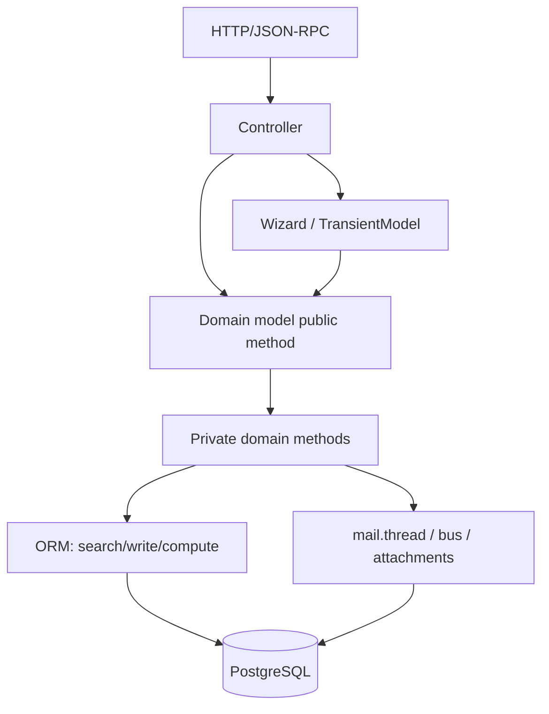

# Business Logic Layer III — Service Structure, Injection, and Orchestration

> **Premise.** Odoo has no Spring context, no separate service interfaces, and no dependency-injection container. Its "services" are model classes resolved through the environment, and its "injection" is Python inheritance plus registry assembly. Understanding this prevents architects from importing layered-architecture assumptions that do not survive contact with the ORM.

---

## 1. What counts as a service in Odoo

| Layer | Odoo construct | Transactional? | Called by |
|---|---|---|---|
| Transport | `http.Controller` | yes, per request | HTTP/JSON-RPC |
| Application service | `TransientModel` wizard | yes, in request | buttons, actions |
| Domain service | model methods (`sale.order.action_confirm`) | yes | controllers, wizards, cron, other models |
| Domain entity | persistent `Model` | yes | everything |
| Policy / rule | `@api.constrains`, `ir.rule`, Python guard | yes | ORM/security |
| Integration | `ir.cron`, `ir.actions.server`, `base.automation` | yes (cron: own transaction) | scheduler/events |
| External API | controller + model method | yes | third parties |

There is no DAO/repository layer. The ORM **is** the repository. There is no DTO layer by default; `read()` dicts and JSON payloads serve that role at the boundary.

### 1.1 Core service class map

| Domain service | Model | Responsibility | Typical public methods |
|---|---|---|---|
| Party master | `res.partner` | customers, vendors, addresses, commercial entity | `_find_accounting_partner`, `_increase_rank` |
| Product master | `product.template` / `product.product` | catalog, variants, pricing, UoM | `_select_seller`, `_get_product_accounts`, `_get_tax_included_unit_price` |
| Sales | `sale.order` / `sale.order.line` | quotation, confirmation, invoicing | `action_confirm`, `_create_invoices` |
| Purchase | `purchase.order` / `purchase.order.line` | RFQ, approval, receipt, billing | `button_confirm`, `action_create_invoice` |
| Inventory | `stock.move` / `stock.picking` / `stock.quant` | demand, fulfilment, on-hand | `_action_assign`, `button_validate`, `_update_available_quantity` |
| Procurement | `stock.rule` / `stock.route` | route resolution and document creation | `run`, `_get_rule` |
| Accounting | `account.move` / `account.move.line` | journal entries, taxes, reconciliation | `_post`, `_reconcile_plan` |
| Payments | `account.payment` | money movement and matching | `action_post`, `action_validate` |
| Manufacturing | `mrp.production` / `mrp.workorder` | production execution | `action_confirm`, `button_mark_done` |
| Messaging | `mail.thread` | chatter, followers, tracking | `message_post`, `message_subscribe` |
| Scheduling | `ir.cron` | periodic jobs | `_process_job`, `_trigger` |
| Automation | `base.automation` / `ir.actions.server` | no-code rules and actions | `_process`, `run` |
| Configuration | `res.config.settings` / `ir.config_parameter` | settings and feature flags | `get_values`, `set_values` |
| Security | `ir.rule` / `ir.model.access` | row/model authorization | `_compute_domain`, `check` |

These are not injected interfaces; they are resolved through `env[...]` and extended through `_inherit`.

### 1.2 The canonical call stack



**[INVARIANT]** Business rules belong in domain models, not controllers or wizards. A rule implemented only in a wizard is bypassed by imports, RPC, cron, and other modules.

---

## 2. Dependency injection, Odoo style

### 2.1 The environment is a service locator

```python
self.env['sale.order']          # model lookup
self.env.ref('base.main_company')
self.env.user
self.env.company
self.env.context
```

`env` is a **service locator**: it resolves any installed model by name at runtime. It is not injected through constructors. This has consequences:

- Dependencies are implicit in the code (`env['account.move']`), not in a constructor signature.
- A missing module produces a `KeyError` at runtime, not a compile-time error.
- Testing requires a database and a registry; there is no lightweight mock container.
- Circular model references are common and legal because resolution is lazy.

### 2.2 Inheritance is the injection mechanism

Odoo's primary extension mechanism is **method injection through MRO**:

```python
class SaleOrder(models.Model):
    _inherit = 'sale.order'

    def _action_confirm(self):
        # inject behaviour before/after the core implementation
        res = super()._action_confirm()
        self._my_post_confirmation_hook()
        return res
```

This is effectively a decorator chain assembled at registry build time. It is powerful and dangerous:

- every installed module participates,
- order depends on module dependencies and load order,
- `super()` must be called to preserve other modules,
- a broken override breaks every downstream module.

### 2.3 Mixins as capability injection

```python
class MyModel(models.Model):
    _name = 'my.model'
    _inherit = ['mail.thread', 'mail.activity.mixin', 'portal.mixin']
```

Mixins inject fields and methods:

| Mixin | Injects |
|---|---|
| `mail.thread` | messages, followers, tracking, notifications |
| `mail.activity.mixin` | activities, deadlines, user assignment |
| `portal.mixin` | portal URL, access token, customer portal |
| `utm.mixin` | campaign/source/medium tracking |
| `analytic.mixin` | analytic distribution |
| `product.catalog.mixin` | product catalog UI |
| `rating.mixin` | ratings and satisfaction |
| `website.published.mixin` | publish/unpublish, SEO |

**[WARNING]** Mixins add tables, fields, and side effects (mail creates messages on create/write). Adding `mail.thread` to a high-volume model can multiply write cost. Measure before adopting.

### 2.4 Configuration as injection

| Mechanism | Scope | Runtime change | Use |
|---|---|---|---|
| `ir.config_parameter` | database | yes | feature flags, external endpoints |
| `res.config.settings` | company | yes | admin UI, writes ICP/company fields |
| `res.company` fields | company | yes | fiscal, inventory, branding |
| `ir.default` | user/company | yes | default values |
| manifest `depends` | installation | no (requires restart) | hard dependencies |
| `post_init_hook` | install | no | one-time setup |
| `ir.actions.server` | record | yes | no-code automation |

**Rule:** if the value changes per deployment, use a config parameter; if it changes per company, use a company field; if it changes per user, use a user preference or `ir.default`. Never hard-code environment-specific values in Python.

### 2.5 External dependency injection

There is no built-in HTTP client abstraction. Integrations typically:

- use `requests` directly in a model method,
- store credentials in `ir.config_parameter` (encrypted at rest? no, only access-controlled),
- wrap the call in a client class instantiated per call,
- use `postcommit` for fire-and-forget.

**[WARNING]** Credentials in `ir.config_parameter` are readable by any user with `base.group_system`. Prefer environment variables or a secrets manager for production; use ICP only for non-sensitive configuration.

---

## 3. Application services: wizards

A wizard is a `TransientModel` with a form view. It is the closest thing to an application service:

```python
class SaleAdvancePaymentInv(models.TransientModel):
    _name = 'sale.advance.payment.inv'

    def create_invoices(self):
        orders = self.env['sale.order'].browse(self._context.get('active_ids', []))
        if self.advance_payment_method == 'percentage':
            ...
        orders._create_invoices()
        return {'type': 'ir.actions.act_window_close'}
```

Wizard responsibilities:

- gather and validate user input,
- select records from context (`active_ids`, `active_model`),
- call a domain method,
- return an action (close, reload, open view).

Wizard anti-patterns:

- business logic that exists only in the wizard,
- direct SQL,
- long-running work without progress feedback,
- storing state in transient records that must survive the request.

**[INVARIANT]** A wizard must be safe to submit twice (double-click). Guard on state, use idempotent domain methods, or disable the button while processing.

---

## 4. Controllers as transport adapters

Controllers should be thin:

```python
class MyPortal(http.Controller):

    @http.route('/my/orders/<int:order_id>', type='http', auth='user', website=True)
    def order(self, order_id, **kw):
        order = request.env['sale.order'].browse(order_id)
        order.check_access('read')
        return request.render('my_module.order_template', {'order': order})
```

Rules:

- authenticate and authorize explicitly (`check_access`, record rules),
- validate and coerce input,
- call one domain method,
- serialize the result,
- never contain business rules,
- never commit,
- never expose internal ids without an access check.

### 4.1 Idempotency at the boundary

For public endpoints (webhooks, payment callbacks), implement:

1. signature verification,
2. event-id uniqueness constraint,
3. idempotent state transition,
4. explicit response contract (2xx even for duplicates, 4xx for invalid signatures).

---

## 5. Domain service design

### 5.1 Public vs private methods

| Prefix | Contract | Stable? |
|---|---|---|
| `action_*` | UI action, returns an action dict or `True` | semi-stable |
| `button_*` | UI button, returns action/`True` | semi-stable |
| `_action_*` | internal state transition, called by public method | internal |
| `_compute_*` | compute method | internal |
| `_prepare_*` | build values for create/write | internal but widely overridden |
| `_get_*` | query/decision helper | internal |
| `_post_*` | post-processing hook | internal |

**[WARNING]** `_prepare_*` and `_get_*` methods are the de facto extension API of Odoo, even though they are private. They are widely overridden by community and enterprise modules. Treat their signatures as contracts within your codebase and document them.

### 5.2 Orchestration vs computation

Keep orchestration separate from computation:

```python
def action_confirm(self):
    self._check_confirmable()
    self.write({'state': 'sale', 'date_order': fields.Datetime.now()})
    self._action_confirm()          # extension point
    self._create_initial_invoice()  # optional
```

- `_check_confirmable()` is pure validation.
- `write()` is the state change.
- `_action_confirm()` is the extension hook.
- Side effects are explicit and ordered.

This structure makes overrides predictable and tests focused.

### 5.3 Invariants and guards

Enforce invariants at the lowest possible layer:

| Invariant | Where |
|---|---|
| field format/range | `@api.constrains` |
| cross-record uniqueness | SQL unique constraint |
| state transition legality | public method guard |
| company consistency | `check_company=True` + `_check_company` |
| accounting balance | `_check_balanced` |
| stock availability | reservation methods |

**[INVARIANT]** Do not rely on the UI to enforce an invariant. Every constraint must be enforced in the model, because imports, RPC, and crons bypass the UI.

### 5.4 Domain events

Odoo has no first-class domain-event bus. Options:

| Mechanism | Semantics | Use |
|---|---|---|
| `mail.thread` tracking | persisted message per field change | audit/history |
| `base.automation` | trigger on create/write/time/state | no-code rules |
| `ir.actions.server` | code triggered by automation/button | procedural hooks |
| `bus.bus` | ephemeral UI notification | live updates |
| overriding methods | synchronous in-process | core customisations |
| `cr.postcommit` | after commit | external integrations |

**[WARNING]** There is no transactional outbox. A `postcommit` hook can fail after the business transaction commits, losing the event. For reliable integration, write an outbox row in the same transaction and let a cron deliver it.

---

## 6. A reference service layout for custom modules

```
my_module/
├── __manifest__.py
├── models/
│   ├── sale_order.py          # extensions, thin
│   ├── my_entity.py           # domain entity + invariants
│   └── my_policy.py           # pure policy functions
├── wizards/
│   └── my_wizard.py           # application service
├── controllers/
│   └── main.py                # transport only
├── services/
│   ├── client.py              # external API client (no ORM)
│   └── outbox.py              # reliable event delivery
├── data/
│   ├── ir_cron.xml
│   └── ir_config_parameter.xml
├── security/
│   ├── ir.model.access.csv
│   └── ir_rule.xml
└── tests/
    ├── test_flow.py
    └── test_invariants.py
```

### 6.1 Layering rules that work with Odoo

1. **Models own invariants.** No invariant may live only in a wizard/controller.
2. **Wizards orchestrate, models decide.** A wizard may choose *which* method to call, not *how* the state changes.
3. **Controllers translate.** No domain logic.
4. **External clients are stateless.** No ORM in the client; pass plain data.
5. **Outbox for reliability.** Write events in-transaction, deliver post-commit.
6. **Pure functions for policy.** Tax/price/discount rules as pure functions are testable without a DB.
7. **One transaction per use case.** Do not split a business operation across RPC calls.

### 6.2 Example: reliable integration

```python
class OutboxEvent(models.Model):
    _name = 'my.outbox.event'
    _sql_constraints = [('uid', 'UNIQUE(event_uid)', 'Duplicate event')]

    event_uid = fields.Char(required=True)
    payload = fields.Json(required=True)
    state = fields.Selection([('pending', 'Pending'), ('sent', 'Sent'), ('failed', 'Failed')], default='pending')

    @api.model
    def emit(self, uid, payload):
        self.create({'event_uid': uid, 'payload': payload})

    @api.model
    def _cron_deliver(self, limit=100):
        for event in self.search([('state', '=', 'pending')], limit=limit, order='id'):
            try:
                client.send(event.payload)
                event.state = 'sent'
            except Exception:
                event.state = 'failed'
```

The outbox row commits with the business transaction; delivery is retried by cron. This is the only reliable pattern without a message broker.

---

## 7. Service-level testing

| Test type | What it proves | Tool |
|---|---|---|
| Unit (pure functions) | pricing/tax/policy maths | `unittest` |
| ORM integration | invariants, state transitions | `TransactionCase` |
| HTTP | auth, routing, serialization | `HttpCase` |
| Tour | UI flow | `odoo.tests.tour` |
| Performance | query count, elapsed time | `assertQueryCount`, `profiler` |
| Upgrade | migration correctness | `openupgrade` scripts + test DB |

**[WARNING]** `TransactionCase` rolls back at the end; it does not test commit hooks, cron transactions, or serialization retries. Add `SavepointCase`/`HttpCase` and explicit concurrency tests for those.

---

## 8. Service-layer anti-patterns

| Anti-pattern | Why it fails |
|---|---|
| Fat controller | bypassed by cron/import; untestable |
| Fat wizard | rules not reusable; double-submit bugs |
| God model | 10k-line files, merge conflicts, slow imports |
| Anemic model + service class | fights the ORM; loses ACL/record rules |
| Direct SQL in service | bypasses cache, ACL, computes |
| `env` stored globally | stale registry, cross-request leakage |
| `sudo()` in service entry point | hides authorization bugs |
| Synchronous external call | duplicates on retry, locks held |
| Event bus without outbox | lost events |
| Caching in module globals | not invalidated across workers |

---

## 9. Evidence index

| Topic | File |
|---|---|
| Environment as mapping | `orm/environments.py:66` |
| Registry model lookup | `orm/registry.py:375` |
| Wizard base | `orm/models_transient.py` |
| Controller base | `http.py:1793`, `addons/base/models/ir_http.py` |
| Automation | `addons/base_automation/models/base_automation.py` |
| Server actions | `addons/base/models/ir_actions.py:586` |
| Mail thread | `addons/mail/models/mail_thread.py:2199` |
| Bus | `addons/bus/models/bus.py:88` |
| Config settings | `addons/base/models/res_config.py` |

Continue with `04-business-rules-events.md` for the trigger catalogue.
