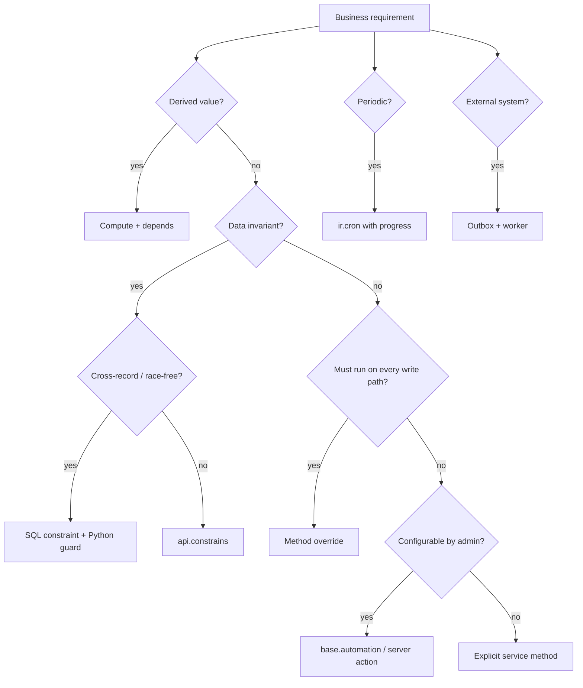

# Business Rules, Events, and Automation Triggers

> **Purpose.** Odoo offers at least eight mechanisms that look like "business rules". They fire at different times, with different guarantees, and they are not interchangeable. This chapter gives a decision matrix and the internal semantics of each.

---

## 1. Trigger catalogue

| Mechanism | Fires when | Transaction | Bypassable | Persisted | Best for |
|---|---|---|---|---|---|
| `@api.depends` compute | dependency change, on read | same | no | if `store=True` | derived values |
| `@api.constrains` | create/write, after fields set | same | no | no | data invariants |
| SQL constraint | INSERT/UPDATE | same | no (DB) | schema | uniqueness, ranges |
| `@api.onchange` | UI edit, before save | no transaction | yes (RPC/import) | no | UX assistance only |
| `create`/`write` override | any write | same | no | no | cross-record invariants, defaults |
| `mail.thread` tracking | write on tracked field | same | via context | yes (`mail.message`) | audit/history |
| `base.automation` | create/write/time/message | same (time: cron) | can be disabled | yes | configurable no-code rules |
| `ir.actions.server` | button/automation/cron | same | depends | yes | procedural actions |
| `ir.cron` | scheduler | own transaction | no | yes | periodic jobs |
| `bus.bus` | explicit send | pre/postcommit | no | transient | UI notifications |
| Controller/webhook | external HTTP | same | no | no | integrations |

**[INVARIANT]** Only computes, constraints, and method overrides are guaranteed to run for **every** write path. Onchange and UI-level rules are not.

---

## 2. Computed fields as rules

### 2.1 Semantics

- A stored compute is recomputed when any declared dependency changes.
- A non-stored compute runs on access; it is not persisted and cannot be searched without a `search` method.
- Compute methods must be pure with respect to the recordset: same inputs → same outputs, no side effects.

### 2.2 Dependency completeness

```python
# WRONG: missing partner_id in dependencies
@api.depends('partner_id.country_id')
def _compute_country_code(self):
    for rec in self:
        rec.country_code = rec.partner_id.country_id.code
```

The ORM treats `partner_id.country_id` as depending on both `partner_id` and `country_id`, but **not** on `partner_id.country_id` being reassigned through a related write that does not touch `partner_id`. In practice, include the full path and test re-link scenarios.

### 2.3 Recursive computes

A compute that reads a field it also writes creates a cycle. The ORM stops after 10 fixpoint iterations and logs "Too many iterations for recomputing fields!" (`orm/environments.py:366`). This is a silent performance and correctness bug.

**[WARNING]** Do not use `@api.depends` on a field that is modified inside the compute method. Use an inverse or a dedicated recompute trigger.

---

## 3. Constraints

### 3.1 Python constraints

```python
@api.constrains('date_start', 'date_end')
def _check_dates(self):
    for rec in self:
        if rec.date_start and rec.date_end and rec.date_start > rec.date_end:
            raise ValidationError(_("Start date must be before end date."))
```

- Run after `create`/`write`, including imports and RPC.
- Receive the recordset of modified records, but the decorator does not tell you which fields changed; check all records.
- Must be deterministic and cheap; they run inside the transaction and can block large imports.
- Do not query large tables without an index.

### 3.2 SQL constraints

```python
class MyModel(models.Model):
    _name = 'my.model'
    _sql_constraints = [
        ('code_uniq', 'UNIQUE(code)', 'Code must be unique.'),
    ]
```

Odoo 19 also supports the declarative `models.Constraint` table object:

```python
_name_uniq = models.Constraint('UNIQUE(name)', 'Name must be unique.')
```

- Enforced by PostgreSQL, therefore race-free.
- Violations surface as `IntegrityError`, converted to `ValidationError` by the retry wrapper.
- Adding a constraint to a table with existing duplicates fails during module upgrade; clean data first.

### 3.3 `@api.ondelete`

```python
@api.ondelete(at_uninstall=False)
def _unlink_check(self):
    if self.state != 'draft':
        raise UserError(_("Only draft records can be deleted."))
```

`at_uninstall=False` means the check is skipped during module uninstall, allowing cleanup. Use it to protect posted accounting entries and confirmed stock documents.

---

## 4. Onchange: UI-only convenience

```python
@api.onchange('partner_id')
def _onchange_partner_id(self):
    if self.partner_id:
        self.pricelist_id = self.partner_id.property_product_pricelist
    return {'warning': {'title': ..., 'message': ...}}
```

Facts:

- Runs in the web client on a **new record** in memory, before save.
- Is **not** executed by RPC `create`, imports, cron, or another model's write.
- Can return a `warning` or `domain` dict; it cannot persist anything.
- Uses `NewId` records; relational assignments may be unresolved until save.

**[INVARIANT]** Never rely on onchange for data integrity. If a value must always be set, use a compute/default or a `create` override.

---

## 5. Method overrides as rules

`create`, `write`, `unlink`, and state-transition methods are the only place to enforce cross-record rules that must survive all entry points.

### 5.1 Ordering inside `write`

1. access checks,
2. field validation,
3. inverse/compute protection,
4. relational `modified(before=True)`,
5. field writes in `write_sequence` order,
6. `modified()` after,
7. inverse methods,
8. Python constraints,
9. company check.

An override that calls `super().write(vals)` **after** its own logic runs too late for constraints but too early for post-processing. Choose deliberately:

```python
def write(self, vals):
    # pre-condition
    res = super().write(vals)
    # post-effect (same transaction)
    return res
```

### 5.2 Recursion guards

A `write` override that writes the same model can recurse. Use context flags or compare values:

```python
def write(self, vals):
    res = super().write(vals)
    if not self.env.context.get('_my_guard'):
        self.with_context(_my_guard=True).write({'computed_flag': True})
    return res
```

**Warning:** context flags are per-environment and can leak into nested calls. Prefer `self.env.protecting` or a dedicated private method.

---

## 6. `mail.thread` tracking

### 6.1 How tracking works

- Fields declared with `tracking=True` are recorded in `mail.tracking.value` when changed.
- `_track_get_fields()` returns tracked fields, filtered by access and context.
- `_track_subtype(initial_values)` decides the message subtype (`mail.mt_comment`, custom subtypes).
- Tracking messages are posted by `mail.thread.write()` after the write.
- `tracking_disable=True` in context suppresses tracking (used by imports/migrations).

Source: `addons/mail/models/mail_thread.py:527-760`, `mail_tracking_value.py:9`.

### 6.2 Cost

Every tracked write can:

- create a `mail.message`,
- create N `mail.tracking.value` rows,
- update followers,
- schedule notifications,
- send emails (async).

**[WARNING]** Tracking a field written in a high-frequency loop (e.g. `sequence`, `state` on stock moves) can generate millions of messages. Audit tracking declarations on volume models.

### 6.3 Subtypes and followers

- Followers receive notifications according to subtype preferences.
- `message_subscribe()` adds followers; `message_post()` notifies them.
- Internal notes vs comments are distinguished by subtype and `is_internal`.
- Email templates render with QWeb and can include attachments.

---

## 7. Automated actions (`base.automation`)

### 7.1 Trigger types [V19]

`base_automation.trigger` supports:

| Trigger | Fires | Notes |
|---|---|---|
| `on_create` | after create | filter domains apply |
| `on_create_or_write` | after create/write | dominant trigger |
| `on_write` | after write | deprecated alias |
| `on_unlink` | before/after unlink | limited |
| `on_change` | UI onchange | not transactional |
| `on_stage_set` | stage field change | CRM/project |
| `on_user_set` | user field change | assignment |
| `on_tag_set` | tag added | CRM |
| `on_state_set` | state field change | generic |
| `on_priority_set` | priority change | generic |
| `on_archive` / `on_unarchive` | active change | generic |
| `on_time` | date field reached | cron-driven |
| `on_time_created` | after creation delay | cron-driven |
| `on_time_updated` | after update delay | cron-driven |
| `on_message_received` | incoming mail | mail.thread |
| `on_message_sent` | outgoing mail | mail.thread |
| `on_webhook` | external webhook | integration |

### 7.2 Execution model

- Automations are evaluated **after** the triggering write, in the same transaction.
- `filter_pre_domain` selects candidate records before the action; `filter_domain` filters after.
- `__action_done` in context prevents recursive re-execution on the same records.
- Actions are `ir.actions.server` records, executed in sequence order.
- Failures raise and roll back the whole transaction unless the action catches them.

**[WARNING]** An automation that writes the same model can trigger itself. Odoo's `__action_done` guard helps but is not a general solution; design automations to be idempotent and narrowly filtered.

### 7.3 Time-based automations

- `on_time` uses a cron (`base_automation.ir_cron_...`) that scans records whose date field falls in the window.
- The scan is domain-based; without an index on the date field it becomes a full table scan.
- The cron interval adapts to the smallest configured delay (`_get_cron_interval`), between 1 minute and 4 hours.

---

## 8. Server actions

### 8.1 Types

`ir.actions.server.state`:

| State | Behaviour | Safe for untrusted admins? |
|---|---|---|
| `object_write` | update a field/path | yes |
| `object_create` | create a record | yes |
| `object_copy` | duplicate | yes |
| `code` | execute Python via `safe_eval` | **no** — trusted code |
| `webhook` | HTTP POST to URL | yes, but SSRF risk |
| `multi` | run child actions | depends |

### 8.2 `safe_eval` is not a sandbox

`safe_eval` restricts builtins and blocks imports (`tools/safe_eval.py:318-422`). It does **not** prevent:

- reading any record the executing user can read (`env`),
- calling any model method,
- writing data,
- exfiltrating data via `env['ir.config_parameter']`,
- resource exhaustion (loops, large searches).

**[INVARIANT]** Treat `code` server actions as **trusted code**. Restrict `base.group_system` membership; audit changes to `ir.act_server.code`; never expose server-action creation to portal users.

### 8.3 Execution context

The eval context includes `env`, `model`, `record`, `records`, `time`, `datetime`, `dateutil`, `uid`, `user`, `context`, `log`. In Odoo 19, the `env` is the current environment; `sudo()` is available and commonly misused.

### 8.4 Webhooks

- Configured with URL, fields, and optional headers.
- Executed synchronously in the transaction unless deferred.
- No retry, no signature by default, no idempotency key.
- SSRF risk: an admin can point a webhook at internal services.

**[WARNING]** For production integrations, do not use `ir.actions.server` webhooks as the primary delivery mechanism. Use an outbox + worker with retries, timeouts, and signatures.

---

## 9. Cron as a rule engine

`ir.cron` jobs are server actions on a schedule. They are suitable for:

- reconciliation and cleanup,
- reminders and escalations,
- external synchronisation,
- report generation,
- batch recomputation.

They are **not** suitable for:

- real-time rules (latency),
- exactly-once delivery (retries),
- long monolithic transactions (timeouts).

See `02-transactions.md` §6 for the progress API and concurrency rules.

---

## 10. Bus events

`bus.bus` is for UI synchronisation, not business events:

- ephemeral (GC after retention),
- at-most-once,
- no ordering guarantee across channels,
- no persistence for offline clients.

Use it to tell the UI "this record changed", then let the UI refetch through the ORM (which enforces access control).

**[WARNING]** Never put sensitive data in a bus payload. Channels are guessable unless derived from a secret; the bus is not an authorization boundary.

---

## 11. Choosing the right mechanism



### 11.1 Decision rules

- **Compute** for anything derivable from stored data.
- **Constraint** for anything that must never be false.
- **Override** for orchestration across models.
- **Automation** for customer-specific rules that change without deployment.
- **Cron** for time-based or batch work.
- **Outbox** for reliable external delivery.
- **Bus** only for UI freshness.

---

## 12. Testing rules and triggers

| Rule type | Test approach |
|---|---|
| Compute | write dependency, assert recompute; test multi-record |
| Constraint | assert `ValidationError` on invalid create/write |
| SQL constraint | duplicate insert, assert `IntegrityError`/`ValidationError` |
| Onchange | `Form` test or direct `onchange` call; do not rely on it for data |
| Override | create/write through ORM, assert side effects |
| Tracking | assert `mail.message` / `mail.tracking.value` count |
| Automation | create `base.automation`, trigger write, assert action effect |
| Server action | run `with_context(active_id=...)`, assert result |
| Cron | call method directly in a `TransactionCase`; test idempotency |
| Bus | assert `bus.bus` rows after commit (postcommit hook) |

**[WARNING]** Tests that rely on `env.cr.commit()` are slow and leak state. Prefer `TransactionCase` and assert within the transaction; test commit hooks separately with `SavepointCase`/`HttpCase`.

---

## 13. Evidence index

| Topic | File |
|---|---|
| Decorators | `orm/decorators.py:83-357` |
| Compute execution | `orm/models.py:4953` |
| Constraint validation | `orm/models.py:3960` |
| Onchange | `orm/models.py` (`onchange`), `orm/decorators.py:189` |
| Tracking | `addons/mail/models/mail_thread.py:527-760` |
| Automation triggers | `addons/base_automation/models/base_automation.py:156-200` |
| Automation execution | `base_automation.py:693-790` |
| Server action types | `addons/base/models/ir_actions.py:586-680` |
| safe_eval | `tools/safe_eval.py:318-422` |
| Bus | `addons/bus/models/bus.py:88-200` |
| Cron | `addons/base/models/ir_cron.py:91-500` |

Continue with `05-security.md`.
