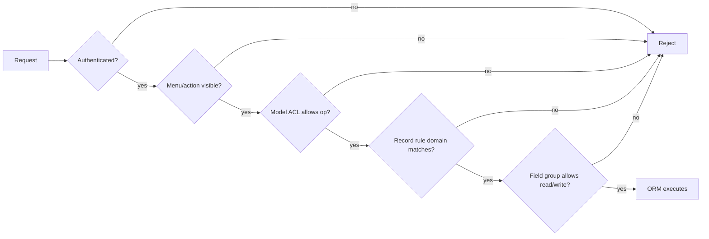

# Security Model — ACLs, Record Rules, Fields, and Privilege Boundaries

> **Warning.** Odoo security is declarative and layered. A missing layer does not fail closed. Most real-world Odoo breaches are not SQL injections; they are over-broad `sudo()`, missing record rules on custom models, portal controllers without access checks, and permissions granted to `base.group_user` because "it was easier".

---

## 1. The five gates



| Gate | Stored in | Scope | Bypass |
|---|---|---|---|
| Authentication | session, `res.users` | request | `auth='none'` routes |
| Menu/action groups | `ir.ui.menu.groups_id`, `ir.actions.*.groups_id` | UI | direct RPC |
| Model ACL | `ir.model.access` | model + operation + group | `sudo()` |
| Record rule | `ir.rule` | row domain + operation + group | `sudo()`, `active_test` nuances |
| Field groups | `groups=` on field | field read/write | `sudo()` |

**[INVARIANT]** UI visibility is **not** security. A hidden menu or button does not prevent an RPC call. Every model and method exposed over RPC must enforce ACLs and rules.

---

## 2. Model ACLs

### 2.1 Structure

```csv
id,name,model_id:id,group_id:id,perm_read,perm_write,perm_create,perm_unlink
access_my_model_user,my.model.user,model_my_model,base.group_user,1,0,0,0
access_my_model_manager,my.model.manager,model_my_model,my_module.group_manager,1,1,1,1
```

Fields: `name`, `model_id`, `group_id` (nullable = global), and four booleans.

Semantics:

- If **any** matching ACL grants the operation, access is allowed.
- A global ACL (`group_id = NULL`) grants to everyone, including portal and public users.
- No ACL at all means no access, even for internal users.
- ACLs are cached per user and invalidated on change (`ir.model.access.check`).

Source: `addons/base/models/ir_model.py:2080-2200`.

### 2.2 Common mistakes

| Mistake | Effect |
|---|---|
| ACL on `base.group_user` for a sensitive model | every internal user can read/write |
| No ACL for a new model | `AccessError` even for admins (unless sudo) |
| ACL without record rules | all rows visible to the group |
| ACL for `base.group_portal` with write | portal users can modify records |
| Forgetting `ir.model.access.csv` in manifest | model unusable after install |

**[WARNING]** During module install, Odoo logs a warning for concrete models without ACLs (`modules/loading.py:290`). Treat that warning as a release blocker.

---

## 3. Record rules

### 3.1 Structure

`ir.rule` fields:

| Field | Meaning |
|---|---|
| `model_id` | target model |
| `domain_force` | Python domain evaluated per user |
| `groups` | groups the rule applies to; empty = global |
| `perm_read/write/create/unlink` | operations |
| `active` | soft disable |

Evaluation (`ir_rule._compute_domain`):

1. Collect rules for the model and operation where `active` and the operation flag is true.
2. Global rules (no groups) are **ANDed**.
3. Group rules are **ORed** within the user's groups.
4. The combined domain is ANDed with global rules.
5. If the user is superuser (`env.su`), no rules apply.

Source: `addons/base/models/ir_rule.py:113-175`.

### 3.2 Example

```xml
<record id="rule_my_model_company" model="ir.rule">
    <field name="name">My Model: multi-company</field>
    <field name="model_id" ref="model_my_model"/>
    <field name="domain_force">['|', ('company_id', '=', False), ('company_id', 'in', company_ids)]</field>
    <field name="groups" eval="[(4, ref('base.group_user'))]"/>
</record>
```

Available eval context: `user`, `company_id`, `company_ids`. `company_ids` is the list of **allowed** companies for the session, not all companies.

### 3.3 Rules on inherited models

`_compute_domain` adds rules from `_inherits` parents as `parent_field any domain`. This means:

- a rule on `ir.actions.server` also constrains `ir.cron`,
- a rule on `product.template` also constrains `product.product` if delegated,
- rules are **not** automatically inherited through `_inherit` (same table), because that is the same model.

### 3.4 Rules and `active_test`

Record rules apply to archived records too unless the domain explicitly filters `active`. `search()` adds `active=True` by default (`active_test`), but `browse()` + read does not. A user may be able to read an archived record they cannot find in a list.

### 3.5 Performance

Record rules become SQL subqueries/joins on every search. A rule with `child_of` on a large hierarchy, or with a Python-evaluated field, can be expensive. Rules are cached per `(uid, model, mode, allowed_company_ids)`, but the SQL is still executed per query.

**[WARNING]** A rule with `domain_force = [(0, '=', 1)]` is the correct way to deny all; an empty domain `[]` means **allow all**, not deny all.

---

## 4. Field-level security

```python
secret = fields.Char(groups='base.group_system')
```

- The field is removed from `fields_get()` for unauthorized users.
- Reading it raises `AccessError` (unless `sudo`).
- Writing it is blocked by `_check_field_access`.
- It does not hide the column from SQL reports or exports created by authorized users.

**[WARNING]** Field groups are a UI/API convenience, not encryption. A user with database access or a report builder can still read the column.

### 4.1 `_check_company`

Company consistency is separate from ACLs:

```python
partner_id = fields.Many2one('res.partner', check_company=True)
```

- `_check_company_auto = True` on the model validates all `check_company=True` fields on create/write.
- It prevents cross-company links, not cross-company reads.
- It is bypassed by raw SQL.

---

## 5. `sudo()` and privilege boundaries

### 5.1 Semantics

| Call | `uid` | `su` | ACL/rules | Audit fields |
|---|---|---|---|---|
| `record.sudo()` | unchanged | True | bypassed | original uid |
| `record.with_user(2)` | 2 | False | evaluated as user 2 | 2 |
| `record.sudo().with_user(2)` | 2 | True | bypassed | 2 |
| `env['model'].sudo()` | unchanged | True | bypassed | original uid |

**[INVARIANT]** `sudo()` must be justified at the call site. Prefer:

```python
# Good: scoped read for a computed field, documented
price = self.sudo().env['product.pricelist'].browse(...).price_get(...)
```

over:

```python
# Bad: entire method runs as superuser
def action_do(self):
    self = self.sudo()
    ...
```

### 5.2 Dangerous patterns

| Pattern | Risk |
|---|---|
| `self.sudo().write(vals)` in a public method | privilege escalation |
| `sudo()` in a controller before `check_access` | bypasses portal rules |
| `sudo()` to "fix" an access error | hides a missing rule |
| `sudo()` in a compute with `compute_sudo=True` (default) | leaks restricted values |
| `sudo()` in a cron with a user context | audit trail lies |

### 5.3 Recommended pattern

```python
def action_approve(self):
    self.check_access('write')            # enforce caller's rights
    records = self._filtered_access('write')
    records._approve_as_system()          # narrow sudo inside
```

Keep the privileged surface as small as possible and make it explicit in the method name.

---

## 6. Portal, public, and website users

| User type | Group | Typical access |
|---|---|---|
| Internal | `base.group_user` | backend, subject to ACL/rules |
| Portal | `base.group_portal` | own records via portal controllers |
| Public | `base.group_public` | website, no backend |
| System | `base.group_system` | settings, server actions, dangerous |

Portal security rules:

- Portal users must only see records linked to their commercial partner.
- Controllers must call `check_access('read')` and rely on record rules.
- `portal.mixin` generates access tokens for unauthenticated links; tokens are bearer credentials.
- Never expose a record by id without an access check; id enumeration is trivial.

**[WARNING]** `auth='public'` routes run as the public user. If they call `sudo()`, they become unauthenticated privileged endpoints. Audit every `sudo()` in website/portal controllers.

---

## 7. Multi-company security

- `allowed_company_ids` in context determines visible companies.
- Record rules typically include `company_id in company_ids or company_id = False`.
- `env.company` is the active company; `env.companies` is the allowed set.
- Company-dependent fields resolve per `env.company`.
- Cross-company data leaks happen when a model lacks a `company_id` field or a rule.

Checklist for a new business model:

- [ ] `company_id = fields.Many2one('res.company', required=True, index=True, default=lambda self: self.env.company)`
- [ ] record rule with `company_ids`
- [ ] `check_company=True` on relational fields
- [ ] `_check_company_auto = True`
- [ ] tests with two companies

---

## 8. Authentication and sessions

- Session cookie `session_id`, HttpOnly, signed and stored server-side.
- CSRF token required for state-changing `http` routes (`csrf=True` default).
- JSON-RPC uses the session cookie; API keys use `Authorization: Bearer` or `X-Odoo-Database`.
- `auth='none'` disables session authentication; use only for health checks and public assets.
- Password hashing uses PBKDF2 (or Argon2 depending on config); never store plaintext.
- 2FA (`auth_totp`) is available; enforce for administrators.

**[WARNING]** `X-Odoo-Database` header allows database selection. In multi-tenant deployments, restrict `dbfilter` and never expose the database list endpoint publicly.

---

## 9. SQL injection and raw SQL

The ORM parameterises queries. Raw SQL is the exception:

```python
# SAFE
self.env.cr.execute("SELECT id FROM res_partner WHERE name = %s", (name,))

# UNSAFE
self.env.cr.execute(f"SELECT id FROM res_partner WHERE name = '{name}'")
```

Use `odoo.tools.SQL` for composable identifiers:

```python
from odoo.tools import SQL
self.env.cr.execute(SQL("SELECT %s FROM %s", SQL.identifier('name'), SQL.identifier(table)))
```

**[INVARIANT]** Never interpolate user input into SQL, including table/column names. Validate identifiers against `ir.model.fields` if dynamic.

---

## 10. File upload and attachment security

- `ir.attachment` access follows the linked record's rules; standalone attachments use `res_model`/`res_id`.
- Filenames are sanitised, but content is not scanned.
- `attachment=True` stores in filestore with a hashed path; direct filesystem access bypasses Odoo security.
- Public attachments (`public=True`) are served without authentication; never mark sensitive files public.
- SVG uploads can contain scripts; serve with `Content-Disposition: attachment` or sanitise.

---

## 11. Server actions, automations, and code execution

- `code` server actions execute with the current user's environment (or `sudo` if the action calls it).
- Only `base.group_system` should create/edit them.
- `ir.actions.server.code` changes are not versioned by default; enable `base.group_system` audit or use a module.
- Automations can be created by admins and run on every write; treat them as code.
- Webhooks can target internal URLs (SSRF); restrict egress at the network layer.

---

## 12. Security review checklist

### Model

- [ ] ACLs for every operation and every intended group.
- [ ] No global ACL unless intentionally public.
- [ ] Record rules for company/ownership.
- [ ] `company_id` present and indexed.
- [ ] `check_company=True` on cross-company relations.
- [ ] `_check_company_auto = True`.
- [ ] `@api.ondelete` protects irreversible states.
- [ ] Field groups on sensitive fields.
- [ ] No `sudo()` in public entry points without justification.

### Controller

- [ ] `auth` is the minimum required.
- [ ] `check_access` before reading/writing.
- [ ] CSRF enabled for state changes.
- [ ] Input validated and bounded.
- [ ] No record id enumeration without rules.
- [ ] No secrets in responses or logs.

### Integration

- [ ] API keys scoped to a dedicated user with minimal groups.
- [ ] Rate limiting at the reverse proxy.
- [ ] Webhook signatures verified.
- [ ] Outbox for reliable delivery.
- [ ] Credentials outside the database where possible.

### Operations

- [ ] `dbfilter` restricts databases by host.
- [ ] Database list endpoint disabled in production.
- [ ] `admin_passwd` strong and rotated.
- [ ] Backups include filestore and are restorable.
- [ ] Audit log (`ir.logging`, `mail.tracking`) retained.
- [ ] PostgreSQL not exposed publicly.
- [ ] Workers run as non-root with a read-only code mount.

---

## 13. Evidence index

| Topic | File |
|---|---|
| ACL model and check | `addons/base/models/ir_model.py:2080-2200` |
| Record rules | `addons/base/models/ir_rule.py:15-175` |
| Rule domain evaluation | `ir_rule.py:141-175` |
| Group computation | `addons/base/models/res_users.py:258`, `447`, `1034` |
| Field access | `orm/models.py:3369-3400`, `orm/fields.py:1649` |
| `check_access` | `orm/models.py:4100-4160` |
| Session/auth | `http.py:1793-2000`, `addons/base/models/ir_http.py` |
| `safe_eval` | `tools/safe_eval.py:318-422` |
| Attachment security | `addons/base/models/ir_attachment.py` |

Continue with Volume 2: end-to-end business flows.
