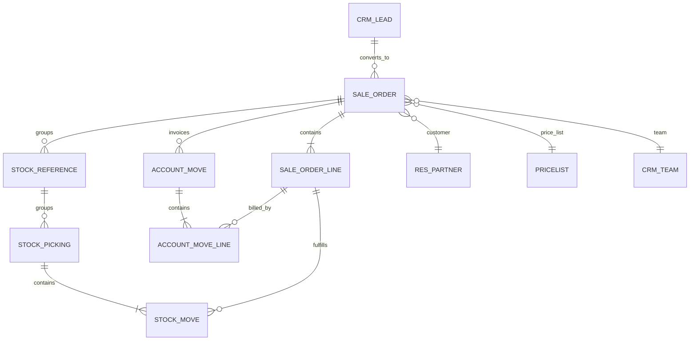
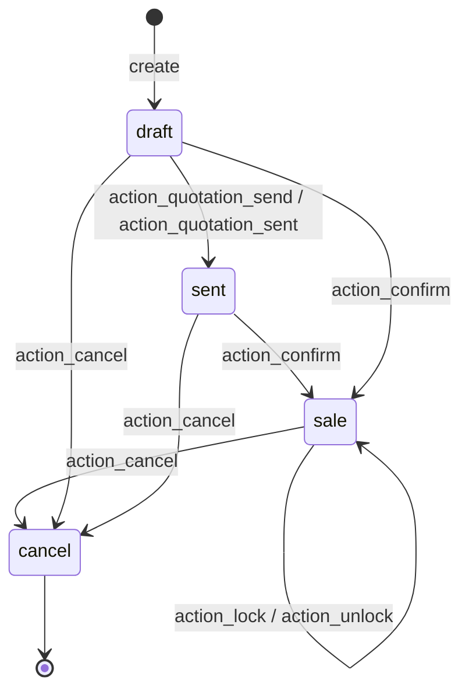
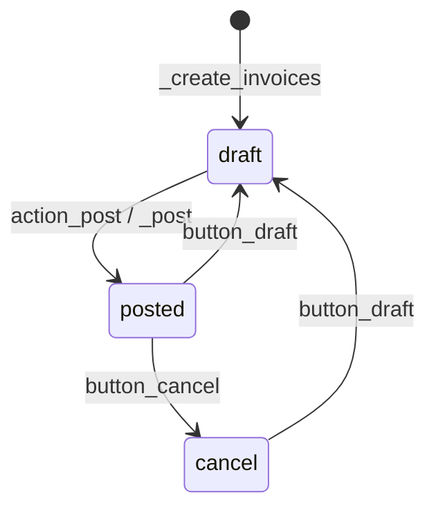
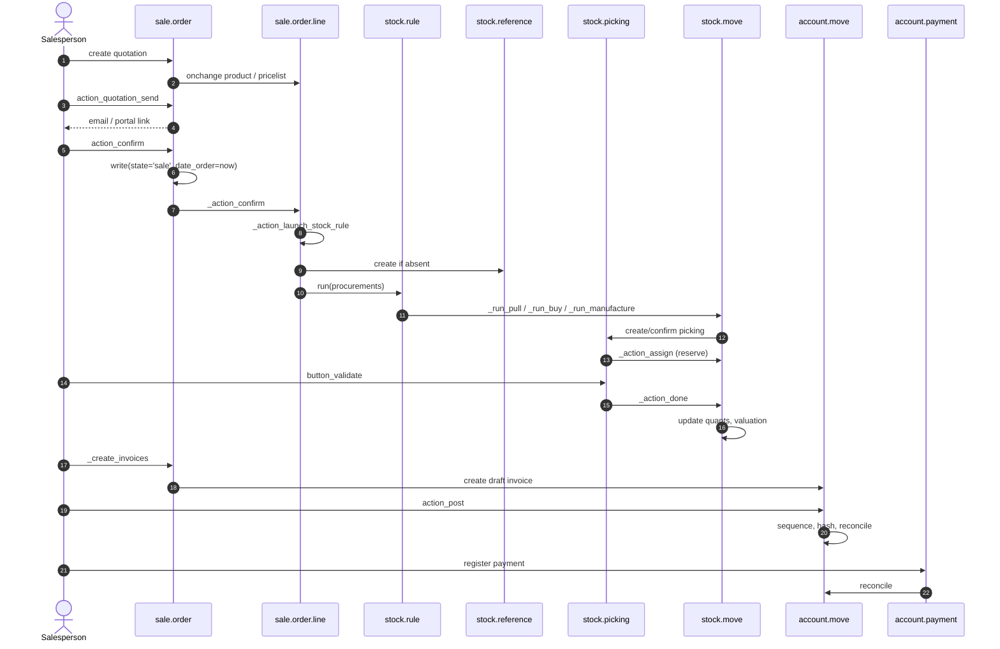
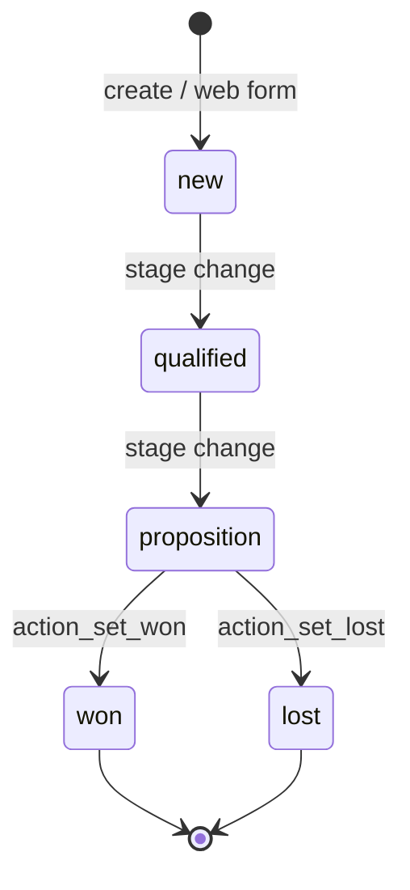

# Flow — Sales and CRM (Quote to Cash)

> **Modules covered.** `sale`, `sale_stock`, `sale_mrp`, `sale_project`, `crm`, `sales_team`, `account` (invoice generation only).
> **Version.** Odoo 19.0 Enterprise. Sales-specific v19 changes are marked **[V19]**.

---

## 1. Actors and entry points

| Actor | Entry point | Effect |
|---|---|---|
| Salesperson | Quotation form | creates `sale.order` (draft) |
| Customer | Portal quotation | accepts/signs, may pay deposit |
| Sales manager | Confirm / Lock | `action_confirm`, `action_lock` |
| Warehouse | Delivery validation | `stock.picking.button_validate` |
| Accountant | Invoice posting | `account.move.action_post` |
| Payment provider | Transaction callback | `payment.transaction` state |
| Automation | `base.automation` / cron | reminders, escalation |

---

## 2. Model map



Key inheritance:

| Model | Core | Extensions |
|---|---|---|
| `sale.order` | `sale/models/sale_order.py` | `sale_stock`, `sale_mrp`, `sale_project`, `sale_crm`, `sale_management`, `website_sale` |
| `sale.order.line` | `sale/models/sale_order_line.py` | `sale_stock`, `sale_mrp`, `sale_project`, `sale_service` |
| `crm.lead` | `crm/models/crm_lead.py` | `sale_crm`, `website_crm`, `crm_phone_validation` |
| `account.move` | `account/models/account_move.py` | `sale`, `sale_stock`, `sale_mrp`, `sale_project` |

---

## 3. State machines

### 3.1 `sale.order`



| State | Meaning | Editable | Invoiceable |
|---|---|---|---|
| `draft` | quotation | yes | no |
| `sent` | quotation sent to customer | yes | no |
| `sale` | confirmed sales order | limited | yes |
| `cancel` | cancelled | no (unless reset) | no |

**There is no `done` state in Odoo 19.** "Done" is the boolean `locked`, which blocks modifications but does not change `state`. Old documentation and third-party modules may still check `state == 'done'`; those checks are dead code.

`action_quotation_send()` opens the mail composer; the send/sent transition is written by the composer (`action_quotation_sent()` is the direct "mark as sent" method).

Source: `sale/models/sale_order.py:26-31` (`SALE_ORDER_STATE`), `:77-81` (`locked`), `:1167` (`action_confirm`), `:1319-1333` (`action_lock`/`action_unlock`/`action_cancel`).

### 3.2 `crm.lead`

CRM has **no `state` field** [V19]. The pipeline is:

- `stage_id` — kanban stage, ordered by `sequence`,
- `won_status` — `won`, `lost`, `pending`,
- `active` — archived or not,
- `probability` — 0–100.

Won stages require probability 100; marking lost archives the lead and sets probability 0. `action_set_won`, `action_set_lost`, `action_archive` are the transitions.

Source: `crm/models/crm_lead.py:123-134`, `222-233`, `612-620`.

### 3.3 `account.move` (invoice)



`_create_invoices()` creates **draft** invoices. Posting is a separate accounting action. `invoice_status` on the SO is quantity-driven, not payment-driven.

---

## 4. End-to-end sequence



### 4.1 Confirmation detail

`action_confirm()`:

1. `_confirmation_error_message()` — state must be `draft`/`sent`, every non-section line must have a product.
2. `order_line._validate_analytic_distribution()` — analytic accounts must be complete.
3. `write(_prepare_confirmation_values())` — sets `state='sale'`, `date_order=now`.
4. `_action_confirm()` — **extension point**; core is a no-op.
5. `_should_be_locked()` → `action_lock()` if the "lock confirmed orders" setting is enabled.
6. optional confirmation email (`send_email` context).

The real side effects live in `_action_confirm()` overrides:

| Module | Override | Effect |
|---|---|---|
| `sale_stock` | `_action_launch_stock_rule()` | creates procurements/pickings |
| `sale_project` | creates project/tasks | service delivery |
| `sale_crm` | updates opportunity revenue | CRM linkage |
| `sale_mrp` | links MOs via `stock.reference` | manufacturing demand |

**[WARNING]** `sale_stock` and `sale_project` do not depend on each other. Their `_action_confirm()` overrides are ordered by module load topology, not by business semantics. If your module needs a specific order, declare dependencies accordingly.

### 4.2 Procurement in v19 [V19]

- `stock.reference` is the document grouping object (there is no `procurement.group` in this build).
- `sale_stock` creates a `stock.reference` named after the SO if absent.
- `_prepare_procurement_values()` passes `reference_ids`, `sale_line_id`, `date_planned`, `date_deadline`, `route_ids`, `warehouse_id`, `location_final_id`.
- `stock.rule.run()` resolves the route and calls `_run_pull`, `_run_buy`, or `_run_manufacture`.
- Pickings are grouped by reference; a single SO can produce multiple pickings (multi-step, backorders, dropship).

Source: `sale_stock/models/sale_order_line.py:280-430`, `stock/models/stock_rule.py:453`.

### 4.3 Delivery

`stock.picking.button_validate()`:

1. confirms draft pickings,
2. `_sanity_check()` — quantities, lots, packages,
3. `_pre_action_done_hook()` — backorder wizard if partial,
4. `_action_done()` → `stock.move._action_done()`,
5. move lines update quants (`_update_available_quantity`),
6. the move value is set/updated (`stock.move.value`; FIFO remaining quantity is derived from it),
7. backorder creation if not fully delivered.

The SO's `delivery_status` is computed from pickings:

| Value | Condition |
|---|---|
| `pending` | no picking done |
| `started` | some picking done, no quantity delivered |
| `partial` | some picking done and some qty delivered |
| `full` | all pickings done/cancelled |

Source: `sale_stock/models/sale_order.py:33-41`, `:90-103`.

### 4.4 Invoicing

`_create_invoices(grouped=False, final=False, date=None)`:

1. permission check (`account.move` create or SO write),
2. `_prepare_invoice()` — header values from SO,
3. `_get_invoiceable_lines(final)` — lines with `qty_to_invoice != 0`, sections/notes preserved,
4. down payments get a dedicated section and negative line on final invoice,
5. grouping by `(company, partner, shipping, currency, fiscal position)` unless `grouped=True`,
6. `account.move.sudo().create(...)` — **draft** invoices,
7. negative totals become refunds when `final=True`,
8. origin link message posted.

`date` is accepted but **unused** in this build; do not rely on it to backdate invoices.

Source: `sale/models/sale_order.py:1500-1693`.

### 4.5 Invoice status semantics

`invoice_status` is computed from `sale.order.line.invoice_status`:

| Line status | Meaning |
|---|---|
| `no` | nothing to invoice |
| `to invoice` | quantity/amount remains |
| `invoiced` | fully invoiced (posted or draft) |
| `upselling` | delivered more than ordered |

Important: `qty_invoiced` includes **draft** invoice lines, while `amount_invoiced` counts posted only. A draft invoice already reduces `qty_to_invoice`; deleting/cancelling it restores the quantity. This is a frequent source of confusion in integration tests.

---

## 5. Decision points and guards

| Decision | Guard | Failure mode |
|---|---|---|
| Can confirm? | `state in ('draft','sent')`, all lines have product | `UserError` |
| Lock after confirm? | `sale.group_auto_done_setting` | none (auto-lock) |
| Create delivery? | product `type == 'consu'` and route yields a rule | no picking, SO still confirmed |
| Invoice on ordered vs delivered? | `product.invoice_policy` (`order`/`delivery`) | `qty_to_invoice` stays 0 |
| Allow cancel? | `not locked`, no done pickings | `UserError` |
| Allow quantity decrease? | not below delivered qty | `UserError` |
| Group invoices? | `_get_invoice_grouping_keys()` | multiple invoices |
| Down payment? | `is_downpayment` lines | tax/rounding differences |

### 5.1 Invoicing policy matrix

| Product type | `invoice_policy` | Invoiceable quantity |
|---|---|---|
| Service | `order` | ordered quantity |
| Service | `delivery` | delivered (timesheet) quantity |
| Goods | `order` | ordered quantity |
| Goods | `delivery` | delivered quantity |
| Combo | n/a | component lines |

**[INVARIANT]** Changing `invoice_policy` after confirmation does not retroactively change `qty_to_invoice` for already-invoiced lines. Test the transition explicitly.

---

## 6. Pricing, taxes, and currency

### 6.1 Price computation chain

```
list_price
  -> pricelist rules (product/category/global, min qty, date)
  -> currency conversion (pricelist currency -> SO currency)
  -> discount (%)
  -> taxes (excluded or included)
  -> price_subtotal / price_tax / price_total
```

Key methods:

| Method | Role |
|---|---|
| `product.pricelist._get_product_price` | base price for partner/qty/date |
| `sale.order.line._compute_price_unit` | applies pricelist |
| `sale.order.line._compute_discount` | default discount |
| `account.tax._get_tax_details` | Odoo 19 tax engine |
| `sale.order.line._prepare_invoice_lines_vals_list` | maps to invoice lines |

**[WARNING]** Manual price edits are protected: the `technical_price_unit` field stores the pricelist-derived value, and recomputation only overwrites `price_unit` when it equals the technical value. An override that writes `price_unit` directly can break this protection.

### 6.2 Fiscal position

- Determines tax mapping and account mapping.
- Selected from partner shipping address by default.
- Changing it recomputes taxes on lines (`action_update_taxes` / compute).
- It does **not** change the price; it changes tax rates and accounts.

### 6.3 Multi-currency

- `currency_id` comes from the pricelist, else company currency.
- `currency_rate` is stored at `date_order`.
- Invoice currency is the SO currency; accounting converts to company currency at posting date.
- Exchange differences are generated at reconciliation, not at invoice creation.

### 6.4 Down payments

- Created as a product line with `is_downpayment=True`.
- Invoiced separately (deposit invoice).
- On the final invoice, the down payment is reversed with a negative quantity so the total equals the order total.
- Taxes on deposits must match the final invoice; otherwise the final balance is wrong.

**[WARNING]** Down payment + discount + tax-included prices is the most bug-prone combination in Odoo sales. Test with the exact tax configuration used in production.

---

## 7. CRM pipeline

### 7.1 Lead lifecycle



- Stages are per-team (`crm.stage.team_id`) and ordered by `sequence`.
- `won_status` is independent of `stage_id`; a lead can be in a "Won" stage but still `pending` if misconfigured.
- Conversion to a quotation calls `sale.order` creation with `opportunity_id`.
- `sale_crm` updates `crm.lead.expected_revenue` from confirmed SOs.

### 7.2 Lead → SO conversion

`crm.lead.action_create_sale_order()` (or the "New Quotation" button):

1. validates the lead is not lost,
2. creates a `sale.order` with partner, currency, team, user, campaign,
3. links `opportunity_id`,
4. may copy the description into order lines.

**[WARNING]** Converting the same lead twice creates two SOs. There is no unique constraint on `sale.order.opportunity_id`; enforce it in custom code if your process requires one.

---

## 8. Accounting impact

| Event | Journal entry | Source |
|---|---|---|
| Invoice posted | Dr receivable / Cr revenue / Cr tax | `account.move._post` |
| COGS (real-time valuation) | Dr expense / Cr stock valuation | `stock_account` on **customer invoice posting**, not delivery |
| Customer payment | Dr bank / Cr receivable | `account.payment` |
| Reconciliation | Partial/full reconcile, exchange diff | `account.move.line._reconcile_plan` |
| Down payment | Dr bank / Cr receivable (deposit invoice) | `sale.advance.payment.inv` |
| Refund | Reverse invoice lines | `account.move._reverse_moves` |

**[INVARIANT]** Revenue is recognised at invoice posting, not at delivery, unless your localization/module implements accrual. Deferred revenue requires `account_deferred`-style modules or custom logic.

---

## 9. Failure modes and troubleshooting

| Symptom | Likely cause | Check |
|---|---|---|
| SO confirmed but no delivery | no route/rule for product/warehouse | `stock.rule` for product category/warehouse |
| Delivery created but not reserved | no stock, `reservation_method='at_confirm'` vs manual | `stock.move.state`, quants |
| `qty_to_invoice` stays 0 | invoice policy `delivery` and nothing delivered | `sale.order.line.qty_delivered` |
| Invoice total differs from SO | taxes, fiscal position, currency rate, discount | tax details, `invoice_currency_rate` |
| Cannot cancel SO | locked or done picking | `locked`, `picking_ids.state` |
| Duplicate invoice lines | `_create_invoices` called twice without final guard | `invoice_ids`, `qty_invoiced` |
| Down payment not deducted | final invoice not `final=True` or deposit not posted | `is_downpayment`, `invoice_ids` |
| Portal shows wrong price | pricelist not applied for portal user | `pricelist_id`, `_get_product_price` |

### 9.1 Diagnostic ORM snippets

```python
so = env['sale.order'].browse(so_id)
print(so.state, so.locked, so.invoice_status, so.delivery_status)
for line in so.order_line:
    print(line.product_id.display_name, line.product_uom_qty, line.qty_delivered,
          line.qty_invoiced, line.qty_to_invoice, line.invoice_status)
print(so.stock_reference_ids, so.picking_ids.mapped('state'))
print(so.invoice_ids.mapped(lambda m: (m.name, m.state, m.amount_total)))
```

---

## 10. Extension points

| Hook | Safe? | Use |
|---|---|---|
| `_prepare_confirmation_values` | safe | add fields on confirm |
| `_action_confirm` | medium | side effects; call super |
| `_prepare_invoice` | safe | invoice header values |
| `_get_invoiceable_lines` | medium | custom invoiceability |
| `_prepare_invoice_lines_vals_list` | medium | invoice line mapping |
| `_create_account_invoices` | medium | replace invoice creation |
| `_action_launch_stock_rule` | risky | procurement changes |
| `_get_qty_procurement` | risky | delivered/qty logic |
| `action_confirm` | risky | full orchestration override |
| `_compute_invoice_status` | risky | status semantics |

### 10.1 Safe customisation recipe

1. Add fields via `_inherit`.
2. Add validation via `@api.constrains`.
3. Extend `_prepare_invoice` and `_prepare_invoice_lines_vals_list` rather than rewriting `_create_invoices`.
4. Use `_action_confirm` only for side effects that cannot be computed.
5. Never change `state` values; add a separate boolean/selection.

---

## 11. Test scenarios

| Scenario | Assertion |
|---|---|
| Quotation → confirm | state `sale`, `date_order` set, picking created |
| Confirm with missing product | `UserError` |
| Confirm locked order | cannot modify lines |
| Deliver partial | `delivery_status='partial'`, backorder exists |
| Invoice ordered qty | invoice lines match SO lines |
| Invoice delivered qty | invoice only after delivery |
| Down payment → final invoice | final total equals SO total |
| Cancel confirmed SO | pickings cancelled, invoices cancelled |
| Multi-currency | invoice company-currency amount uses posting rate |
| Fiscal position | taxes/accounts remapped |
| Portal access | customer sees only own SO |

---

## 12. Evidence index

| Topic | File:line |
|---|---|
| SO states | `sale/models/sale_order.py:26-31` |
| `action_confirm` | `sale/models/sale_order.py:1167` |
| `_action_confirm` | `sale/models/sale_order.py:1232` |
| Lock/unlock/cancel | `sale/models/sale_order.py:1319-1333` |
| Invoice status | `sale/models/sale_order.py:619-664` |
| `_create_invoices` | `sale/models/sale_order.py:1551` |
| Invoice preparation | `sale/models/sale_order.py:1412` |
| Procurement | `sale_stock/models/sale_order_line.py:280-430` |
| Delivery status | `sale_stock/models/sale_order.py:33-103` |
| Picking validation | `stock/models/stock_picking.py:1413` |
| Move done | `stock/models/stock_move.py:2244` |
| CRM lead | `crm/models/crm_lead.py:84-233` |
| Product type [V19] | `product/models/product_template.py:54-62` |

Continue with `02-purchase.md`.
