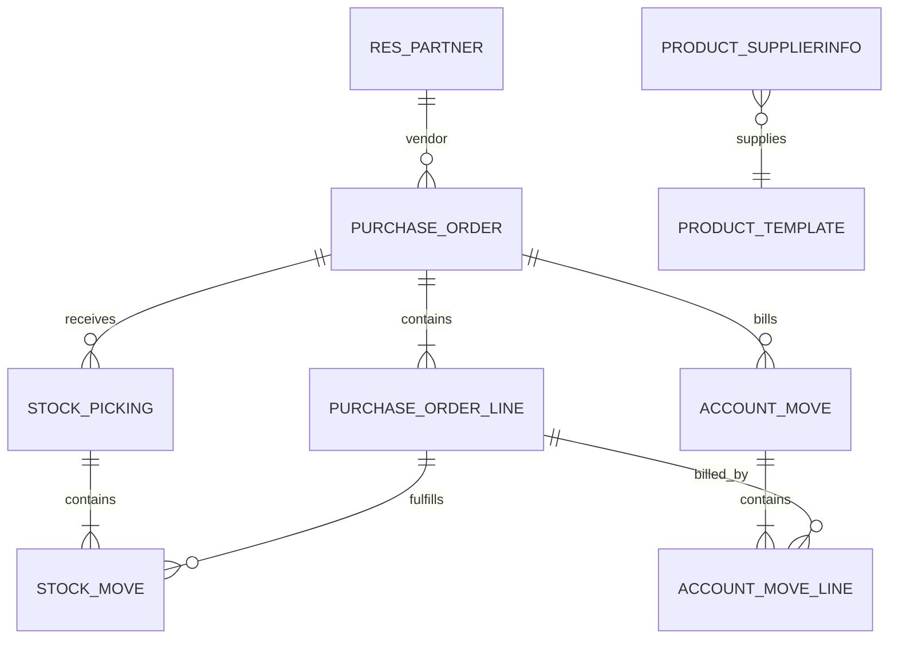
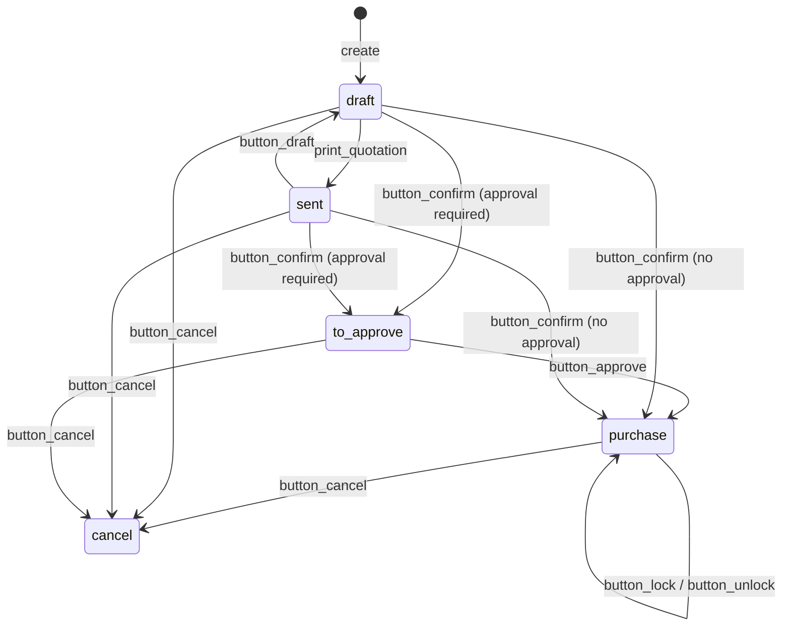
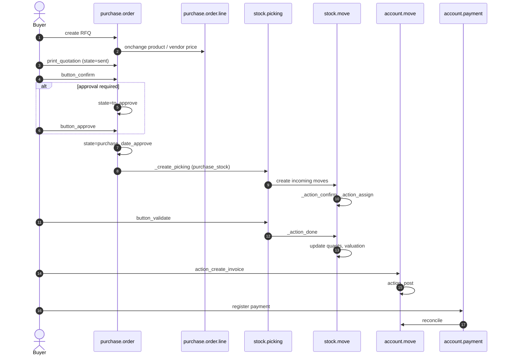

# Flow — Purchase (Requisition to Payables)

> **Modules covered.** `purchase`, `purchase_stock`, `account`, `account_3way_match` (Enterprise).
> **Version.** Odoo 19.0 Enterprise. Purchase has **no `done` state** in this build.

---

## 1. Actors and documents

| Actor | Document | Model |
|---|---|---|
| Buyer | Request for Quotation | `purchase.order` (`draft`/`sent`) |
| Purchase manager | Approval | `purchase.order` (`to approve` → `purchase`) |
| Vendor | Quotation / order confirmation | PDF/portal |
| Warehouse | Receipt | `stock.picking` (incoming) |
| Accountant | Vendor bill | `account.move` (`in_invoice`) |
| Controller | 3-way match | `account.move.release_to_pay` |
| Treasury | Payment | `account.payment` |

---

## 2. Model map

Key inheritance:

| Model | Core | Extensions |
|---|---|---|
| `purchase.order` | `purchase/models/purchase_order.py` | `purchase_stock`, `purchase_mrp`, `purchase_requisition`, `account_3way_match` |
| `purchase.order.line` | `purchase/models/purchase_order_line.py` | `purchase_stock`, `purchase_mrp` |
| `stock.picking` | `stock/models/stock_picking.py` | `purchase_stock` |
| `account.move` | `account/models/account_move.py` | `purchase`, `account_3way_match` |

---

## 3. State machine

### 3.1 `purchase.order`

| State | Meaning | Editable | Receipt created |
|---|---|---|---|
| `draft` | RFQ | yes | no |
| `sent` | RFQ sent | yes | no |
| `to approve` | awaiting manager | limited | no |
| `purchase` | confirmed PO | limited | yes (on confirm) |
| `cancel` | cancelled | no | no |

`locked` is an independent boolean; a locked PO cannot be cancelled or edited. There is **no `done` state**; receiving does not change the PO state. "Done" is inferred from `qty_received >= product_qty` and `invoice_status`.

Source: `purchase/models/purchase_order.py:105-116`, `:625-655`.

### 3.2 `stock.picking` (receipt)

Same state machine as all transfers:

`draft → confirmed → assigned → done`, with `waiting` for chained moves and `cancel`.

A receipt is created in `confirmed` and becomes `assigned` when quants are reserved. For incoming moves, reservation is usually not required; the picking may stay `confirmed` until validation.

---

## 4. End-to-end sequence

### 4.1 Confirmation detail

`button_confirm()`:

1. skip orders not in `draft`/`sent`,
2. `_confirmation_error_message()` — every non-section line needs a product,
3. `_validate_analytic_distribution()`,
4. `_add_supplier_to_product()` — creates a `product.supplierinfo` if the vendor is not already a supplier (max 10 suppliers),
5. `_approval_allowed()`:
   - `po_double_validation = 'one_step'` → approve,
   - `'two_step'` and total below `po_double_validation_amount` → approve,
   - user in `purchase.group_purchase_manager` → approve,
   - otherwise `state='to approve'`.
6. `button_approve()` writes `state='purchase'`, `date_approve=now`, and locks if `po_lock='lock'`.

Source: `purchase/models/purchase_order.py:615-639`, `:1251-1260`.

### 4.2 Receipt creation [V19]

`purchase_stock._create_picking()`:

1. only for `state == 'purchase'` and at least one `consu` product,
2. reuse an existing non-done picking if present,
3. `_prepare_picking()` → `stock.picking` with `picking_type_id` = incoming,
4. `order_line._create_stock_moves(picking)`:
   - skip non-`consu` products,
   - compute price unit including taxes,
   - split quantities to satisfy linked move destinations (MTO/sale),
5. `_action_confirm()` then `_action_assign()`,
6. confirm forward pickings created by push rules,
7. delete an empty receipt,
8. post an origin link message.

Source: `purchase_stock/models/purchase_order.py:375-410`, `purchase_stock/models/purchase_order_line.py:206-237`.

### 4.3 Receipt validation

`stock.picking.button_validate()` follows the common inventory flow (see `03-inventory.md`):

- sanity check quantities/lots/packages,
- backorder wizard for partial receipts,
- `_action_done()` → move lines → quants,
- valuation: incoming move value = purchase price (+ landed costs if any),
- `qty_received` on the PO line is computed from done incoming moves,
- vendor bill matching uses `qty_received` vs `qty_invoiced`.

### 4.4 Vendor bill

`purchase.order.action_create_invoice()`:

1. `_prepare_invoice()` — vendor, currency, payment terms, fiscal position,
2. iterate lines, preserving sections/subsections,
3. `line._prepare_account_move_line()` — account, tax, analytic distribution, quantity,
4. group by `(company, partner, currency)`,
5. create `account.move` with `move_type='in_invoice'` in **draft**,
6. negative totals become vendor credits (`action_switch_move_type`),
7. optional attachments are linked and OCR/extraction may run.

Source: `purchase/models/purchase_order.py:760-850`.

**[INVARIANT]** The bill is created draft. Posting (`action_post`) is a separate accounting step and may be blocked by lock dates, missing partner, negative total, or duplicate vendor reference detection.

---

## 5. Quantity and billing semantics

| Field | Definition | Source |
|---|---|---|
| `product_qty` | ordered quantity in PO UoM | `purchase.order.line` |
| `qty_received` | done incoming quantity (minus returns) | computed from stock moves |
| `qty_invoiced` | quantity on posted/draft vendor bills | computed from `account.move.line` |
| `qty_to_invoice` | `qty_received` or `product_qty` minus `qty_invoiced` depending on policy | computed |
| `invoice_status` | `no` / `to invoice` / `invoiced` | `_get_invoiced` |

### 5.1 Control policy

`product.purchase_method` (or `purchase.order.line` override):

| Policy | Billable quantity |
|---|---|
| `purchase` (on ordered quantities) | `product_qty` |
| `receive` (on received quantities) | `qty_received` |

**[WARNING]** If the policy is `receive` and the receipt is partial, the bill can only cover the received quantity unless you manually change it. Over-invoicing is blocked by the `qty_to_invoice` compute, not by a database constraint.

### 5.2 Three-way match [ENTERPRISE]

`account_3way_match` computes `release_to_pay` on vendor bills:

- `yes` — received quantity >= billed quantity,
- `no` — nothing received,
- `exception` — quantity or price mismatch.

It is informational unless a custom workflow blocks payment. Odoo does not prevent posting an over-billed invoice by default; it flags it. Enforce with a constraint if your controls require it.

Source: `addons/account_3way_match/models/account_invoice.py:14-120`.

---

## 6. Decision points

| Decision | Rule | Consequence |
|---|---|---|
| Approval required? | company `po_double_validation`, amount, manager group | `to approve` vs `purchase` |
| Create receipt? | at least one `consu` product | no receipt for services |
| Receipt split? | partial quantity / backorder setting | backorder picking |
| Bill on order or receipt? | `product.purchase_method` | invoiceable qty |
| Landed cost? | `stock.landed.cost` | valuation adjustment |
| Currency? | vendor pricelist/PO currency | FX gain/loss at payment |
| Tax? | vendor taxes + fiscal position | bill tax lines |
| Lock? | `company.po_lock` | no edit/cancel |

---

## 7. Returns and corrections

### 7.1 Purchase return

- Create a return picking from the receipt with the `stock.return.picking` wizard (`action_create_returns()`).
- Done return moves decrease `qty_received`.
- Create a vendor credit (`account.move` `in_refund`) or use the return wizard.
- If the bill is already posted, use a credit note, not a bill edit.

### 7.2 Price difference

If the vendor bill price differs from the PO price:

- the bill line keeps the vendor price,
- `price_unit` difference is not automatically posted to a price-variance account in core,
- `account_3way_match` flags `exception`,
- custom modules may post a variance entry.

**[WARNING]** Core Odoo does not implement a full purchase price variance (PPV) accounting flow. If PPV is required, specify the accounts and posting rules explicitly; do not assume standard cost revaluation will absorb it.

---

## 8. Landed costs

`stock.landed.cost` distributes additional costs (freight, customs, insurance) over received moves:

1. select the picking(s),
2. add cost lines with a split method (`equal`, `by_quantity`, `by_current_cost_price`, `by_weight`, `by_volume`),
3. validate → creates `stock.valuation.layer`-equivalent value adjustments on moves (in v19, `stock.move.value` adjustments),
4. accounting entry: Dr inventory / Cr expense or payable.

**[WARNING]** Landed costs applied after the goods are sold change COGS retroactively. Apply them before delivery or run the valuation adjustment explicitly.

---

## 9. Accounting impact [V19]

| Event | Accounting behaviour |
|---|---|
| Receipt | `stock.move.value` is set; no per-move GL entry for a normal supplier→stock move |
| Vendor bill | Dr expense (or configured stock input) / Dr tax / Cr payable |
| Price difference | not posted as PPV by core; `account_3way_match` flags exceptions |
| Payment | Dr payable / Cr bank; FX difference if currency differs |
| Return | reverse receipt value and vendor credit |
| Landed cost | value adjustment on moves; GL entry when the landed cost is validated |
| Stock closing | `action_close_stock_valuation` reconciles stock valuation ledger with `stock.move.value` |

The exact accounts depend on the product category (`property_stock_valuation_account_id`, `account_stock_variation_id`, `account_stock_expense_id`) and on the valuation setting (`real_time` vs `periodic`). See `04-accounting.md` §8 and `03-inventory.md` §5.4.

---

## 10. Failure modes

| Symptom | Cause | Check |
|---|---|---|
| Confirm goes to `to approve` unexpectedly | two-step validation threshold | `company.po_double_validation`, amount |
| No receipt created | all products are services, or no incoming picking type | `product.type`, warehouse config |
| Receipt not reserved | incoming reservation policy | `stock.move.state` |
| Cannot bill full quantity | policy `receive`, partial receipt | `qty_received`, `qty_to_invoice` |
| Bill total differs | taxes, currency, discount, landed cost | tax details, `invoice_currency_rate` |
| Duplicate vendor bill | no duplicate detection | `account.move` `ref`, `_check_duplicate_supplier_reference` |
| Cannot cancel PO | locked or posted bills | `locked`, `invoice_ids.state` |
| Stock valuation wrong | missing price on move, wrong cost method | `stock.move.value` |

---

## 11. Extension points

| Hook | Use | Risk |
|---|---|---|
| `_prepare_picking` | customize receipt header | low |
| `_prepare_stock_moves` | customize move values | medium |
| `_create_picking` | replace receipt creation | high |
| `_prepare_invoice` | bill header | low |
| `_prepare_account_move_line` | bill line mapping | medium |
| `_approval_allowed` | custom approval matrix | medium |
| `button_confirm` | add validations | high |
| `_add_supplier_to_product` | vendor catalogue automation | low |

---

## 12. Test scenarios

| Scenario | Assertion |
|---|---|
| RFQ → confirm (one-step) | state `purchase`, receipt exists |
| RFQ → confirm (two-step) | state `to approve`, no receipt |
| Manager approves | state `purchase`, `date_approve` set |
| Partial receipt | `qty_received < product_qty`, backorder |
| Bill on received | `qty_to_invoice == qty_received - qty_invoiced` |
| Over-invoice attempt | blocked or flagged |
| Vendor return | `qty_received` decreases, credit note |
| Landed cost | move value increases, journal entry balanced |
| Multi-currency | company-currency amount uses PO date rate |
| Locked PO | edit/cancel raises `UserError` |

---

## 13. Evidence index

| Topic | File:line |
|---|---|
| PO states | `purchase/models/purchase_order.py:105-116` |
| Confirm/approve | `purchase/models/purchase_order.py:615-639` |
| Approval rule | `purchase/models/purchase_order.py:1251-1260` |
| Cancel/lock | `purchase/models/purchase_order.py:641-655` |
| Bill creation | `purchase/models/purchase_order.py:760-850` |
| Invoice status | `purchase/models/purchase_order.py:47-68` |
| Receipt creation | `purchase_stock/models/purchase_order.py:375-410` |
| Stock move prep | `purchase_stock/models/purchase_order_line.py:206-237` |
| 3-way match | `account_3way_match/models/account_invoice.py:14-120` |

Continue with `03-inventory.md`.
