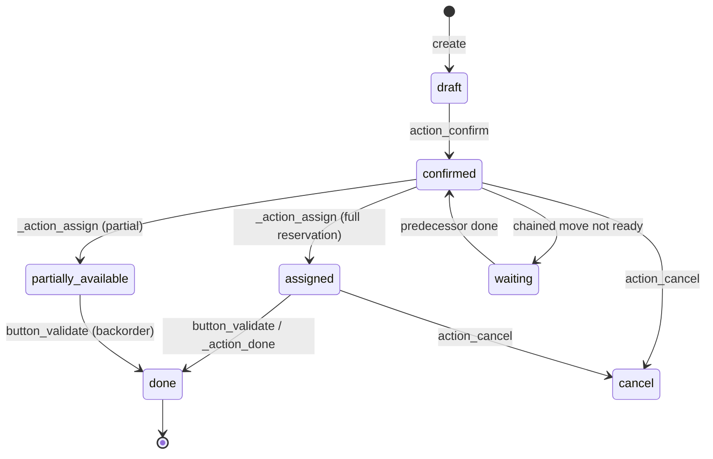
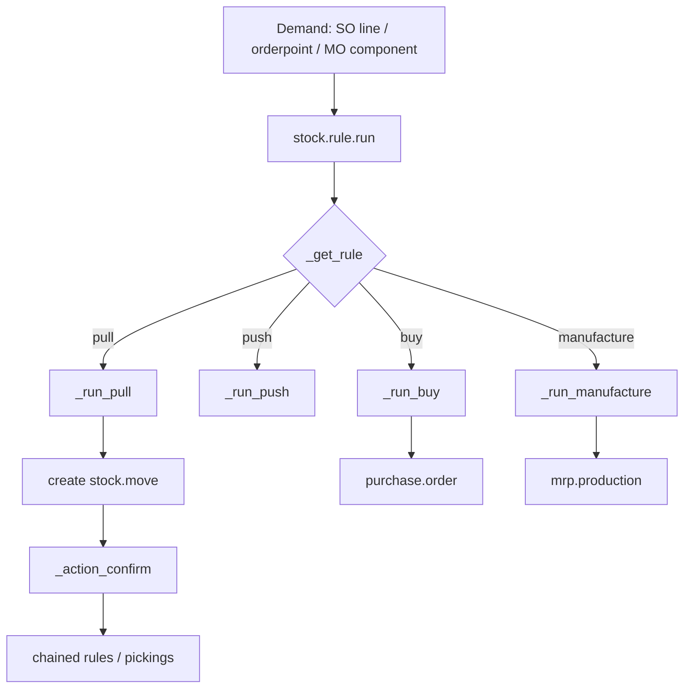
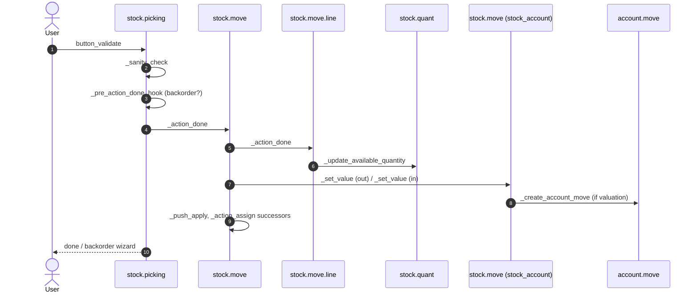

# Flow — Inventory and Stock Valuation

> **Modules covered.** `stock`, `stock_account`, `stock_landed_costs`, `product`, `uom`, `purchase_stock`, `sale_stock`.
> **Version.** Odoo 19.0 Enterprise. Inventory changed substantially in v19: `procurement.group` and `stock.valuation.layer` are gone; valuation lives on `stock.move.value` and `product.value`; UoM is a tree.

---

## 1. The inventory model in one page

| Concept | Model | Meaning |
|---|---|---|
| Product | `product.product` | variant; `is_storable` distinguishes stocked goods |
| Location | `stock.location` | physical/logical node; `usage` determines behaviour |
| Warehouse | `stock.warehouse` | configuration root: routes, picking types, locations |
| Picking type | `stock.picking.type` | operation template (incoming, outgoing, internal, manufacturing) |
| Picking | `stock.picking` | document grouping moves |
| Move | `stock.move` | demand for a quantity from A to B |
| Move line | `stock.move.line` | actual execution detail (lot, package, owner, qty) |
| Quant | `stock.quant` | on-hand/reserved quantity per product/location/lot/package/owner |
| Rule | `stock.rule` | how demand is fulfilled (pull/push/buy/manufacture) |
| Route | `stock.route` | ordered set of rules |
| Reference | `stock.reference` | [V19] document grouping replacing `procurement.group` |

### 1.1 Locations and usage types

| Usage | Behaviour | Reservation |
|---|---|---|
| `internal` | owned stock | yes |
| `supplier` | vendor source | no |
| `customer` | customer destination | no |
| `inventory` | adjustment counterpart | no |
| `production` | manufacturing | yes (components) |
| `transit` | inter-warehouse/inter-company | yes |
| `view` | structural only | n/a |

**[INVARIANT]** A move from `supplier` to `internal` is a receipt; from `internal` to `customer` is a delivery; `internal` to `internal` is a transfer. The `usage` fields, not the picking type name, determine reservation and valuation behaviour.

---

## 2. State machines

### 2.1 `stock.picking`



The picking `state` is **computed** from its moves (`_compute_state`), not written directly. Move states:

`draft → waiting | confirmed → partially_available → assigned → done`, plus `cancel`.

### 2.2 `stock.quant`

No state machine. `quantity` and `reserved_quantity` are numeric; `available_quantity = quantity - reserved_quantity`. A quant with negative quantity is allowed if the location/product configuration permits it.

---

## 3. Procurement: how demand becomes moves



### 3.1 Rule resolution order

`_get_rule(product, location, values)` searches pull rules for the destination location, walking up the location hierarchy. `_search_rule` priority:

1. explicit `route_ids` in the procurement values,
2. packaging routes,
3. product routes + product category routes,
4. warehouse routes.

Within a route, rules are ordered by `route_sequence`, then `sequence`. The first matching rule wins.

Source: `stock/models/stock_rule.py:567-650`.

### 3.2 Pull vs push

- **Pull**: a demand at destination triggers a move from source (e.g. delivery pulls from stock; if insufficient, MTO pulls from supplier).
- **Push**: a move into a location triggers a follow-up move out (e.g. receipt pushes to quality control, then to stock).
- `procure_method`:
  - `make_to_stock`: take from stock if available, else wait.
  - `make_to_order`: create a chained move from the supplier/production.
  - `mts_else_mto`: choose based on forecast at creation time.

**[WARNING]** `mts_else_mto` evaluates forecast at procurement time. Under concurrency, two demands can both see sufficient stock and both choose MTS, causing a later shortage. The retry wrapper does not fix this; it is a business configuration decision.

### 3.3 Multi-step routes

| Route | Steps | Typical use |
|---|---|---|
| Receive in 1 step | vendor → stock | simple |
| Receive in 2 steps | vendor → input → stock | quality/putaway |
| Receive in 3 steps | vendor → input → quality → stock | regulated |
| Deliver in 1 step | stock → customer | simple |
| Deliver in 2 steps | stock → output → customer | staging |
| Deliver in 3 steps | stock → pick → pack → customer | e-commerce |
| Cross-dock | vendor → output → customer | no storage |
| Dropship | vendor → customer | direct shipment |

Each step creates a picking; moves are chained with `move_dest_ids`. Confirming the first picking triggers `_action_assign` on the next when the predecessor is done.

### 3.4 Reordering rules

`stock.warehouse.orderpoint`:

- `product_min_qty`, `product_max_qty`, `qty_multiple`, `trigger` (`auto`/`manual`).
- The scheduler (`stock.rule.run_scheduler`) computes `qty_to_order = max - virtual_available`, rounds to multiple, and creates a procurement.
- `virtual_available` includes incoming/outgoing within the lead time horizon; context keys change the horizon.
- The scheduler is a cron (`stock.scheduler_cron`) and processes companies separately.

**[WARNING]** Reordering rules use forecast quantities that depend on confirmed but not done moves. Cancelled or late documents distort the forecast. Monitor `qty_to_order` and the scheduler log.

---

## 4. Reservation and quants

### 4.1 Reservation

`stock.move._action_assign()`:

1. find candidate quants via `_gather` using the removal strategy,
2. compute available quantity (`quantity - reserved_quantity`),
3. create/update `stock.move.line` with `reserved_qty`,
4. update `stock.quant.reserved_quantity` through `_update_reserve_quantity`,
5. set move state to `assigned` or `partially_available`.

Removal strategies (`product.category.removal_strategy_id` or location):

| Strategy | Order |
|---|---|
| `fifo` | oldest `in_date` first (default) |
| `lifo` | newest `in_date` first |
| `closest` | nearest location by complete name |
| `least_packages` | fewest packages first (A* over package contents) |
| FEFO | expiration/removal date ordering, requires expiration dates and `with_expiration` context |

Strategies are `product.removal` records (data-defined), selected by `product.category.removal_strategy_id` or `stock.location.removal_strategy_id`; the method string is what the quant code dispatches on.

Source: `stock/models/stock_quant.py:771-900`, `stock/models/stock_move.py:2041`.

### 4.2 Quant updates

`_update_available_quantity(product, location, quantity, reserved_quantity, lot, package, owner)`:

- gathers the exact quant (`strict=True`),
- locks one row with `try_lock_for_update` (SKIP LOCKED),
- updates `quantity` or `reserved_quantity`,
- creates a quant if none exists,
- maintains `in_date` as the oldest incoming date.

**[INVARIANT]** Never write `stock.quant.quantity` directly from custom code. Always go through `_update_available_quantity` so that reservations, `in_date`, and valuation stay coherent.

### 4.3 Negative stock

Negative quants are allowed when:

- the location permits it (`usage` internal),
- the product is not lot-tracked with strict constraints,
- the move is forced/validated without enough stock.

Negative stock distorts FIFO/AVCO valuation and COGS. Enable "block negative stock" at the product category or warehouse level if the business requires it.

### 4.4 Lots and serial numbers

- `tracking='lot'` or `'serial'` on the product.
- `stock.move.line.lot_id` identifies the lot moved.
- `stock.lot` stores `name`, `product_id`, `expiration_date`, `removal_date`, `alert_date`.
- Quants are gathered per `lot_id`; duplicates are merged by `_quant_tasks`, not prevented by a DB unique constraint.
- Serial numbers should have quantity 1 per quant; Odoo does not enforce this at the database level for all flows.

**[WARNING]** Creating a move line without a lot for a tracked product raises at validation. Bulk imports that bypass the UI must set lots explicitly.

### 4.5 Packages and owners

- `stock.package` groups move lines; `package_id` (source) and `result_package_id` (destination).
- `owner_id` supports consignment stock: goods owned by a third party but stored in your location.
- Valuation and availability are owner-aware.

---

## 5. Validation and valuation

### 5.1 `button_validate` sequence



Key details:

- `_action_done` first cancels moves with no picked quantity, then processes picked move lines.
- `picked` is a boolean gate: a move line with quantity but `picked=False` is not validated (v19 behaviour).
- Quants are updated per move line, with the source location decreasing and destination increasing.
- Backorders are created for unpicked quantities unless `cancel_backorder` is set.
- Successor moves are assigned after validation (`_trigger_assign`).

Source: `stock/models/stock_picking.py:1256-1480`, `stock/models/stock_move.py:2244-2320`.

### 5.2 Valuation in v19 [V19]

There is **no `stock.valuation.layer`** in this build. Instead:

- `stock.move.value` stores the total value of the move.
- `stock.move.remaining_qty` / `remaining_value` track FIFO layers.
- `product.value` is an audit trail of manual value changes (standard price, lot price, move value).
- `product.standard_price` is the current cost.
- On outgoing moves, `_set_value()` consumes FIFO layers or uses standard price.
- On incoming moves, `_set_value()` determines value by priority:
  1. manual value (`product.value` with `move_id`),
  2. vendor bill / invoice lines,
  3. production cost,
  4. quotation (SO/PO) price,
  5. returns,
  6. standard price,
  7. extra costs (landed costs).

Source: `stock_account/models/stock_move.py:193-470`, `product_value.py:1-120`.

### 5.3 Cost methods

| Method | Incoming value | Outgoing value |
|---|---|---|
| `standard` | standard price | standard price |
| `fifo` | actual cost; layer per receipt | oldest layer cost |
| `average` (AVCO) | weighted average | current average |

For FIFO, `_run_fifo` consumes layers; for AVCO, `_update_standard_price` recomputes the average after each receipt. Lot-valuated AVCO (`lot_valuated=True`) computes per-lot averages.

### 5.4 Journal entries [V19]

Odoo 19 does **not** post a stock valuation journal entry for every receipt or delivery. The authoritative value lives on `stock.move.value`; accounting is reconciled separately.

`stock.move._create_account_move()` runs only when `_should_create_account_move()` is true:

- the product is storable and the move is valued,
- valuation is `real_time`,
- the source or destination location has a `valuation_account_id` (production, inventory, scrap, transit),
- the quantity is non-zero.

It posts a move between the product's stock valuation account and the location's valuation account in `company.account_stock_journal_id`.

For ordinary supplier/customer moves, the financial effect comes from:

- **COGS lines on customer invoices** — `stock_account.account_move._post()` adds `display_type='cogs'` lines (Dr expense / Cr stock valuation) for real-time storable products;
- **stock valuation closing** — `res.company.action_close_stock_valuation()` compares `product.total_value` with the posted stock-valuation balance and posts a closing entry. The `_cron_post_stock_valuation` cron runs daily or monthly depending on `company.inventory_period` (`manual` requires an explicit run);
- **continental variation** — `_get_continental_realtime_variation_vals()` posts the period's inventory variation.

Source: `stock_account/models/stock_move.py:661-670`, `stock_account/models/account_move.py:29-40`, `stock_account/models/res_company.py:49-148`, `:238-320`.

**[WARNING]** Do not assume that validating a receipt increases the stock valuation account immediately. Run the closing process (or the cron) and reconcile `stock_value()` vs `stock_accounting_value()`; otherwise the balance sheet and the inventory report diverge.

### 5.5 Cost methods and accounting

| Configuration | Value source | Accounting entry |
|---|---|---|
| `standard` | standard price | COGS at invoice + closing adjustments |
| `fifo` | FIFO layers on moves | COGS at invoice + closing adjustments |
| `average` | weighted average | COGS at invoice + closing adjustments |
| Periodic valuation | closing computation | closing entry only |
| Real-time + location valued | move `value` | move-level entry + closing reconciliation |

The Anglo-Saxon/continental distinction is less visible in v19 than in earlier versions, but the accounts still matter:

- `property_stock_valuation_account_id` — inventory asset,
- `account_stock_variation_id` — variation/COGS counterpart,
- `account_stock_expense_id` — continental variation expense,
- `property_stock_journal` / `account_stock_journal_id` — valuation journal.

Test a full cycle: purchase → receipt → bill → sale → delivery → invoice → stock closing, and reconcile the stock valuation account after each step.

---

## 6. Returns, scrap, and adjustments

### 6.1 Returns

- `stock.return.picking.action_create_returns()` creates a reverse picking with `origin_returned_move_id` links.
- Return moves have `to_refund=True` when they should reduce the original document quantity.
- Valuation reverses the original value (FIFO layer restoration or average adjustment).
- The linked SO/PO quantity is reduced if `to_refund`.

### 6.2 Scrap

- `stock.scrap` creates a move to a scrap location (`usage='inventory'`).
- Scrap is valued as an outgoing move; the counterpart account is the scrap location's valuation account or the product's expense account.
- Scrap can be done from a picking or standalone.

### 6.3 Inventory adjustment

- `stock.quant.inventory_quantity` is the counted quantity.
- `action_apply_inventory` creates an adjustment move to/from the inventory location.
- `inventory_quantity_set` tracks whether the user changed the value.
- The adjustment is valued at standard cost (or FIFO for increases).

**[WARNING]** Inventory adjustments do not require a physical document; they are a privileged operation. Restrict `stock.group_stock_manager` and audit the resulting moves.

### 6.4 Cycle counting

Core Odoo has inventory adjustments and `stock.quant` counts, but no full cycle-count scheduling engine. Enterprise `stock_cycle_count`-style features or custom modules are needed for ABC scheduling, count sheets, and variance approval.

---

## 7. Decision points

| Decision | Driver | Effect |
|---|---|---|
| Reserve on confirm? | `picking_type.reservation_method` | `at_confirm` vs `by_date` vs `manual` |
| Create backorder? | `picking_type.create_backorder` | never / ask / always |
| Use lot? | product tracking | move line requirement |
| Allow negative? | category/warehouse setting | validation succeeds/fails |
| Value at? | cost method | FIFO layer vs standard |
| Post valuation entry? | product category `property_valuation` | real-time vs manual |
| Push next step? | route rules | chained picking |
| Split? | package/owner/lot | multiple move lines |

---

## 8. Performance and locking

### 8.1 Hot paths

- `_gather` → `search` on `stock_quant` with product/location/lot/package/owner. Needs composite indexes; core creates them via `_table_objects` and field indexes.
- `_update_available_quantity` → row lock per quant. Contention on popular products.
- `_action_done` → per move line quant updates; batch by product/location where possible.
- `virtual_available` → aggregate over quants and moves; expensive on large catalogs.
- `stock.quant` cron `_quant_tasks` → merges duplicates, cleans zero quants.

### 8.2 Deadlock avoidance

- Sort product/location ids before bulk operations.
- Avoid validating two pickings with overlapping products in parallel; the retry wrapper will serialize them but throughput drops.
- Use `SKIP LOCKED` semantics where core does; do not add `FOR UPDATE` on quants in custom code without a clear order.

### 8.3 Query patterns

```sql
-- On hand by product/location
SELECT product_id, location_id, SUM(quantity), SUM(reserved_quantity)
FROM stock_quant
WHERE company_id = %s
GROUP BY product_id, location_id;

-- Moves not yet done
SELECT id, product_id, product_uom_qty, quantity, state
FROM stock_move
WHERE state IN ('confirmed','partially_available','assigned')
ORDER BY date;
```

---

## 9. Failure modes

| Symptom | Cause | Check |
|---|---|---|
| Picking stuck in `confirmed` | no stock / reservation method manual | quants, `_action_assign` |
| `assigned` but cannot validate | `picked=False` on move lines | `move_line_ids.picked` |
| Negative stock after validation | forced quantity / no block | quant quantity |
| Wrong COGS | cost method, missing bill price, negative stock | `stock.move.value`, layers |
| Duplicate quants | concurrent `_update_available_quantity` | run `_quant_tasks` / merge |
| Backorder not created | `create_backorder='never'` | picking type |
| Valuation entry unbalanced | missing accounts on category | product category accounts |
| Return does not reduce SO qty | `to_refund=False` | return wizard option |
| Lot/serial mismatch | move line lot not set | move lines |

---

## 10. Extension points

| Hook | Use | Risk |
|---|---|---|
| `_get_rule` | custom route selection | high |
| `_get_stock_move_values` | add move fields | medium |
| `_action_assign` | custom reservation | high |
| `_prepare_move_line_vals` | custom move line | medium |
| `_action_done` | post-validation effects | very high |
| `_update_available_quantity` | custom quant logic | very high |
| `_get_value_data` | custom valuation | high |
| `_get_account_move_line_vals` | custom accounts | high |
| `_should_create_account_move` | skip/postpone valuation | medium |

**[INVARIANT]** Never override `_action_done` without calling `super()` and without understanding backorders, push rules, and valuation. It is the single most dangerous method in inventory.

---

## 11. Test scenarios

| Scenario | Assertion |
|---|---|
| Receipt 1-step | quant increases, valuation entry balanced |
| Receipt partial | backorder created, `qty_received` partial |
| Delivery reservation | quant `reserved_quantity` increases |
| Delivery validation | quant decreases; move value determined; COGS later on invoice |
| Return | quant restored, value reversed |
| Scrap | quant decreases, scrap entry |
| Inventory adjustment | quant matches counted qty |
| FIFO | outgoing value uses oldest layer |
| AVCO | standard price recomputed |
| Multi-step route | chained pickings created and assigned |
| Dropship | no internal quant, vendor-to-customer move |
| Lot tracking | validation blocked without lot |

---

## 12. Evidence index

| Topic | File:line |
|---|---|
| Quant model | `stock/models/stock_quant.py:20-120` |
| Gather/available | `stock_quant.py:771-850` |
| Quant update | `stock_quant.py:1038-1095` |
| Rule run | `stock/models/stock_rule.py:453-510` |
| Rule resolution | `stock_rule.py:567-650` |
| Pull | `stock_rule.py:290-400` |
| Move assign | `stock/models/stock_move.py:2041` |
| Move done | `stock_move.py:2244-2320` |
| Picking validate | `stock/models/stock_picking.py:1413-1480` |
| Picking done | `stock_picking.py:1256-1300` |
| Valuation | `stock_account/models/stock_move.py:193-470` |
| Product value | `stock_account/models/product_value.py:1-120` |
| UoM tree [V19] | `uom/models/uom_uom.py:18-100` |

Continue with `04-accounting.md`.
