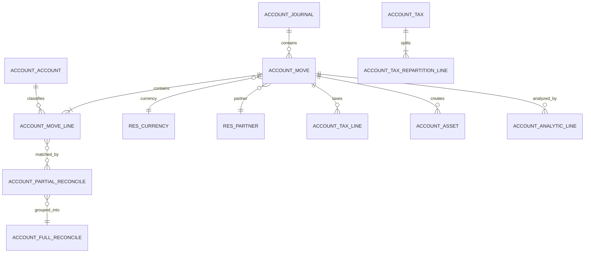
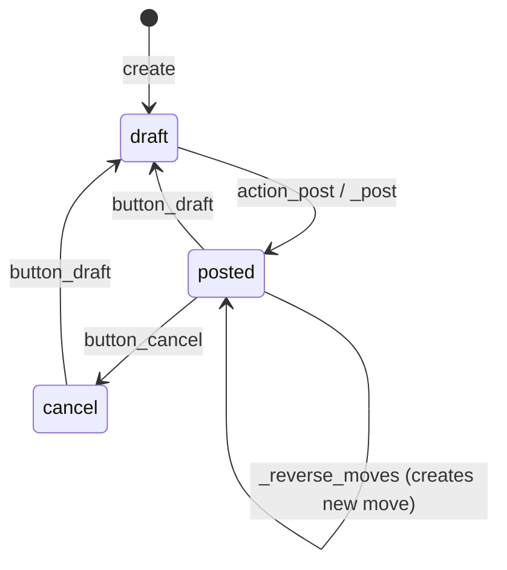
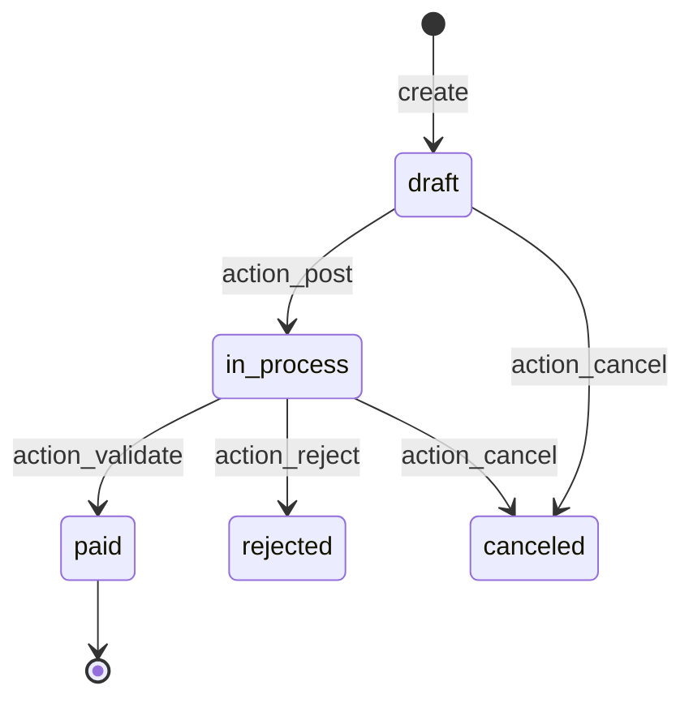

# Flow — Accounting (Invoice to Financial Statements)

> **Modules covered.** `account`, `account_asset`, `account_reports` (Enterprise), `account_accountant`, `account_edi_ubl_cii`, `account_3way_match`.
> **Version.** Odoo 19.0 Enterprise. The Odoo 19 tax engine is a **pure-function pipeline**; many pre-18 extension points are deprecated.

---

## 1. The accounting model



| Object | Meaning | Key invariant |
|---|---|---|
| `account.journal` | numbering/book container | one sequence per journal/period |
| `account.account` | chart-of-accounts node | `account_type` drives reports |
| `account.move` | journal entry / invoice / payment | balanced, posted immutability |
| `account.move.line` | debit/credit line | sum(debit) = sum(credit) per move |
| `account.partial.reconcile` | amount matched between two lines | residual updated atomically |
| `account.full.reconcile` | group of partials that closes lines | one per fully reconciled set |
| `account.tax` | tax definition | repartition lines must sum to 100% |
| `account.payment` | payment document | posts a move and reconciles |
| `account.asset` | depreciable asset | board schedule |

---

## 2. Move lifecycle



### 2.1 `_post(soft=True)` pipeline

1. permission check (`account.group_account_invoice` or sudo),
2. invoice-specific validations:
   - quick-edit total mismatch,
   - archived/invalid partner bank,
   - negative total (must be a credit note),
   - missing partner,
   - missing invoice date (defaults to today),
   - `stock_account` override creates COGS lines for real-time storable products **before** `super()._post()`,
3. `_check_balanced(container)` — **context manager** that validates debit=credit and triggers dynamic line sync,
4. `_sync_dynamic_lines(container)` — recomputes tax lines, payment terms, rounding,
5. `to_post.write({'state': 'posted', 'posted_before': True})`,
6. sequence assignment (`_set_next_sequence`) for unnumbered moves,
7. hash chain if `restrict_mode_hash_table`,
8. `_reconcile_marked()` for lines marked for reconciliation,
9. partner rank updates,
10. zero-total invoices trigger `_invoice_paid_hook`,
11. commit is handled by the request wrapper, not here.

Source: `account/models/account_move.py:5574-5805`.

### 2.2 Balanced check

`_check_balanced` is a context manager, not a boolean method. It wraps a block and raises `UserError` if the move is unbalanced after the block. `_sync_dynamic_lines` recomputes:

- tax lines from base lines,
- payment term lines (receivable/payable),
- rounding lines,
- cash-basis lines when applicable.

**[INVARIANT]** Never write `account.move.line` debit/credit directly without flushing and re-checking balance. Use `_prepare_*` helpers or `Command` on `line_ids` and let `_sync_dynamic_lines` recompute.

### 2.3 Posted immutability

Once posted:

- `name` is assigned and cannot change,
- `date` is restricted by lock dates,
- `line_ids` cannot be added/removed except through specific wizards,
- hashed moves cannot be modified at all,
- corrections require `button_draft` (if allowed), a reversal, or an adjusting entry.

`button_draft` checks `_check_draftable()` and lock dates. `button_cancel` is only allowed for moves that are not reconciled and not locked.

### 2.4 Reversal

`_reverse_moves(default_values_list, cancel=False)`:

- creates a new move with reversed debit/credit,
- links `reversed_entry_id`,
- optionally reconciles the reversal with the original (`move_reverse_cancel`),
- does **not** delete the original.

**[WARNING]** `cancel=True` on an invoice creates a credit note and reconciles it; it does not change the original to `cancel`. Use `button_cancel` only for draft/unreconciled entries.

---

## 3. Sequences and hash chain

### 3.1 Sequence allocation

`sequence.mixin._locked_increment`:

- determines the format from the last sequence in the journal/period,
- locks a unique index entry by updating a posted row,
- increments a transaction-local cache,
- on unique violation, rolls back to a savepoint and retries.

This produces gapless-ish numbering per journal and period. Gaps occur when a transaction allocates a number and later rolls back.

Source: `account/models/sequence_mixin.py:355-425`.

**[WARNING]** Posting thousands of invoices in one transaction holds the sequence lock for the transaction duration and serialises posting per journal. Batch in chunks and commit between chunks if your process allows it.

### 3.2 Hash chain

When `journal.restrict_mode_hash_table` is enabled:

- each posted move gets an `inalterable_hash` (`$version$hex`),
- the hash covers selected fields plus the previous hash in the chain,
- editing a hashed move is blocked,
- the chain can be verified with the integrity report.

Versions and covered fields are defined in `_get_integrity_hash_fields` (`account_move.py:4590`). The chain is per journal and sequence prefix. A missing or altered move breaks verification.

**[INVARIANT]** Hash chaining is an inalterability control, not a backup or a blockchain. It does not prevent deletion by a database administrator; it only makes tampering detectable.

---

## 4. Taxes

### 4.1 Tax definition

`account.tax`:

| Field | Meaning |
|---|---|
| `amount`, `amount_type` | percent/fixed/division |
| `price_include` | tax included in price |
| `include_base_amount` | subsequent taxes apply on base+tax |
| `tax_group_id` | report grouping |
| `repartition_line_ids` | base/tax splits by factor and account |
| `invoice_repartition_line_ids` / `refund_repartition_line_ids` | direction-specific |
| `tax_exigibility` | on invoice or on payment (cash basis) |
| `analytic` | analytic distribution |
| `l10n_*` | localization fields |

### 4.2 Odoo 19 tax pipeline [V19]

The engine is a set of pure functions on "base lines" dicts:

```
_prepare_product_base_line_for_taxes_computation(line)
  -> _add_tax_details_in_base_lines(base_lines, company)
  -> _round_base_lines_tax_details(base_lines, company, tax_lines=...)
  -> _aggregate_base_lines_tax_details(...)
  -> _aggregate_base_lines_aggregated_values(...)
```

Key methods:

| Method | Purpose |
|---|---|
| `_get_tax_details(price_unit, currency, quantity, product, partner, ...)` | compute tax details for a single base |
| `_add_tax_details_in_base_lines` | attach tax data to base lines |
| `_round_base_lines_tax_details` | round per tax/group, handle round-globally |
| `_aggregate_base_lines_tax_details` | group for tax lines |
| `compute_all` | legacy-compatible wrapper |

Source: `account/models/account_tax.py:1137`, `:4972`.

**[WARNING]** Odoo 19 deprecated several pre-18 helpers (`_compute_taxes`, `_prepare_invoice_aggregated_taxes`). If you override them, verify against the 19 source; they may be shims or removed. Prefer the pure-function pipeline.

### 4.3 Repartition lines

Each tax has repartition lines for base and tax:

- `factor_percent` — share of the tax (e.g. 50% deductible),
- `repartition_type` — `base` or `tax`,
- `account_id` — override account,
- `use_in_tax_closing` — carry to closing entry.

Sum of `factor_percent` for base lines must be 100; same for tax lines. A misconfigured tax produces unbalanced or misstated entries.

### 4.4 Price-included taxes

When `price_include=True`:

- the unit price includes tax,
- the base is back-computed: `base = price / (1 + rate)`,
- rounding can produce a 1-cent difference, absorbed by a rounding line,
- `round_globally` changes the rounding granularity.

### 4.5 Cash basis

`tax_exigibility='on_payment'`:

- tax is not recognised at invoice posting,
- a cash-basis move is created at reconciliation (`_create_tax_cash_basis_moves`),
- the cash-basis move reverses the tax line and posts the tax to the cash-basis account.

**[WARNING]** Cash basis requires the journal/account configuration to be correct; a missing cash-basis account silently posts to the default. Test with a payment and inspect the generated move.

### 4.6 Fiscal positions

`account.fiscal.position` maps:

- taxes (`tax_ids` / `tax_ids` inverse),
- accounts (`account_ids`),
- country/state rules,
- auto-apply based on partner.

It is applied when the invoice is created and can be re-applied (`action_update_fpos_values`). It does not change prices, only tax/account mapping.

---

## 5. Reconciliation

### 5.1 Partial and full reconciliation

- `account.partial.reconcile` links a debit line and a credit line with `amount` and `debit_amount_currency`/`credit_amount_currency`.
- `account.full.reconcile` groups partials that fully close a set of lines.
- `amount_residual` on a line = original amount - sum(partials).
- `matched_debit_ids` / `matched_credit_ids` are the relation.

### 5.2 `_reconcile_plan`

`account.move.line._reconcile_plan(plan)`:

1. `_optimize_reconciliation_plan` flattens and batches,
2. `_check_balanced` + `_sync_dynamic_lines` on the involved moves,
3. `_prepare_reconciliation_plan` computes partial amounts and exchange differences,
4. creates partials,
5. creates exchange difference moves,
6. creates cash-basis moves,
7. creates full reconciles,
8. triggers `_invoice_paid_hook` when invoices become paid.

Source: `account/models/account_move_line.py:2793-2950`.

### 5.3 Exchange differences

When a foreign-currency invoice is paid at a different rate:

- partials are created in both currencies,
- the residual difference is posted to the exchange gain/loss account,
- a new move is created and linked via `exchange_move_id`.

### 5.4 Payment matching

`account.payment.register` wizard:

1. computes the amount to pay per line,
2. handles write-offs and early payment discounts,
3. creates `account.payment` + journal entry,
4. reconciles the payment receivable/payable line with the invoice lines.

**[WARNING]** Payment registration uses the **residual** amount, not the invoice total. Partially paid invoices produce multiple partials. If the payment is in a different currency, the wizard computes the company-currency amount at the payment date.

---

## 6. Payments

`account.payment` state machine:



- `action_post` moves to `in_process` (or `paid` for cash accounts).
- `action_validate` marks paid (bank reconciliation usually does this).
- The journal entry is created and posted by `action_post`.
- Outstanding receipts/payments accounts are used until bank reconciliation.

---

## 7. Assets

`account.asset`:

| Field | Meaning |
|---|---|
| `state` | `draft`, `open`, `paused`, `close`, `cancelled` |
| `method` | `linear`, `degressive`, `linear-limit` |
| `method_number` / `method_period` | number of depreciations, period months |
| `prorata_date` | prorata temporis start |
| `original_value` | acquisition cost |
| `book_value` | net book value |
| `depreciation_move_ids` | generated entries |

`_create_depreciation_moves` generates a move per period. The depreciation board is recomputed when the asset value, method, or dates change.

**[WARNING]** Disposing an asset before the end of its life requires a disposal wizard that posts the gain/loss. Deleting depreciation moves manually leaves the board inconsistent.

---

## 8. Stock valuation accounting [V19]

See `03-inventory.md` §5.4. Key configuration:

- `product.category.property_stock_valuation_account_id` — inventory asset,
- `account.account.account_stock_variation_id` — variation/COGS counterpart,
- `account.account.account_stock_expense_id` — continental variation expense,
- `company.account_stock_journal_id` — valuation journal,
- `stock.location.valuation_account_id` — production/inventory/scrap/transit locations only.

| Event | v19 behaviour |
|---|---|
| Receipt | `stock.move.value` set; no per-move GL entry for normal supplier→stock |
| Vendor bill | Dr expense/configured input / Cr payable |
| Delivery | `stock.move.value` consumed (FIFO/AVCO); no COGS entry at delivery |
| Customer invoice | COGS lines created on `_post` (Dr expense / Cr stock valuation) |
| Stock closing | `res.company.action_close_stock_valuation()` reconciles ledger to `stock.move.value` |
| Landed cost | value adjustment; GL entry on validation |

**[INVARIANT]** The stock valuation account is reconciled by the closing process, not by every move. If `stock_value()` and `stock_accounting_value()` diverge, run the closing and investigate the difference before posting.

**[WARNING]** The pre-18 `property_stock_account_input_categ_id` / `output_categ_id` configuration no longer exists in this build. Do not port old account mappings blindly; use the v19 variation/expense accounts.

---

## 9. Lock dates

Company fields (`account/models/company.py:76-112`):

| Field | Blocks |
|---|---|
| `fiscalyear_lock_date` | posting/modifying entries before date (accountants) |
| `tax_lock_date` | tax reporting changes |
| `sale_lock_date` | sale journal entries |
| `purchase_lock_date` | purchase journal entries |
| `hard_lock_date` | everyone, including accountants (except sudo with exception group) |

Lock dates are enforced in Python, not PostgreSQL. A direct SQL update bypasses them.

---

## 10. Analytic accounting

- `account.analytic.account` — analytic plan/account tree.
- `account.analytic.line` — analytic journal item.
- `analytic.mixin` adds `analytic_distribution` (JSONB) to invoice lines.
- Distribution is a mapping `{account_id: percent}`; percentages must sum to 100.
- Analytic lines are created on posting for posted moves, and on stock/expense events for some modules.
- `account.analytic.plan` groups accounts; reports aggregate by plan.

**[WARNING]** Analytic distribution validation happens at invoice posting and stock validation. An incomplete distribution raises `UserError`; a distribution summing to >100 is rejected.

---

## 11. Reports and Enterprise `account_reports`

`account_reports` (Enterprise) is a **separate report engine**, not just views:

- report definitions are Python classes + XML data,
- expressions are evaluated against SQL queries/account codes,
- reports support drill-down, comparison, and export,
- tax reports use a generic SQL engine with tags,
- deferred reports (deferred revenue/expense) create adjusting entries.

Core `account` provides the ledger, trial balance, and general ledger views. Enterprise adds financial statements, tax reports, audit, and consolidation.

**[WARNING]** Custom report expressions are code-like and evaluated in the report engine. They are not covered by the standard ORM security model; restrict access to report designers.

---

## 12. Decision points and invariants

| Decision | Rule |
|---|---|
| Can post? | balance, partner, date, lock date, journal, sequence |
| Can draft? | not hashed, not locked, not reconciled |
| Can cancel? | draft or unreconciled posted |
| Tax inclusive? | `price_include` + back-computed base |
| Cash basis? | `tax_exigibility='on_payment'` |
| Round globally? | company `tax_calculation_rounding_method` |
| Exchange diff? | multi-currency residual at reconciliation |
| Asset? | product category `asset` flags + invoice line |

**[INVARIANT]** Every posted move must satisfy `sum(debit) == sum(credit)` in company currency. Foreign-currency lines also carry `amount_currency` and `currency_id`; the balance is always company currency.

---

## 13. Failure modes

| Symptom | Cause | Check |
|---|---|---|
| Cannot post "unbalanced" | missing tax/rounding line | `line_ids`, `_sync_dynamic_lines` |
| Duplicate sequence | concurrent posting / manual name | sequence lock, `name` uniqueness |
| Hash chain broken | edited/deleted hashed move | integrity report |
| Wrong tax | fiscal position, price_include, repartition | tax details |
| Payment won't reconcile | different partner/account/currency | residuals, account type |
| Exchange diff missing | same currency or no rate | `res.currency.rate` |
| Lock date error | date before lock | company lock dates |
| Asset not created | product category asset config | `account_asset` fields |
| COGS missing | valuation manual / no stock account | product category accounts |
| Report mismatch | wrong account types/tags | `account.account.account_type` |

---

## 14. Test scenarios

| Scenario | Assertion |
|---|---|
| Post customer invoice | balanced, sequence assigned, state posted |
| Post unbalanced | `UserError` from `_check_balanced` |
| Reverse invoice | new move, linked, balanced |
| Register partial payment | residual reduced, partial created |
| Full payment | full reconcile, invoice paid |
| Multi-currency payment | exchange diff move |
| Tax-included price | base + tax = total |
| Cash-basis tax | tax move on payment |
| Asset depreciation | board and moves match |
| Lock date | posting before date blocked |
| Hash chain | verification passes; edit blocked |

---

## 15. Evidence index

| Topic | File:line |
|---|---|
| Move model | `account/models/account_move.py:74` |
| `_post` | `account_move.py:5574` |
| `action_post` | `account_move.py:6164` |
| `_check_balanced` | `account_move.py:2780` |
| `_sync_dynamic_lines` | `account_move.py:3765` |
| `button_draft` / `button_cancel` | `account_move.py:6253`, `6368` |
| Hash fields | `account_move.py:4590-4630` |
| Sequence lock | `account/models/sequence_mixin.py:355` |
| Reconciliation | `account/models/account_move_line.py:2793` |
| Tax details | `account/models/account_tax.py:1137`, `4972` |
| Payment posting | `account/models/account_payment.py:1126` |
| Payment register | `account/wizard/account_payment_register.py:993` |
| Lock dates | `account/models/company.py:76-112` |
| Asset | `account_asset/models/account_asset.py` |

Continue with `05-manufacturing.md`.
