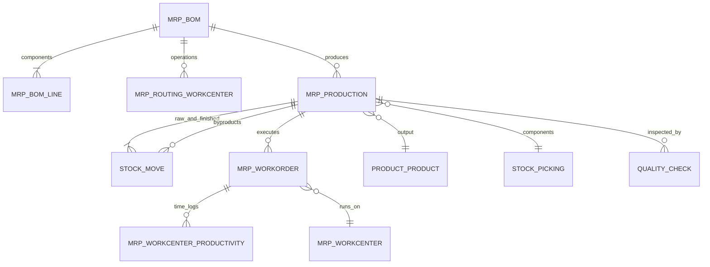
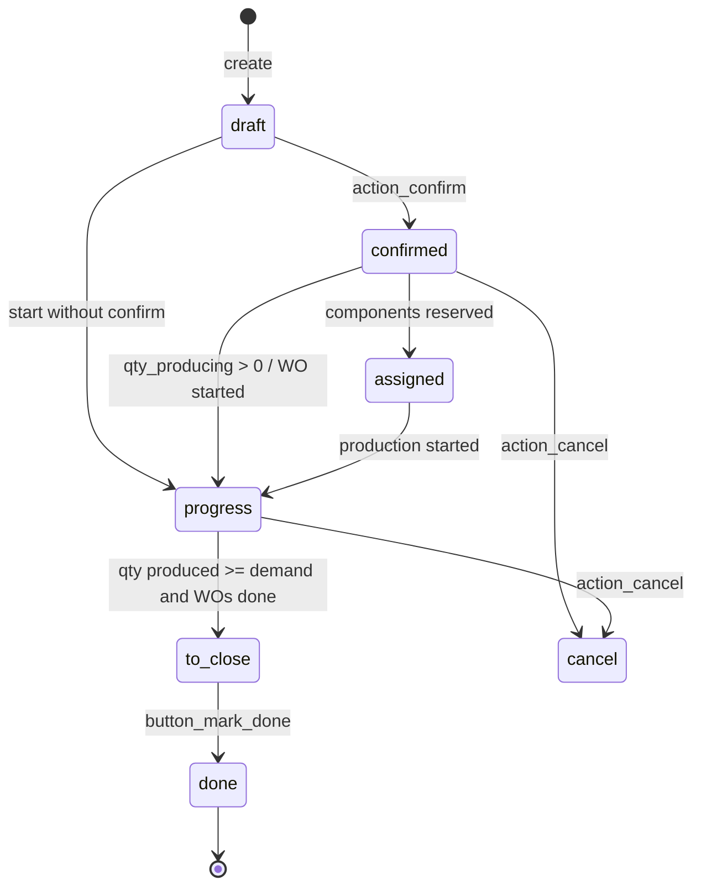
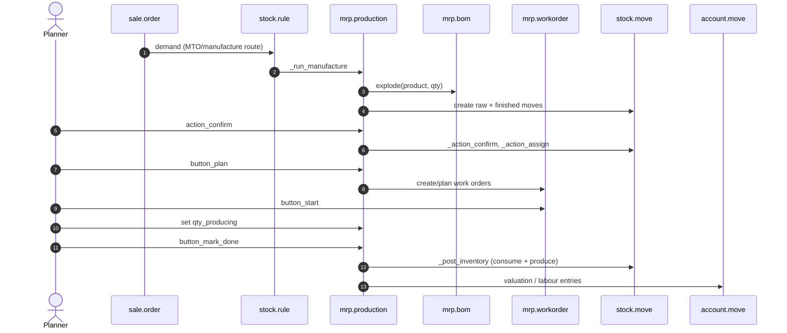

# Flow — Manufacturing (Plan to Produce)

> **Modules covered.** `mrp`, `mrp_account`, `mrp_subcontracting`, `mrp_workorder` (Enterprise), `quality`, `quality_mrp`, `stock_account`.
> **Version.** Odoo 19.0 Enterprise. MO state is **computed** from moves/work orders, not written directly.

---

## 1. Model map



| Model | Role |
|---|---|
| `mrp.bom` | recipe: output, quantity, components, operations, phantom flag |
| `mrp.bom.line` | component + quantity + UoM + attributes |
| `mrp.routing.workcenter` | operation: workcenter, duration, sequence |
| `mrp.production` | manufacturing order |
| `mrp.workorder` | operation execution instance |
| `mrp.workcenter` | capacity, calendar, cost |
| `mrp.workcenter.productivity` | time tracking (productive, downtime, performance) |
| `mrp.unbuild` | reverse manufacturing |
| `quality.check` | inspection point |

---

## 2. State machine

### 2.1 `mrp.production`



`state` is **computed** (`_compute_state`, `mrp_production.py:573`):

- `draft` — no moves or unsaved,
- `cancel` — all finished moves cancelled,
- `done` — all raw and finished moves done/cancelled,
- `to_close` — work orders done/cancelled, or no WOs and produced qty >= demand,
- `progress` — any WO in progress/done, qty producing > 0, or any raw move picked,
- otherwise `confirmed`.

**[WARNING]** Because state is computed, writing `state='done'` directly is wrong. Use `button_mark_done()` (which posts inventory) or `action_confirm()`.

### 2.2 `mrp.workorder`

`blocked → ready → progress → done`, plus `cancel`. Transitions:

| Method | Effect |
|---|---|
| `button_start` | sets `progress`, starts time tracking |
| `button_finish` | sets `done`, stops tracking, computes duration |
| `button_pending` | stops the current user's timer, logs productivity |
| `end_all` | closes all open productivity timers for the work order |

Work order readiness depends on component availability and predecessor operations (`blocked_by_workorder_ids`).

### 2.3 `mrp.workcenter.productivity`

Tracks `date_start`, `date_end`, `duration`, `loss_id` (loss reason), and the related effectiveness category (`productive`, `performance`, `quality`, `availability`), plus `user_id`. Used for cost and OEE-style analysis.

---

## 3. Bill of materials

### 3.1 BoM types

| Type | Behaviour |
|---|---|
| Normal | components + operations |
| Phantom (kit) | exploded into parent; no separate MO |
| Subcontracting | produced by a subcontractor; components shipped |
| Variant-specific | `product_tmpl_id` + `product_id` + attribute values |
| Alternative | `bom_ids` on product, selected by `sequence`/date |

### 3.2 Explosion algorithm [V19]

`mrp.bom.explode(product, quantity, picking_type, never_attribute_values)`:

1. start with the BoM's own lines,
2. for each line, if the component has a **phantom** BoM, replace the line with that BoM's lines (recursive, iterative BFS),
3. convert quantities using UoM factors,
4. **round up** leaf component quantities to the UoM rounding (`rounding_method='UP'`),
5. `_round_last_line_done` allows a final adjustment,
6. return `(boms_done, lines_done)` with parent references for traceability.

Source: `mrp/models/mrp_bom.py:419-474`.

**[INVARIANT]** Phantom BoMs never create their own MO; their components appear on the parent MO. A phantom with operations is handled specially: if the parent BoM has the same operations, they are not duplicated.

### 3.3 Component quantity

```
component_qty = (mo_qty / bom.product_qty) * bom_line.product_qty
```

then converted to the component's UoM. Rounding up at the leaf is intentional: you cannot consume a fraction of a unit if the UoM is discrete. This can over-consume compared to a pure mathematical explosion.

### 3.4 Byproducts and cost share

- `mrp.bom.byproduct_ids` define outputs with a `cost_share` percentage.
- The finished product's cost is reduced by the byproduct cost share.
- Byproducts with `cost_method` FIFO/AVCO get a `price_unit` derived from the total cost; standard-cost byproducts use their standard price.

Source: `mrp_account/models/mrp_production.py:57-94`.

---

## 4. End-to-end sequence



### 4.1 Creation paths

| Path | Method | Result |
|---|---|---|
| Manual | `mrp.production.create` | draft MO |
| Sale order | `stock.rule._run_manufacture` | confirmed MO linked to SO |
| Reordering rule | scheduler → manufacture route | confirmed MO |
| Subcontracting | `mrp_subcontracting` | MO at subcontractor location |
| Unbuild | `mrp.unbuild` | reverse MO |

### 4.2 Confirmation

`action_confirm()`:

1. `_check_company()`,
2. force product UoM to the product's UoM for serial-tracked outputs,
3. `move_raw_ids._adjust_procure_method()` — decide MTS/MTO per component,
4. `moves._action_confirm(merge=False)`,
5. `workorder_ids._action_confirm()`, set cost mode,
6. `move_raw_ids._trigger_scheduler()` — trigger reordering for missing components,
7. confirm component pickings,
8. set `state='confirmed'` only for draft MOs.

Source: `mrp/models/mrp_production.py:1625-1668`.

### 4.3 Reservation

`action_assign()` → `move_raw_ids._action_assign()`. Component availability is reflected in `reservation_state` (`confirmed`, `assigned`, `waiting`) and `components_availability_state`.

### 4.4 Planning

`button_plan()`:

- confirms draft MOs,
- `_plan_workorders()` schedules operations on workcenters using the workcenter calendar and capacity,
- respects `blocked_by_workorder_ids` dependencies,
- computes `date_planned_start`/`date_planned_finished`.

**[WARNING]** Planning is finite-capacity only at the workcenter level; it does not solve a global scheduling optimisation. For advanced APS, integrate an external scheduler.

### 4.5 Production

- `qty_producing` is the quantity being produced in the current operation.
- `_set_qty_producing()` scales component quantities to the produced quantity.
- Work order `button_start` starts time tracking; `button_finish` stops it.
- `_post_inventory()` consumes picked raw moves and produces finished moves.
- `button_mark_done()` wraps `_post_inventory`, splits backorders, closes work orders, and sets `is_locked`.

Source: `mrp/models/mrp_production.py:1402`, `:1907-1980`, `:2219-2290`.

### 4.6 Backorders and splits

`_split_productions()` creates backorder MOs for the unproduced quantity. Component consumption is allocated proportionally; `cancel_remaining_qty` cancels instead of splitting. The backorder keeps `production_group_id` and reference links.

---

## 5. Valuation and cost

### 5.1 Finished product cost

`mrp_account._cal_price(consumed_moves)`:

```
total_cost = sum(consumed move values)
           + workcenter cost (workorder._cal_cost())
           + extra_cost * quantity
finished_unit_cost = total_cost * (1 - byproduct_cost_share/100) / produced_qty
```

- For FIFO/AVCO finished products, `price_unit` is set from this total.
- For standard-cost products, `price_unit` is the product standard price.
- Workorder cost = duration × workcenter cost per hour (including employee cost if configured).

Source: `mrp_account/models/mrp_production.py:57-94`.

### 5.2 Labour posting

`_post_labour()` (Enterprise `mrp_account`):

- only for real-time valuation and a production location with a valuation account,
- groups workorder costs by expense account,
- posts Dr WIP/production / Cr labour expense,
- links the journal item to the productivity lines.

### 5.3 WIP

Work in progress is not a separate standard report in core. It is represented by:

- raw components consumed but not yet finished (value sits in production location),
- labour posted to WIP,
- finished goods not yet received.

Enterprise `mrp_account`/`account_reports` may provide WIP reports; verify your localization.

### 5.4 Scrap and byproducts

- Scrap creates an outgoing move to a scrap location, valued at cost.
- Byproducts create incoming moves with a cost share; the main product's cost is reduced accordingly.

---

## 6. Subcontracting

`mrp_subcontracting`:

1. A subcontracting BoM has a `subcontractor_id` and components.
2. A PO with a subcontracting product creates a receipt and a subcontracting MO at the subcontractor location.
3. Components are transferred to the subcontractor (internal transfer to a `subcontractor` location).
4. The subcontractor produces; the receipt of the finished product triggers MO completion.
5. Valuation includes component cost + subcontracting service cost.

State and ownership are delicate:

- the subcontractor location is `internal` with `subcontractor_id`,
- components remain owned by you until consumed,
- the MO is linked to the PO line and the receipt.

**[WARNING]** Subcontracting returns, scrap at the subcontractor, and component shortages are under-documented. Test the full cycle including a component return and a finished-product rejection.

---

## 7. Quality integration

`quality` / `quality_mrp`:

- `quality.point` defines triggers (operation, product, picking type) and a test type (pass/fail, measure, picture, instructions).
- Checks are created at confirmation, at workorder start/finish, or at receipt/delivery.
- A failed check can set `quality_state='fail'`, record a failure location, and (depending on the flow/module) block the operation; verify the `quality_mrp`/`quality_control` behaviour for your version.
- `quality.check` links to `mrp.production`, `mrp.workorder`, `stock.move.line`.

**[WARNING]** Quality checks are not a substitute for inventory quarantine. A failed check may record a failure location, but the goods remain physically present; use locations and scrap to isolate them.

---

## 8. Decision points

| Decision | Driver | Effect |
|---|---|---|
| Make or buy? | route, BoM existence | MO vs PO |
| Phantom? | BoM type | explode into parent |
| Workorders? | BoM operations | planning/time tracking |
| Reservation? | component availability | `assigned` vs `confirmed` |
| Backflush? | BoM `consumption` | consume reserved vs scanned |
| Split? | `qty_producing < product_qty` | backorder MO |
| Byproducts? | BoM byproducts | cost share |
| Subcontract? | BoM subcontractor | PO + MO |
| Quality gate? | quality points | block/allow |

### 8.1 Consumption modes

| Mode | Behaviour |
|---|---|
| `strict` | consume exactly the BoM quantity; warn/block on mismatch |
| `flexible` | allow more/less, log the difference |
| `warning` | allow but warn |

The mode is on `mrp.bom.consumption` and copied to the MO.

---

## 9. Failure modes

| Symptom | Cause | Check |
|---|---|---|
| MO stuck in `confirmed` | components unavailable | `reservation_state`, quants |
| Cannot mark done | raw moves not picked / qty mismatch | `move_raw_ids.picked`, `qty_producing` |
| Wrong finished cost | missing component value, workcenter cost, byproduct share | `_cal_price`, move values |
| MO `to_close` but not done | WOs not finished | `workorder_ids.state` |
| Phantom creates MO | BoM type wrong | `bom.type` |
| Over-consumption | rounding up / flexible mode | `consumption`, move lines |
| Backorder loop | qty_producing 0 / split logic | `_split_productions` |
| Subcontracting receipt blocked | component transfer not done | subcontractor location, moves |
| Quality check not created | trigger config | `quality.point` |

---

## 10. Extension points

| Hook | Use | Risk |
|---|---|---|
| `_compute_state` | custom state logic | high (computed) |
| `action_confirm` | pre/post confirmation | medium |
| `_post_inventory` | custom consumption | very high |
| `_cal_price` | custom costing | high |
| `_get_quantity_to_backorder` | split logic | medium |
| `button_mark_done` | orchestration | high |
| `explode` | custom BoM explosion | high |
| `_plan_workorders` | scheduling | high |

---

## 11. Test scenarios

| Scenario | Assertion |
|---|---|
| Simple MO | consume components, produce finished, value correct |
| Phantom BoM | no MO for kit, components on parent |
| Partial production | backorder MO created |
| Workorder flow | start/finish logs time, cost included |
| Byproduct | cost share applied |
| Subcontracting | component transfer + receipt + MO done |
| Quality fail | operation blocked |
| Unbuild | components returned, value reversed |
| Scrap | quant decreases, scrap entry |

---

## 12. Evidence index

| Topic | File:line |
|---|---|
| MO state compute | `mrp/models/mrp_production.py:573-620` |
| Confirm | `mrp_production.py:1625-1668` |
| Plan | `mrp_production.py:1708-1760` |
| Post inventory | `mrp_production.py:1907-1980` |
| Mark done | `mrp_production.py:2219-2290` |
| Split | `mrp_production.py:1981-2100` |
| BoM explode | `mrp/models/mrp_bom.py:419-474` |
| Cost | `mrp_account/models/mrp_production.py:57-94` |
| Labour | `mrp_account/models/mrp_production.py:101-130` |
| Workorder | `mrp/models/mrp_workorder.py:656-780` |
| Subcontracting | `mrp_subcontracting/models/mrp_production.py` |
| Quality | `quality/models/quality.py` (`quality.point`, `quality.check`) |

Continue with `06-cross-module.md` for the document graph.
