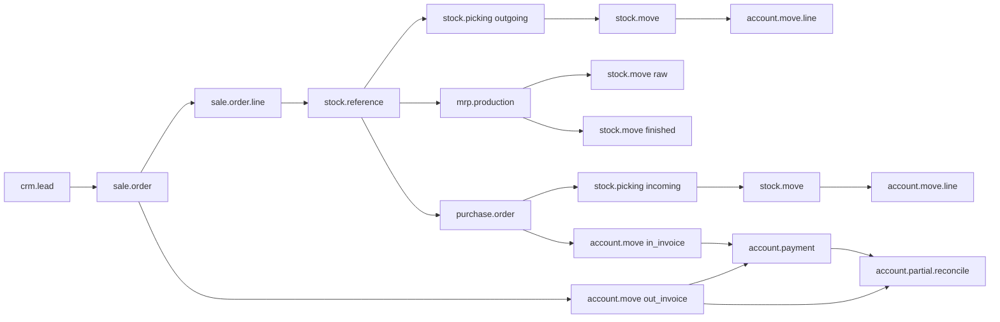
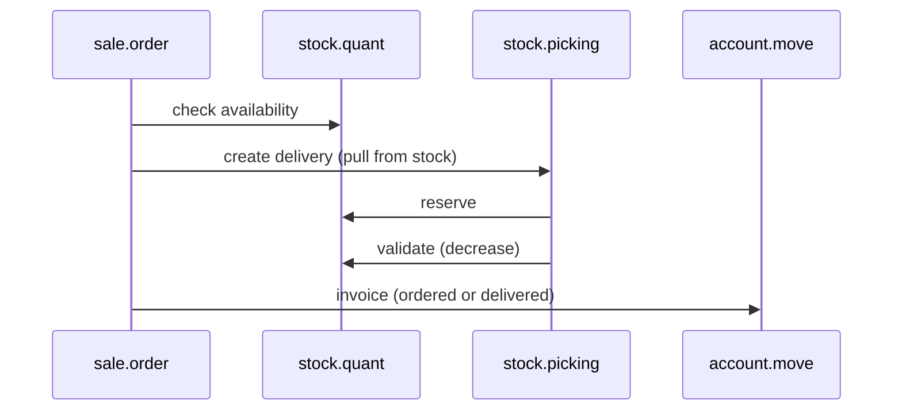
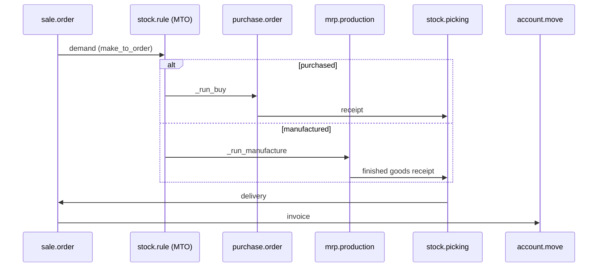
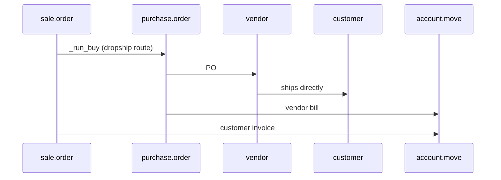
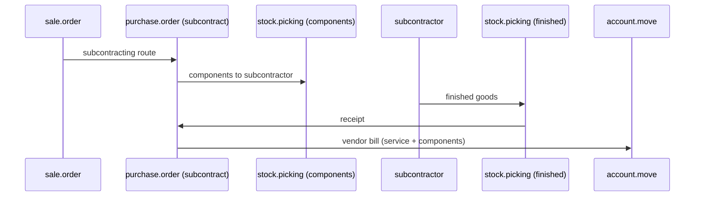

# Cross-Module Document Flow

> **Purpose.** No Odoo module is an island. This chapter maps how a commercial demand becomes procurement, manufacturing, logistics, and accounting documents, and where the coupling is loose or dangerous.

---

## 1. The document graph



Every arrow is a database relation, not an event:

| From | To | Field |
|---|---|---|
| SO line | stock move | `stock.move.sale_line_id` |
| SO | reference | `sale.order.stock_reference_ids` |
| Reference | moves | `stock.reference.move_ids` |
| MO | reference | `mrp.production.reference_ids` |
| PO line | stock move | `stock.move.purchase_line_id` |
| Move | valuation entry | `stock.move.account_move_id` |
| Stock move | invoice line | via SO/PO line links (`sale_order_line_invoice_rel`, `purchase_line_id`) |
| Invoice | payment | `account.partial.reconcile` |
| MO | SO line | via reference + `sale_line_id` on finished move |

---

## 2. Make-to-stock (MTS) flow



- No procurement document; the delivery pulls from existing stock.
- If stock is insufficient, the picking stays `confirmed` (or `partially_available`).
- Reordering rules replenish asynchronously; the SO does not wait for them unless you configure MTO.

## 3. Make-to-order (MTO) flow



- The SO line's route determines buy vs manufacture.
- `procure_method='make_to_order'` creates a chained move; the delivery waits for the receipt/MO.
- Lead times propagate through `date_planned`/`date_deadline`.

## 4. Dropship flow



- No internal quant; the moves go from supplier to customer.
- Valuation is often zero or pass-through depending on configuration.
- The customer delivery may have no picking if the vendor ships directly; traceability relies on the PO and SO references.

## 5. Subcontracting flow



## 6. Intercompany flow

`account_inter_company_rules` can automatically create:

- a sale order in company B when company A confirms a purchase order,
- a purchase order in company B when company A confirms a sale order,
- mirrored invoices/bills.

Key constraints:

- products must be shared or mapped,
- partners must be linked (`res.partner` with company),
- taxes/fiscal positions must exist in both companies,
- currency conversion uses the document date.

**[WARNING]** Intercompany automation doubles the document volume and can create loops if both companies have reciprocal rules. Test with a two-company database and explicit idempotency guards.

---

## 7. Project and service flows

`sale_project` and `sale_timesheet`:

- A confirmed SO creates a project and/or tasks.
- Timesheets are `account.analytic.line` records linked to `sale.order.line`.
- Invoicing policy `delivery` bills delivered timesheet quantity.
- Milestones can trigger invoicing (`sale_project` milestone billing).

Coupling points:

- `project.project` ← `sale.order.project_id`,
- `project.task` ← `sale.order.line.task_id`,
- `account.analytic.line` ← `so_line` + `project_id`,
- invoice creation uses `qty_delivered` from timesheets.

---

## 8. Subscription and rental flows

Enterprise `sale_subscription`:

- recurring plans generate invoices on a schedule,
- `sale.subscription` is a separate model (not `sale.order`),
- invoicing is driven by cron and `next_invoice_date`,
- proration, upsell, and churn are subscription-specific.

`rental`:

- SO lines become rental pickings and returns,
- pricing is per period, with late fees,
- stock availability considers the rental period.

**[WARNING]** Subscriptions and rentals are Enterprise-only. Do not assume their models exist in a Community deployment; guard imports with `depends` and feature checks.

---

## 9. POS flow

`point_of_sale`:

- POS orders are `pos.order`, not `sale.order`,
- payment is immediate; stock moves are created on validation,
- accounting entries are generated per session or per order depending on config,
- returns and refunds use `pos.order.line` negative quantities.

Integration with the rest of the ERP is via stock moves, account moves, and partner records. There is no SO.

---

## 10. Decision matrix: which document for which demand?

| Demand source | Document | Route | Stock effect | Accounting |
|---|---|---|---|---|
| Customer order, stock available | SO → delivery | MTS | out | invoice + COGS |
| Customer order, no stock, buy | SO → PO → receipt → delivery | MTO buy | in then out | bill + invoice |
| Customer order, no stock, make | SO → MO → receipt → delivery | MTO manufacture | consume + produce | MO valuation + invoice |
| Customer order, direct shipment | SO → PO → customer | dropship | none | bill + invoice |
| Replenishment | orderpoint → PO/MO | auto | in | bill / MO |
| Internal transfer | picking | internal | move | none (unless valuation) |
| Scrap | scrap | inventory | out | scrap expense |
| Inventory count | adjustment | inventory | delta | adjustment |

---

## 11. Coupling risks

| Risk | Mechanism | Mitigation |
|---|---|---|
| Override order depends on module load | MRO | declare `depends`, test module matrix |
| Circular procurement | MTO loops (A buys from B, B buys from A) | detect via route/rule audit |
| Double invoicing | `_create_invoices` called twice | guard on `qty_to_invoice`, idempotency key |
| Orphan documents | cancelled SO leaves draft PO/MO | propagate cancel (`propagate_cancel`) |
| Stock/invoice mismatch | delivered qty ≠ invoiced qty | reconciliation report |
| Intercompany loop | reciprocal rules | idempotency, company guards |
| Automation recursion | automation writes same model | narrow filters, `__action_done` |
| Currency drift | document dates differ | use document-date rates, reconcile FX |

---

## 12. Traceability queries

```sql
-- SO → pickings → moves
SELECT so.name, sp.name, sm.product_id, sm.product_uom_qty, sm.state
FROM sale_order so
JOIN stock_reference_sale_rel r ON r.sale_id = so.id
JOIN stock_reference_move_rel rm ON rm.reference_id = r.reference_id
JOIN stock_move sm ON sm.id = rm.move_id
JOIN stock_picking sp ON sp.id = sm.picking_id
WHERE so.id = %s;

-- SO → invoices → payments
SELECT so.name, am.name, am.state, am.amount_total, ap.name, ap.state
FROM sale_order so
JOIN sale_order_line sol ON sol.order_id = so.id
JOIN sale_order_line_invoice_rel rel ON rel.order_line_id = sol.id
JOIN account_move_line aml ON aml.id = rel.invoice_line_id
JOIN account_move am ON am.id = aml.move_id
LEFT JOIN account_partial_reconcile pr ON pr.debit_move_id = aml.id OR pr.credit_move_id = aml.id
LEFT JOIN account_move ap ON ap.id = pr.credit_move_id
WHERE so.id = %s;
```

---

## 13. Evidence index

| Topic | File |
|---|---|
| Sale procurement | `sale_stock/models/sale_order_line.py:280-430` |
| Stock rules | `stock/models/stock_rule.py:290-650` |
| MO creation | `mrp/models/mrp_production.py`, `stock_rule.py:_run_manufacture` |
| PO creation | `purchase_stock/models/stock_rule.py` |
| Dropship | `stock/models/stock_rule.py`, `purchase_stock` |
| Subcontracting | `mrp_subcontracting/models/` |
| Intercompany | `account_inter_company_rules/models/` |
| Project | `sale_project/models/`, `sale_timesheet/models/` |
| Subscription | `sale_subscription/models/` (Enterprise) |
| POS | `point_of_sale/models/` |

Continue with Volume 3: database design.
