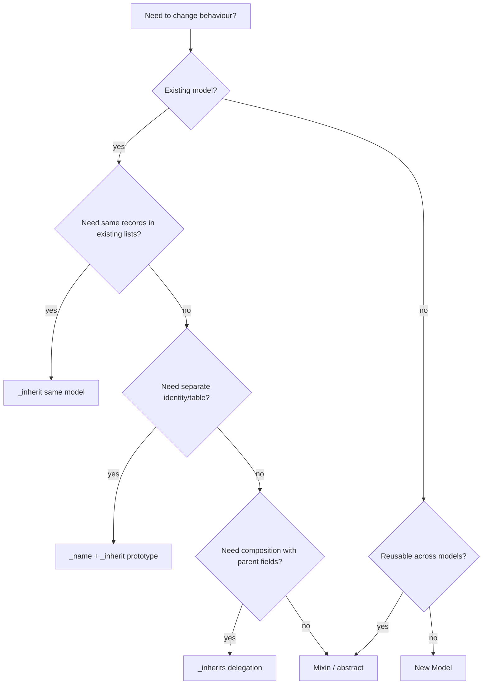

# Database Design II — Inheritance Strategies and Schema Effects

> **Core question.** Odoo has three inheritance mechanisms with three different database footprints. Choosing the wrong one is a structural decision that is expensive to reverse.

---

## 1. Comparison

| Mechanism | Declaration | Table | Columns | Polymorphism | Typical use |
|---|---|---|---|---|---|
| Extension | `_inherit = 'x'` (no `_name`) | same table | added | no | add fields/behaviour to existing model |
| Prototype | `_name = 'y'`, `_inherit = 'x'` | new table | all parent fields copied | no | specialised model sharing behaviour |
| Delegation | `_inherits = {'x': 'x_id'}` | new table | only FK + own fields | no | composition, 1:1 wrapper |
| Abstract mixin | `_name`, `_abstract = True` | none | none | n/a | reusable fields/methods |

There is **no joined-table inheritance** in the JPA/Hibernate sense. `_inherits` is composition, not a polymorphic subtype. Queries on the parent never return child rows.

---

## 2. Extension inheritance (`_inherit`)

### 2.1 Definition

```python
class ResPartner(models.Model):
    _inherit = 'res.partner'

    loyalty_tier = fields.Selection([('bronze', 'Bronze'), ('gold', 'Gold')])
```

### 2.2 Schema effect

```sql
ALTER TABLE res_partner ADD COLUMN loyalty_tier VARCHAR;
```

- No new table.
- Existing rows get the default (or NULL).
- A required field without a default fails on a non-empty table unless Odoo can compute it.
- Indexes/constraints are added to the existing table.

### 2.3 Class assembly

The registry builds a new class whose MRO includes the extension:

```
registry['res.partner']
  -> ResPartner (my_module)
  -> ResPartner (base)
  -> ...
  -> Model
```

Consequences:

- `super()` in `my_module` calls `base` and all modules between them.
- Field definitions merge; a redefinition replaces attributes but not the field identity.
- `_order`, `_rec_name`, `_check_company_auto` can be overridden by the last module in MRO.
- A module that does not depend on yours may still wrap your method if it loads later.

**[INVARIANT]** Every module that extends a model must declare the model's module in `depends`. Otherwise load order is undefined and `super()` may skip core behaviour.

### 2.4 Field redefinition

```python
# module A
name = fields.Char(required=True)

# module B (depends on A)
name = fields.Char(required=False, index=True)
```

The final field is the B definition, merged over A. Attributes not re-specified may keep A's values depending on the merge path (`_base_fields__`). This is subtle; avoid redefining core fields unless necessary.

---

## 3. Prototype inheritance (`_name` + `_inherit`)

### 3.1 Definition

```python
class MyInvoice(models.Model):
    _name = 'my.invoice'
    _inherit = 'account.move'
```

### 3.2 Schema effect

- Creates `my_invoice` with **all stored fields** of `account_move` (columns copied).
- Does **not** copy data.
- Does **not** create a FK to `account_move`.
- Methods are inherited through Python MRO; `super()` works.

### 3.3 When to use

- You need a separate table with mostly the same shape.
- You want independent numbering/security/lifecycle.
- You accept duplicated schema and no polymorphic queries.

### 3.4 When not to use

- You need the record to appear in the parent model's lists/reports — use `_inherit` instead.
- You need shared identity — use `_inherits`.
- You only need behaviour — use a mixin.

**[WARNING]** Prototype inheritance copies columns at module install time. Later changes to the parent schema are **not** propagated automatically. You must add the same field to the child or write a migration.

---

## 4. Delegation inheritance (`_inherits`)

### 4.1 Definition

```python
class IrCron(models.Model):
    _name = 'ir.cron'
    _inherits = {'ir.actions.server': 'ir_actions_server_id'}

    ir_actions_server_id = fields.Many2one(
        'ir.actions.server', required=True, ondelete='cascade', delegate=True)
```

### 4.2 Schema effect

```
ir_cron
├── id                    PK
├── ir_actions_server_id  FK → ir_act_server.id (required, cascade)
├── cron_name
├── interval_number
├── interval_type
├── nextcall
└── ...
```

Parent fields (`name`, `code`, `state`, `model_id`) are **not** columns in `ir_cron`; they are related fields resolved through the FK.

### 4.3 Behaviour

- `create()` creates the parent, then the child.
- `write()` splits values between parent and child.
- `read()` joins the parent.
- `unlink()` deletes the child and cascades to the parent (or restricts).
- Record rules on the parent apply to the child through `_compute_domain` (`parent_field any domain`).
- Field name collisions resolve to the **last** parent in `_inherits` order.

### 4.4 Requirements

The delegate field must be:

- `Many2one`,
- `required=True`,
- `ondelete='cascade'` or `'restrict'`,
- `delegate=True`.

Odoo raises `TypeError` at registry build if these are missing (`orm/model_classes.py:465-480`).

### 4.5 When to use

- A genuine 1:1 composition where the child is a specialisation of a shared action/document.
- You want the parent's fields and methods without duplicating columns.
- You accept the multi-table write cost and the rule complexity.

### 4.6 When not to use

- High-volume models: every read joins the parent.
- Models with divergent lifecycles.
- When you need independent security on parent/child; rules are tricky.
- When field names collide across parents.

---

## 5. Abstract mixins

```python
class MailThread(models.AbstractModel):
    _name = 'mail.thread'
    _description = 'Email Thread'
```

- No table, no columns.
- Fields are copied into each concrete model that inherits the mixin.
- Methods are mixed into the MRO.
- Ideal for cross-cutting behaviour (tracking, activities, portal, UTM).

**[WARNING]** Mixins with stored fields add columns to every adopting model. `mail.thread` adds `message_main_attachment_id`, `website_message_ids`, and others; `mail.activity.mixin` adds activity fields. Measure the schema impact before adopting a heavy mixin.

---

## 6. MRO and override order

### 6.1 Load order

Modules are loaded in phases by dependency depth (`modules/module_graph.py`). Within a phase, order is by `(depth, name)`. The registry class MRO is built from model definitions in **reverse load order** so that the last loaded module is first in the MRO.

Example with `sale`, `sale_stock`, `sale_mrp`:

```
registry['sale.order']
  -> SaleOrder (sale_mrp)     # loaded last
  -> SaleOrder (sale_stock)
  -> SaleOrder (sale)
  -> ... mixins ...
```

`super()._action_confirm()` from `sale_mrp` calls `sale_stock`, then `sale`.

### 6.2 Sibling modules

If `sale_stock` and `sale_project` both override `_action_confirm()` and neither depends on the other, their relative order is determined by load order (depth then name), not by business logic. This is a real source of non-determinism across installations with different module sets.

**[INVARIANT]** If your module's behaviour depends on another module's override running before/after, declare a dependency (even a soft one) or use explicit hooks.

### 6.3 `super()` pitfalls

| Pitfall | Consequence |
|---|---|
| Not calling `super()` | breaks other modules and core invariants |
| Calling `super()` twice | double side effects |
| Changing the signature | `TypeError` in downstream overrides |
| Using `super(MyClass, self)` | wrong MRO after registry rebuild |
| Assuming `self` is one record | `ensure_one` errors or silent partial processing |

---

## 7. Schema merge rules

| Element | Merge behaviour |
|---|---|
| Field name | single field object; attributes merged |
| `_order` | last definition wins |
| `_rec_name` | last non-empty wins |
| `_check_company_auto` | last definition wins |
| `_sql_constraints` | union (names must be unique) |
| `_table_objects` | union |
| `_inherits` | union of parents |
| `_parent_store` | must be consistent; changing it later requires migration |
| `_log_access` | fixed at first table creation; changing later is dangerous |
| `_table` | fixed; changing it creates a new table and leaves the old one |

**[WARNING]** Changing `_table`, `_log_access`, or `_parent_store` on an existing model is a schema migration, not a code change. Odoo will not move data.

---

## 8. Inheritance decision tree



---

## 9. Migration implications

| Change | Migration required |
|---|---|
| Add optional field | no (auto column) |
| Add required field | yes (default/backfill, then NOT NULL) |
| Rename field | yes (add new, copy, drop old) |
| Remove field | yes (drop or archive) |
| Change type | yes (cast, validate, may need USING) |
| Change `_table` | yes (create/copy/drop) |
| Change `_inherits` | yes (add FK, backfill, drop old columns) |
| Change `_parent_store` | yes (compute `parent_path`) |
| Change `_log_access` | yes (add/drop audit columns) |
| Add SQL constraint | yes (clean duplicates first) |

### 9.1 Safe rename pattern

```python
# 1. add new column in module A (optional, no constraint)
new_code = fields.Char(index=True)

# 2. migration: copy data
env.cr.execute("UPDATE my_table SET new_code = old_code WHERE new_code IS NULL")

# 3. migration: add constraint/index
env.cr.execute("CREATE UNIQUE INDEX ... ON my_table(new_code)")

# 4. later module: drop old column
env.cr.execute("ALTER TABLE my_table DROP COLUMN old_code")
```

Never rename in one step in production; run the copy in a maintenance window and validate.

---

## 10. Anti-patterns

| Anti-pattern | Problem |
|---|---|
| Prototype-inheriting a huge model for one field | duplicated schema, maintenance burden |
| `_inherits` on a high-volume table | every read joins the parent |
| `_inherit` without `depends` | undefined MRO |
| Overriding `create`/`write` without `super()` | breaks other modules |
| Re-declaring a core field to change one attribute | unexpected merge semantics |
| Changing `_table` on a live model | orphan table + data loss |
| Using `_inherits` for polymorphic queries | parent queries don't see children |
| Storing business data in a transient model | vacuumed after ~1 hour |

---

## 11. Evidence index

| Topic | File |
|---|---|
| Model class assembly | `orm/model_classes.py:1-140` |
| `_inherit` / `_inherits` attributes | `orm/models.py:400-460` |
| `_inherits` validation | `orm/model_classes.py:465-480` |
| Inherited field generation | `orm/model_classes.py:482-520` |
| Load phases | `modules/module_graph.py:26-160` |
| Field merge | `orm/fields.py:414-491` |
| `_table_query` | `orm/models.py:493` |
| Parent store | `orm/models.py:3070-3120` |

Continue with `03-er-model.md`.
