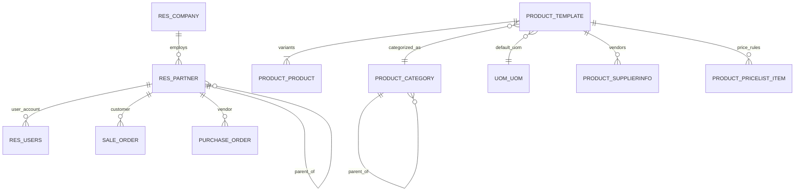
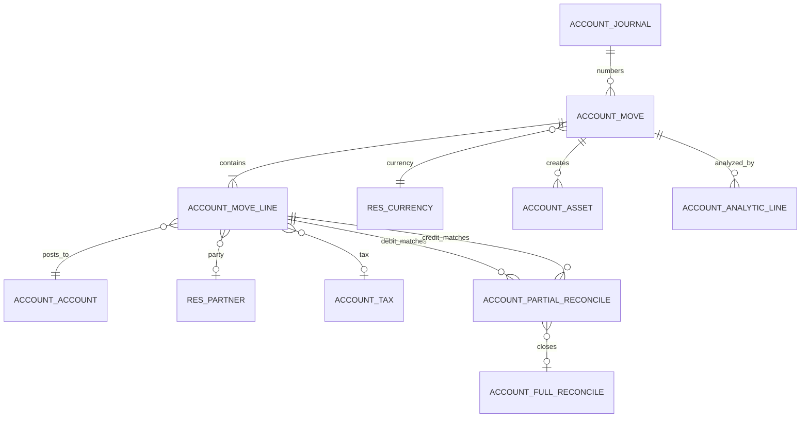
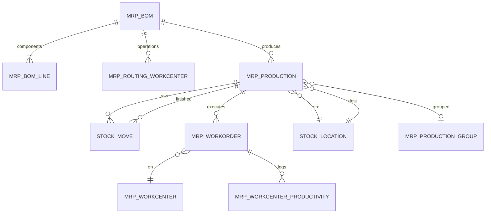

# Database Design III — Core Entity-Relationship Model

> **Scope.** The physical tables that matter for reporting, integration, and migration. This is not a full data dictionary (1,469 modules would need thousands of pages); it covers the core commercial, logistics, accounting, and manufacturing entities, plus the hidden fields developers trip over.

---

## 1. Party and product core



### 1.1 `res_partner`

| Column | Type | Notes |
|---|---|---|
| `id` | serial | PK |
| `name` | varchar (jsonb if translated? `name` index) | display name |
| `parent_id` | int FK self | company hierarchy |
| `parent_path` | varchar | materialised path (`/1/4/7/`) |
| `is_company` | bool | company vs contact |
| `type` | varchar | `contact`, `invoice`, `delivery`, `other` |
| `commercial_partner_id` | int FK self | computed root for business |
| `vat` | varchar indexed | tax id |
| `email`, `phone`, `street`, `city`, `zip`, `country_id` | | address |
| `lang`, `tz` | | locale |
| `active` | bool | archive flag |
| `customer_rank`, `supplier_rank` | int | usage counters |
| `company_id` | int FK | multi-company |
| `create_uid`, `create_date`, `write_uid`, `write_date` | | audit |

**Hidden semantics:**

- `commercial_partner_id` is the invoicing entity; a contact inherits it from the parent company. Reports should group by `commercial_partner_id`, not `id`.
- `parent_path` enables `child_of` without recursive CTEs.
- `customer_rank`/`supplier_rank` are incremented on invoice posting, not on SO/PO creation.

### 1.2 `product_template` / `product_product`

`product_product` uses `_inherits = {'product.template': 'product_tmpl_id'}`. Template fields are delegated, not duplicated.

| `product_template` column | Notes |
|---|---|
| `name` | `jsonb` translated |
| `type` | `consu`, `service`, `combo` [V19] |
| `is_storable` | boolean added by `stock`; distinguishes goods from consumables |
| `categ_id` | category (accounts, routes, costing) |
| `uom_id` | default UoM |
| `list_price`, `standard_price` | sale/cost |
| `sale_ok`, `purchase_ok` | |
| `tracking` | `none`, `lot`, `serial` (from stock) |
| `invoice_policy` | `order`, `delivery` (from sale) |
| `purchase_method` | `purchase`, `receive` (from purchase) |
| `volume`, `weight` | logistics |
| `active` | archive |

| `product_product` column | Notes |
|---|---|
| `product_tmpl_id` | FK, required, cascade |
| `default_code` | internal reference |
| `barcode` | unique-ish |
| `product_template_attribute_value_ids` | relation table for variant attributes |

**[V19]** `type='product'` no longer exists; storable goods are `type='consu'` + `is_storable=True`. Any custom code checking `type == 'product'` is dead. This is one of the most common upgrade bugs.

### 1.3 `uom_uom` [V19]

| Column | Notes |
|---|---|
| `relative_uom_id` | parent unit (tree) |
| `relative_factor` | multiplier to parent |
| `factor` | computed absolute factor to root |
| `rounding` | computed from `decimal.precision` ("Product Unit") |
| `category_id` | **removed** in v19 |

Conversion walks the tree to the root. There is no per-category rounding. Code that queries `category_id` or assumes a flat category must be rewritten.

---

## 2. Sales and procurement

```mermaid
erDiagram
    SALE_ORDER ||--|{ SALE_ORDER_LINE : contains
    SALE_ORDER }o--|| RES_PARTNER : customer
    SALE_ORDER }o--|| RES_CURRENCY : currency
    SALE_ORDER }o--|| CRM_TEAM : team
    SALE_ORDER ||--o{ STOCK_REFERENCE : groups
    STOCK_REFERENCE ||--o{ STOCK_MOVE : groups
    STOCK_REFERENCE ||--o{ STOCK_PICKING : groups
    STOCK_PICKING ||--|{ STOCK_MOVE : contains
    STOCK_MOVE ||--|{ STOCK_MOVE_LINE : executes
    STOCK_MOVE }o--|| PRODUCT_PRODUCT : product
    STOCK_MOVE }o--|| STOCK_LOCATION : from
    STOCK_MOVE }o--|| STOCK_LOCATION : to
    STOCK_MOVE_LINE }o--o| STOCK_LOT : lot
    STOCK_MOVE_LINE }o--o| STOCK_QUANT : updates
    SALE_ORDER_LINE ||--o{ STOCK_MOVE : fulfills
    SALE_ORDER ||--o{ ACCOUNT_MOVE : invoices
```

### 2.1 `sale_order`

| Column | Type | Notes |
|---|---|---|
| `name` | varchar | sequence, unique |
| `state` | varchar | `draft`/`sent`/`sale`/`cancel` |
| `locked` | bool | "done" replacement |
| `partner_id` | int FK | customer |
| `partner_invoice_id`, `partner_shipping_id` | int FK | addresses |
| `pricelist_id`, `currency_id` | int FK | pricing |
| `currency_rate` | float | rate at `date_order` |
| `date_order` | timestamp | confirmation date |
| `commitment_date` | timestamp | promised delivery |
| `picking_policy` | varchar | `direct`/`one` (from sale_stock) |
| `warehouse_id` | int FK | from sale_stock |
| `company_id` | int FK | |
| `team_id`, `user_id` | int FK | ownership |
| `amount_untaxed`, `amount_tax`, `amount_total` | numeric | stored computed |
| `invoice_status` | varchar | computed |
| `delivery_status` | varchar | computed (sale_stock) |
| `client_order_ref`, `origin`, `reference` | varchar | external refs |
| `note` | text/html | |
| `campaign_id`, `medium_id`, `source_id` | int FK | UTM |

**Hidden fields:**

- `technical_price_unit` on `sale.order.line`: pricelist-derived price used to detect manual overrides.
- `qty_invoiced_posted` vs `qty_invoiced`: posted vs all invoices.
- `invoice_ids` is a computed M2M, not a column; the relation is through invoice lines.
- `amount_to_invoice` is computed from untaxed amounts, not stored.
- `duplicated_order_ids` is computed for duplicate detection.

### 2.2 `stock_reference` [V19]

| Column | Notes |
|---|---|
| `id` | PK |
| `name` | reference (SO/PO/MO name) |

Relations:

- `stock_reference_move_rel(reference_id, move_id)`
- `stock.reference.picking_ids` is computed from moves.

This replaces `procurement.group` from earlier versions. Any module that queries `procurement_group_id` must be ported.

### 2.3 `stock_move`

| Column | Type | Notes |
|---|---|---|
| `product_id` | int FK | |
| `product_uom_qty` | numeric | demand |
| `product_qty` | numeric | demand in product UoM, stored compute/inverse |
| `quantity` | numeric | done quantity (v19) |
| `product_uom` | int FK | |
| `location_id`, `location_dest_id` | int FK | |
| `location_final_id` | int FK | final destination for multi-step |
| `picking_id` | int FK | |
| `state` | varchar | `draft`/`waiting`/`confirmed`/`partially_available`/`assigned`/`done`/`cancel` |
| `picked` | bool | validation gate |
| `procure_method` | varchar | `make_to_stock`/`make_to_order`/`mts_else_mto` |
| `rule_id` | int FK | rule that created it |
| `reference_ids` | M2M | document grouping |
| `origin`, `origin_returned_move_id` | | traceability |
| `sale_line_id`, `purchase_line_id`, `raw_material_production_id`, `production_id` | int FK | source links |
| `value` | numeric | v19 valuation |
| `account_move_id` | int FK | valuation entry |
| `is_inventory`, `scrap_id` | | adjustments/scrap |

**Hidden semantics:**

- `product_uom_qty` is demand; `quantity` is done. Never compare them directly without UoM conversion.
- `picked` must be true for a move line to be validated; a quantity alone is not enough.
- `product_qty` is stored for reporting but is a computed inverse of demand.
- `state` is computed for pickings but written for moves.

### 2.4 `stock_move_line`

| Column | Notes |
|---|---|
| `move_id`, `picking_id` | parents |
| `product_id`, `product_uom_id` | |
| `quantity` | done quantity in move UoM |
| `quantity_product_uom` | done quantity in product UoM |
| `lot_id`, `lot_name` | lot/serial |
| `package_id`, `result_package_id` | packages |
| `owner_id` | consignment |
| `location_id`, `location_dest_id` | actual locations |
| `picked` | validation gate |
| `date` | effective date |
| `consume_line_ids` / `produce_line_ids` | MO traceability |

### 2.5 `stock_quant`

| Column | Notes |
|---|---|
| `product_id`, `location_id` | key |
| `lot_id`, `package_id`, `owner_id` | dimensions |
| `quantity` | on hand |
| `reserved_quantity` | reserved |
| `available_quantity` | computed |
| `in_date` | FIFO/LIFO date |
| `inventory_quantity`, `inventory_diff_quantity` | adjustment UI |
| `company_id` | |

Quant uniqueness is **not** enforced by a database constraint in this build. `_update_available_quantity` gathers matching quants and locks one row; concurrent inserts can create duplicates, which `_quant_tasks()._merge_quants()` cleans periodically. Do not assume a unique index exists.

---

## 3. Accounting



### 3.1 `account_move`

| Column | Notes |
|---|---|
| `name` | sequence, `/` until posted |
| `state` | `draft`/`posted`/`cancel` |
| `move_type` | `entry`, `out_invoice`, `out_refund`, `in_invoice`, `in_refund`, `out_receipt`, `in_receipt` |
| `journal_id` | FK |
| `date` | accounting date |
| `invoice_date`, `invoice_date_due` | invoice dates |
| `partner_id`, `commercial_partner_id` | |
| `currency_id`, `company_currency_id` | |
| `invoice_currency_rate` | rate at invoice date |
| `amount_untaxed`, `amount_tax`, `amount_total` | stored |
| `amount_residual` | remaining |
| `payment_state` | `not_paid`/`partial`/`paid`/`in_payment`/`blocked` |
| `inalterable_hash`, `secure_sequence_number` | hash chain |
| `restrict_mode_hash_table` | related journal flag |
| `posted_before` | re-post tracking |
| `auto_post` | future auto-post |
| `reversed_entry_id`, `reversal_move_ids` | reversal chain |
| `tax_cash_basis_rec_id` | cash basis origin |
| `statement_line_id` | bank statement origin |

**Hidden fields:**

- `line_ids` includes **all** lines: product, tax, payment terms, rounding, sections. `invoice_line_ids` is only the product/display subset.
- `amount_total_signed` is in company currency; `amount_total` is in document currency.
- `name` is `/` until posting; reports must filter `state='posted'`.
- `sequence_prefix` / `sequence_number` are stored for gap detection.
- `made_sequence_gap` flags the first gap.

### 3.2 `account_move_line`

| Column | Notes |
|---|---|
| `move_id`, `journal_id` | parents |
| `account_id` | FK, required |
| `debit`, `credit`, `balance` | company currency |
| `amount_currency`, `currency_id` | document currency |
| `partner_id` | party |
| `display_type` | `product`/`cogs`/`tax`/`discount`/`rounding`/`payment_term`/section/note |
| `tax_line_id` | tax line marker |
| `tax_repartition_line_id` | repartition |
| `tax_ids` | base line taxes (M2M) |
| `tax_base_amount` | |
| `amount_residual`, `amount_residual_currency` | reconciliation |
| `reconciled` | computed |
| `full_reconcile_id` | |
| `matching_number` | grouping |
| `sale_line_ids`, `purchase_line_id` | source links |
| `sale_line_ids` | M2M to `sale.order.line` (`sale_order_line_invoice_rel`) |
| `analytic_distribution` | JSONB |

**Sign convention:** `balance = debit - credit`. Receivable is a debit; payable is a credit. Reports that sum `balance` must invert liabilities for display.

### 3.3 Reconciliation tables

| Table | Columns |
|---|---|
| `account_partial_reconcile` | `debit_move_id`, `credit_move_id`, `amount`, `debit_amount_currency`, `credit_amount_currency`, `exchange_move_id`, `max_date` |
| `account_full_reconcile` | `name`, `exchange_move_id` |

A line is fully reconciled when `amount_residual = 0` and `full_reconcile_id` is set. Partial reconciliation updates residuals without closing the line.

### 3.4 Taxes

| Table | Purpose |
|---|---|
| `account_tax` | tax definition |
| `account_tax_repartition_line` | base/tax split, factor, account, tags |
| `account_tax_group` | report grouping |
| `account_tax_tag` | report tags |
| `account_fiscal_position` | mapping header |
| `account_fiscal_position_tax` | tax mapping |
| `account_fiscal_position_account` | account mapping |

---

## 4. Manufacturing



### 4.1 `mrp_production`

| Column | Notes |
|---|---|
| `name` | sequence |
| `state` | computed: `draft`/`confirmed`/`progress`/`to_close`/`done`/`cancel` |
| `product_id`, `product_qty`, `product_uom_id` | output |
| `bom_id` | recipe |
| `qty_producing` | current batch quantity |
| `qty_produced` | computed |
| `location_src_id`, `location_dest_id`, `location_final_id` | |
| `date_start`, `date_finished`, `date_deadline` | |
| `reservation_state` | `confirmed`/`assigned`/`waiting` |
| `consumption` | `strict`/`flexible`/`warning` |
| `is_locked`, `is_planned` | |
| `production_group_id` | backorder grouping |
| `reference_ids` | document grouping |
| `extra_cost` | additional cost per unit |
| `lot_producing_ids` | output lots |

### 4.2 `mrp_workorder`

| Column | Notes |
|---|---|
| `production_id`, `operation_id`, `workcenter_id` | |
| `state` | `pending`/`ready`/`progress`/`done`/`cancel` |
| `qty_production`, `qty_producing`, `qty_produced` | |
| `date_start`, `date_finished`, `duration_expected`, `duration` | |
| `blocked_by_workorder_ids` | dependencies |
| `costs_hour` | snapshot of workcenter cost |

### 4.3 `mrp_workcenter_productivity`

| Column | Notes |
|---|---|
| `workorder_id`, `workcenter_id`, `user_id` | |
| `date_start`, `date_end`, `duration` | minutes |
| `loss_id` | productive/performance/downtime |
| `account_move_line_id` | labour posting link |

---

## 5. Cross-cutting system tables

| Table | Purpose | Keys |
|---|---|---|
| `ir_model_data` | XML IDs | (`module`, `name`) unique |
| `ir_attachment` | files | `res_model`, `res_id`, `checksum` |
| `ir_cron` | scheduled jobs | `ir_actions_server_id` delegate |
| `ir_logging` | server logs (if enabled) | `create_date` |
| `mail_message` | messages | `model`, `res_id` |
| `mail_followers` | subscriptions | `res_model`, `res_id`, `partner_id` |
| `mail_activity` | activities | `res_model`, `res_id` |
| `bus_bus` | transient notifications | `channel`, `create_date` |
| `ir_config_parameter` | key/value config | `key` unique |
| `ir_sequence` | document numbering | `code` |
| `res_groups` / `res_users` | security | M2M relations |
| `ir_rule` / `ir_model_access` | row/model security | |

---

## 6. Hidden and legacy columns

| Table | Column | Why it is hidden |
|---|---|---|
| `sale_order_line` | `technical_price_unit` | pricelist baseline for manual price detection |
| `sale_order_line` | `qty_invoiced_posted` | posted-only quantity, not shown in UI |
| `sale_order` | `currency_rate` | historical rate snapshot |
| `stock_move` | `product_qty` | stored compute in product UoM |
| `stock_move` | `picking_type_id` | stored compute for reporting |
| `stock_move_line` | `quantity_product_uom` | converted quantity |
| `stock_quant` | `in_date` | FIFO/LIFO ordering |
| `account_move` | `secure_sequence_number` | hash chain index |
| `account_move` | `made_sequence_gap` | first gap marker |
| `account_move_line` | `matching_number` | reconciliation grouping |
| `account_move_line` | `parent_state` | stored related for fast filtering |
| `mrp_production` | `product_uom_qty` | computed total quantity |
| `mrp_production` | `qty_produced` | computed from moves |
| `product_template` | `is_storable` | v19 stock flag |
| `product_product` | `product_tmpl_id` | delegation FK |
| `res_partner` | `parent_path` | materialised hierarchy |
| `res_partner` | `commercial_partner_id` | invoicing root |

### 6.1 Removed/renamed in v19

| Old | New | Impact |
|---|---|---|
| `procurement.group` | `stock.reference` | queries/overrides break |
| `stock.valuation.layer` | `stock.move.value` / `product.value` | valuation reports break |
| `product.type='product'` | `type='consu'` + `is_storable` | stock filters break |
| `uom.category` / `uom_id.category_id` | tree `relative_uom_id` | conversions break |
| `sale.order.state='done'` | `locked` boolean | state checks break |
| `purchase.order.state='done'` | no done state | state checks break |

**[WARNING]** These are not cosmetic. Any custom SQL, report, or integration that references the old columns will fail silently or return wrong data after migration.

---

## 7. Reporting join patterns

### 7.1 Sales margin

```sql
SELECT so.name, pt.name->>'en_US' AS product,
       sol.product_uom_qty, sol.qty_delivered,
       sol.price_subtotal, sol.price_unit,
       pp.standard_price * sol.qty_delivered AS cost,
       sol.price_subtotal - pp.standard_price * sol.qty_delivered AS margin
FROM sale_order_line sol
JOIN sale_order so ON so.id = sol.order_id
JOIN product_product pp ON pp.id = sol.product_id
JOIN product_template pt ON pt.id = pp.product_tmpl_id
WHERE so.state = 'sale';
```

### 7.2 Stock on hand by location

```sql
SELECT pp.default_code, pt.name->>'en_US', sl.complete_name,
       SUM(sq.quantity) AS qty, SUM(sq.reserved_quantity) AS reserved
FROM stock_quant sq
JOIN product_product pp ON pp.id = sq.product_id
JOIN product_template pt ON pt.id = pp.product_tmpl_id
JOIN stock_location sl ON sl.id = sq.location_id
WHERE sl.usage = 'internal'
GROUP BY pp.default_code, pt.name, sl.complete_name;
```

### 7.3 Trial balance

```sql
SELECT aa.code, aa.name->>'en_US', SUM(aml.debit) AS debit, SUM(aml.credit) AS credit,
       SUM(aml.balance) AS balance
FROM account_move_line aml
JOIN account_move am ON am.id = aml.move_id
JOIN account_account aa ON aa.id = aml.account_id
WHERE am.state = 'posted' AND am.date <= %s
GROUP BY aa.code, aa.name
ORDER BY aa.code;
```

---

## 8. Evidence index

| Topic | File |
|---|---|
| Partner fields | `addons/base/models/res_partner.py:148-306` |
| Product fields | `addons/product/models/product_template.py:44-173` |
| Product delegation | `addons/product/models/product_product.py:19-42` |
| UoM tree | `addons/uom/models/uom_uom.py:18-100` |
| Sale fields | `addons/sale/models/sale_order.py:54-326` |
| Sale line fields | `addons/sale/models/sale_order_line.py:34-309` |
| Stock reference | `addons/stock/models/stock_reference.py` |
| Stock move fields | `addons/stock/models/stock_move.py:24-184` |
| Stock move line | `addons/stock/models/stock_move_line.py:21-95` |
| Quant fields | `addons/stock/models/stock_quant.py:20-115` |
| Account move | `addons/account/models/account_move.py:109-589` |
| Account move line | `addons/account/models/account_move_line.py:32-321` |
| MO fields | `addons/mrp/models/mrp_production.py:80-273` |

Continue with `04-indexes-performance.md`.
