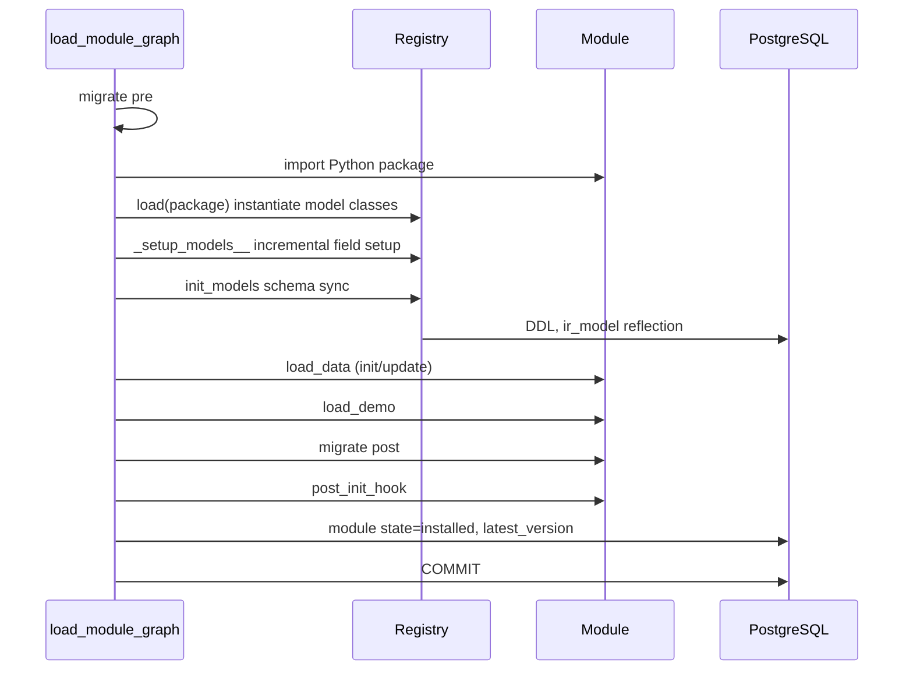
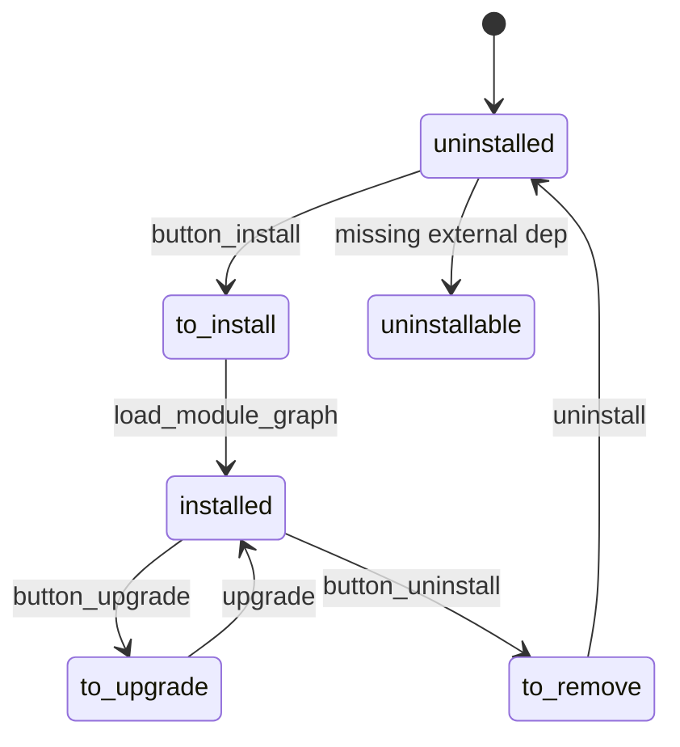

# Module Relationships I — Manifest, Loading, and Dependency Semantics

> **Version.** Odoo 19.0 Enterprise, 1,469 modules (656 Community + 813 Enterprise). Statistics in this chapter come from a static analysis of every `__manifest__.py` in this tree.

---

## 1. Manifest schema

A module is a Python package with `__manifest__.py` returning a dict. The manifest is parsed into `odoo.modules.module.Manifest` with defaults and normalisation.

### 1.1 Key reference

| Key | Type | Effect | Gotcha |
|---|---|---|---|
| `name` | str | human name | required by convention, not enforced |
| `version` | str | module version (`19.0.1.0.0`) | drives migration script selection |
| `license` | str | `LGPL-3`, `OEEL-1`, `OPL-1` | metadata only; not enforced |
| `author`, `website`, `summary`, `description` | str | metadata | |
| `category` | str | Apps menu grouping | free text |
| `depends` | list[str] | hard dependencies | determines load order |
| `data` | list[str] | XML/CSV loaded on install and update | order matters; forward refs fail |
| `demo` | list[str] | demo data | only if `with_demo` |
| `auto_install` | bool or list[str] | install automatically when dependencies are installed | list must be subset of `depends` |
| `application` | bool | show as an app, not a module | UI only |
| `installable` | bool | can be installed | `False` for test/iot images |
| `external_dependencies` | dict | Python/binaries required | checked on install/upgrade only |
| `assets` | dict | asset bundles | keys are bundle names |
| `pre_init_hook`, `post_init_hook`, `uninstall_hook` | str | lifecycle hooks | idempotency required |
| `countries` | list[str] | localization applicability | used by auto-install logic |
| `sequence` | int | ordering in Apps | |
| `price`, `currency`, `support`, `live_test_url` | | app-store metadata | not used by the server |
| `bootstrap`, `configurator_snippets`, `new_page_templates` | | website/theme metadata | module-specific |

### 1.2 Legacy/ignored keys

| Key | Status |
|---|---|
| `demo_xml`, `update_xml`, `init_xml` | legacy, ignored |
| `test` | legacy, ignored |
| `web` | legacy, ignored |
| `js`, `css` | legacy, ignored (use `assets`) |
| `active` | not a manifest key |

### 1.3 `auto_install` semantics

Three forms:

```python
'auto_install': False            # never automatic
'auto_install': True             # automatic when all depends are installed
'auto_install': ['sale', 'stock'] # automatic when these specific deps are installed
```

Rules (`addons/base/models/ir_module.py:407-434`):

- `True` is normalised to the set of `depends`.
- A list must be a subset of `depends`, else the manifest asserts.
- The module installs when all `auto_install_required` dependencies are installed/to install/to upgrade **and at least one is to install**.
- Country-specific modules also require a company country match.
- `--skip-auto-install` disables the closure.

**[WARNING]** Auto-install chains are why installing `account` in an Enterprise database can pull dozens of modules (`account_accountant`, `account_reports`, `account_asset`, `account_edi_ubl_cii`, ...). Always check the closure before estimating an install.

### 1.4 External dependencies

```python
'external_dependencies': {
    'python': ['zeep', 'phonenumbers'],
    'bin': ['wkhtmltopdf'],
    'apt': {'zeep': 'python3-zeep'},   # hint only
}
```

- Checked by `ir.module.module.check_external_dependencies()` on install/upgrade.
- Not checked at server startup.
- Not installed automatically.
- A missing dependency blocks installation with a user-facing message.
- `apt` is a Debian/Ubuntu hint; it is not executed.

In this tree, 14 modules declare external dependencies; only `zeep` is importable in the analysis environment.

---

## 2. Loading pipeline

### 2.1 Graph construction

`ModuleGraph` (`modules/module_graph.py`) builds a DAG from `depends`:

- **load mode** (normal startup): `base` in phase 0, all other installed modules in phase 1, sorted by `(depth, name)`.
- **update mode** (install/upgrade): phases alternate between modules that need schema init and those that do not, so dependencies always load before dependents.
- Test modules (`test_*`) are ordered immediately after their last dependency.

Depth = longest path to `base`. In this tree: max depth 18 (`industry_fsm_repair`), average 10.47.

### 2.2 Per-module steps



Important ordering facts:

- `pre_init_hook` runs **before** model loading.
- `post_init_hook` runs **after** data load, demo, post-migration, translations, but **before** `state='installed'` is written.
- `uninstall_hook` runs during uninstall, before data deletion.
- `post_load` is not a supported manifest key in this build (0 occurrences).

### 2.3 Transaction boundaries

- Each module's install/upgrade commits at the end (`modules/loading.py:270`).
- A failure rolls back that module's transaction but leaves previously committed modules installed.
- `-u all` is therefore a sequence of per-module transactions, not one atomic upgrade.

**[WARNING]** A failed upgrade can leave a database in a mixed state (some modules upgraded, others not). Always run upgrades on a copy and restore on failure; do not "fix forward" on production without a backup.

---

## 3. Dependency semantics

### 3.1 Manifest vs Python imports

| Dependency type | Declared in | Effect |
|---|---|---|
| Hard module | `depends` | load order, install, data availability |
| Python import | `import` statement | runtime failure if module absent |
| XML ID reference | `ref="module.xmlid"` | data load failure if module absent |
| DB FK | `_inherits`, `Many2one` | schema dependency |
| Soft/optional | `if env['x']` / `hasattr` | runtime fallback |
| Auto-install | `auto_install` | implicit install closure |

**[INVARIANT]** Every module whose models, XML IDs, views, or Python symbols you reference must be in `depends`. A Python `try/except ImportError` is not a substitute for a dependency; it hides configuration errors.

### 3.2 Data XML IDs

- `ref="sale.action_quotations"` requires `sale` installed.
- `env.ref('sale.action_quotations')` raises if missing (unless `raise_if_not_found=False`).
- Data files load in manifest order; a reference to a record defined later in the same module fails.
- `noupdate` affects updates, not load order.

### 3.3 Database foreign keys

- `Many2one` to a model in another module creates a FK only if that model has a table.
- `_inherits` requires the parent model to exist at registry build.
- Uninstalling a module with dependent FKs is blocked unless `ondelete` allows it.

### 3.4 Circular dependencies

There are **0 dependency cycles** in this tree (Kahn/Tarjan over 3,234 edges). The graph is a DAG by construction and by policy.

Can a cycle exist? Technically a manifest cycle would make the graph unresolvable; Odoo's loading would fail or loop. In practice:

- Python-level circular imports are common and legal because model registration is deferred.
- Data-level circular references are resolved by loading one side first and updating later.
- Module-level cycles are forbidden; break them with a third module or a soft dependency.

### 3.5 Community vs Enterprise

- 656 Community modules, 813 Enterprise modules.
- Enterprise licenses: 762 `OEEL-1`, 47 `LGPL-3` bridge/test, 4 `OPL-1`.
- **0 Community modules depend directly on Enterprise modules** in this tree.
- Enterprise modules may depend on Community modules (normal).
- There is no enterprise-only manifest key; the distinction is repository + license.

**[WARNING]** A custom module that depends on an Enterprise module cannot be installed in a Community database. Declare the dependency explicitly so installation fails cleanly, rather than crashing at import time.

---

## 4. Dependency statistics (this tree)

| Metric | Value |
|---|---|
| Modules | 1,469 |
| Installable | 1,467 |
| Dependency edges | 3,234 |
| Cycles | 0 |
| Missing manifest deps | 0 |
| Missing data/demo files | 0 |
| `auto_install` truthy | 1,006 (735 `True`, 271 list) |
| Modules with `external_dependencies` | 14 |
| Application modules | 78 |
| Max depth | 18 (`industry_fsm_repair`) |
| Average depth | 10.47 |

### 4.1 Top fan-in

| Module | Dependents | License |
|---|---|---|
| `account` | 165 | LGPL-3 |
| `account_reports` | 119 | OEEL-1 |
| `mail` | 77 | LGPL-3 |
| `point_of_sale` | 68 | LGPL-3 |
| `account_edi_ubl_cii` | 48 | LGPL-3 |
| `base` | 47 | LGPL-3 |
| `web` | 47 | LGPL-3 |
| `base_vat` | 46 | LGPL-3 |
| `hr_payroll` | 35 | OEEL-1 |
| `website` | 34 | LGPL-3 |
| `sale` | 33 | LGPL-3 |
| `stock` | 16 | LGPL-3 |
| `purchase` | 16 | LGPL-3 |
| `mrp` | 17 | LGPL-3 |

High fan-in means high blast radius. A change to `account` or `account_reports` affects hundreds of modules; test the full closure, not just the immediate module.

### 4.2 Depth distribution

Most modules sit at depth 9–13. Deep chains indicate layered dependencies (localization → accounting → reports → dashboards). They also mean a failure in a deep dependency blocks everything above it.

---

## 5. Uninstall semantics

Uninstalling a module:

1. runs `uninstall_hook(env)` if declared,
2. removes its data records via `ir.model.data` (only records with XML IDs from that module),
3. drops its tables if the model is no longer provided by any module,
4. removes its fields from shared tables (columns are **not** dropped),
5. removes its views, actions, menus, security rules,
6. marks the module `uninstalled`.

Risks:

- **Data loss:** records with XML IDs from the module are deleted.
- **Orphan columns:** fields on shared tables remain.
- **Broken references:** other modules may still reference deleted XML IDs.
- **Custom data:** records without XML IDs are not deleted, but may become inaccessible.

**[INVARIANT]** Never uninstall a module in production without a backup and a dependency check (`ir.module.module.downstream_dependencies`). Uninstalling `account` or `base` is effectively a database reset.

---

## 6. Module state machine



States are stored in `ir_module_module.state`. A failed upgrade can leave `to_upgrade`; a failed install can leave `to_install`. Recovery requires logs, a backup, or manual SQL (last resort).

---

## 7. Manifest design rules

- [ ] Every referenced module is in `depends`.
- [ ] `data` files are ordered: security → data → views → actions → menus.
- [ ] `auto_install` is intentional; document the closure.
- [ ] `external_dependencies` includes every non-stdlib import.
- [ ] `license` matches your distribution obligations.
- [ ] `version` follows `19.0.x.y.z`.
- [ ] Hooks are idempotent and fast.
- [ ] No test/demo data in `data`.
- [ ] No absolute paths in `data`/`assets`.
- [ ] `installable=False` only for non-deployable artifacts.

---

## 8. Evidence index

| Topic | File |
|---|---|
| Manifest class | `modules/module.py:180-620` |
| Graph/phases | `modules/module_graph.py:26-317` |
| Loading pipeline | `modules/loading.py:115-340` |
| Module install logic | `addons/base/models/ir_module.py:300-450` |
| External deps | `addons/base/models/ir_module.py:351-376` |
| Migration manager | `modules/migration.py` |
| Stats | Parsed from `addons/*/__manifest__.py` in this tree |

Continue with `02-module-map.md`.
