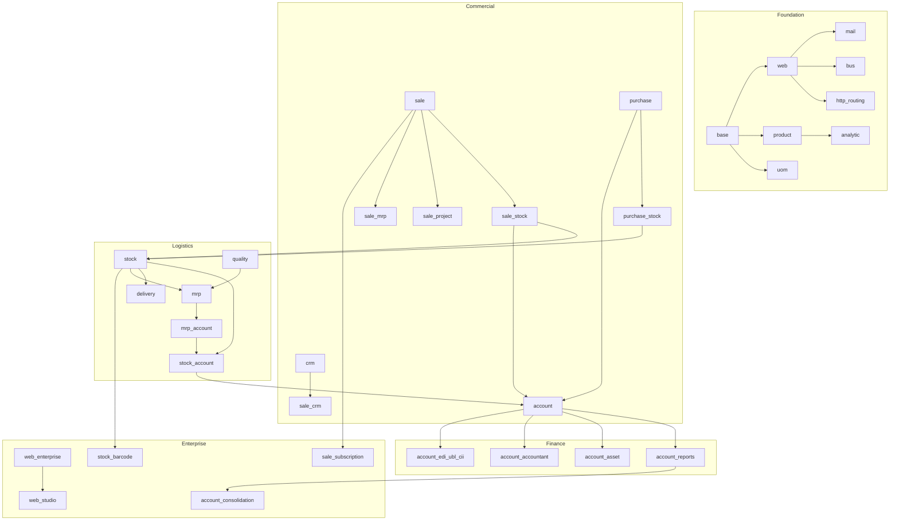
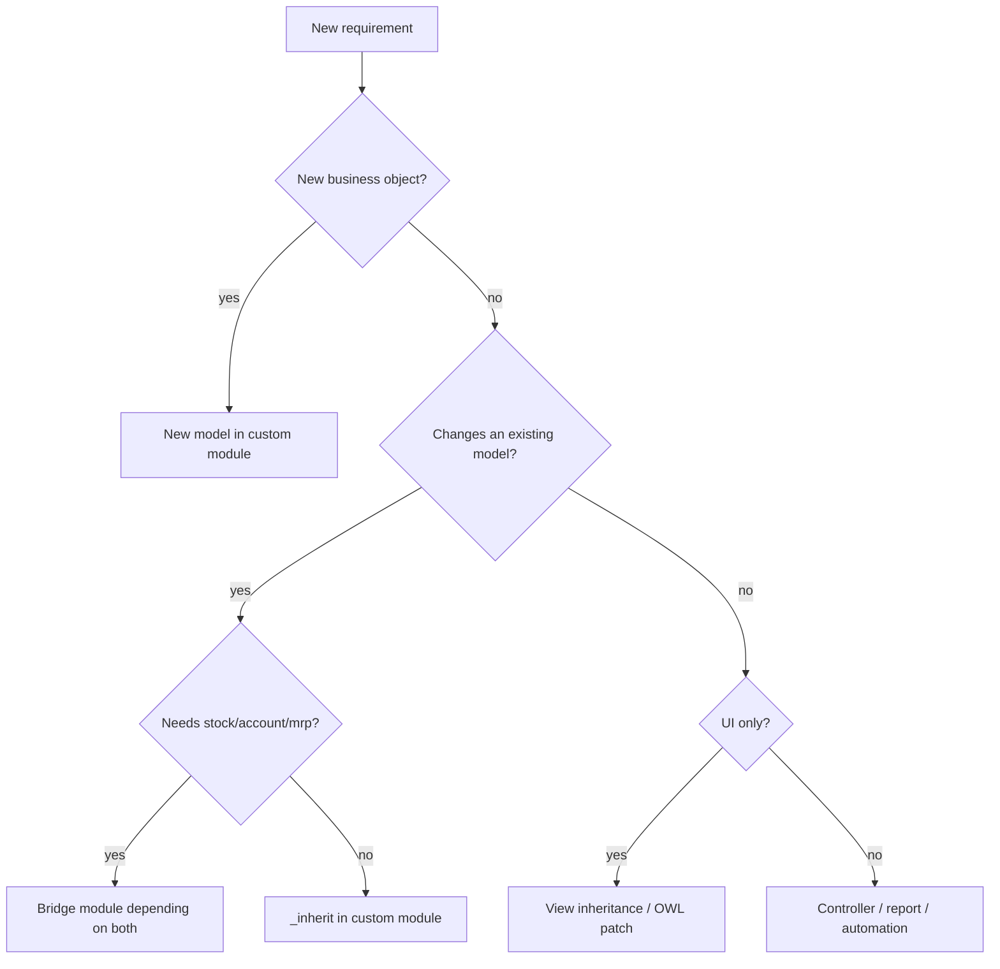

# Module Relationships II — Platform Map and Dependency Clusters

> **Purpose.** A mental map of 1,469 modules, grouped by architectural layer and business cluster, with the bridge modules that connect them. Use it to scope impact analysis and to decide where a customisation belongs.

---

## 1. Layered map



---

## 2. Foundation cluster

| Module | Role | Fan-in | Notes |
|---|---|---|---|
| `base` | ORM, security, partners, companies, modules | 47 | always installed |
| `web` | backend SPA, views, assets, RPC | 47 | OWL client |
| `mail` | messaging, followers, activities | 77 | mixin used everywhere |
| `bus` | websocket notifications | 5 | PostgreSQL NOTIFY |
| `product` | product/template/variant, UoM | high | core commercial master |
| `uom` | units of measure | high | v19 tree model |
| `analytic` | analytic plans/accounts | high | cost accounting |
| `base_setup` | settings framework | 23 | `res.config.settings` |
| `base_automation` | no-code rules | 25 | triggers |
| `base_import` | CSV/XLS import | 7 | |
| `html_editor` | rich text | 11 | replaces summernote |
| `web_tour` | onboarding tours | 14 | |
| `iap` | in-app purchases | 16 | external services |
| `portal` | customer portal | 26 | |
| `website` | public CMS | 34 | |
| `http_routing` | URL routing/redirects | 7 | |

**Rule:** custom modules almost always depend on `base`, `web`, and one or more of `mail`, `product`, `account`, `stock`.

---

## 3. Commercial cluster

| Module | Depends on | Adds |
|---|---|---|
| `sale` | `sales_team`, `account_payment`, `product`, `utm`, `portal` | quotations, orders, invoices |
| `sale_management` | `sale`, `digest` | app shell, advanced settings |
| `sale_stock` | `sale`, `stock_account` | delivery, procurement |
| `sale_mrp` | `mrp`, `sale_stock` | MOs for SOs |
| `sale_project` | `sale_management`, `project_account` | projects/tasks from SO |
| `sale_timesheet` | `sale_project`, `hr_timesheet` | billable time |
| `sale_purchase` | `sale`, `purchase` | drop-ship/PO from SO |
| `sale_loyalty` | `sale`, `loyalty` | coupons, promotions |
| `sale_subscription` [ENT] | `sale_management`, `account_accountant` | recurring invoices |
| `sale_renting` [ENT] | `sale`, `web_gantt` | rental periods |
| `crm` | `sales_team`, `mail`, `calendar`, `utm` | leads/opportunities |
| `sale_crm` | `sale`, `crm` | quotation from lead |
| `purchase` | `account` | RFQ, PO, bills |
| `purchase_stock` | `purchase`, `stock` | receipts |
| `purchase_mrp` | `purchase_stock`, `mrp` | subcontract/kit purchase |
| `purchase_requisition` | `purchase` | blanket orders |

**Bridge modules** are where behaviour lives:

- `sale_stock` is the bridge between sales and inventory; it owns `_action_launch_stock_rule`, `delivery_status`, and `picking_policy`.
- `sale_mrp` is the bridge between sales and manufacturing; it links MOs through `stock.reference`.
- `purchase_stock` is the bridge between purchasing and inventory; it owns `_create_picking`.
- `sale_purchase` is the bridge for drop-shipping and intercompany.

**[INVARIANT]** Never put stock logic in `sale` or purchase logic in `stock`. Use the bridge module or a new bridge; otherwise you create a hidden dependency that breaks standalone installs.

---

## 4. Logistics cluster

| Module | Role |
|---|---|
| `stock` | moves, quants, pickings, routes, rules |
| `stock_account` | valuation, COGS, stock journal |
| `stock_delivery` | carrier integration framework |
| `delivery_*` | carrier connectors (DHL, UPS, FedEx, ...) |
| `stock_landed_costs` | freight/customs allocation |
| `stock_barcode` [ENT] | barcode UI |
| `stock_enterprise` [ENT] | reporting/cohort additions |
| `mrp` | BoMs, MOs, work orders |
| `mrp_account` | manufacturing valuation |
| `mrp_workorder` [ENT] | shop-floor UI, time tracking |
| `mrp_plm` [ENT] | engineering change orders |
| `mrp_subcontracting` | subcontracting |
| `quality` / `quality_mrp` | inspection points |
| `maintenance` | equipment maintenance |
| `repair` | repair orders |

---

## 5. Finance cluster

| Module | Role |
|---|---|
| `account` | journal entries, invoices, taxes, reconciliation |
| `account_accountant` [ENT] | full accounting app shell |
| `account_reports` [ENT] | financial statements, tax reports |
| `account_asset` [ENT] | fixed assets |
| `account_budget` [ENT] | budgets |
| `account_consolidation` [ENT] | multi-company consolidation |
| `account_edi` | e-invoicing framework |
| `account_edi_ubl_cii` | UBL/CII formats |
| `account_peppol` | EU PEPPOL |
| `account_followup` [ENT] | dunning |
| `account_batch_payment` [ENT] | batch payments |
| `account_3way_match` [ENT] | purchase control |
| `account_inter_company_rules` | intercompany automation |
| `account_intrastat` [ENT] | EU Intrastat |
| `l10n_*` | country localizations (245 modules with `countries`) |

**Localization rule:** install exactly one `l10n_<country>` chart per company. Multiple charts in one company corrupt the chart of accounts. Multi-company can use different localizations.

---

## 6. Enterprise cluster

Enterprise modules are not a separate platform; they are addons with `OEEL-1`/`OPL-1` licenses.

| Area | Modules |
|---|---|
| Accounting | `account_accountant`, `account_reports`, `account_asset`, `account_budget`, `account_consolidation`, `account_followup`, `account_batch_payment`, `account_3way_match`, `account_intrastat` |
| Sales | `sale_subscription`, `sale_renting`, `sale_amazon`, `sale_shopee`, `sale_lazada`, `sale_tiktok` |
| Field service | `industry_fsm`, `industry_fsm_sale`, `industry_fsm_repair` |
| HR | `hr_payroll`, `hr_appraisal`, `hr_recruitment_reports`, `planning` |
| Marketing | `marketing_automation`, `social`, `mass_mailing_sms` |
| Productivity | `documents`, `knowledge`, `sign`, `approvals`, `web_studio` |
| Logistics | `stock_barcode`, `mrp_workorder`, `mrp_plm`, `quality_control` |
| Website | `website_sale_dashboard`, `website_helpdesk`, `website_appointment` |
| AI | `ai`, `ai_app`, `ai_fields`, `ai_document` |

**[WARNING]** Enterprise modules frequently use `auto_install=True`. Installing a Community app in an Enterprise database can pull in Enterprise dependencies and change menus, permissions, and data models. Verify the closure.

---

## 7. Application modules (the 78 "apps")

Apps are modules with `application=True`; they appear as top-level tiles in the Apps menu. They are not architecturally special. Examples:

| App | Module | Depends on |
|---|---|---|
| Sales | `sale_management` | `sale`, `digest` |
| Purchase | `purchase` | `account` |
| Inventory | `stock` | `product`, `barcodes_gs1_nomenclature`, `digest` |
| Manufacturing | `mrp` | `product`, `stock`, `resource` |
| Accounting | `accountant` | `account_reports` |
| Invoicing | `account` | `base_setup`, `product`, `analytic`, `portal` |
| CRM | `crm` | `sales_team`, `mail`, `calendar`, `utm` |
| Project | `project` | `analytic`, `mail`, `portal`, `rating`, `resource` |
| Website | `website` | `web`, `html_editor`, `http_routing`, `portal` |
| eCommerce | `website_sale` | `website`, `sale`, `delivery` |
| POS | `point_of_sale` | `stock_account`, `barcodes`, `html_editor` |
| Helpdesk | `helpdesk` | `mail`, `utm`, `rating`, `portal` |
| Field Service | `industry_fsm` | `project_enterprise`, `timesheet_grid` |
| Subscriptions | `sale_subscription` | `account_accountant`, `sale_management` |

**[WARNING]** Installing an app installs its entire dependency closure, including auto-install modules. The Apps UI shows a simplified count; the actual module count can be 10–50× larger.

---

## 8. Bridge modules and shared services

| Shared service | Implemented by | Used by |
|---|---|---|
| Messaging/tracking | `mail` | all business modules |
| Activity scheduling | `mail.activity.mixin` | CRM, SO, project, helpdesk |
| Portal access | `portal` | SO, invoices, tickets, projects |
| UTM attribution | `utm` | CRM, SO, website, marketing |
| Rating | `rating` | project, helpdesk, delivery |
| Analytic distribution | `analytic` | SO, invoices, expenses, timesheets |
| Currency | `res.currency` | all monetary models |
| UoM | `uom` | product, stock, purchase, sale, mrp |
| Sequence | `ir.sequence` | all documents |
| Attachments | `ir.attachment` | all documents |
| Bus | `bus` | UI notifications |
| Cron | `ir.cron` | all scheduled work |
| Config | `ir.config_parameter` | feature flags, integrations |

---

## 9. Impact analysis rules

When changing a module, estimate the blast radius by fan-in:

| Fan-in | Blast radius | Test strategy |
|---|---|---|
| > 100 | platform-wide | full regression + upgrade test |
| 30–100 | major cluster | cluster regression + key flows |
| 10–30 | multiple apps | affected apps + integration |
| 3–10 | local | module + direct dependents |
| 0–2 | isolated | module tests |

Use this query to list dependents:

```sql
SELECT d.name
FROM ir_module_module_dependency dep
JOIN ir_module_module d ON d.id = dep.module_id
JOIN ir_module_module m ON m.id = dep.depend_id
WHERE m.name = 'account' AND d.state = 'installed';
```

Or in Python:

```python
module = env['ir.module.module'].search([('name', '=', 'account')])
dependents = module.downstream_dependencies()
```

---

## 10. Where to put a customisation



**Rules:**

1. Never modify core source. Use `_inherit` and view inheritance.
2. Put cross-module glue in a bridge module; do not make `sale` depend on `stock`.
3. Put industry-specific logic in an `industry_*` or `l10n_*` module, not in `sale`.
4. Put configuration in `res.config.settings`, not in code.
5. Put one-off data fixes in migration scripts, not in `post_init_hook`.

---

## 11. Evidence index

| Topic | File |
|---|---|
| Module list | `addons/*/__manifest__.py` |
| Application flags | manifest `application` |
| Dependency stats | Parsed from `addons/*/__manifest__.py` in this tree |
| Auto-install logic | `addons/base/models/ir_module.py:407-434` |
| Downstream deps | `addons/base/models/ir_module.py` (`downstream_dependencies`) |
| Localizations | `addons/l10n_*/__manifest__.py` |

Continue with `03-extension-points.md`.
