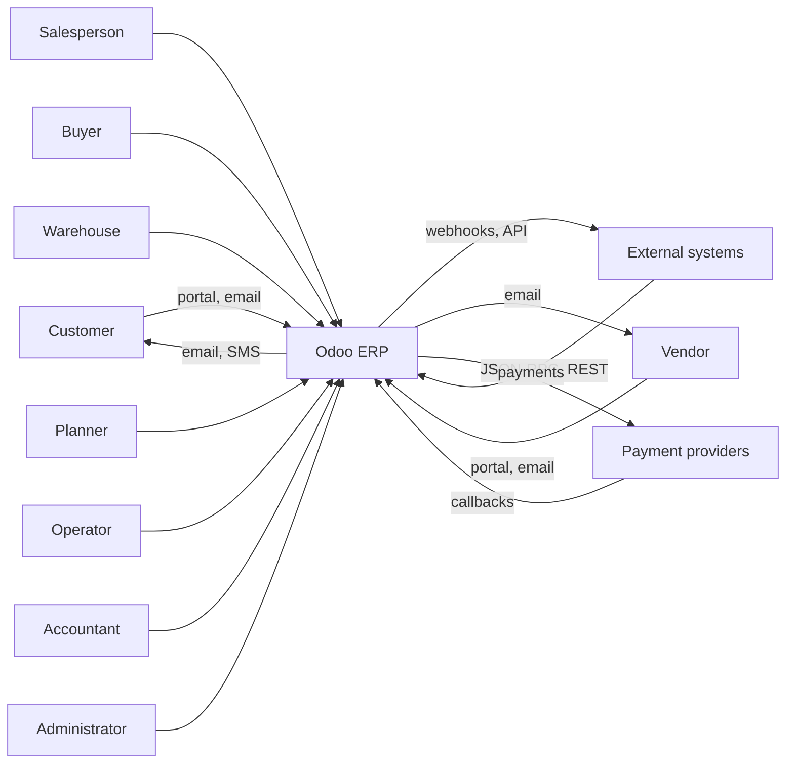

# Software Engineering I — Use Case Model

> **Notation.** UML use case diagram in Mermaid, supplemented by a textual catalogue. Each use case has an ID, actors, trigger, preconditions, main flow, alternates, postconditions, and the Odoo modules/methods that realise it.

---

## 1. Actors

| Actor | Type | Description |
|---|---|---|
| Salesperson | human | creates quotations, follows opportunities |
| Sales Manager | human | approves discounts/orders, locks |
| Customer | external | portal quotation, payment, delivery |
| Buyer | human | RFQ, PO |
| Purchase Manager | human | approval, vendor strategy |
| Vendor | external | quotation, delivery, bill |
| Warehouse Operator | human | receipts, deliveries, counts |
| Manufacturing Planner | human | MOs, work orders, scheduling |
| Machine Operator | human | shop-floor execution |
| Accountant | human | invoices, payments, reconciliation, close |
| Controller | human | reporting, budgets, audit |
| HR Officer | human | employees, payroll, time off |
| Administrator | human | users, groups, modules, configuration |
| Integration Client | system | API, webhook, ETL |
| Scheduler | system | cron jobs |
| Automation Engine | system | base.automation, server actions |
| Payment Provider | external | transaction callbacks |

---

## 2. System context

---

## 3. Use case diagram

```mermaid
flowchart TB
    subgraph Sales
        UC1[Create quotation]
        UC2[Apply pricelist/discount]
        UC3[Confirm order]
        UC4[Approve exception]
        UC5[Deliver order]
        UC6[Invoice order]
        UC7[Register payment]
    end
    subgraph Purchasing
        UC8[Create RFQ]
        UC9[Approve PO]
        UC10[Receive goods]
        UC11[Record vendor bill]
        UC12[Pay vendor]
    end
    subgraph Inventory
        UC13[Transfer stock]
        UC14[Adjust inventory]
        UC15[Return goods]
        UC16[Scrap]
    end
    subgraph Manufacturing
        UC17[Create BoM]
        UC18[Plan MO]
        UC19[Execute work orders]
        UC20[Close MO]
    end
    subgraph Accounting
        UC21[Post invoice]
        UC22[Reconcile bank]
        UC23[Close period]
        UC24[Report financials]
    end
    subgraph Platform
        UC25[Manage users/access]
        UC26[Install/upgrade module]
        UC27[Run integration]
        UC28[Schedule job]
    end

    SP --> UC1
    SP --> UC2
    SP --> UC3
    SM[Sales Manager] --> UC4
    C --> UC3
    WH --> UC5
    AC --> UC6
    AC --> UC7
    BU --> UC8
    PM[Purchase Manager] --> UC9
    WH --> UC10
    AC --> UC11
    AC --> UC12
    WH --> UC13
    WH --> UC14
    WH --> UC15
    WH --> UC16
    PL --> UC17
    PL --> UC18
    OP --> UC19
    PL --> UC20
    AC --> UC21
    AC --> UC22
    CO[Controller] --> UC23
    CO --> UC24
    AD --> UC25
    AD --> UC26
    I[Integration] --> UC27
    SCH[Scheduler] --> UC28
```

---

## 4. Use case catalogue

### UC-01 Create quotation

| Field | Value |
|---|---|
| Actors | Salesperson, Customer |
| Trigger | Customer request |
| Preconditions | Customer exists; product catalog configured; pricelist available |
| Main flow | 1. Create `sale.order` (draft). 2. Add lines; product onchange sets UoM/price/taxes. 3. Pricelist computes price. 4. Set payment terms, fiscal position. 5. Save. 6. Send quotation. |
| Alternates | A1: customer-specific price → manual price override. A2: missing tax → configure tax/fiscal position. A3: credit limit exceeded → warning/block. |
| Postconditions | `state='draft'` or `'sent'`; PDF/portal link available |
| Realisation | `sale.order`, `sale.order.line`, `product.pricelist`, `account.tax` |

### UC-02 Apply pricelist/discount

| Field | Value |
|---|---|
| Actors | Salesperson, Sales Manager |
| Preconditions | Pricelist rules configured; discount limits set |
| Main flow | 1. Pricelist selected from partner/company. 2. `_compute_price_unit` applies rules. 3. Discount entered. 4. Taxes computed. 5. Totals recomputed. |
| Alternates | A1: discount above limit → manager approval. A2: currency change → recompute rate. |
| Postconditions | `price_unit`, `discount`, `price_subtotal`, `price_tax`, `price_total` consistent |
| Realisation | `product.pricelist._get_product_price`, `sale.order.line._compute_price_unit`, `account.tax._get_tax_details` |

### UC-03 Confirm order

| Field | Value |
|---|---|
| Actors | Salesperson, Customer (portal) |
| Preconditions | Quotation has lines with products; state `draft`/`sent`; no lock |
| Main flow | 1. `action_confirm`. 2. Validate lines. 3. Write `state='sale'`, `date_order`. 4. `_action_confirm` overrides. 5. Procurement creates delivery/MO/PO. 6. Optional lock/email. |
| Alternates | A1: missing product → `UserError`. A2: no route → confirmed but no delivery. A3: credit limit → warning. A4: analytic distribution invalid → `UserError`. |
| Postconditions | `state='sale'`; pickings/MOs/POs created; `delivery_status='pending'` |
| Realisation | `sale.order.action_confirm`, `_action_confirm`, `sale_stock._action_launch_stock_rule` |

### UC-04 Approve exception

| Field | Value |
|---|---|
| Actors | Sales Manager |
| Preconditions | Order exceeds discount/margin/credit threshold; approval rule configured |
| Main flow | 1. Order flagged (custom field/automation). 2. Manager reviews margin/credit. 3. Approve → field set. 4. Confirm allowed. |
| Alternates | A1: reject → cancel/quotation revision. |
| Postconditions | Approval recorded with user/date |
| Realisation | `base.automation`, custom fields, `sale.order` override |

### UC-05 Deliver order

| Field | Value |
|---|---|
| Actors | Warehouse Operator, Customer |
| Preconditions | SO confirmed; picking exists; stock available or backorder accepted |
| Main flow | 1. Open picking. 2. Reserve (`_action_assign`). 3. Set quantities/lots/packages. 4. `button_validate`. 5. Quants update; valuation entry. 6. Backorder if partial. |
| Alternates | A1: no stock → `confirmed`/`partial`. A2: lot required but missing → error. A3: package mismatch → error. |
| Postconditions | Picking `done`; `qty_delivered` updated; `delivery_status` partial/full |
| Realisation | `stock.picking.button_validate`, `stock.move._action_done`, `stock.quant._update_available_quantity` |

### UC-06 Invoice order

| Field | Value |
|---|---|
| Actors | Accountant, Salesperson |
| Preconditions | SO `sale`; invoiceable qty > 0 (policy-dependent) |
| Main flow | 1. `_create_invoices`. 2. Prepare header/lines. 3. Create draft `account.move`. 4. Review. 5. `action_post`. 6. Sequence/hash. |
| Alternates | A1: nothing to invoice → `UserError`. A2: tax/fiscal position wrong → edit draft. A3: down payment → deposit invoice. |
| Postconditions | Posted invoice; `qty_invoiced` updated; `invoice_status` updated |
| Realisation | `sale.order._create_invoices`, `account.move._post` |

### UC-07 Register payment

| Field | Value |
|---|---|
| Actors | Accountant, Payment Provider |
| Preconditions | Posted invoice; bank journal configured |
| Main flow | 1. Open payment wizard. 2. Select amount/date/method. 3. Create `account.payment`. 4. Post. 5. Reconcile with invoice. 6. Optional bank reconciliation. |
| Alternates | A1: partial payment → partial reconcile. A2: FX difference → exchange move. A3: write-off → write-off line. |
| Postconditions | `payment_state='paid'`/`partial`; residual updated |
| Realisation | `account.payment.register`, `account.move.line._reconcile_plan` |

### UC-08 Create RFQ

| Field | Value |
|---|---|
| Actors | Buyer, Vendor |
| Preconditions | Vendor exists; product purchasable |
| Main flow | 1. Create `purchase.order` draft. 2. Add lines; vendor price from `product.supplierinfo`. 3. Set currency/payment terms. 4. Send RFQ. |
| Alternates | A1: no vendor price → manual price. A2: vendor not a supplier → `_add_supplier_to_product` on confirm. |
| Postconditions | RFQ `draft`/`sent` |
| Realisation | `purchase.order`, `purchase.order.line` |

### UC-09 Approve PO

| Field | Value |
|---|---|
| Actors | Purchase Manager |
| Preconditions | RFQ ready; approval threshold configured |
| Main flow | 1. `button_confirm`. 2. Validate. 3. If approval required → `to approve`. 4. Manager `button_approve`. 5. `state='purchase'`. 6. Receipt created. |
| Alternates | A1: below threshold → auto-approve. A2: manager group bypass. A3: locked company setting → lock after approval. |
| Postconditions | PO `purchase`; receipt exists |
| Realisation | `purchase.order.button_confirm`, `button_approve`, `purchase_stock._create_picking` |

### UC-10 Receive goods

| Field | Value |
|---|---|
| Actors | Warehouse Operator |
| Preconditions | PO confirmed; incoming picking |
| Main flow | 1. Open receipt. 2. Set quantities/lots. 3. Validate. 4. Quants/valuation. 5. `qty_received` updated. |
| Alternates | A1: partial → backorder. A2: over-receipt → allowed/warned. A3: quality fail → block/scrap. |
| Postconditions | Receipt `done`; stock increased |
| Realisation | `stock.picking.button_validate`, `stock_account` valuation |

### UC-11 Record vendor bill

| Field | Value |
|---|---|
| Actors | Accountant, Vendor |
| Preconditions | PO/receipt exists; vendor bill received |
| Main flow | 1. `action_create_invoice` or manual bill. 2. Match lines/quantities. 3. Post. 4. 3-way match flag. |
| Alternates | A1: price/qty mismatch → exception. A2: duplicate bill → blocked. A3: credit note → refund. |
| Postconditions | Posted bill; `invoice_status='invoiced'` when fully billed |
| Realisation | `purchase.order.action_create_invoice`, `account.move._post`, `account_3way_match` |

### UC-12 Pay vendor

| Field | Value |
|---|---|
| Actors | Accountant |
| Preconditions | Posted bill; due date |
| Main flow | 1. Payment wizard. 2. Create/post payment. 3. Reconcile payable. 4. Bank reconciliation. |
| Alternates | A1: batch payment. A2: FX difference. A3: early payment discount. |
| Postconditions | Bill paid/partial |
| Realisation | `account.payment`, `account.payment.register` |

### UC-13 Transfer stock

| Field | Value |
|---|---|
| Actors | Warehouse Operator |
| Preconditions | Internal locations; product storable |
| Main flow | 1. Create internal picking. 2. Add moves. 3. Reserve. 4. Validate. 5. Quants move. |
| Alternates | A1: no stock → waiting. A2: multi-step route → chained pickings. |
| Postconditions | Stock moved; no valuation entry unless location valuation |
| Realisation | `stock.picking`, `stock.move` |

### UC-14 Adjust inventory

| Field | Value |
|---|---|
| Actors | Warehouse Manager |
| Preconditions | Count performed; permission |
| Main flow | 1. Open `stock.quant`. 2. Enter counted quantity. 3. Apply. 4. Adjustment move. 5. Valuation. |
| Alternates | A1: variance above threshold → approval. A2: lot-tracked → per-lot count. |
| Postconditions | Quant matches count; audit trail |
| Realisation | `stock.quant._apply_inventory` |

### UC-15 Return goods

| Field | Value |
|---|---|
| Actors | Warehouse, Customer |
| Preconditions | Original delivery/receipt exists |
| Main flow | 1. Create return picking. 2. Receive/inspect. 3. Validate. 4. Credit note/refund. |
| Alternates | A1: partial return. A2: scrap instead of restock. A3: replacement order. |
| Postconditions | Stock restored/scrapped; financial reversal |
| Realisation | `stock.return.picking.action_create_returns`, `account.move._reverse_moves` |

### UC-16 Scrap

| Field | Value |
|---|---|
| Actors | Warehouse Operator |
| Preconditions | Product in stock; scrap location |
| Main flow | 1. Create scrap. 2. Set qty/reason. 3. Validate. 4. Quant decrease; expense entry. |
| Alternates | A1: scrap from MO → component scrap. |
| Postconditions | Stock reduced; scrap recorded |
| Realisation | `stock.scrap` |

### UC-17 Create BoM

| Field | Value |
|---|---|
| Actors | Manufacturing Engineer |
| Preconditions | Product, components, workcenters |
| Main flow | 1. Create `mrp.bom`. 2. Add components/UoM. 3. Add operations/workcenters. 4. Set consumption mode. |
| Alternates | A1: phantom BoM. A2: variant-specific BoM. A3: byproducts. |
| Postconditions | BoM usable in MOs |
| Realisation | `mrp.bom`, `mrp.bom.line`, `mrp.routing.workcenter` |

### UC-18 Plan MO

| Field | Value |
|---|---|
| Actors | Planner |
| Preconditions | MO confirmed; components/routing |
| Main flow | 1. `button_plan`. 2. Workorders scheduled on workcenters. 3. Dates computed. 4. Capacity checked. |
| Alternates | A1: no capacity → later dates. A2: missing components → still planned, waiting. |
| Postconditions | `is_planned=True`; workorder dates set |
| Realisation | `mrp.production.button_plan`, `_plan_workorders` |

### UC-19 Execute work orders

| Field | Value |
|---|---|
| Actors | Machine Operator |
| Preconditions | MO planned; components reserved |
| Main flow | 1. Start workorder. 2. Record time/quantity. 3. Finish. 4. Next operation. |
| Alternates | A1: pause/downtime. A2: quality check fail. A3: split production. |
| Postconditions | Workorder done; time/cost recorded |
| Realisation | `mrp.workorder.button_start/button_finish`, `mrp.workcenter.productivity` |

### UC-20 Close MO

| Field | Value |
|---|---|
| Actors | Planner |
| Preconditions | Production complete; workorders done |
| Main flow | 1. `button_mark_done`. 2. Consume components. 3. Produce finished goods. 4. Value. 5. Close/backorder. |
| Alternates | A1: partial → backorder. A2: over-consumption. A3: scrap. |
| Postconditions | MO `done`; stock/valuation updated |
| Realisation | `mrp.production.button_mark_done`, `_post_inventory`, `_cal_price` |

### UC-21 Post invoice

| Field | Value |
|---|---|
| Actors | Accountant |
| Preconditions | Draft invoice balanced; open period |
| Main flow | 1. `action_post`. 2. Validate. 3. Sync tax/payment lines. 4. Sequence. 5. Hash. |
| Alternates | A1: unbalanced → error. A2: lock date → error. A3: missing partner → error. |
| Postconditions | Posted entry; immutable |
| Realisation | `account.move._post` |

### UC-22 Reconcile bank

| Field | Value |
|---|---|
| Actors | Accountant |
| Preconditions | Bank statement imported; journal configured |
| Main flow | 1. Open reconciliation. 2. Match lines. 3. Create write-offs. 4. Validate. |
| Alternates | A1: unmatched → suspense. A2: FX difference. A3: duplicate statement. |
| Postconditions | Statement reconciled; payments validated |
| Realisation | `account.bank.statement.line`, reconciliation models |

### UC-23 Close period

| Field | Value |
|---|---|
| Actors | Controller |
| Preconditions | All entries posted; reconciliations done |
| Main flow | 1. Review trial balance. 2. Post adjustments. 3. Set lock dates. 4. Generate reports. 5. Archive. |
| Alternates | A1: late invoice → adjusting entry. A2: FX revaluation. A3: accruals. |
| Postconditions | Period locked; statements produced |
| Realisation | `account.move`, lock dates, `account_reports` |

### UC-24 Report financials

| Field | Value |
|---|---|
| Actors | Controller, Auditor |
| Preconditions | Posted entries; report access |
| Main flow | 1. Select report/period. 2. Drill down. 3. Export. |
| Alternates | A1: multi-company consolidation. A2: multi-currency translation. |
| Postconditions | Report generated |
| Realisation | `account_reports` [ENT] |

### UC-25 Manage users/access

| Field | Value |
|---|---|
| Actors | Administrator |
| Preconditions | Admin rights |
| Main flow | 1. Create user. 2. Assign groups. 3. Set companies. 4. Test access. |
| Alternates | A1: portal user. A2: API user. A3: 2FA enforcement. |
| Postconditions | User can access only intended data |
| Realisation | `res.users`, `res.groups`, ACLs, rules |

### UC-26 Install/upgrade module

| Field | Value |
|---|---|
| Actors | Administrator, DevOps |
| Preconditions | Backup; staging test |
| Main flow | 1. Add module to addons path. 2. Update app list. 3. Install/upgrade. 4. Run migrations. 5. Test. |
| Alternates | A1: missing dependency → error. A2: migration failure → restore. |
| Postconditions | Module installed; schema/data migrated |
| Realisation | `ir.module.module`, `load_module_graph`, `MigrationManager` |

### UC-27 Run integration

| Field | Value |
|---|---|
| Actors | Integration Client |
| Preconditions | API user; credentials; contract |
| Main flow | 1. Authenticate. 2. Call JSON-RPC/REST. 3. Validate. 4. Process idempotently. 5. Return result. |
| Alternates | A1: retry → idempotency. A2: validation error → 4xx. A3: partial failure → outbox. |
| Postconditions | Data synced; event recorded |
| Realisation | Controllers, `service.model.retrying`, outbox |

### UC-28 Schedule job

| Field | Value |
|---|---|
| Actors | Scheduler, Administrator |
| Preconditions | Cron configured |
| Main flow | 1. Claim job. 2. Execute. 3. Commit progress. 4. Reschedule. |
| Alternates | A1: failure → backoff/deactivate. A2: concurrent run → lock. |
| Postconditions | Job completed or rescheduled |
| Realisation | `ir.cron` |

---

## 5. Traceability matrix

| Use case | Modules | Key methods | Tests |
|---|---|---|---|
| UC-01/02/03 | sale, product, account | `action_confirm`, `_compute_price_unit` | sale tests |
| UC-05 | sale_stock, stock | `_action_launch_stock_rule`, `button_validate` | sale_stock tests |
| UC-06/07 | account | `_create_invoices`, `_post`, `_reconcile_plan` | account tests |
| UC-08/09/10/11 | purchase, purchase_stock, account | `button_confirm`, `_create_picking` | purchase tests |
| UC-13/14/15/16 | stock, stock_account | `_action_done`, `_apply_inventory` | stock tests |
| UC-17/18/19/20 | mrp, mrp_account | `explode`, `button_plan`, `_post_inventory` | mrp tests |
| UC-21/22/23/24 | account, account_reports | `_post`, `_reconcile_plan` | account tests |
| UC-25 | base | `res.users`, `ir.rule` | base tests |
| UC-26 | base, modules | `load_module_graph` | module tests |
| UC-27/28 | http, ir.cron | `retrying`, `_process_job` | integration tests |

---

## 6. Use case quality rules

- [ ] Every use case has a measurable postcondition.
- [ ] Every alternate path has a system response.
- [ ] Every use case maps to at least one test.
- [ ] Actors are roles, not named people.
- [ ] The system boundary is explicit (what Odoo does vs external).
- [ ] Exceptions are modelled, not hidden.

Continue with `02-domain-model.md`.
