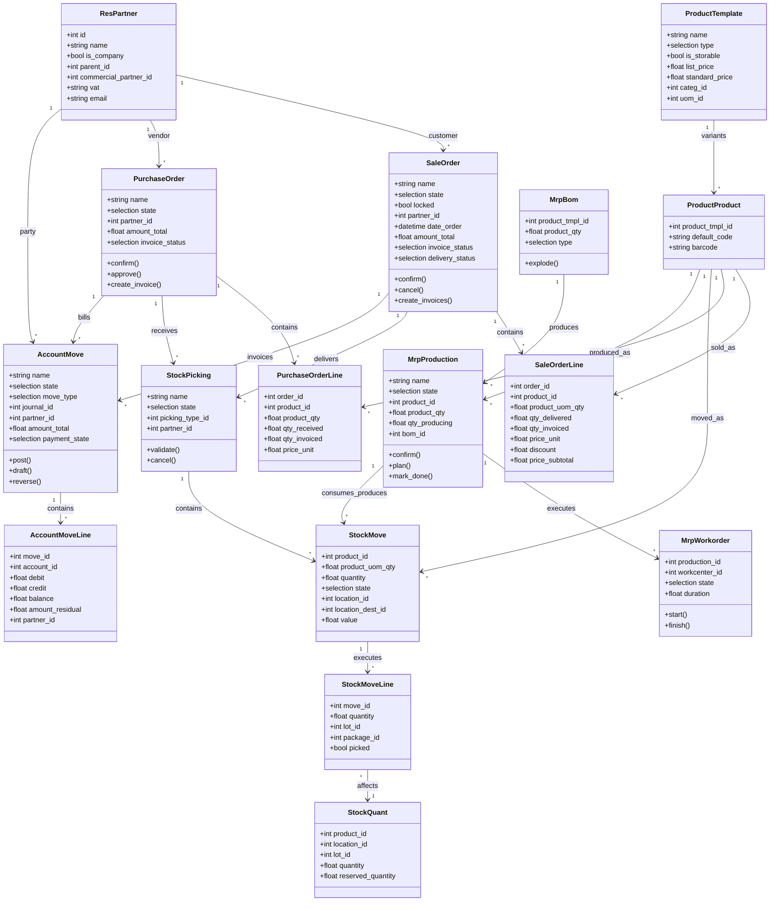

# Software Engineering II — Domain Model and Aggregates

> **Purpose.** A technology-neutral model of the business domain as Odoo implements it, plus the boundaries (aggregates) that determine transaction and consistency rules. Use it for design reviews, onboarding, and gap analysis.

---

## 1. Ubiquitous language

| Term | Meaning | Odoo model |
|---|---|---|
| Party | a person or organisation | `res.partner` |
| Product | a sellable/buyable/storable good or service | `product.template` / `product.product` |
| Quote | a non-binding offer | `sale.order` (draft/sent) |
| Sales Order | a confirmed commitment to deliver | `sale.order` (sale) |
| Demand | a need for quantity at a location | `stock.move` (procurement) |
| Fulfilment | execution of demand | `stock.picking` / `stock.move.line` |
| Inventory | on-hand quantity by location/lot | `stock.quant` |
| Purchase Order | a commitment to buy | `purchase.order` |
| Receipt | incoming fulfilment | `stock.picking` (incoming) |
| Vendor Bill | supplier's invoice | `account.move` (`in_invoice`) |
| Customer Invoice | your invoice | `account.move` (`out_invoice`) |
| Payment | money movement | `account.payment` |
| Journal Entry | double-entry record | `account.move` (`entry`) |
| Manufacturing Order | a production commitment | `mrp.production` |
| Bill of Materials | recipe | `mrp.bom` |
| Work Order | an operation execution | `mrp.workorder` |
| Valuation | monetary value of stock | `stock.move.value` |
| Reference | document grouping | `stock.reference` [V19] |

---

## 2. Core class diagram



---

## 3. Aggregates and consistency boundaries

An aggregate is a cluster of objects treated as a unit for transactions. Odoo does not enforce aggregate boundaries structurally; they are conventions.

### 3.1 Sales order aggregate

```
SaleOrder
├── SaleOrderLine[]
├── StockReference[] (via sale_stock)
└── AccountMove[] (invoices, by reference)
```

**Invariants:**

- an order line belongs to exactly one order,
- totals = sum of line totals (tax-exclusive + tax),
- confirmed orders cannot be edited (except allowed fields),
- a locked order cannot be cancelled,
- invoice status derives from line quantities.

**Transaction boundary:** confirming an order and creating procurement should be one transaction. If procurement fails, the order must not remain confirmed with no delivery intent.

### 3.2 Purchase order aggregate

```
PurchaseOrder
├── PurchaseOrderLine[]
├── StockPicking[] (receipts)
└── AccountMove[] (bills)
```

**Invariants:**

- `qty_received` ≤ or ≥ `product_qty` depending on over-receipt policy,
- `qty_invoiced` ≤ billable quantity (unless manually overridden),
- cancelled PO has no open receipts,
- locked PO cannot be edited/cancelled.

### 3.3 Stock move aggregate

```
StockPicking
├── StockMove[]
│   └── StockMoveLine[]
└── StockQuant updates (side effect)
```

**Invariants:**

- sum of move line quantities = move done quantity,
- a move line must have a lot for tracked products,
- quants are the authoritative on-hand; moves are intentions,
- validated moves are immutable.

### 3.4 Invoice aggregate

```
AccountMove
├── AccountMoveLine[] (product, tax, payment terms, rounding)
└── AccountPartialReconcile[] (via lines)
```

**Invariants:**

- sum(debit) = sum(credit) per move,
- posted moves are immutable,
- residual = amount - reconciled,
- tax lines derive from base lines,
- payment terms sum to total.

### 3.5 Manufacturing aggregate

```
MrpProduction
├── StockMove[] (raw, finished, byproducts)
├── MrpWorkorder[]
│   └── MrpWorkcenterProductivity[]
└── StockMoveLine[] (consumption/production)
```

**Invariants:**

- produced quantity ≤ demand + overproduction policy,
- consumed components correspond to the BoM (strict/flexible),
- workorder duration ≥ 0,
- state is derived from moves/workorders.

---

## 4. Cross-aggregate rules

| Rule | Enforced by | Consistency |
|---|---|---|
| SO → delivery | procurement in same transaction | strong |
| SO → invoice | `_create_invoices` in same transaction | strong |
| PO → receipt | `_create_picking` on confirm | strong |
| PO → bill | `action_create_invoice` | strong |
| Delivery → valuation | `_action_done` → `_create_account_move` | strong |
| Invoice → payment | separate transaction (wizard) | eventual |
| MO → SO | reference link, not a transaction | eventual |
| Intercompany | separate documents/transactions | eventual |

**[WARNING]** Cross-aggregate operations that span multiple RPC calls are eventually consistent. Design idempotency and reconciliation for them.

---

## 5. Domain invariants catalogue

### 5.1 Commercial

- A quotation line must reference a product (or be a display line).
- A confirmed order cannot be edited except for allowed fields.
- Discounts cannot exceed configured limits without approval.
- Currency must match the pricelist or be explicitly converted.
- Invoice quantity cannot exceed billable quantity (policy-dependent).

### 5.2 Inventory

- On-hand quantity = sum of quant quantities.
- Reserved quantity ≤ on-hand (unless negative stock allowed).
- A done move cannot be modified.
- A tracked product requires a lot on every move line.
- A package cannot be split across locations in one move.

### 5.3 Accounting

- Every posted move is balanced.
- A posted move has a unique sequence per journal/period.
- A hashed move cannot be modified.
- A reconciled line has residual 0 or a full reconcile.
- Lock dates block posting before the date.

### 5.4 Manufacturing

- A BoM cannot contain itself (directly or through phantoms).
- Component quantities are positive.
- Workorder sequence follows the routing.
- Finished quantity cannot exceed the MO quantity without overproduction.

---

## 6. Domain events (conceptual)

Odoo does not have a domain-event bus, but these are the meaningful state changes:

| Event | Emitted by | Consumers |
|---|---|---|
| QuoteConfirmed | `sale.order.action_confirm` | stock, project, CRM, mail |
| DeliveryValidated | `stock.picking._action_done` | stock valuation, SO status |
| InvoicePosted | `account.move._post` | reconciliation, reports, mail |
| PaymentRegistered | `account.payment.action_post` | reconciliation |
| POConfirmed | `purchase.order.button_approve` | stock, mail |
| ReceiptValidated | `stock.picking._action_done` | PO qty, valuation |
| MOCompleted | `mrp.production.button_mark_done` | stock, valuation, SO |
| InventoryAdjusted | `stock.quant._apply_inventory` | valuation, audit |

For reliable integration, wrap these in an outbox (see `01-business-logic/03-service-layer.md` §6.2).

---

## 7. Mapping to implementation

| Domain concept | Model | Table | Aggregate root |
|---|---|---|---|
| Party | `res.partner` | `res_partner` | yes |
| Product | `product.template` | `product_template` | yes |
| Variant | `product.product` | `product_product` | no (delegated) |
| Quote/Order | `sale.order` | `sale_order` | yes |
| Order line | `sale.order.line` | `sale_order_line` | no |
| Fulfilment | `stock.picking` | `stock_picking` | yes |
| Move | `stock.move` | `stock_move` | no |
| Move line | `stock.move.line` | `stock_move_line` | no |
| Inventory | `stock.quant` | `stock_quant` | yes (per key) |
| Purchase | `purchase.order` | `purchase_order` | yes |
| Invoice | `account.move` | `account_move` | yes |
| Entry line | `account.move.line` | `account_move_line` | no |
| MO | `mrp.production` | `mrp_production` | yes |
| BoM | `mrp.bom` | `mrp_bom` | yes |
| Workorder | `mrp.workorder` | `mrp_workorder` | no |

---

## 8. Modelling rules for custom domains

1. **One aggregate root per transaction.** Do not modify two roots in one method unless the business operation requires it.
2. **Reference by id, not by embedding.** Use many2one, not copied fields.
3. **Enforce invariants in the root.** Child models validate their own fields, but cross-child rules belong to the root.
4. **Use state machines explicitly.** Every status field needs a transition table.
5. **Name states as past participles** (`confirmed`, `done`) and actions as verbs (`confirm`, `validate`).
6. **Avoid boolean flags that duplicate state.** `locked` is an exception because it is orthogonal.
7. **Model money with currency.** Never store a monetary amount without its currency.
8. **Model quantities with UoM.** Never store a quantity without its unit.
9. **Model time in UTC.** Convert only at presentation.
10. **Document derived fields.** If it is computed, say from what.

---

## 9. Evidence index

| Topic | File |
|---|---|
| Partner | `addons/base/models/res_partner.py` |
| Product | `addons/product/models/product_template.py` |
| Sale | `addons/sale/models/sale_order.py` |
| Stock | `addons/stock/models/stock_move.py`, `stock_quant.py` |
| Purchase | `addons/purchase/models/purchase_order.py` |
| Account | `addons/account/models/account_move.py` |
| MRP | `addons/mrp/models/mrp_production.py` |

Continue with `03-sequence-diagrams.md`.
