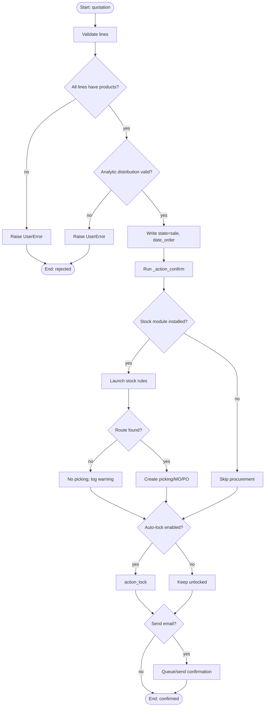
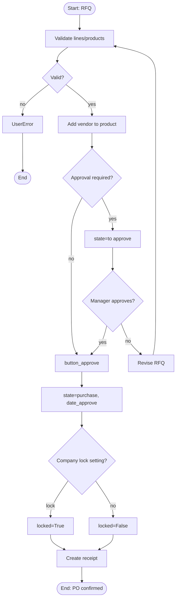
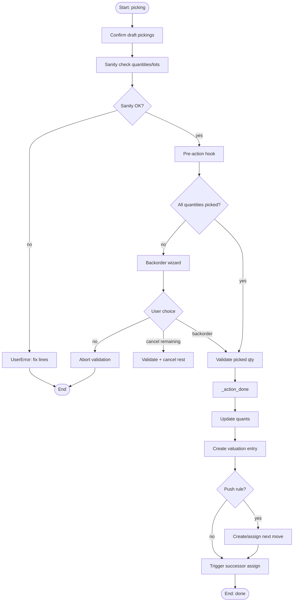
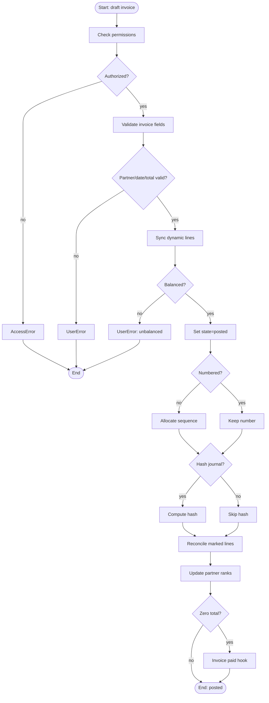
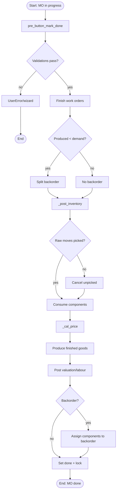
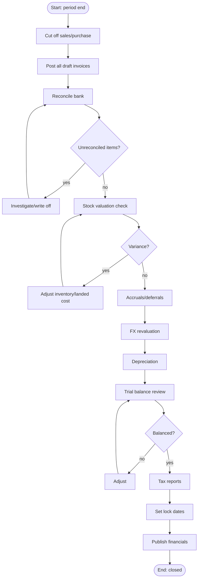
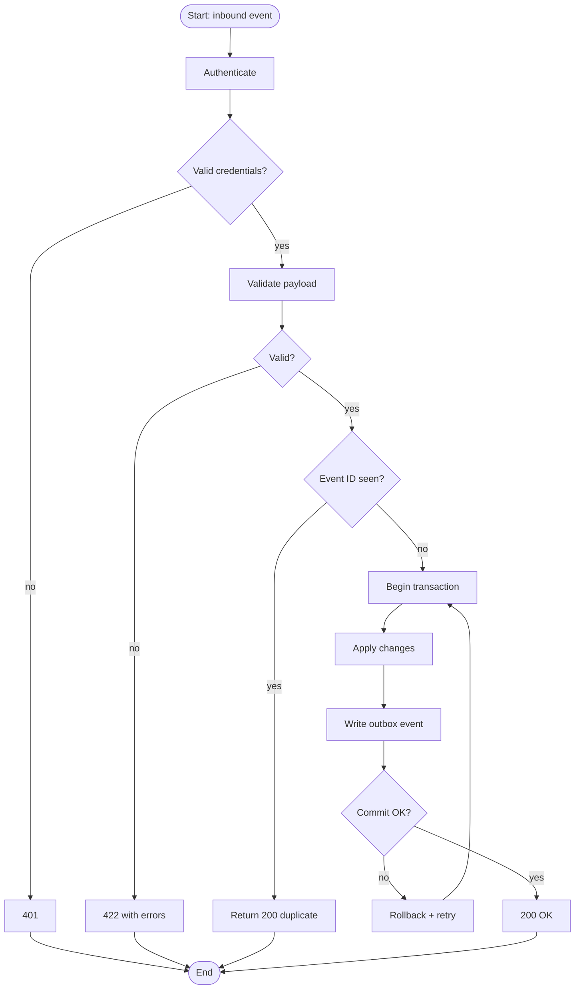
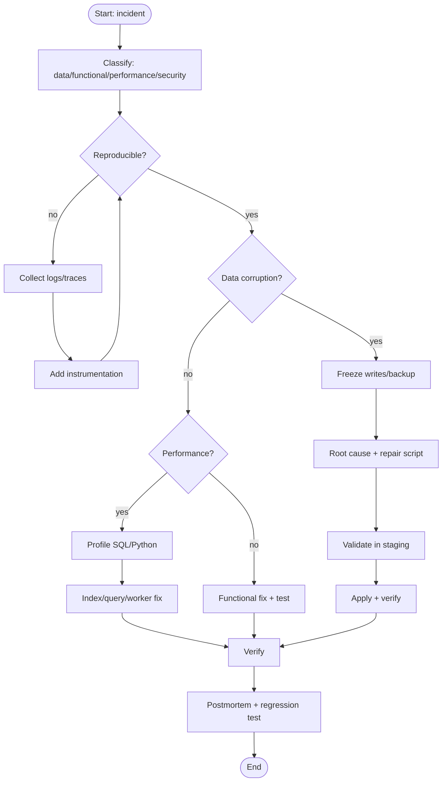

# Software Engineering IV — Activity Diagrams and BPMN Mapping

> **Purpose.** Decision-oriented views of the same flows. Each activity diagram can be converted directly to BPMN: rectangles are tasks, diamonds are exclusive gateways, parallel bars are parallel gateways, and swimlanes are roles.

---

## 1. BPMN mapping rules

| Mermaid construct | BPMN element |
|---|---|
| `[Start]` / `[End]` | start/end event |
| `[Action]` | task |
| `{Decision?}` | exclusive gateway (XOR) |
| parallel branches | parallel gateway (AND) |
| `subgraph Lane` | pool/lane |
| arrow with condition | sequence flow with condition |
| timer event | intermediate timer catch event |
| message event | message catch/throw event |

---

## 2. Sales order confirmation

### 2.1 BPMN notes

- `Validate lines` and `Write state` are service tasks in the Sales lane.
- `Route found?` is the key business gateway; in BPMN, document the route resolution rule.
- `Create picking/MO/PO` is a sub-process with its own diagram.
- The timer for quotation expiry is a boundary timer event on the quotation task.

---

## 3. Purchase approval

**Decision data:** `company.po_double_validation`, `po_double_validation_amount`, `purchase.group_purchase_manager`.

---

## 4. Delivery validation

**Exception paths:** lot missing, package split, negative stock blocked, reservation conflict, valuation account missing.

---

## 5. Invoice posting

---

## 6. Manufacturing completion

---

## 7. Month-end close

---

## 8. Integration processing

**Note:** the outbox write is in the same transaction; delivery is a separate cron. This is the only reliable pattern without a broker.

---

## 9. Support incident triage

---

## 10. Activity-to-test mapping

| Activity diagram | Test focus |
|---|---|
| Sales confirmation | guards, procurement, lock, email |
| Purchase approval | threshold, manager group, receipt |
| Delivery validation | partial, lots, packages, backorder |
| Invoice posting | balance, lock date, sequence, hash |
| MO completion | consumption, backorder, valuation |
| Month-end close | reconciliation, FX, lock dates |
| Integration | idempotency, retry, outbox |
| Incident triage | runbooks, observability |

---

## 11. BPMN export checklist

- [ ] Every decision has a default flow.
- [ ] Every task has an owner (lane).
- [ ] Every event has a trigger (message/timer/signal).
- [ ] Exception paths terminate or loop, never dangle.
- [ ] Data objects (SO, picking, invoice) are referenced, not duplicated.
- [ ] Timers are explicit (quotation expiry, payment terms, SLA).
- [ ] Sub-processes are linked to their own diagrams.

---

## 12. Evidence index

| Flow | File |
|---|---|
| Sales | `sale/models/sale_order.py:1167` |
| Purchase | `purchase/models/purchase_order.py:625` |
| Delivery | `stock/models/stock_picking.py:1413` |
| Invoice | `account/models/account_move.py:5574` |
| MO | `mrp/models/mrp_production.py:2219` |
| Integration | `service/model.py:160` |
| Close | `account/models/company.py:76-112` |

Continue with `05-state-machines.md`.
