# Software Engineering V — State Machines Reference

> **Purpose.** A single place to verify legal states, transitions, and triggers. Every transition names the method that performs it; computed states say so explicitly.

---

## 1. State machine principles in Odoo

- A state field is usually a `Selection` with `copy=False` and `index=True`.
- Transitions are **methods**, not direct writes. Writing `state` directly bypasses guards.
- Some states are **computed** (`stock.picking`, `mrp.production`); writing them is a bug.
- `locked`/`active` are orthogonal booleans, not states.
- Automations and imports can write state if they bypass methods; enforce guards in `write` if needed.

---

## 2. Sales order

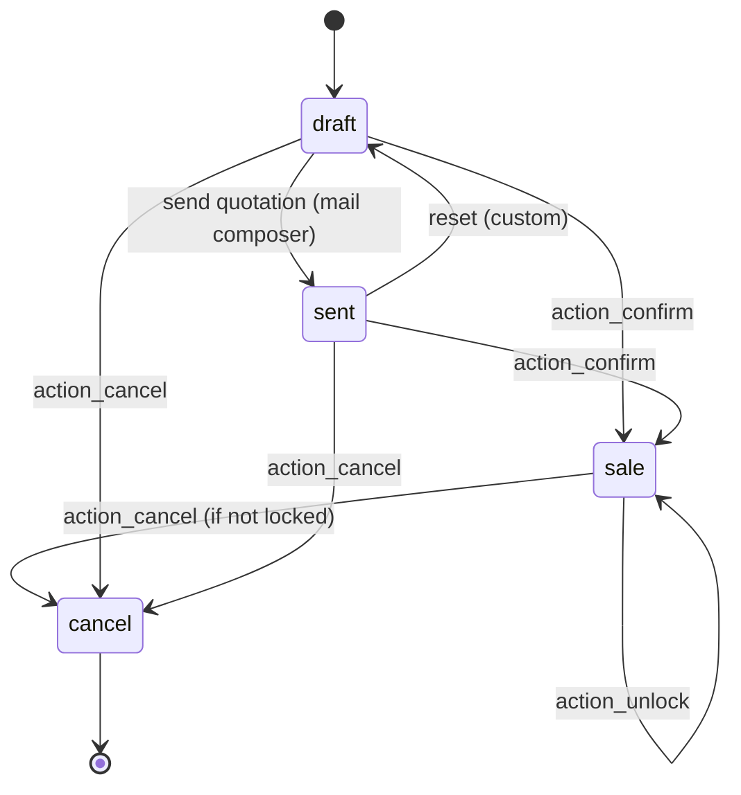

| From | To | Trigger | Guard |
|---|---|---|---|
| `draft` | `sale` | `action_confirm` | all lines have product |
| `sent` | `sale` | `action_confirm` | same |
| `draft`/`sent`/`sale` | `cancel` | `action_cancel` | not locked |
| any | `sale` (locked) | `action_lock` | confirmed |
| `sale` (locked) | `sale` | `action_unlock` | manager |
| — | — | `locked` | independent boolean |

**No `done` state.** `invoice_status` and `delivery_status` are computed, not states.

Source: `sale/models/sale_order.py:26-81`, `:1167-1333`.

---

## 3. CRM lead

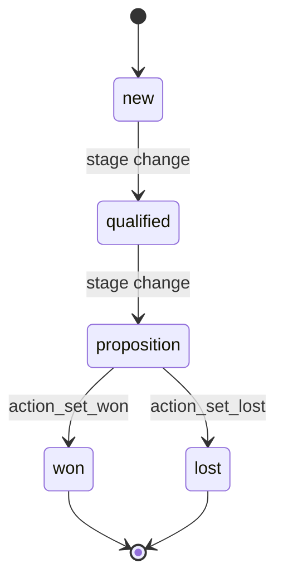

| Concept | Field | Values |
|---|---|---|
| Stage | `stage_id` | configurable, ordered by `sequence` |
| Outcome | `won_status` | `won`, `lost`, `pending` |
| Archive | `active` | `True`/`False` |
| Probability | `probability` | 0–100 |

**No `state` field.** Won requires probability 100; lost archives and sets 0.

Source: `crm/models/crm_lead.py:123-233`, `:612-620`.

---

## 4. Purchase order

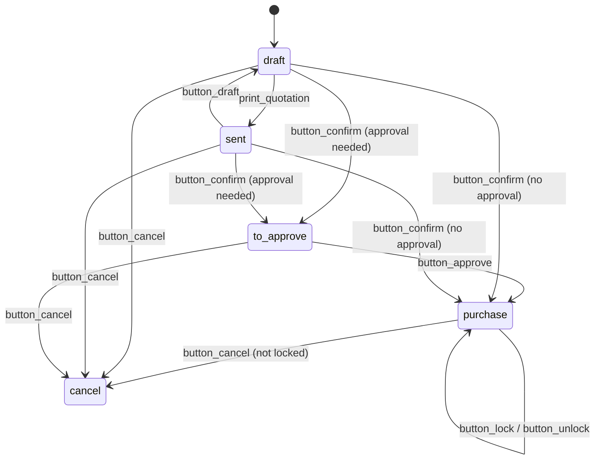

| From | To | Trigger | Guard |
|---|---|---|---|
| `draft`/`sent` | `purchase` | `button_confirm` → `button_approve` | approval allowed |
| `draft`/`sent` | `to approve` | `button_confirm` | approval required |
| `to approve` | `purchase` | `button_approve` | manager/threshold |
| any | `cancel` | `button_cancel` | not locked, no posted bills |
| `purchase` | `purchase` | `button_lock` | — |

**No `done` state.** `qty_received` and `invoice_status` indicate completion.

Source: `purchase/models/purchase_order.py:105-116`, `:615-655`.

---

## 5. Stock picking

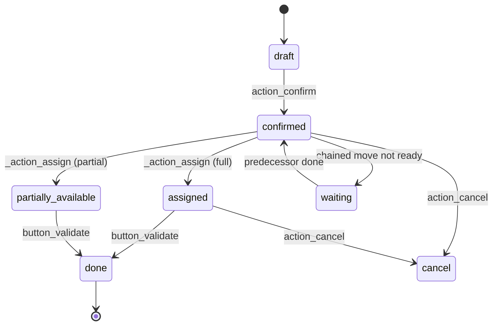

| State | Meaning | Computed? |
|---|---|---|
| `draft` | not confirmed | yes |
| `waiting` | predecessor not done | yes |
| `confirmed` | waiting availability | yes |
| `assigned` | fully reserved | yes |
| `done` | validated | yes |
| `cancel` | cancelled | yes |

`state` is computed from moves (`_compute_state`). Move states: `draft`, `waiting`, `confirmed`, `partially_available`, `assigned`, `done`, `cancel`.

Source: `stock/models/stock_picking.py:575-590`, `:816`, `stock_move.py:107-120`.

---

## 6. Stock move / move line

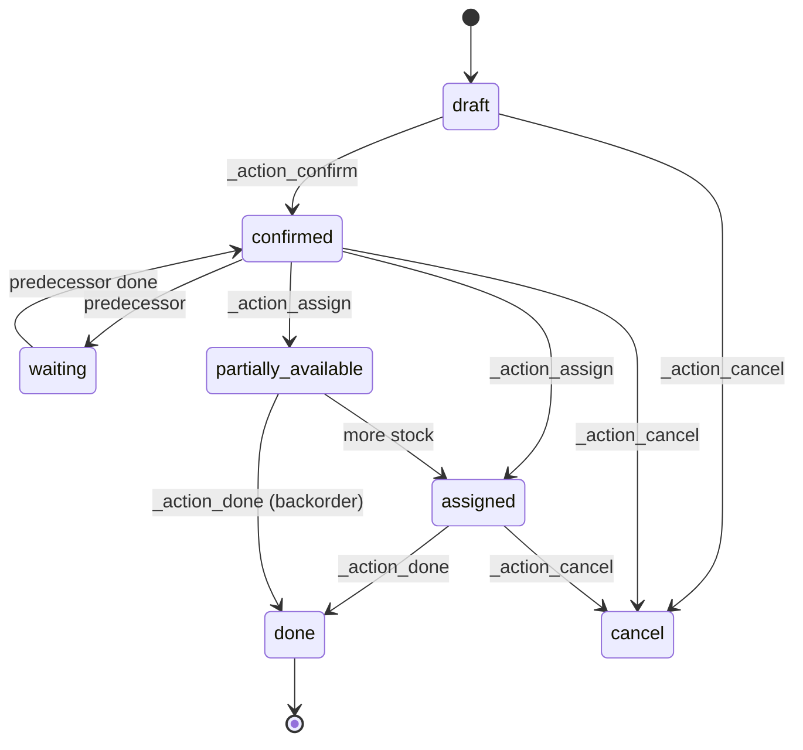

**`picked` gate:** a move line with quantity but `picked=False` is not validated. This is a v19 behaviour and a common source of "why is my quantity ignored?".

---

## 7. Stock quant

No state machine. Numeric fields:

| Field | Meaning |
|---|---|
| `quantity` | on hand |
| `reserved_quantity` | reserved |
| `available_quantity` | `quantity - reserved_quantity` |
| `inventory_quantity` | counted value (UI) |

A quant can be negative if allowed. There is no `done`/`cancel`.

---

## 8. Account move (journal entry / invoice)

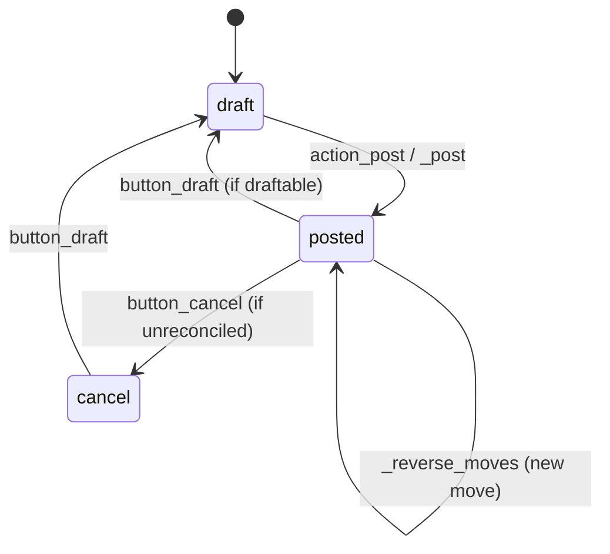

| From | To | Trigger | Guard |
|---|---|---|---|
| `draft` | `posted` | `action_post` | balanced, partner, date, lock date |
| `posted` | `draft` | `button_draft` | not hashed, not locked, not reconciled |
| `posted` | `cancel` | `button_cancel` | unreconciled |
| `cancel` | `draft` | `button_draft` | — |

`payment_state`: `not_paid`, `partial`, `paid`, `in_payment`, `blocked` (computed from reconciliation).

Source: `account/models/account_move.py:130-160`, `:5574-5800`, `:6253`, `:6368`.

---

## 9. Account payment

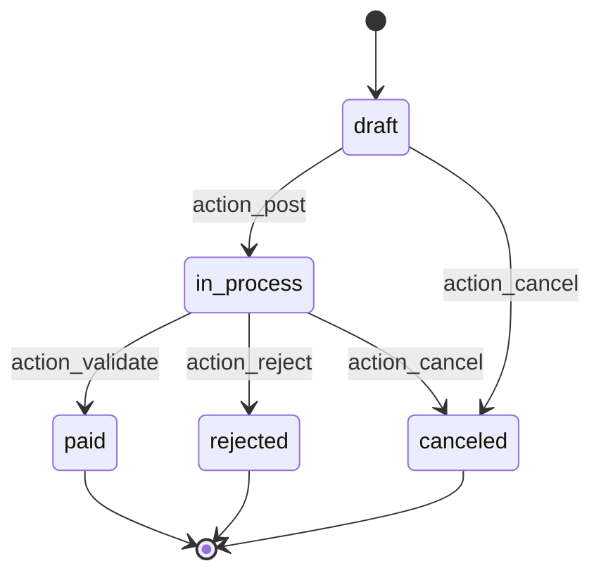

Cash accounts may go directly to `paid` on post.

Source: `account/models/account_payment.py:1126-1160`.

---

## 10. Account asset

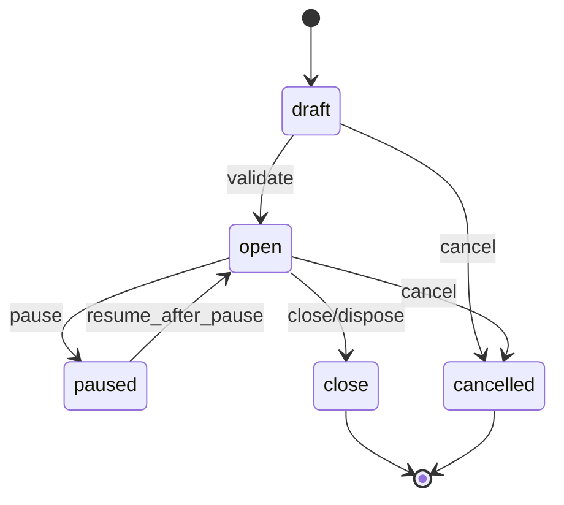

The `model` state is used by asset *templates* (asset models), not by an individual asset.

Depreciation moves are generated while `open`; pausing stops future depreciation. The methods are `validate`, `pause`, `resume_after_pause`, and the close/cancel actions.

Source: `account_asset/models/account_asset.py:32-46`, `:865`, `:993`, `:1002`.

---

## 11. Manufacturing order

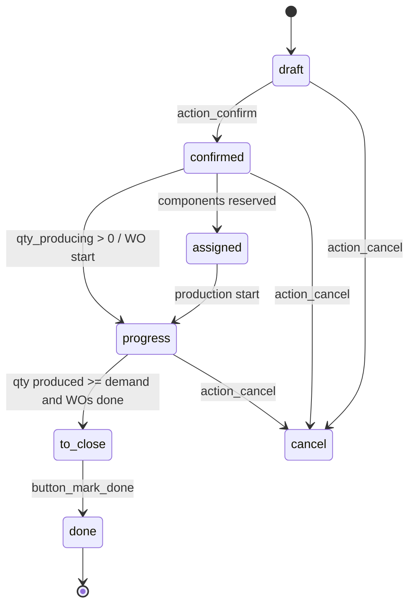

`state` is **computed** (`_compute_state`):

| Condition | State |
|---|---|
| no moves/unsaved | `draft` |
| all finished moves cancelled | `cancel` |
| all raw + finished moves done/cancelled | `done` |
| WOs done/cancelled, or no WOs and produced >= demand | `to_close` |
| any WO progress/done, qty producing > 0, or raw picked | `progress` |
| otherwise | `confirmed` |

Source: `mrp/models/mrp_production.py:177-200`, `:573-620`.

---

## 12. Work order

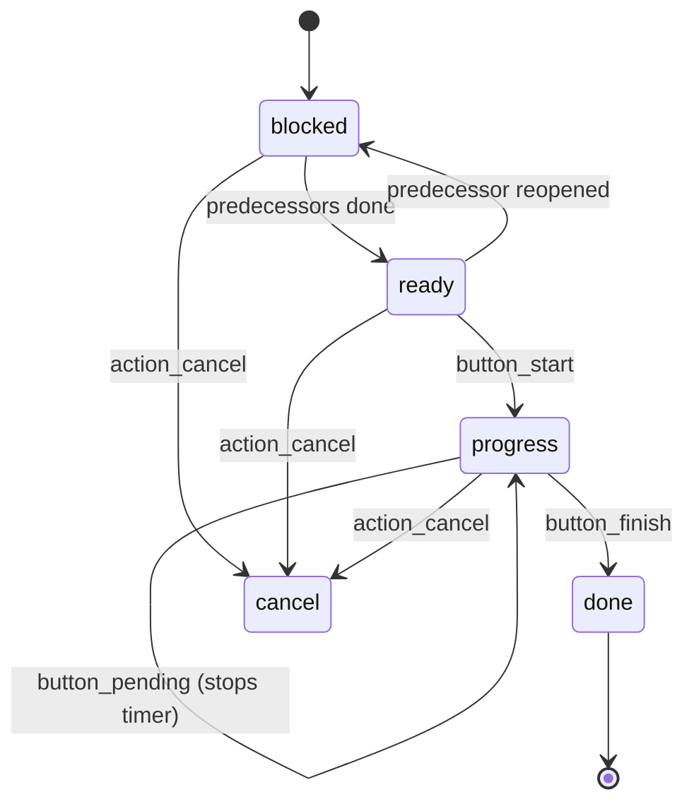

| State | Meaning |
|---|---|
| `blocked` | waiting for a predecessor operation or workcenter unblock |
| `ready` | can start |
| `progress` | time tracking running |
| `done` | finished |
| `cancel` | cancelled |

`button_pending()` stops the current user's timer; it does not by itself change the state. State transitions are computed by `_compute_state`.

Source: `mrp/models/mrp_workorder.py:66-74`, `:656-780`.

---

## 13. Module

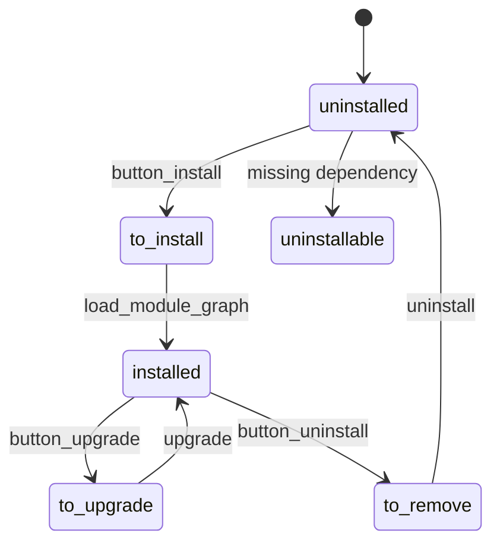

Source: `addons/base/models/ir_module.py`.

---

## 14. Cron job (lifecycle, not a state field)

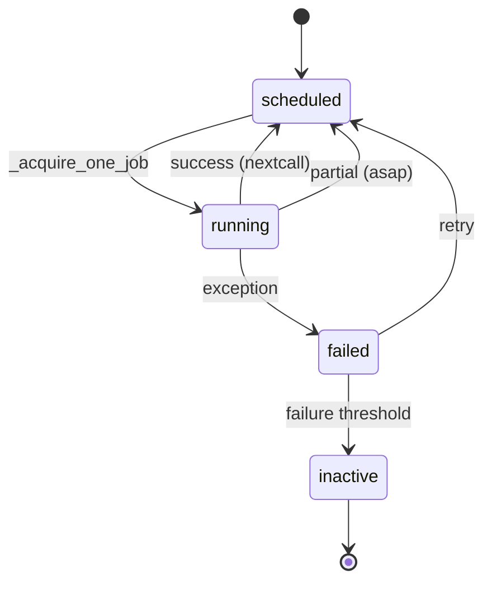

Fields: `active`, `nextcall`, `lastcall`, `failure_count`, `first_failure_date`. Progress in `ir.cron.progress`.

Source: `addons/base/models/ir_cron.py:91-130`, `:399-500`.

---

## 15. Transition testing matrix

| Machine | Happy path | Guard failure | Concurrent | Idempotency |
|---|---|---|---|---|
| Sale order | draft → sale | missing product | double confirm | confirm twice |
| Purchase | draft → purchase | approval | double approve | confirm twice |
| Picking | draft → done | no stock/lot | two operators | validate twice |
| Invoice | draft → posted | unbalanced/lock | sequence contention | post twice |
| Payment | draft → paid | bank untrusted | reconcile same line | register twice |
| MO | draft → done | no components | two operators | mark done twice |
| Cron | scheduled → done | exception | two workers | run twice |

**[INVARIANT]** Every transition must be safe to invoke twice. If it is not, add a state guard and a test.

---

## 16. Evidence index

| Machine | File |
|---|---|
| Sale | `addons/sale/models/sale_order.py:26-81`, `1167-1333` |
| CRM | `addons/crm/models/crm_lead.py:123-233` |
| Purchase | `addons/purchase/models/purchase_order.py:105-116`, `615-655` |
| Picking | `addons/stock/models/stock_picking.py:575-590`, `816` |
| Move | `addons/stock/models/stock_move.py:107-120`, `2244` |
| Account move | `addons/account/models/account_move.py:130-160`, `5574` |
| Payment | `addons/account/models/account_payment.py:1126` |
| Asset | `addons/account_asset/models/account_asset.py` |
| MO | `addons/mrp/models/mrp_production.py:177-200`, `573` |
| Workorder | `addons/mrp/models/mrp_workorder.py:656` |
| Module | `addons/base/models/ir_module.py` |
| Cron | `addons/base/models/ir_cron.py:91-130` |

Continue with `06-nfr.md`.
