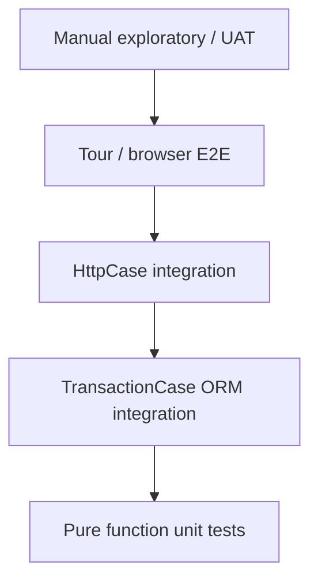
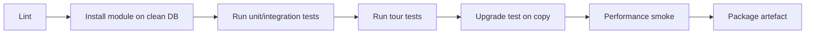

# Software Engineering VII — Test Strategy for Odoo Customisations

> **Premise.** Odoo tests are not generic unit tests. They run inside a real registry, a real transaction, and usually a real database. The framework gives you tools for each layer; using the wrong one produces slow, flaky, or meaningless tests.

---

## 1. Test pyramid for Odoo



| Layer | Speed | Confidence | Use for |
|---|---|---|---|
| Pure unit | ms | logic | pricing, tax maths, validators |
| `TransactionCase` | 100 ms–2 s | ORM behaviour | invariants, computes, flows |
| `HttpCase` | 1–10 s | HTTP/auth/portal | controllers, JSON-RPC, portal |
| Tour | 10–60 s | UI flow | critical user journeys |
| Manual/UAT | hours | business fit | acceptance |

---

## 2. Test base classes

| Class | Transaction | Use |
|---|---|---|
| `BaseCase` | none | helpers, no DB fixture |
| `TransactionCase` | one transaction, rolled back | most ORM tests |
| `SingleTransactionCase` | one transaction for the class | expensive setup shared across tests |
| `HttpCase` | HTTP client + DB | controllers, portal, tours |
| `Form` | in-memory `NewId` | onchange/UI-like tests |

**[WARNING]** `SavepointCase` is not present in Odoo 19. Use `SingleTransactionCase` for class-level fixtures.

Source: `odoo/tests/common.py:302`, `:990`, `:1171`, `:2196`; `odoo/tests/form.py:27`.

---

## 3. What to test

### 3.1 Invariants

Every `@api.constrains`, SQL constraint, and state guard needs a negative test.

```python
def test_end_before_start_rejected(self):
    with self.assertRaises(ValidationError):
        self.env['my.entity'].create({
            'date_start': '2026-02-01',
            'date_end': '2026-01-01',
        })
```

### 3.2 Computes

Test each dependency and multi-record batching.

```python
def test_total_recomputes_on_line_change(self):
    order = self.env['sale.order'].create({...})
    line = order.order_line[0]
    line.product_uom_qty = 5
    self.assertEqual(order.amount_untaxed, 5 * line.price_unit)
```

### 3.3 State transitions

Test happy path, guard failure, double invocation.

```python
def test_confirm_twice_is_idempotent(self):
    order.action_confirm()
    with self.assertRaises(UserError):
        order.action_confirm()
```

### 3.4 Security

- ACL denies by default,
- record rule restricts rows,
- field group hides field,
- portal user sees only own records,
- `sudo()` does not leak.

```python
def test_portal_user_sees_only_own_orders(self):
    order = self._create_order(partner=self.portal_partner)
    other = self._create_order(partner=self.other_partner)
    visible = self.env['sale.order'].with_user(self.portal_user).search([])
    self.assertIn(order, visible)
    self.assertNotIn(other, visible)
```

### 3.5 Multi-company

Create two companies, assert cross-company access is blocked and `_check_company` raises.

### 3.6 Concurrency

`TransactionCase` cannot test two transactions. Use:

- `HttpCase` with two cursors,
- a dedicated `CursorCase`/thread test,
- integration tests against a real server.

```python
def test_sequence_concurrent(self):
    # spawn threads with separate cursors, assert unique names
    ...
```

### 3.7 Performance

```python
def test_confirm_query_count(self):
    with self.assertQueryCount(50):
        order.action_confirm()
```

Set realistic budgets; a count that changes on every patch is a maintenance burden. Test the hot path, not every method.

### 3.8 Tours

```python
def test_create_order_tour(self):
    self.start_tour('/web', 'my_module_create_order', login='admin')
```

Tours are JavaScript recordings; they catch UI regressions but are slower and flakier. Use for 3–5 critical journeys, not every screen.

---

## 4. Test data

### 4.1 Fixtures

- create the minimum records in `setUpClass`,
- use `self.env.ref()` for standard data (company, groups, taxes),
- avoid demo data assumptions,
- isolate company/currency per test when testing multi-company.

### 4.2 Factories

```python
def _make_partner(self, **vals):
    base = {'name': 'Test Partner', 'is_company': True}
    return self.env['res.partner'].create({**base, **vals})

def _make_order(self, partner=None, lines=1):
    partner = partner or self._make_partner()
    return self.env['sale.order'].create({
        'partner_id': partner.id,
        'order_line': [Command.create({
            'product_id': self.product.id,
            'product_uom_qty': 1,
        }) for _ in range(lines)],
    })
```

### 4.3 Demo data

Never rely on demo data in tests. It changes between versions and is not installed in production. Create what you need.

---

## 5. Test organisation

```
my_module/
├── tests/
│   ├── __init__.py
│   ├── common.py            # shared fixtures
│   ├── test_invariants.py
│   ├── test_flows.py
│   ├── test_security.py
│   ├── test_performance.py
│   └── test_tours.py
```

- `tests/__init__.py` imports test modules.
- Test modules are discovered by the Odoo test runner.
- Tag tests (`@tagged('post_install', '-at_install')`) to control when they run.
- Use `@tagged('slow')` for long tests and exclude them from fast CI.

---

## 6. CI pipeline



### 6.1 Stages

| Stage | Command | Gate |
|---|---|---|
| Lint | `ruff`, `pylint-odoo`, `eslint` | no errors |
| Install | `odoo-bin -d test -i my_module --stop-after-init` | exit 0 |
| Tests | `odoo-bin -d test -u my_module --test-enable --stop-after-init` | all pass |
| Tours | `--test-tags /my_module:TestTour` | all pass |
| Upgrade | restore prod copy, `-u my_module` | no errors |
| Security | `bandit`, dependency scan | no high |
| Performance | `assertQueryCount` thresholds | within budget |

### 6.2 Test database strategy

- build a template DB with `base` + dependencies,
- clone per pipeline (`CREATE DATABASE ... TEMPLATE ...`),
- never run tests on production,
- reset sequences/fixtures between runs.

### 6.3 Flakiness

Common causes:

- time-dependent tests (`fields.Datetime.now()`),
- random data without seeds,
- tours with animations/async,
- shared class-level state,
- external APIs.

Fix by freezing time (`freeze_time`), seeding random, waiting for selectors, and isolating state.

---

## 7. Upgrade testing

1. restore a production copy,
2. install the new module version,
3. run migration scripts,
4. run module tests,
5. run smoke flows,
6. compare key totals (trial balance, stock value, open orders),
7. check logs for warnings (`Missing not-null`, `no access rules`).

---

## 8. UAT and acceptance

| Artefact | Content |
|---|---|
| UAT plan | scenarios, roles, data, expected results |
| UAT scripts | step-by-step, screenshots |
| Traceability | requirement → use case → test |
| Sign-off | business owner per domain |
| Defect log | severity, owner, fix version |

UAT is not a demo. Use production-like data and real roles; test exceptions (returns, cancellations, partial payments), not just happy paths.

---

## 9. Test anti-patterns

| Anti-pattern | Problem |
|---|---|
| Testing only happy path | guards untested |
| Asserting on ids | brittle across DBs |
| Relying on demo data | missing in production |
| `cr.commit()` in tests | leaks state, breaks isolation |
| Sleeping instead of waiting | flaky |
| One giant test | hard to diagnose |
| Mocking the ORM | tests nothing real |
| No security tests | privilege bugs |
| No performance budget | regressions unnoticed |
| Tour for everything | slow, flaky CI |

---

## 10. Coverage targets

| Area | Target |
|---|---|
| Custom model invariants | 100% of constraints |
| State transitions | 100% of transitions + guards |
| Security | every model/rule |
| Critical flows | end-to-end |
| Migrations | dry run + data assertions |
| Performance | hot paths only |

Line coverage is a weak metric in Odoo; behaviour coverage matters more.

---

## 11. Evidence index

| Topic | File |
|---|---|
| Test base classes | `odoo/tests/common.py:302`, `990`, `1171`, `2196` |
| Form helper | `odoo/tests/form.py:27` |
| Query count | `odoo/tests/common.py:604` |
| Tour start | `odoo/tests/common.py:2555` |
| Test loader | `odoo/tests/loader.py` |
| Tags | `odoo/tests/suite.py` |

Continue with Volume 7: project management.
