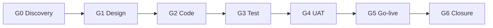

# Project Management IV — Quality Gates and Definition of Done

> **Purpose.** Quality gates are decision points where evidence is reviewed, not meetings where opinions are exchanged. Each gate has entry criteria, evidence, reviewers, and a pass/fail decision.

---

## 1. Gate map

| Gate | Question | Evidence |
|---|---|---|
| G0 Discovery | Is the scope real and funded? | scope, data audit, estimates |
| G1 Design | Will this design work and be maintainable? | architecture, ADRs, ER, security |
| G2 Code | Is the change correct and safe? | review, tests, migration |
| G3 Test | Does the system meet requirements? | test report, performance, security |
| G4 UAT | Does the business accept it? | UAT sign-off, defect closure |
| G5 Go-live | Can we operate it? | cutover plan, runbooks, backup test |
| G6 Closure | Is it handed over and stable? | hypercare report, handover |

---

## 2. G1 — Design review

### 2.1 Checklist

- [ ] Every requirement maps to config/custom/integration.
- [ ] Module boundaries respect dependencies (no core edits, no cycles).
- [ ] Data model uses the right inheritance strategy.
- [ ] State machines are documented with guards.
- [ ] Security matrix covers models, rules, fields, portal.
- [ ] Multi-company and multi-currency are addressed.
- [ ] Integration contracts are versioned and idempotent.
- [ ] Migration strategy is defined and estimated.
- [ ] Performance targets and dataset are defined.
- [ ] Upgrade path and version pinning are documented.
- [ ] ADRs exist for non-obvious decisions.

### 2.2 Reviewers

Architect (chair), functional lead, developer lead, DBA/DevOps, security/compliance, key user for domain.

### 2.3 Exit criteria

Signed design document, approved ADRs, estimated backlog, no open critical design questions.

---

## 3. G2 — Code review

### 3.1 Automatic checks

- lint (ruff/pylint-odoo/eslint),
- unit/integration tests,
- module install on a clean DB,
- migration dry run,
- security scan (bandit, dependency audit),
- no debug code/print/console.log,
- no hard-coded credentials.

### 3.2 Manual checklist

**ORM**

- [ ] `@api.model_create_multi` for `create`.
- [ ] `super()` called in overrides.
- [ ] recordset-safe (no `ensure_one` in loops).
- [ ] `@api.depends` complete.
- [ ] no `cr.commit()` in model code.
- [ ] no raw SQL without flush/parameterisation.
- [ ] no `sudo()` without justification.
- [ ] no `search()` in loops.
- [ ] no unbounded `search([])`.

**Schema**

- [ ] `_description`, `_order`, `_rec_name`.
- [ ] `company_id` + rule for business models.
- [ ] indexes on filtered FKs.
- [ ] SQL constraints for race-free uniqueness.
- [ ] `ondelete` explicit.
- [ ] migration for removed/renamed fields.

**Security**

- [ ] ACLs for all operations.
- [ ] record rules for company/ownership.
- [ ] field groups on sensitive fields.
- [ ] controllers call `check_access`.
- [ ] portal routes scoped to partner.
- [ ] no secrets in code/logs.

**Views/UI**

- [ ] xpath anchors stable.
- [ ] no `position="replace"` of whole forms.
- [ ] access modifiers consistent with groups.
- [ ] assets in the right bundle.
- [ ] translations for user-facing strings.

**Operations**

- [ ] cron idempotent + progress commits.
- [ ] external calls postcommit/outbox.
- [ ] logs structured, no PII.
- [ ] config via ICP/company, not code.
- [ ] tests cover the change.

### 3.3 Exit criteria

Two approvals (author + reviewer), CI green, migration tested, documentation updated.

---

## 4. G3 — System test

### 4.1 Test evidence

- test plan and results,
- automated suite results,
- performance results vs targets,
- security test results,
- regression results,
- defect log with severity.

### 4.2 Performance gate

| Scenario | Target | Result |
|---|---|---|
| SO confirm 50 lines | < 2 s p95 | |
| Delivery 100 lines | < 3 s p95 | |
| Invoice post | < 1 s p95 | |
| Product list 100 | < 1 s p95 | |
| Trial balance 1M lines | < 30 s | |
| Import 10k rows | < 10 min | |

Test on production-like data. An empty DB result is not evidence.

### 4.3 Security gate

- role matrix tested,
- portal isolation tested,
- API auth tested,
- 2FA/admin access verified,
- secrets not in repo,
- dependency scan clean,
- pen test findings closed or accepted.

### 4.4 Data gate

- migration dry run completed,
- row counts reconciled,
- financial totals reconciled,
- stock valuation reconciled,
- attachments verified,
- rollback tested.

---

## 5. G4 — UAT

### 5.1 Entry criteria

- system test passed,
- UAT environment with production-like data,
- users trained,
- scenarios ready,
- defect process live.

### 5.2 Exit criteria

- all critical/high defects closed,
- medium defects accepted with workaround,
- UAT sign-off per domain,
- open issues logged with owners,
- go-live recommendation.

### 5.3 UAT scenarios

Use the use case catalogue. For each:

- precondition,
- steps,
- expected result,
- actual result,
- pass/fail,
- evidence (screenshot/ID).

Include exceptions: returns, cancellations, partial payments, credit limits, multi-currency, multi-company.

---

## 6. G5 — Go-live readiness

### 6.1 Checklist

- [ ] Backup verified and restore tested.
- [ ] Cutover plan with timings and owners.
- [ ] Data migration final run rehearsed.
- [ ] Rollback plan tested.
- [ ] Monitoring/alerts live.
- [ ] Support desk briefed.
- [ ] Users trained and credentials issued.
- [ ] Integrations tested end-to-end.
- [ ] Cron jobs scheduled.
- [ ] Print/report templates verified.
- [ ] Legal/fiscal sign-off.
- [ ] Go/no-go meeting held.

### 6.2 Rollback criteria

Define in advance:

- data reconciliation failure beyond tolerance,
- critical flow unavailable,
- security incident,
- performance unacceptable,
- integration data corruption.

Rollback is a business decision, not a technical one; the PM recommends, the sponsor decides.

---

## 7. G6 — Closure

- hypercare report (incidents, fixes, trends),
- handover to BAU support,
- documentation complete,
- training records,
- open backlog and known issues,
- lessons learned,
- financial closure,
- warranty/support contract.

---

## 8. Definition of Done

A user story is done when:

- [ ] code/config merged,
- [ ] tests written and passing,
- [ ] code reviewed,
- [ ] deployed to staging,
- [ ] functional acceptance by product owner,
- [ ] documentation updated,
- [ ] migration considered,
- [ ] security reviewed (if applicable),
- [ ] performance checked (if hot path),
- [ ] translations added,
- [ ] no new lint warnings.

A release is done when:

- [ ] all stories meet DoD,
- [ ] regression suite green,
- [ ] upgrade tested on a copy,
- [ ] release notes published,
- [ ] backup taken,
- [ ] rollback plan ready.

---

## 9. Quality metrics

| Metric | Target |
|---|---|
| Defect escape rate | < 5% |
| Critical defects open at go-live | 0 |
| Test automation coverage (critical flows) | 100% |
| Code review coverage | 100% |
| Migration reconciliation variance | 0 |
| Performance p95 vs target | within 20% |
| UAT pass rate first cycle | > 80% |
| Post-go-live critical incidents | 0 |

---

## 10. Evidence index

| Gate | Artefact |
|---|---|
| G1 | architecture doc, ADRs, ER diagram |
| G2 | PR review, CI logs, tests |
| G3 | test report, performance report, security report |
| G4 | UAT sign-off, defect log |
| G5 | cutover plan, backup test, runbooks |
| G6 | hypercare report, handover |

Continue with `05-environments-ci.md`.
