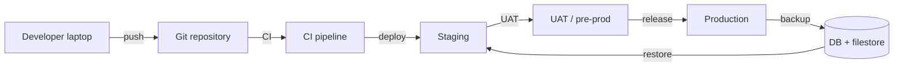
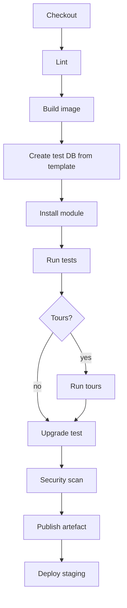

# Project Management V — Environments, CI/CD, and Operations

> **Goal.** Reproducible environments, automated tests, tested backups, and a release process that can be reversed. Odoo's monolithic runtime makes environment parity and database state the two biggest operational risks.

---

## 1. Environment topology



| Environment | Purpose | Data | Access |
|---|---|---|---|
| Dev | coding, unit tests | synthetic | developers |
| CI | build/test | template DB | pipeline |
| Staging | integration, performance | anonymized prod copy | team |
| UAT | business acceptance | anonymized prod copy | key users |
| Prod | live | real | restricted |

**[INVARIANT]** Never test on production. Never copy production data to dev without anonymization/neutralization.

---

## 2. Database copies

### 2.1 Copy procedure

```bash
# 1. stop writes or use a snapshot
pg_dump -Fc -d prod_db -f prod_db.dump
rsync -a /opt/odoo/filestore/prod_db/ /backup/filestore/prod_db/

# 2. create target
createdb -T template0 staging_db
pg_restore -d staging_db prod_db.dump

# 3. restore filestore
rsync -a /backup/filestore/prod_db/ /opt/odoo/filestore/staging_db/

# 4. neutralize
odoo-bin neutralize -d staging_db --config=/etc/odoo/odoo.conf
```

### 2.2 Neutralization

`odoo-bin neutralize` runs `data/neutralize.sql` per installed module:

- disables outgoing mail servers,
- disables payment providers,
- clears API keys/webhooks,
- changes cron schedules,
- resets branding.

**[WARNING]** Custom integrations need their own `neutralize.sql`, or the staging copy will call production APIs.

### 2.3 Anonymization

If personal data must be removed:

- replace partner names/emails/phones,
- scramble VAT/IBAN,
- delete attachments with personal data,
- keep relational integrity.

Anonymization is a custom script; core does not provide it.

---

## 3. Local development

### 3.1 Typical layout

```
project/
├── odoo/                    # submodule or pip install
├── enterprise/              # licensed addons (if any)
├── custom/                  # your modules
├── config/odoo.conf
├── docker-compose.yml
└── scripts/
```

### 3.2 `odoo.conf` essentials

```ini
[options]
addons_path = /opt/odoo/addons,/opt/odoo/enterprise,/opt/custom
data_dir = /var/lib/odoo
db_host = db
db_port = 5432
db_user = odoo
db_password = ***
admin_passwd = ***
workers = 0
limit_time_cpu = 600
limit_time_real = 1200
log_level = info
```

### 3.3 Docker Compose (development)

```yaml
services:
  db:
    image: postgres:16
    environment:
      POSTGRES_DB: odoo
      POSTGRES_USER: odoo
      POSTGRES_PASSWORD: odoo
    volumes:
      - db:/var/lib/postgresql/data
  odoo:
    image: odoo:19.0
    depends_on: [db]
    ports: ["8069:8069"]
    volumes:
      - ./config:/etc/odoo
      - ./custom:/mnt/extra-addons
      - data:/var/lib/odoo
    command: ["odoo", "-c", "/etc/odoo/odoo.conf"]
volumes:
  db:
  data:
```

**[WARNING]** The `odoo:19.0` image may not match your Enterprise source build. For production, build an image from the exact source commit and requirements.

---

## 4. CI pipeline



### 4.1 Example job

```yaml
test:
  image: odoo:19.0
  services:
    - postgres:16
  script:
    - odoo -d test -i my_module --stop-after-init --without-demo=all
    - odoo -d test -u my_module --test-enable --stop-after-init --log-level=test
  artifacts:
    when: always
    paths: [test.log]
```

### 4.2 Test tags

```bash
odoo -d test -u my_module --test-enable --test-tags /my_module:TestFlow
odoo -d test -u my_module --test-enable --test-tags /my_module:TestTour
```

### 4.3 Upgrade job

```bash
# restore a production copy into CI
pg_restore -d upgrade_test prod.dump
odoo -d upgrade_test -u my_module --stop-after-init
# run smoke tests
```

---

## 5. Release management

### 5.1 Versioning

- Odoo modules: `19.0.<major>.<minor>.<patch>`.
- Git tags: `v19.0.1.0.0`.
- Database: record the deployed commit and module versions in `ir_module_module.latest_version`.

### 5.2 Release checklist

- [ ] changelog,
- [ ] migration scripts reviewed,
- [ ] staging upgrade tested,
- [ ] UAT sign-off,
- [ ] backup verified,
- [ ] maintenance window scheduled,
- [ ] rollback plan,
- [ ] post-deploy smoke test.

### 5.3 Deployment steps

```bash
# 1. put the app in maintenance mode (reverse proxy)
# 2. stop workers (keep DB)
systemctl stop odoo
# 3. backup DB + filestore
# 4. deploy code
git checkout v19.0.1.0.0
# 5. upgrade modules
odoo-bin -c /etc/odoo/odoo.conf -d prod -u my_module --stop-after-init
# 6. start workers
systemctl start odoo
# 7. smoke test
curl -f https://erp.example.com/web/health
```

### 5.4 Rollback

```bash
systemctl stop odoo
dropdb prod && createdb -T template0 prod
pg_restore -d prod backup.dump
rsync -a /backup/filestore/prod/ /var/lib/odoo/filestore/prod/
git checkout previous-tag
systemctl start odoo
```

Test the rollback in staging. A rollback that has never been executed is a plan, not a capability.

---

## 6. Backup and restore

| Item | Frequency | Retention |
|---|---|---|
| Full DB dump | daily | 30 days |
| WAL archiving | continuous | 7 days |
| Filestore | daily incremental | 30 days |
| Off-site copy | daily | 90 days |
| Restore test | monthly | record |

### 6.1 Restore validation

- [ ] Database starts.
- [ ] Registry loads without errors.
- [ ] Login works.
- [ ] Key records exist (SO, invoice, stock).
- [ ] Attachments open.
- [ ] Reports render.
- [ ] Cron jobs scheduled.

---

## 7. Monitoring

### 7.1 Infrastructure

- CPU, RAM, disk, network,
- PostgreSQL connections, locks, replication lag, bloat,
- filestore size/growth,
- reverse proxy 5xx/latency.

### 7.2 Application

- `/web/health` (if enabled) or a lightweight controller,
- cron failure count,
- mail queue depth,
- bus backlog,
- integration outbox pending/failed,
- long-running requests.

### 7.3 Alerts

| Alert | Threshold |
|---|---|
| HTTP 5xx | > 1% for 5 min |
| p95 latency | > 2 s for 10 min |
| DB connections | > 80% max |
| Long transaction | > 5 min |
| Cron failures | > 3 consecutive |
| Disk | > 80% |
| Backup failure | any |
| Replication lag | > 60 s |

---

## 8. Security operations

- patch OS/PostgreSQL/Odoo monthly,
- rotate secrets and API keys,
- review admin accounts quarterly,
- enforce 2FA for admins,
- restrict database network access,
- scan dependencies,
- review logs for anomalies,
- test restore and incident response.

---

## 9. Runbooks

Maintain short, tested runbooks:

1. start/stop/restart workers,
2. restore database + filestore,
3. rotate a failed worker,
4. clear a stuck cron,
5. investigate a lock wait,
6. disable an integration,
7. roll back a release,
8. handle a security incident,
9. month-end close support.

Each runbook: trigger, impact, steps, verification, escalation.

---

## 10. Evidence index

| Topic | File |
|---|---|
| Config options | `tools/config.py` |
| Neutralization | `modules/neutralize.py` |
| Cron | `addons/base/models/ir_cron.py` |
| Filestore | `addons/base/models/ir_attachment.py` |
| Health/HTTP | `http.py`, `addons/base/models/ir_http.py` |

Continue with `06-risk-register.md`.
