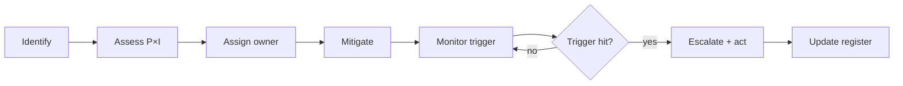

# Project Management VI — Risk Register and Mitigation Playbook

> **Use.** Review at every gate and monthly during delivery. A risk without an owner and a trigger is a wish.

---

## 1. Scoring

| Probability | Score | Impact | Score |
|---|---|---|---|
| Very low | 1 | Negligible | 1 |
| Low | 2 | Minor | 2 |
| Medium | 3 | Moderate | 3 |
| High | 4 | Major | 4 |
| Very high | 5 | Critical | 5 |

`Risk score = probability × impact`. Priority: ≥ 15 critical, 9–14 high, 5–8 medium, ≤ 4 low.

---

## 2. Risk register

| ID | Risk | P | I | Score | Mitigation | Owner | Trigger |
|---|---|---|---|---|---|---|---|
| R-01 | Scope creep | 4 | 4 | 16 | change control, backlog, sponsor sign-off | PM | new requests without CR |
| R-02 | Poor master data | 4 | 5 | 20 | data profiling, cleansing sprints, ownership | Data | duplicates > 5% |
| R-03 | Localization gaps | 3 | 5 | 15 | accountant review, country SME, early test | Functional | tax/report mismatch |
| R-04 | Underestimated integration | 4 | 4 | 16 | contract-first, spike, sandbox | Architect | API undocumented |
| R-05 | Performance at volume | 3 | 4 | 12 | production-like load test, indexes | Architect | p95 > target |
| R-06 | Custom code fragility | 3 | 4 | 12 | tests, review, no core edits | Dev lead | hotfix rate |
| R-07 | Upgrade breaks custom | 3 | 5 | 15 | pinned version, migration tests | Architect | new Odoo release |
| R-08 | Security/privacy incident | 2 | 5 | 10 | ACL/rules review, pen test, 2FA | Security | access anomaly |
| R-09 | Key user unavailable | 4 | 3 | 12 | named deputies, calendar | PM | missed UAT |
| R-10 | Low adoption | 3 | 5 | 15 | change mgmt, training, champions | Change | login/task metrics |
| R-11 | Data migration loss | 2 | 5 | 10 | reconciliation, backup, dry runs | Data | row/total mismatch |
| R-12 | Cutover overrun | 3 | 4 | 12 | rehearsal, runbook, buffer | PM | time > plan |
| R-13 | Vendor/licence constraint | 2 | 4 | 8 | contract review, legal | Sponsor | licence audit |
| R-14 | Auto-install surprise | 3 | 3 | 9 | closure audit, pinned module list | Architect | unexpected module |
| R-15 | Cron/integration duplication | 3 | 4 | 12 | idempotency, advisory locks, monitoring | Architect | duplicate records |
| R-16 | Accounting close failure | 2 | 5 | 10 | parallel run, reconciliation | Controller | close delay |
| R-17 | Filestore/backup gap | 2 | 5 | 10 | backup test, off-site copy | DevOps | restore failure |
| R-18 | Knowledge loss | 3 | 3 | 9 | documentation, pairing, handover | PM | key person leaves |

---

## 3. Top risks in detail

### R-01 Scope creep

**Why it happens:** Odoo makes small changes look easy ("just add a field"). Each field triggers views, security, reports, migrations, and tests.

**Mitigation:**

- baseline scope with explicit out-of-scope list,
- change request with effort/impact,
- sponsor approves scope changes,
- backlog grooming, not hallway requests.

**Trigger:** more than 2 unplanned items in a sprint.

### R-02 Poor master data

**Why it happens:** legacy systems have duplicates, missing fields, inconsistent UoMs, invalid VAT.

**Mitigation:**

- profile data in discovery (counts, nulls, duplicates),
- define golden record rules,
- cleansing sprints before migration,
- reconciliation per entity.

**Trigger:** duplicate rate > 5%, missing mandatory fields > 10%.

### R-03 Localization gaps

**Why it happens:** the `l10n_<country>` module may not cover a specific tax, e-invoice format, or report.

**Mitigation:**

- accountant reviews the chart/taxes early,
- test a full invoice cycle with real fiscal cases,
- budget for custom reports,
- verify e-invoicing with the tax authority sandbox.

**Trigger:** tax report mismatch or rejected e-invoice.

### R-04 Integration underestimation

**Why it happens:** external APIs are undocumented, rate-limited, or semantically different.

**Mitigation:**

- API spike before commitment,
- contract tests,
- idempotency keys,
- outbox + retry,
- sandbox with realistic data.

**Trigger:** mapping ambiguity, repeated 4xx/5xx.

### R-05 Performance at volume

**Why it happens:** demos use 100 records; production has millions.

**Mitigation:**

- production-like dataset,
- performance tests at 2× peak,
- indexes/composite queries,
- read replica for reports,
- archiving strategy.

**Trigger:** p95 exceeds target by 20%.

### R-07 Upgrade breaks custom

**Why it happens:** internal APIs change, models are removed, views are restructured.

**Mitigation:**

- pin Odoo version for the project,
- avoid private APIs where possible,
- migration tests on a copy,
- upgrade budget (10–30% of build),
- monitor release notes.

**Trigger:** new major/minor release.

### R-10 Low adoption

**Why it happens:** users were not involved, training was a demo, processes changed without support.

**Mitigation:**

- key users in design and UAT,
- role-based training,
- champions network,
- SOPs,
- adoption metrics (logins, transactions, workarounds).

**Trigger:** usage below 70% after 2 weeks.

### R-15 Duplicate processing

**Why it happens:** retries, double-click, cron overlap, webhook replays.

**Mitigation:**

- idempotency keys/unique constraints,
- state guards,
- advisory locks for cron,
- outbox with dedupe,
- monitoring for duplicates.

**Trigger:** duplicate invoice/payment/stock document.

---

## 4. Risk review process

Cadence:

- weekly during build,
- daily during UAT/cutover,
- monthly during hypercare,
- at every gate.

---

## 5. Issue vs risk

| | Risk | Issue |
|---|---|---|
| Nature | may happen | already happened |
| Owner | risk owner | issue owner |
| Action | mitigation | resolution |
| Tracking | register | ticket |

Do not let issues masquerade as risks; they need resolution, not mitigation.

---

## 6. Contingency planning

| Scenario | Trigger | Response |
|---|---|---|
| Go-live blocked | critical defect | delay, fix, re-test |
| Data mismatch | reconciliation variance | rollback, fix, reload |
| Integration down | external outage | queue/outbox, manual fallback |
| Performance unacceptable | p95 > 2× target | rollback, tune, retest |
| Security incident | breach/leak | isolate, notify, investigate |
| Key person leaves | notice | knowledge transfer, backup owner |

Each response has a named decision-maker and a communication plan.

---

## 7. Risk register template

| Field | Description |
|---|---|
| ID | R-NN |
| Category | scope/data/tech/security/compliance/ops/vendor/change |
| Description | cause → event → effect |
| Probability | 1–5 |
| Impact | 1–5 |
| Score | P×I |
| Mitigation | preventive action |
| Contingency | if it happens |
| Owner | accountable person |
| Trigger | observable signal |
| Status | open/monitoring/closed |
| Review date | |

---

## 8. Evidence and tailoring

- A small project can use 10 risks; a programme needs 30+.
- Review the register with the sponsor, not just the team.
- Close risks only when the trigger window has passed.
- Feed lessons learned into the next project's register.

Continue with `07-implementation-playbook.md`.
