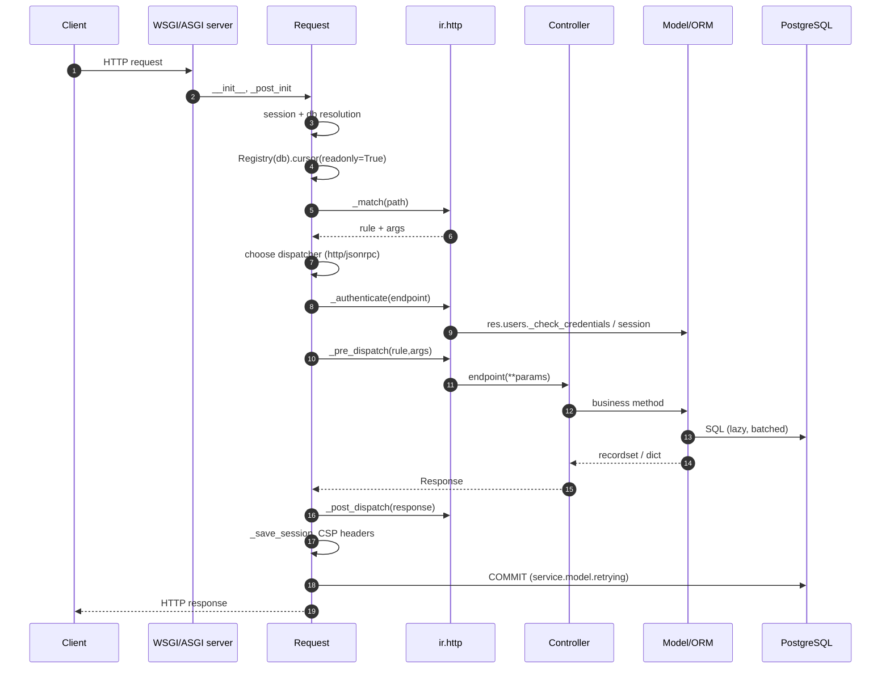

# Arquitectura y modelo de ejecución

> **Alcance.** Odoo 19.0 Enterprise (`odoo-19.0+e.20260826`). Cada afirmación de este documento se verificó contra el árbol de código fuente; la documentación oficial de la 20.0 solo se referencia para señalar divergencias.

---

## 1. Resumen ejecutivo

Odoo es un **servidor de aplicaciones ORM monolítico, dirigido por el registro y con gran peso de metadatos**, respaldado por PostgreSQL. No es una plataforma de microservicios, ni un contenedor de inyección de dependencias al estilo Spring, ni un framework MVC en el sentido web. Su arquitectura se comprende mejor como cinco capas concéntricas:

```
┌─────────────────────────────────────────────────────────────┐
│ 5. Presentation: OWL SPA, website, portal, POS, mobile      │
├─────────────────────────────────────────────────────────────┤
│ 4. Transport: WSGI/ASGI, HTTP controllers, JSON-RPC, bus    │
├─────────────────────────────────────────────────────────────┤
│ 3. Application: models, wizards, cron, actions, automation  │
├─────────────────────────────────────────────────────────────┤
│ 2. ORM kernel: registry, environment, fields, cache, SQL    │
├─────────────────────────────────────────────────────────────┤
│ 1. Data: PostgreSQL schema + filestore + module metadata     │
└─────────────────────────────────────────────────────────────┘
```

Los hechos arquitectónicos dominantes:

- **Un registro por base de datos**, construido una vez y compartido por todos los workers mediante un mecanismo de copia al escribir (copy-on-write) más señalización del registro.
- **Un cursor por petición**, envuelto en un `Environment` que contiene `cr`, `uid`, `context`, `su` y una `Transaction` que contiene la caché de registros y los recálculos pendientes.
- **Los modelos son clases ensambladas en tiempo de ejecución** a partir de las definiciones de todos los módulos instalados mediante el MRO de Python. No existe un «registro de servicios» en tiempo de ejecución separado del registro de modelos.
- **La lógica de negocio reside en los métodos de los modelos**, no en los controladores. Los controladores son adaptadores finos que deserializan, autentican, invocan un modelo y serializan.
- **El esquema de la base de datos se genera a partir de las definiciones de campos en Python**, salvo que un modelo lo desactive con `_auto = False` o use `_table_query`.
- **Todo está dirigido por metadatos**: las vistas, acciones, seguridad, informes, menús y trabajos cron son filas de la base de datos, editables en tiempo de ejecución.

---

## 2. Topología de procesos y despliegue

### 2.1 Procesos de ejecución

| Proceso | Punto de entrada | Responsabilidad |
|---|---|---|
| Servidor HTTP (con hilos o gevent) | `odoo/http.py`, `odoo/service/server.py` | Sirve web, JSON-RPC, XML-RPC, longpolling/websocket |
| Worker de cron | `odoo/addons/base/models/ir_cron.py` | Reclama y ejecuta trabajos de `ir.cron` en transacciones dedicadas |
| Bus de mensajes / websocket | `odoo/addons/bus/` | `NOTIFY` de PostgreSQL → envío por websocket |
| Filestore | local o compatible con S3 | Adjuntos binarios fuera de PostgreSQL |
| PostgreSQL | externo | Todos los datos relacionales, traducciones JSONB, valores dependientes de la compañía |

El servidor puede ejecutarse en modo **prefork** (`--workers=N`) o en modo **con hilos**. En modo prefork, cada worker es un proceso independiente con su propio objeto de registro; la consistencia del registro se mantiene mediante **señalización del registro** (`Registry.check_signaling`, `signal_changes`, `NOTIFY` de PostgreSQL).

### 2.2 Ciclo de vida de una petición (HTTP)



Anclas clave en el código fuente:

| Paso | Ubicación |
|---|---|
| Clase `Request` | `http.py:1793` |
| Resolución de base de datos/sesión | `http.py:1810` (`_get_session_and_dbname`) |
| Estrategia de cursor de solo lectura | `http.py:2267` (`_serve_db`) |
| Coincidencia de rutas | `ir.http._match`, `addons/base/models/ir_http.py` |
| Autenticación | `ir.http._authenticate` |
| Reintento + commit | `service/model.py:160` (`retrying`) |
| Despachadores | `http.py:2447` (`HttpDispatcher`), `http.py:2520` (`JsonRPCDispatcher`) |

### 2.3 La ruta rápida de solo lectura [V19]

Odoo 19 abre primero un **cursor de solo lectura**, hace coincidir la ruta y solo lo eleva a cursor de lectura/escritura si la ruta no es `readonly` o si se lanza una `ReadOnlySqlTransaction`. Es una característica de rendimiento y seguridad significativa:

- Las rutas declaradas `readonly=True` nunca toman bloqueos de escritura.
- Una escritura intentada en una ruta de solo lectura genera una excepción, se registra y la petición se reintenta con un cursor de lectura/escritura.
- No se debe confiar en esto como frontera de seguridad; es una optimización con un mecanismo de reserva.

```python
@http.route('/report/pdf/<int:report_id>', type='http', auth='user', readonly=True)
def report_pdf(self, report_id):
    ...
```

**[WARNING]** Las rutas de solo lectura de larga duración siguen manteniendo una instantánea de PostgreSQL. En una base de datos con mucha actividad, esto contribuye a la inflación (bloat) y puede bloquear vacuum. Mantener los endpoints de informes acotados y paginados.

---

## 3. El registro

### 3.1 Qué es

`odoo.orm.registry.Registry` es un `Mapping[str, type[BaseModel]]` con exactamente una instancia por base de datos (por proceso). Posee:

- las clases de modelo ensambladas,
- los grafos de dependencias de campos (`field_depends`, `field_depends_context`),
- los árboles de disparadores de campos calculados,
- los metadatos de relaciones many2many,
- las cachés (`_REGISTRY_CACHES`),
- el estado de carga de módulos,
- los indicadores de preparación del esquema.

Ruta de creación:

```
Registry(db_name)
  -> Registry.new()
     -> load_modules()
        -> ModuleGraph(cr, mode='load'|'update')
        -> for each module in phase order: registry.load(package)
        -> model_classes.add_to_registry()
        -> registry._setup_models__()
        -> registry.init_models()  # schema sync
```

### 3.2 Ensamblaje de clases de modelo [INTERNAL pero esencial]

Odoo distingue las **definiciones de modelo** (clases escritas en los módulos) de las **clases de modelo** (clases del registro). La clase de registro de `sale.order` hereda, en orden inverso de módulos, de cada definición que contribuyó a ella:

```
Model
 ├── SaleOrder (sale)
 ├── SaleOrder (sale_stock)
 ├── SaleOrder (sale_mrp)
 └── ...
        ↓
   registry['sale.order']  (single dynamic class)
        ↓
   recordset instances
```

Consecuencias:

- `super()` dentro de un método de modelo recorre el **orden de carga de módulos**, no el orden en que se escribió el módulo.
- El MRO es determinista pero **no obvio**; depende de la topología de dependencias y de los nombres de módulo dentro de la misma fase.
- Una sobrescritura de método puede omitirse silenciosamente si dos módulos no dependen entre sí y ambos sobrescriben el mismo método. El que se carga después envuelve al anterior.
- Las definiciones de campos se fusionan; un campo redefinido en un módulo posterior reemplaza atributos pero conserva su identidad en la caché.

Fuente: `orm/model_classes.py:1-140` (la explicación canónica), `orm/model_classes.py:152` (`add_to_registry`), `orm/registry.py:375` (`load`).

### 3.3 Eventos del ciclo de vida del registro

| Evento | Disparador | Efecto |
|---|---|---|
| Construcción del registro | primera petición o inicio de `odoo-bin` | carga módulos, construye clases, sincroniza el esquema |
| Instalación/actualización de módulo | `-i`, `-u`, interfaz de Aplicaciones | reconstrucción parcial del registro, migración del esquema |
| Señalización del registro | otro worker confirma un cambio de módulo | `check_signaling` recarga el registro |
| Reinicio del registro | `env.transaction.reset()` | limpia las cachés, vuelve a enlazar el registro |
| Reciclado de workers | `--max-cron-threads`, `--limit-request` | el nuevo proceso reconstruye el registro |

**[INVARIANT]** Nunca se debe mantener una referencia a una clase de modelo entre recargas del registro. Usar `env['model.name']`, no una clase en caché. Una clase obsoleta apunta a un registro obsoleto y produce `MissingError` o escrituras en la versión de esquema equivocada.

---

## 4. Entorno, cursor y transacción

### 4.1 Composición del entorno

```python
env = Environment(cr, uid, context, su=False)
env['sale.order']          # empty recordset
env(ref='base.main_company')
env(user=2, context={'lang': 'fr_FR'})   # new or reused env
env.su                     # superuser mode flag
env.company                # current company from context
env.companies              # allowed companies
```

`Environment` es un `Mapping` y es **inmutable una vez creado**. `env(...)` devuelve un entorno nuevo o en caché. Los entornos se almacenan en caché por transacción, indexados por `(cr, uid, su, context)` (`orm/environments.py:66`).

Implicaciones críticas:

- `with_user()` y `with_context()` **no** modifican el entorno actual; devuelven uno derivado.
- Los entornos derivados comparten la misma `Transaction`, y por tanto la misma caché y los mismos cálculos pendientes.
- `sudo()` establece `su=True` pero **no cambia `uid`**. Los campos de auditoría (`create_uid`, `write_uid`) siguen registrando el usuario original a menos que también se use `with_user(SUPERUSER_ID)`.
- `env.context` es un `frozendict`; mutarlo genera una excepción o no hace nada silenciosamente según la ruta. Usar siempre `with_context`.

### 4.2 Objeto de transacción

`Transaction` (`orm/environments.py:552`) es el contenedor de estado por cursor:

| Atributo | Propósito |
|---|---|
| `field_data` | caché `{field: {record_id: value}}` |
| `field_dirty` | valores modificados en la caché pero aún no escritos |
| `field_data_patches` | adiciones x2many diferidas |
| `tocompute` | recálculos pendientes `{field: ids}` |
| `protected` | campos temporalmente inmunes al recálculo |
| `envs` | conjunto débil de entornos que comparten la transacción |
| `default_env` | entorno utilizado para el volcado (flush) |

El cursor posee las colas de callbacks `precommit`, `postcommit`, `prerollback`, `postrollback` (`sql_db.py:160`). No son hooks del ORM; son hooks del ciclo de vida de la transacción utilizados por el bus, el correo y el almacenamiento de adjuntos.

### 4.3 Reglas de entorno y transacción

- **[INVARIANT]** Todos los conjuntos de registros pasados a la misma operación de negocio deben compartir un entorno y un cursor. Mezclar cursores produce escrituras invisibles e incoherencia de caché.
- **[INVARIANT]** Nunca se debe llamar a `cr.commit()` dentro de un método de modelo. Rompe la transacción de la petición, confirma media operación de negocio y anula la lógica de reintentos.
- Usar `with env.cr.savepoint():` para operaciones que pueden fallar sin abortar toda la petición (p. ej., una inserción única opcional).
- `env.flush_all()` fuerza el volcado a SQL de los cálculos y escrituras pendientes. Llamarlo antes de SQL directo que lea columnas modificadas por el ORM.
- `env.invalidate_all()` descarta la caché; usarlo solo tras SQL masivo o cambios externos.

---

## 5. El ORM como entorno de ejecución de la lógica de negocio

### 5.1 Los conjuntos de registros son la unidad de trabajo

Todo es un conjunto de registros: `self` en un método puede contener 0, 1 o N registros. El modelo de rendimiento del framework depende de las **operaciones por lotes**:

```python
# Good: one SQL query for all partners
partners = self.env['res.partner'].browse(ids)
names = partners.mapped('name')

# Bad: N queries
for pid in ids:
    name = self.env['res.partner'].browse(pid).name
```

**[WARNING]** `ensure_one()` dentro de un bucle sobre `self` es un error común de rendimiento y corrección. O lanza una excepción en llamadas con varios registros, o fuerza el procesamiento registro a registro. Preferir código vectorizado; llamar a `ensure_one()` solo en verdaderos límites de API (acciones de botones, asistentes, métodos de informes).

### 5.2 Mecánica de campos

Cada campo es un descriptor que media entre la caché, la base de datos y el comportamiento de cálculo, inverso, relacionado y traducción. Las categorías de campos importantes:

| Categoría | Almacenamiento | Recálculo | Trampa habitual |
|---|---|---|---|
| Normal almacenado | columna | solo si `compute` | los valores por defecto se aplican al crear, no al escribir |
| Calculado almacenado | columna | disparado por dependencias | obsoleto si no se declara la dependencia |
| Calculado no almacenado | solo caché | al acceder | no se puede buscar/ordenar de forma eficiente |
| Relacionado almacenado | columna | disparado por dependencias | una cadena de campos relacionados puede disparar el recálculo |
| Relacionado no almacenado | solo caché | al acceder | los derechos de acceso se evalúan en el destino |
| Dependiente de la compañía | columna `jsonb` | por compañía | las consultas SQL necesitan `->company_id` |
| Traducido | columna `jsonb` | por idioma | indexación solo trigram |
| Binario | adjunto o columna | — | el contexto `bin_size` cambia la representación |
| Propiedades | `jsonb` | por definición | el esquema es dato, no código |

Fuente: `orm/fields.py:781` (`column_type`), `orm/fields.py:1138` (`update_db`), `orm/fields_relational.py:576` (caché x2many), `orm/fields_textual.py:291` (caché de texto traducido).

### 5.3 Cálculo, inverso y búsqueda

Un campo calculado tiene hasta tres funciones invocables:

```python
total = fields.Monetary(compute='_compute_total', inverse='_inverse_total', search='_search_total')
```

- `compute` se ejecuta cuando se lee el campo y falta, o cuando cambia una dependencia.
- `inverse` se ejecuta cuando se escribe el campo; debe escribir los campos almacenados subyacentes.
- `search` traduce un dominio sobre el campo calculado en un dominio sobre campos almacenados.

**[INVARIANT]** Un campo calculado no almacenado sin `search` no se puede usar en un dominio, un `order`, una agrupación (group-by) ni una regla de registro. Odoo lanza `NotImplementedError` o lo ignora silenciosamente según el contexto.

### 5.4 Caché y recálculo

La caché es **transaccional y por campo**:

```
Transaction.field_data[field][record_id] = value
Transaction.field_dirty[field] = {ids changed but not flushed}
Transaction.tocompute[field] = {ids needing recompute}
```

Cuando se escribe un campo:

1. `write()` valida el acceso y los valores.
2. Los descriptores de campo escriben en la caché y marcan como sucio.
3. `modified()` recorre el árbol de disparadores y marca los campos almacenados dependientes en `tocompute`.
4. Al hacer flush (commit, búsqueda o `flush_all` explícito), el recálculo se ejecuta hasta un punto fijo (máximo 10 iteraciones, `MAX_FIXPOINT_ITERATIONS`).
5. Los valores sucios se escriben en sentencias `UPDATE ... FROM (VALUES ...)` por lotes.

Fuente: `orm/models.py:4334` (`write`), `orm/models.py:6756` (`modified`), `orm/environments.py:380` (`flush_all`), `orm/models.py:6934` (`_recompute_recordset`).

Consecuencias:

- Leer un campo calculado almacenado puede desencadenar una escritura. Un endpoint de «lectura» no es necesariamente de solo lectura.
- El orden de recálculo se rige por las dependencias, no por el orden de declaración.
- Un `@api.depends` ausente no falla de forma ruidosa; produce valores obsoletos que pueden persistir hasta el reinicio.
- `@api.depends_context('lang')` crea una entrada de caché separada por valor de contexto; no se puede almacenar.

---

## 6. Carga de módulos y sincronización del esquema

### 6.1 Fases de carga

`ModuleGraph` (`modules/module_graph.py`) calcula una fase y una profundidad para cada módulo. En modo **load**:

```
phase 0: base
phase 1: every other module, sorted by (depth, name)
```

En modo **update**, las fases alternan entre módulos que requieren inicialización de esquema y los que no, de modo que las dependencias se cargan antes que los dependientes. Los módulos de prueba se ordenan inmediatamente después de su última dependencia.

### 6.2 Flujo de procesamiento por módulo

Para cada módulo en orden de fase (`modules/loading.py:115`):

1. `load_openerp_module()` — importa el paquete Python, registrando las definiciones de modelos en `MetaModel`.
2. `registry.load(package)` — instancia las clases de modelo a partir de las definiciones.
3. `registry._setup_models__()` — configuración incremental de campos.
4. `registry.init_models()` — crea o altera tablas, columnas, índices y restricciones; refleja `ir.model*`.
5. `load_data()` — analiza los archivos de datos XML/CSV en el orden del manifiesto.
6. `load_demo()` — datos de demostración si están habilitados.
7. `migrate_module('post')` — ejecuta los scripts de migración.
8. `post_init_hook` — hook opcional de Python.
9. `module.write({'state': 'installed'})` — commit.

**[WARNING]** Los archivos de datos se cargan con semántica `noupdate` controlada por XML. Un registro con `noupdate="1"` **no se actualiza** al actualizar el módulo, aunque se modifique el XML. Esta es la causa más común de «mi cambio no se aplicó» en producción.

### 6.3 Sincronización del esquema

`init_models()` es idempotente y aditivo:

- Crea las tablas ausentes (`CREATE TABLE`).
- Añade las columnas ausentes (`ALTER TABLE ADD COLUMN`).
- Crea los índices declarados con `index=True`.
- Añade las restricciones SQL declaradas mediante `models.Constraint` / `_sql_constraints`.
- **Nunca elimina columnas** cuando se elimina un campo. Registra una advertencia; la columna permanece.
- Los renombrados no se detectan; un campo renombrado crea una columna nueva y deja la antigua.

Fuente: `orm/models.py:3170` (`_auto_init`), `orm/registry.py:750` (`init_models`), `orm/registry.py:829` (`check_indexes`).

**[INVARIANT]** Dado que las columnas nunca se eliminan automáticamente, toda actualización de producción necesita un plan de migración explícito para los campos eliminados o renombrados. Véase `03-database/05-migrations.md`.

---

## 7. HTTP, RPC y contratos de controladores

### 7.1 Declaración de rutas

```python
from odoo import http
from odoo.http import request

class MyController(http.Controller):

    @http.route('/my/endpoint', type='jsonrpc', auth='user', methods=['POST'])
    def endpoint(self, **kwargs):
        records = request.env['my.model'].search([])
        return {'count': len(records)}
```

Atributos de ruta relevantes:

| Atributo | Efecto |
|---|---|
| `type` | `http`, `jsonrpc`, `websocket`; selecciona el despachador |
| `auth` | `user`, `public`, `none`; controla la autenticación de sesión |
| `methods` | verbos HTTP; por defecto, todos |
| `readonly` | usa la ruta rápida del cursor de solo lectura [V19] |
| `csrf` | validación CSRF para POST `http`; por defecto, `True` |
| `cors` | política CORS |
| `save_session` | si los cambios de sesión se persisten |
| `max_content_length` | límite de subida |

### 7.2 Contrato JSON-RPC

El JSON-RPC de Odoo difiere de la especificación:

- La ruta HTTP selecciona el método; el campo `method` del JSON se ignora.
- `params` debe ser un objeto, no un arreglo posicional.
- Los errores se devuelven como `{"error": {"code", "message", "data"}}` con HTTP 200.
- `context` en los parámetros reemplaza el contexto de sesión para esa llamada.

Fuente: `http.py:2500-2600`.

**[WARNING]** JSON-RPC devuelve HTTP 200 para errores de aplicación. La monitorización basada en el estado HTTP no detectará los fallos de negocio. Hay que analizar el miembro `error`.

### 7.3 El envoltorio `retrying`

`service/model.py:160` envuelve cada llamada RPC:

- reintenta ante `SerializationFailure`, `DeadlockDetected`, `LockNotAvailable`, `IntegrityError` (convertido en `ValidationError`),
- hasta 5 intentos con retroceso exponencial,
- revierte y reinicia la transacción entre intentos,
- hace commit una sola vez al final,
- ejecuta los callbacks `postcommit` después del commit.

**[WARNING]** Los efectos secundarios ejecutados antes de un fallo de serialización **no** se revierten si escapan de la transacción: archivos escritos en el filestore, correos enviados, llamadas HTTP a sistemas externos, llamadas a `cr.commit()`. Hay que hacer idempotentes los efectos secundarios externos o diferirlos a `postcommit`.

---

## 8. Mecanismos asíncronos

### 8.1 Cron

`ir.cron` es un delegado de `ir.actions.server`. El programador:

1. Reclama un trabajo con `SELECT ... FOR UPDATE SKIP LOCKED` (`_acquire_one_job`).
2. Lo ejecuta en un **cursor y una transacción nuevos**.
3. Admite notificación de progreso (`ir.cron.progress`) y finalización parcial.
4. Reprograma si tiene éxito; aplica retroceso y finalmente desactiva tras fallos repetidos.
5. Confirma el progreso por separado de la transacción principal del trabajo.

Fuente: `addons/base/models/ir_cron.py:187-500`.

**[INVARIANT]** Un trabajo cron debe ser idempotente. Puede ejecutarse varias veces de forma concurrente en distintos workers si se pierde el bloqueo o si el trabajo se activa manualmente. Usar bloqueos advisory o guardas de estado para los trabajos destructivos.

### 8.2 Bus / websocket

`bus.bus` es una tabla de mensajes respaldada por PostgreSQL más `NOTIFY`:

- `_sendone(target, type, message)` añade a `cr.precommit.data['bus.bus.values']`.
- Un hook precommit inserta filas.
- Un hook postcommit envía `NOTIFY imbus` con las cargas útiles de los canales.
- Los workers websocket consultan `bus.bus` y envían a los clientes.
- Los mensajes antiguos se recogen mediante `_gc_messages` (retención predeterminada configurable).

Fuente: `addons/bus/models/bus.py:88-200`.

**[WARNING]** Las notificaciones del bus son **como máximo una vez** (at-most-once). Un cliente desconectado pierde mensajes; la interfaz debe resincronizarse al reconectarse.

### 8.3 Correo

`mail.thread` es un mixin que añade mensajería, seguidores, actividades y seguimiento a cualquier modelo. No es un servicio separado. `message_post()` escribe `mail.message`, actualiza los seguidores y programa notificaciones por correo/websocket. El envío de correo es asíncrono por defecto (cola `mail.mail` + cron).

**[WARNING]** `message_post()` dentro de un bucle es un problema clásico de rendimiento. Procesarlo por lotes o usar `message_post_with_source` con una plantilla y destinatarios explícitos.

---

## 9. Persistencia y almacenamiento

### 9.1 PostgreSQL

- Un esquema por base de datos, normalmente `public`.
- Las tablas se nombran según el modelo con los puntos reemplazados por guiones bajos (`sale.order` → `sale_order`).
- Las claves primarias son enteros `SERIAL`.
- Se crean claves externas para las relaciones many2one y many2many, con semántica `ON DELETE` derivada del campo.
- No hay aislamiento de inquilinos a nivel de base de datos; cada inquilino es una base de datos separada.
- Las extensiones `unaccent`, `pg_trgm` y `btree_gin` se usan para la búsqueda.

### 9.2 Filestore

Los campos binarios se pueden almacenar:

- en la base de datos (`attachment=True` es el valor predeterminado para la mayoría de los campos),
- en el filestore (`attachment=True` más el manejo de `bin_size`),
- como una referencia calculada/externa.

La ruta del filestore se deriva del nombre de la base de datos y del SHA del adjunto. **Las copias de seguridad de la base de datos sin el filestore están incompletas.** Este es el fallo de recuperación ante desastres más común en los despliegues de Odoo.

### 9.3 Columnas JSONB

Dos usos importantes:

- **Traducciones**: `name` es `jsonb` `{"en_US": "...", "fr_FR": "..."}` cuando `translate=True`.
- **Campos dependientes de la compañía**: `jsonb` indexado por id de compañía (`{"1": value, "2": value}`).

Las consultas deben usar el operador correcto:

```sql
-- translated value for current language
SELECT name->>'en_US' FROM product_template;

-- company-dependent value with fallback
SELECT COALESCE(property_account_income_id->'1', 'null'::jsonb)
FROM product_category;
```

---

## 10. Lista de verificación de invariantes arquitectónicos

- **[INVARIANT]** Un cursor, una transacción, un entorno por operación de negocio.
- **[INVARIANT]** Nunca hacer commit dentro del código de modelo.
- **[INVARIANT]** Nunca almacenar en caché una clase de modelo o un conjunto de registros entre peticiones.
- **[INVARIANT]** Todo campo calculado almacenado necesita un `@api.depends` completo.
- **[INVARIANT]** Todo cambio de esquema necesita una migración; Odoo no eliminará ni renombrará columnas.
- **[INVARIANT]** Todo efecto secundario externo debe ser idempotente o ejecutarse después del commit.
- **[INVARIANT]** Las reglas de registro se evalúan en SQL; `sudo()` las omite, `with_user()` no.
- **[WARNING]** El orden de carga de módulos determina el orden de sobrescritura; declarar dependencias para cada módulo cuyo comportamiento se extienda.
- **[WARNING]** Los datos con `noupdate="1"` nunca se refrescan al actualizar.
- **[WARNING]** Las transacciones largas bloquean vacuum y la asignación de secuencias; mantener las peticiones cortas.

---

## 11. Dónde termina la documentación oficial

La documentación oficial para desarrolladores de la 20.0 cubre:

- conceptos básicos de la API de modelos/campos, vistas, acciones, menús, grupos de seguridad,
- controladores, enrutamiento HTTP, JSON-RPC,
- conceptos básicos del manifiesto de módulos, archivos de datos, assets, pruebas,
- scripts de actualización y CLI.

**No** cubren adecuadamente:

- el ensamblaje de clases del registro y las consecuencias del MRO,
- los aspectos internos de la caché transaccional y el recálculo,
- `retrying` y la semántica de serialización,
- las consultas JSONB dependientes de la compañía y traducidas,
- los límites de la sincronización del esquema (sin eliminaciones ni renombrados),
- la API de progreso de cron, la reclamación de trabajos y la concurrencia,
- las garantías de entrega del bus,
- las eliminaciones arquitectónicas de la 18→19,
- las implicaciones de rendimiento de los campos calculados almacenados y el prefetch,
- la cadena de hash contable y el bloqueo de secuencias,
- el comportamiento de los módulos exclusivos de Enterprise.

Esas lagunas son la razón de este manual. Continuar con `01-business-logic/01-orm-runtime.md`.
