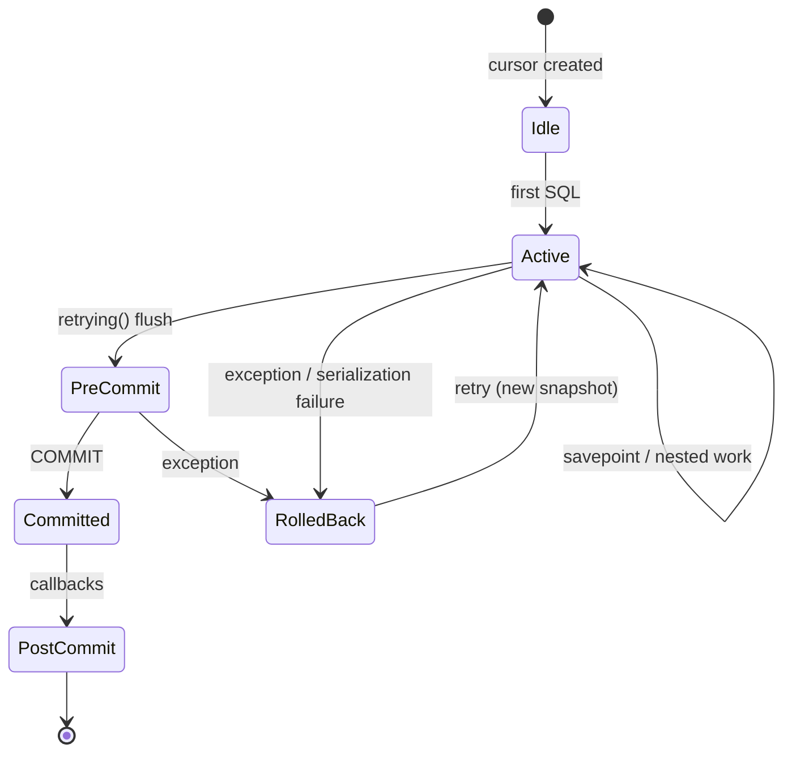

# Capa de lógica de negocio II — Transacciones, concurrencia e integridad de datos

> **Versión.** Odoo 19.0 Enterprise. La semántica de transacciones es una de las partes menos documentadas y más determinantes de la plataforma.

---

## 1. El contrato de transacción

Cada unidad de trabajo de Odoo es una **transacción de PostgreSQL** vinculada a un cursor. La plataforma ofrece cuatro garantías y una no garantía:

| Garantía | Mecanismo |
|---|---|
| Atomicidad de una petición | un cursor, confirmación al final de `service.model.retrying` |
| Caché consistente | `Transaction` invalida/recalcula dentro del mismo cursor |
| Aislamiento | `REPEATABLE READ` (aislamiento por instantánea) |
| Reintento automático ante fallo de serialización/interbloqueo | `retrying()` hasta 5 intentos |
| **No garantizado:** efectos secundarios externos exactamente una vez | sin transacción distribuida, sin outbox por defecto |

### 1.1 Nivel de aislamiento

Odoo establece `ISOLATION_LEVEL_REPEATABLE_READ` en cada conexión (`sql_db.py:373`). PostgreSQL lo asigna a aislamiento por instantánea:

- una transacción ve una instantánea consistente desde su primera consulta,
- las actualizaciones concurrentes de la misma fila provocan un fallo de serialización al confirmar,
- las lecturas no bloquean las escrituras y las escrituras no bloquean las lecturas,
- `SELECT ... FOR UPDATE` toma bloqueos de fila de forma explícita.

**[INVARIANT]** Con `REPEATABLE READ`, una petición de larga duración ve datos obsoletos de forma deliberada. Si se necesita el valor confirmado más reciente a mitad de una transacción, se debe usar `SELECT ... FOR UPDATE` o iniciar una nueva transacción. `env.invalidate_all()` solo limpia la caché del ORM; no refresca la instantánea de PostgreSQL.

### 1.2 Ciclo de vida de una transacción



Fuente: `service/model.py:160` (`retrying`), `sql_db.py:207` (`commit`), `sql_db.py:217` (`savepoint`), `tools/misc.py:1110` (`Callbacks`).

---

## 2. API de cursor y transacciones

### 2.1 Creación de cursores

```python
with registry.cursor() as cr:          # commits on success, rolls back on exception
    env = api.Environment(cr, uid, {})
    ...

with registry.cursor(readonly=True) as cr:   # read-only transaction
    ...
```

`Cursor` envuelve una conexión `psycopg2` proveniente de un pool. `close()` devuelve la conexión al pool; si la conexión está en estado de fallo, se descarta. Los cursores que se filtran agotan el pool y dejan bloqueado el servidor.

### 2.2 Confirmación y reversión

```python
cr.commit()     # runs precommit, COMMIT, postcommit
cr.rollback()   # runs prerollback, ROLLBACK, postrollback
```

**[INVARIANT]** El código de aplicación no debe llamar a `cr.commit()` ni a `cr.rollback()` dentro de un método de modelo. Los únicos lugares legítimos son:

- el contenedor externo de la petición o tarea,
- los scripts de migración,
- las confirmaciones de progreso de `ir.cron`,
- los trabajos por lotes de larga duración explícitamente documentados que gestionan su propia transacción.

Confirmar dentro de un método de negocio rompe la atomicidad de la petición: una excepción posterior no puede deshacer la confirmación anterior, y el contenedor de reintentos volverá a ejecutar el método sobre un estado parcialmente confirmado.

### 2.3 Puntos de guardado

```python
try:
    with env.cr.savepoint():
        env['my.model'].create({...})
except IntegrityError:
    # the savepoint was rolled back; the outer transaction is still usable
    ...
```

`env.cr.savepoint(flush=True)` vuelca los cambios pendientes del ORM antes de crear el punto de guardado. Al revertir, también **limpia la caché del ORM** (`_FlushingSavepoint.rollback`), porque las entradas de la caché pueden reflejar los cambios revertidos.

Reglas:

- Un punto de guardado no proporciona una nueva instantánea; solo permite una reversión parcial.
- La reversión de un punto de guardado no deshace los efectos secundarios externos.
- PostgreSQL admite puntos de guardado anidados, pero el código de Odoo los usa con moderación; cada uno tiene un coste.
- `savepoint(flush=False)` es más rápido, pero puede dejar la caché incoherente con la base de datos si el cuerpo escribe datos a través del ORM. Úsese solo para sondeos de solo lectura o de SQL directo.

### 2.4 Hooks previos y posteriores a la confirmación

```python
env.cr.precommit.add(fn)     # runs before COMMIT, inside the transaction
env.cr.postcommit.add(fn)    # runs after COMMIT, outside the transaction
```

Casos de uso:

- `precommit`: insertar mensajes del bus, volcar cachés, validar invariantes que deben abortar la confirmación.
- `postcommit`: enviar `NOTIFY` del bus, invalidar cachés externas, encolar correos, llamar a webhooks.

**[WARNING]** Una función callback de postcommit se ejecuta después de confirmar la transacción. Si lanza una excepción, los datos ya son duraderos y la excepción no puede revertirlos. Los callbacks de postcommit deben estar diseñados para no lanzar excepciones y ser idempotentes.

### 2.5 Gestor de contexto del cursor

```python
with cr:
    cr.execute(...)
# commits if no exception, rolls back otherwise, then closes
```

Esto resulta cómodo en scripts y pruebas, pero **no debe** envolver una petición que espera que el contenedor de reintentos gestione la transacción.

---

## 3. El contenedor de reintentos

`service.model.retrying()` es el gestor de transacciones más externo para las llamadas RPC:

```python
for attempt in range(1, 6):
    try:
        result = func()
        env.cr.flush()
        break
    except (IntegrityError, OperationalError, ConcurrencyError) as exc:
        env.cr.rollback()
        env.transaction.reset()
        env.registry.reset_changes()
        if isinstance(exc, IntegrityError):
            raise ValidationError(...)
        if not retryable(exc) or last_attempt:
            raise
        sleep(random.uniform(0, 2 ** attempt))
env.cr.commit()
env.registry.signal_changes()
```

SQLSTATE reintentables: `40001` (fallo de serialización), `40P01` (interbloqueo), `55P03` (bloqueo no disponible). `IntegrityError` **no** se reintenta; se convierte en un `ValidationError` orientado al usuario.

### 3.1 Qué se restablece entre intentos

- el cursor se revierte (nueva instantánea),
- `env.transaction.reset()` limpia la caché y vuelve a vincular el registro,
- las marcas de cambio del registro se restablecen,
- los identificadores de archivos subidos se rebobinan si permiten búsqueda,
- la sesión HTTP se vuelve a leer.

### 3.2 Qué no se restablece

- los objetos de Python creados antes de la llamada (closures, cachés a nivel de módulo),
- los archivos escritos en el filestore,
- los correos ya enviados,
- las llamadas a API externas,
- los callbacks de `cr.postcommit` del intento fallido (se borran al revertir).

**[INVARIANT]** Una petición reintentada debe poder ejecutarse dos veces sin efectos adversos. Por eso Odoo prohíbe los efectos secundarios externos antes de la confirmación.

---

## 4. Bloqueos y concurrencia

### 4.1 Bloqueos implícitos

| Operación | Bloqueo |
|---|---|
| `UPDATE` / `DELETE` | bloqueo exclusivo a nivel de fila |
| `INSERT` | bloqueo a nivel de fila + comprobaciones de índice único |
| `SELECT ... FOR UPDATE` | bloqueo de fila explícito |
| Inserción/actualización de clave externa | bloqueo compartido en la fila referenciada (`FOR KEY SHARE`) |
| Asignación de secuencia (`_locked_increment`) | bloqueo de entrada de índice único |
| Reserva de `stock.quant` | `SELECT ... FOR UPDATE SKIP LOCKED` |

Odoo no utiliza bloqueos a nivel de tabla en los flujos de negocio habituales. Los bloqueos costosos son:

- **stock quants** durante la reserva y la validación,
- **secuencias de account.move** al contabilizar,
- **ir.cron** al reclamar trabajos,
- **seguidores de mail** durante el envío masivo de correo,
- escrituras en **ir.config_parameter** (las actualizaciones frecuentes provocan contención).

### 4.2 Bloqueo de quants de stock [V19]

`stock.quant._update_available_quantity` y `_gather` usan `try_lock_for_update` con `SKIP LOCKED` para evitar interbloqueos. Dos entregas concurrentes para el mismo producto/ubicación pueden seguir entrando en conflicto si reservan quants distintos y después actualizan el mismo agregado; el contenedor de reintentos gestiona el fallo de serialización resultante.

Fuente: `addons/stock/models/stock_quant.py:1038`, `stock_quant.py:1082`.

**[WARNING]** Los ajustes de inventario masivos que tocan cientos de quants en orden arbitrario son un generador de interbloqueos. Se deben ordenar los identificadores de producto/ubicación antes de escribir, o procesar en lotes pequeños confirmados.

### 4.3 Bloqueo de secuencias contables

`sequence.mixin._locked_increment` bloquea una entrada de índice único actualizando una fila publicada y, a continuación, incrementa una caché local a la transacción. Esto garantiza la unicidad entre transacciones concurrentes, pero serializa la contabilización por diario/periodo.

Fuente: `addons/account/models/sequence_mixin.py:355`.

Consecuencias:

- Contabilizar muchas facturas en una sola transacción mantiene el bloqueo de secuencia durante toda la transacción.
- Una contabilización de larga duración puede bloquear todas las demás contabilizaciones del mismo diario.
- Pueden producirse huecos cuando una transacción se revierte después de asignar un número.

### 4.4 Patrones de interbloqueo

| Patrón | Causa | Mitigación |
|---|---|---|
| Dos registros actualizados en orden opuesto | ordenación incoherente | ordenar los identificadores antes de escribir |
| Inserción concurrente padre/hijo | key-share de clave externa frente a actualización | crear primero los padres, por lotes |
| Intercalado de quant de stock y línea de movimiento | reserva frente a validación | procesar un picking a la vez |
| Secuencia + líneas de factura | bloqueo retenido durante el cálculo | contabilizar en lotes pequeños |
| Cron + acción de usuario sobre los mismos registros | falta de coordinación | bloqueos advisory / guardas de estado |

Diagnóstico:

```sql
SELECT pid, state, wait_event_type, wait_event, query
FROM pg_stat_activity
WHERE datname = current_database() AND state <> 'idle';

SELECT * FROM pg_locks WHERE NOT granted;
```

### 4.5 Bloqueos advisory

El núcleo de Odoo utiliza bloqueos advisory con moderación. Para trabajos personalizados que no deben ejecutarse de forma concurrente, use bloqueos advisory de PostgreSQL o una fila de estado con `SELECT ... FOR UPDATE SKIP LOCKED`:

```python
env.cr.execute("SELECT pg_try_advisory_xact_lock(%s)", (hash_key,))
if not env.cr.fetchone()[0]:
    return  # another worker is running
```

La variante `xact` se libera automáticamente al confirmar o revertir.

---

## 5. Semántica de caché y volcado del ORM

### 5.1 Sucio frente a calculado

- Un campo **sucio** tiene un valor en la caché que difiere de la base de datos.
- Un campo **pendiente de cálculo** se ha invalidado y debe recalcularse antes de usarse.
- `flush()` recalcula hasta un punto fijo y después escribe los campos sucios.
- `invalidate()` descarta los valores de la caché; no los escribe.

### 5.2 Cuándo se produce el volcado

- De forma explícita: `env.flush_all()`, `record.flush_recordset()`, `model.flush_model()`.
- De forma implícita: antes de `search()`, `read()`, `export`, los ayudantes de SQL directo y la confirmación.
- Durante la ejecución de `env.cr.precommit`.

### 5.3 Reglas para SQL directo

```python
self.env['sale.order'].flush_model(['state'])   # ensure pending writes are in SQL
self.env.cr.execute("SELECT ... WHERE state = %s", ('sale',))
```

Después de SQL directo que modifica datos:

```python
self.env.invalidate_all()   # discard stale cache
```

**[INVARIANT]** Nunca se debe mezclar SQL directo con lecturas del ORM sin un volcado. El ORM puede devolver valores en caché que la actualización SQL no vio, o el SQL puede no ver las escrituras pendientes del ORM.

### 5.4 Invalidación de caché entre workers

La caché es por transacción y por worker. **No existe invalidación de caché entre workers**, salvo:

- la señalización del registro para cambios de módulos,
- las notificaciones del bus para el estado de la interfaz,
- `env.invalidate_all()` explícito tras cambios externos.

Si el worker A actualiza un registro y el worker B lo tiene en caché de una petición anterior, la siguiente petición del worker B inicia una nueva transacción y una nueva caché, por lo que ve el nuevo valor. Dentro de una única transacción larga, B no lo verá.

---

## 6. Transacciones de cron

`ir.cron` ejecuta cada trabajo en un **cursor nuevo** (`ir_cron.py:458`):

```python
with cls.pool.cursor() as job_cr:
    env = api.Environment(job_cr, job['user_id'], {'lastcall': ..., 'cron_id': ...})
    ...
```

API de progreso:

- `env['ir.cron']._commit_progress(done, remaining)` confirma el progreso del trabajo y libera la transacción,
- la finalización parcial reprograma el trabajo de inmediato,
- los fallos incrementan `failure_count`; los fallos repetidos desactivan el trabajo.

**[INVARIANT]** Un trabajo de cron que procesa 100k registros debe confirmar el progreso por lotes; de lo contrario, mantiene una transacción abierta durante horas, bloquea el vacuum y corre el riesgo de agotar el tiempo de espera. Use `_commit_progress` o divida el trabajo en varios disparadores de cron.

---

## 7. Hooks de transacción del bus y del correo

### 7.1 Bus

`bus.bus._sendone` **no** inserta de inmediato. Añade datos a `cr.precommit.data`, y un hook de precommit inserta las filas; un hook de postcommit envía `NOTIFY`. Esto garantiza que los clientes nunca reciban una notificación de datos no confirmados.

Fuente: `addons/bus/models/bus.py:111-145`.

### 7.2 Correo

`message_post()` escribe `mail.message` y `mail.notification` dentro de la transacción. La entrega de correo se encola en `mail.mail` y la envía un cron, salvo que `force_send=True`. Incluso con `force_send`, la llamada SMTP real puede producirse en un hook de postcommit.

**[WARNING]** Los adjuntos creados en una transacción que después se revierte pueden dejar archivos huérfanos en el filestore. El recolector de basura (GC) de adjuntos de Odoo los limpia con el tiempo; no se debe confiar en una limpieza inmediata.

---

## 8. Idempotencia y ejecución exactamente una vez

Odoo ofrece una ejecución **al menos una vez** para RPC y cron, no exactamente una vez. El diseño debe orientarse a la idempotencia:

| Operación | Clave de idempotencia |
|---|---|
| Importación de pagos | identificador único de la línea de extracto bancario / identificador externo |
| Gestor de webhooks | identificador de evento almacenado en un modelo con restricción de unicidad |
| Creación de facturas desde un sistema externo | referencia externa + `ir.model.data` |
| Recepción de stock | nombre del picking / referencia del proveedor |
| Envío de correo | estado de `mail.mail` + identificador de mensaje |
| Lote de cron | último identificador procesado + fila de progreso |

Patrón:

```python
class ExternalEvent(models.Model):
    _name = 'external.event'
    _sql_constraints = [('event_uid', 'UNIQUE(event_uid)', 'Event already processed')]

    def process(self, payload):
        try:
            with self.env.cr.savepoint():
                self.create({'event_uid': payload['id']})
        except IntegrityError:
            return  # already processed
        ...
```

---

## 9. Antipatrones de transacción

| Antipatrón | Consecuencia | Enfoque correcto |
|---|---|---|
| `cr.commit()` en el código del modelo | estado de negocio parcial, reintento roto | eliminar |
| Transacción larga con llamadas externas | bloqueos retenidos, duplicados al reintentar | postcommit + idempotencia |
| `flush()` en un bucle | SQL O(n²) | procesar por lotes |
| `invalidate_all()` después de cada escritura | se pierden los beneficios de la caché, tormentas de recálculo | invalidación selectiva |
| `SELECT FOR UPDATE` sin índice | bloquea muchas filas, interbloqueos | indexar el predicado |
| Actualizaciones masivas sin ordenar | interbloqueos | ordenar los identificadores |
| Cron sin confirmaciones de progreso | tiempo de espera agotado, hinchazón de tablas, esperas de bloqueo | `_commit_progress` |
| Depender de los huecos de secuencia | discontinuidad en la numeración | usar `made_sequence_gap` o aceptar huecos |
| Mantener un cursor abierto entre llamadas HTTP | agotamiento del pool | cerrar antes de la E/S |
| Punto de guardado anidado por fila | degradación grave del rendimiento | lote + un solo punto de guardado |

---

## 10. Consultas de diagnóstico

```sql
-- Long-running transactions
SELECT pid, now() - xact_start AS age, state, query
FROM pg_stat_activity
WHERE xact_start IS NOT NULL
ORDER BY age DESC
LIMIT 20;

-- Blocking chains
SELECT blocked.pid AS blocked_pid, blocking.pid AS blocking_pid,
       blocked.query AS blocked_query, blocking.query AS blocking_query
FROM pg_stat_activity blocked
JOIN pg_locks bl ON bl.pid = blocked.pid AND NOT bl.granted
JOIN pg_locks kl ON kl.locktype = bl.locktype
                 AND kl.database IS NOT DISTINCT FROM bl.database
                 AND kl.relation IS NOT DISTINCT FROM bl.relation
                 AND kl.page IS NOT DISTINCT FROM bl.page
                 AND kl.tuple IS NOT DISTINCT FROM bl.tuple
                 AND kl.transactionid IS NOT DISTINCT FROM bl.transactionid
                 AND kl.granted
JOIN pg_stat_activity blocking ON blocking.pid = kl.pid;

-- Idle in transaction (pool leak)
SELECT pid, now() - state_change AS idle_age, query
FROM pg_stat_activity
WHERE state = 'idle in transaction'
ORDER BY idle_age DESC;

-- Sequence gaps in a journal
SELECT name, sequence_number, state
FROM account_move
WHERE journal_id = %s AND state = 'posted'
ORDER BY sequence_number;
```

---

## 11. Índice de evidencia

| Tema | Archivo |
|---|---|
| Nivel de aislamiento | `sql_db.py:285-374` |
| Confirmación/reversión de cursor | `sql_db.py:207-217`, `560-575` |
| Puntos de guardado | `sql_db.py:60-140` |
| Callbacks de pre/post confirmación | `tools/misc.py:1110`, `sql_db.py:160` |
| Contenedor de reintentos | `service/model.py:160-241` |
| Transacción de cron | `addons/base/models/ir_cron.py:399-500` |
| Hooks del bus | `addons/bus/models/bus.py:111-145` |
| Bloqueo de quants | `addons/stock/models/stock_quant.py:1038-1090` |
| Bloqueo de secuencia | `addons/account/models/sequence_mixin.py:355-425` |

Continúe con `03-service-layer.md` para ver cómo se estructuran los servicios de negocio en Odoo.
