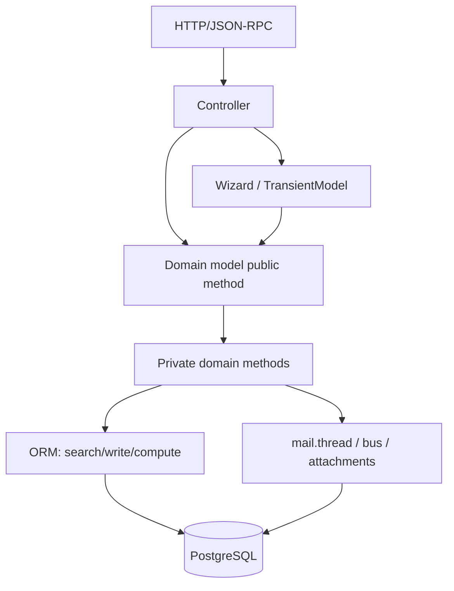

# Capa de lógica de negocio III — Estructura de servicios, inyección y orquestación

> **Premisa.** Odoo no tiene contexto de Spring, ni interfaces de servicio separadas, ni contenedor de inyección de dependencias. Sus «servicios» son clases de modelo resueltas a través del entorno, y su «inyección» es la herencia de Python más el ensamblaje del registro. Comprender esto evita que los arquitectos importen supuestos de arquitectura por capas que no sobreviven al contacto con el ORM.

---

## 1. Qué se considera un servicio en Odoo

| Capa | Constructo de Odoo | ¿Transaccional? | Invocado por |
|---|---|---|---|
| Transporte | `http.Controller` | sí, por petición | HTTP/JSON-RPC |
| Servicio de aplicación | asistente `TransientModel` | sí, en la petición | botones, acciones |
| Servicio de dominio | métodos de modelo (`sale.order.action_confirm`) | sí | controladores, asistentes, cron, otros modelos |
| Entidad de dominio | `Model` persistente | sí | todo |
| Política / regla | `@api.constrains`, `ir.rule`, guarda de Python | sí | ORM/seguridad |
| Integración | `ir.cron`, `ir.actions.server`, `base.automation` | sí (cron: transacción propia) | planificador/eventos |
| API externa | controlador + método de modelo | sí | terceros |

No existe una capa DAO/repositorio. El ORM **es** el repositorio. No existe una capa DTO por defecto; los diccionarios de `read()` y las cargas útiles JSON cumplen ese papel en el límite.

### 1.1 Mapa de clases de servicios principales

| Servicio de dominio | Modelo | Responsabilidad | Métodos públicos típicos |
|---|---|---|---|
| Maestro de terceros | `res.partner` | clientes, proveedores, direcciones, entidad comercial | `_find_accounting_partner`, `_increase_rank` |
| Maestro de productos | `product.template` / `product.product` | catálogo, variantes, precios, UdM | `_select_seller`, `_get_product_accounts`, `_get_tax_included_unit_price` |
| Ventas | `sale.order` / `sale.order.line` | presupuesto, confirmación, facturación | `action_confirm`, `_create_invoices` |
| Compras | `purchase.order` / `purchase.order.line` | SdP, aprobación, recepción, facturación | `button_confirm`, `action_create_invoice` |
| Inventario | `stock.move` / `stock.picking` / `stock.quant` | demanda, cumplimiento, existencias disponibles | `_action_assign`, `button_validate`, `_update_available_quantity` |
| Abastecimiento | `stock.rule` / `stock.route` | resolución de rutas y creación de documentos | `run`, `_get_rule` |
| Contabilidad | `account.move` / `account.move.line` | asientos contables, impuestos, conciliación | `_post`, `_reconcile_plan` |
| Pagos | `account.payment` | movimiento de dinero y conciliación | `action_post`, `action_validate` |
| Fabricación | `mrp.production` / `mrp.workorder` | ejecución de la producción | `action_confirm`, `button_mark_done` |
| Mensajería | `mail.thread` | chatter, seguidores, seguimiento | `message_post`, `message_subscribe` |
| Programación | `ir.cron` | trabajos periódicos | `_process_job`, `_trigger` |
| Automatización | `base.automation` / `ir.actions.server` | reglas y acciones sin código | `_process`, `run` |
| Configuración | `res.config.settings` / `ir.config_parameter` | ajustes e indicadores de funcionalidad | `get_values`, `set_values` |
| Seguridad | `ir.rule` / `ir.model.access` | autorización de filas/modelos | `_compute_domain`, `check` |

No son interfaces inyectadas; se resuelven mediante `env[...]` y se extienden mediante `_inherit`.

### 1.2 La pila de llamadas canónica



**[INVARIANT]** Las reglas de negocio pertenecen a los modelos de dominio, no a los controladores ni a los asistentes. Una regla implementada solo en un asistente queda eludida por las importaciones, RPC, cron y otros módulos.

---

## 2. Inyección de dependencias al estilo Odoo

### 2.1 El entorno es un localizador de servicios

```python
self.env['sale.order']          # model lookup
self.env.ref('base.main_company')
self.env.user
self.env.company
self.env.context
```

`env` es un **localizador de servicios**: resuelve cualquier modelo instalado por nombre en tiempo de ejecución. No se inyecta mediante constructores. Esto tiene consecuencias:

- Las dependencias son implícitas en el código (`env['account.move']`), no en la firma de un constructor.
- Un módulo ausente produce un `KeyError` en tiempo de ejecución, no un error en tiempo de compilación.
- Las pruebas requieren una base de datos y un registro; no hay un contenedor de mocks ligero.
- Las referencias circulares entre modelos son habituales y legales porque la resolución es perezosa.

### 2.2 La herencia es el mecanismo de inyección

El mecanismo de extensión principal de Odoo es la **inyección de métodos mediante el MRO**:

```python
class SaleOrder(models.Model):
    _inherit = 'sale.order'

    def _action_confirm(self):
        # inject behaviour before/after the core implementation
        res = super()._action_confirm()
        self._my_post_confirmation_hook()
        return res
```

En la práctica, se trata de una cadena de decoradores ensamblada durante la construcción del registro. Es potente y peligrosa:

- participa cada módulo instalado,
- el orden depende de las dependencias de los módulos y del orden de carga,
- se debe llamar a `super()` para preservar los demás módulos,
- una sobrescritura defectuosa rompe todos los módulos dependientes.

### 2.3 Mixins como inyección de capacidades

```python
class MyModel(models.Model):
    _name = 'my.model'
    _inherit = ['mail.thread', 'mail.activity.mixin', 'portal.mixin']
```

Los mixins inyectan campos y métodos:

| Mixin | Inyecta |
|---|---|
| `mail.thread` | mensajes, seguidores, seguimiento, notificaciones |
| `mail.activity.mixin` | actividades, plazos, asignación de usuarios |
| `portal.mixin` | URL del portal, token de acceso, portal de clientes |
| `utm.mixin` | seguimiento de campaña/origen/medio |
| `analytic.mixin` | distribución analítica |
| `product.catalog.mixin` | interfaz del catálogo de productos |
| `rating.mixin` | valoraciones y satisfacción |
| `website.published.mixin` | publicar/despublicar, SEO |

**[WARNING]** Los mixins añaden tablas, campos y efectos secundarios (mail crea mensajes al crear/escribir). Añadir `mail.thread` a un modelo de gran volumen puede multiplicar el coste de escritura. Mídase antes de adoptarlo.

### 2.4 La configuración como inyección

| Mecanismo | Ámbito | Cambio en tiempo de ejecución | Uso |
|---|---|---|---|
| `ir.config_parameter` | base de datos | sí | indicadores de funcionalidad, puntos de conexión externos |
| `res.config.settings` | compañía | sí | interfaz de administración, escribe ICP/campos de la compañía |
| campos de `res.company` | compañía | sí | fiscal, inventario, identidad de marca |
| `ir.default` | usuario/compañía | sí | valores por defecto |
| `depends` del manifiesto | instalación | no (requiere reinicio) | dependencias estrictas |
| `post_init_hook` | instalación | no | configuración única |
| `ir.actions.server` | registro | sí | automatización sin código |

**Regla:** si el valor cambia por despliegue, use un parámetro de configuración; si cambia por compañía, use un campo de la compañía; si cambia por usuario, use una preferencia de usuario o `ir.default`. Nunca codifique de forma rígida valores específicos del entorno en Python.

### 2.5 Inyección de dependencias externas

No existe una abstracción de cliente HTTP integrada. Las integraciones suelen:

- usar `requests` directamente en un método de modelo,
- almacenar credenciales en `ir.config_parameter` (¿cifradas en reposo? no, solo con control de acceso),
- envolver la llamada en una clase de cliente instanciada por llamada,
- usar `postcommit` para envío sin espera (fire-and-forget).

**[WARNING]** Las credenciales en `ir.config_parameter` son legibles por cualquier usuario con `base.group_system`. En producción, es preferible usar variables de entorno o un gestor de secretos; use ICP solo para configuración no sensible.

---

## 3. Servicios de aplicación: asistentes

Un asistente es un `TransientModel` con una vista de formulario. Es lo más parecido a un servicio de aplicación:

```python
class SaleAdvancePaymentInv(models.TransientModel):
    _name = 'sale.advance.payment.inv'

    def create_invoices(self):
        orders = self.env['sale.order'].browse(self._context.get('active_ids', []))
        if self.advance_payment_method == 'percentage':
            ...
        orders._create_invoices()
        return {'type': 'ir.actions.act_window_close'}
```

Responsabilidades de un asistente:

- recopilar y validar la entrada del usuario,
- seleccionar registros del contexto (`active_ids`, `active_model`),
- llamar a un método de dominio,
- devolver una acción (cerrar, recargar, abrir vista).

Antipatrones de los asistentes:

- lógica de negocio que solo existe en el asistente,
- SQL directo,
- trabajo de larga duración sin retroalimentación de progreso,
- almacenar estado en registros transitorios que debe sobrevivir a la petición.

**[INVARIANT]** Un asistente debe poder enviarse dos veces sin efectos adversos (doble clic). Protéjase con el estado, use métodos de dominio idempotentes o desactive el botón mientras se procesa.

---

## 4. Controladores como adaptadores de transporte

Los controladores deben ser delgados:

```python
class MyPortal(http.Controller):

    @http.route('/my/orders/<int:order_id>', type='http', auth='user', website=True)
    def order(self, order_id, **kw):
        order = request.env['sale.order'].browse(order_id)
        order.check_access('read')
        return request.render('my_module.order_template', {'order': order})
```

Reglas:

- autenticar y autorizar de forma explícita (`check_access`, reglas de registro),
- validar y convertir la entrada,
- llamar a un único método de dominio,
- serializar el resultado,
- no contener nunca reglas de negocio,
- no confirmar nunca,
- no exponer nunca identificadores internos sin una comprobación de acceso.

### 4.1 Idempotencia en el límite

Para puntos de conexión públicos (webhooks, callbacks de pago), implemente:

1. verificación de firma,
2. restricción de unicidad del identificador de evento,
3. transición de estado idempotente,
4. contrato de respuesta explícito (2xx incluso para duplicados, 4xx para firmas no válidas).

---

## 5. Diseño de servicios de dominio

### 5.1 Métodos públicos frente a privados

| Prefijo | Contrato | ¿Estable? |
|---|---|---|
| `action_*` | acción de interfaz, devuelve un diccionario de acción o `True` | semiestable |
| `button_*` | botón de interfaz, devuelve acción/`True` | semiestable |
| `_action_*` | transición de estado interna, invocada por un método público | interno |
| `_compute_*` | método de cálculo | interno |
| `_prepare_*` | construir valores para create/write | interno, pero ampliamente sobrescrito |
| `_get_*` | ayudante de consulta/decisión | interno |
| `_post_*` | hook de posprocesamiento | interno |

**[WARNING]** Los métodos `_prepare_*` y `_get_*` son la API de extensión de facto de Odoo, aunque sean privados. Los módulos de la comunidad y de la empresa los sobrescriben ampliamente. Trate sus firmas como contratos dentro del código base y documéntelas.

### 5.2 Orquestación frente a cálculo

Mantenga la orquestación separada del cálculo:

```python
def action_confirm(self):
    self._check_confirmable()
    self.write({'state': 'sale', 'date_order': fields.Datetime.now()})
    self._action_confirm()          # extension point
    self._create_initial_invoice()  # optional
```

- `_check_confirmable()` es validación pura.
- `write()` es el cambio de estado.
- `_action_confirm()` es el hook de extensión.
- Los efectos secundarios son explícitos y están ordenados.

Esta estructura hace que las sobrescrituras sean predecibles y las pruebas estén enfocadas.

### 5.3 Invariantes y guardas

Aplique los invariantes en la capa más baja posible:

| Invariante | Dónde |
|---|---|
| formato/rango de campo | `@api.constrains` |
| unicidad entre registros | restricción única de SQL |
| legalidad de la transición de estado | guarda del método público |
| coherencia de compañía | `check_company=True` + `_check_company` |
| equilibrio contable | `_check_balanced` |
| disponibilidad de stock | métodos de reserva |

**[INVARIANT]** No se debe confiar en la interfaz para aplicar un invariante. Toda restricción debe aplicarse en el modelo, porque las importaciones, RPC y los cron omiten la interfaz.

### 5.4 Eventos de dominio

Odoo no tiene un bus de eventos de dominio de primera clase. Opciones:

| Mecanismo | Semántica | Uso |
|---|---|---|
| seguimiento de `mail.thread` | mensaje persistido por cada cambio de campo | auditoría/historial |
| `base.automation` | se activa al crear/escribir/por tiempo/por estado | reglas sin código |
| `ir.actions.server` | código activado por automatización/botón | hooks procedimentales |
| `bus.bus` | notificación efímera para la interfaz | actualizaciones en vivo |
| sobrescritura de métodos | síncrona en el proceso | personalizaciones del núcleo |
| `cr.postcommit` | después de la confirmación | integraciones externas |

**[WARNING]** No existe un outbox transaccional. Un hook `postcommit` puede fallar después de que se confirme la transacción de negocio, perdiendo el evento. Para una integración fiable, escriba una fila de outbox en la misma transacción y deje que un cron la entregue.

---

## 6. Diseño de referencia de servicios para módulos personalizados

```
my_module/
├── __manifest__.py
├── models/
│   ├── sale_order.py          # extensions, thin
│   ├── my_entity.py           # domain entity + invariants
│   └── my_policy.py           # pure policy functions
├── wizards/
│   └── my_wizard.py           # application service
├── controllers/
│   └── main.py                # transport only
├── services/
│   ├── client.py              # external API client (no ORM)
│   └── outbox.py              # reliable event delivery
├── data/
│   ├── ir_cron.xml
│   └── ir_config_parameter.xml
├── security/
│   ├── ir.model.access.csv
│   └── ir_rule.xml
└── tests/
    ├── test_flow.py
    └── test_invariants.py
```

### 6.1 Reglas de capas que funcionan con Odoo

1. **Los modelos poseen los invariantes.** Ningún invariante puede residir solo en un asistente o controlador.
2. **Los asistentes orquestan, los modelos deciden.** Un asistente puede elegir *qué* método llamar, no *cómo* cambia el estado.
3. **Los controladores traducen.** Sin lógica de dominio.
4. **Los clientes externos no tienen estado.** Sin ORM en el cliente; se pasan datos simples.
5. **Outbox para la fiabilidad.** Escribir eventos dentro de la transacción, entregarlos después de la confirmación.
6. **Funciones puras para las políticas.** Las reglas de impuestos/precios/descuentos como funciones puras son comprobables sin base de datos.
7. **Una transacción por caso de uso.** No divida una operación de negocio entre llamadas RPC.

### 6.2 Ejemplo: integración fiable

```python
class OutboxEvent(models.Model):
    _name = 'my.outbox.event'
    _sql_constraints = [('uid', 'UNIQUE(event_uid)', 'Duplicate event')]

    event_uid = fields.Char(required=True)
    payload = fields.Json(required=True)
    state = fields.Selection([('pending', 'Pending'), ('sent', 'Sent'), ('failed', 'Failed')], default='pending')

    @api.model
    def emit(self, uid, payload):
        self.create({'event_uid': uid, 'payload': payload})

    @api.model
    def _cron_deliver(self, limit=100):
        for event in self.search([('state', '=', 'pending')], limit=limit, order='id'):
            try:
                client.send(event.payload)
                event.state = 'sent'
            except Exception:
                event.state = 'failed'
```

La fila de outbox se confirma junto con la transacción de negocio; el cron reintenta la entrega. Este es el único patrón fiable sin un broker de mensajes.

---

## 7. Pruebas a nivel de servicio

| Tipo de prueba | Qué demuestra | Herramienta |
|---|---|---|
| Unitaria (funciones puras) | cálculos de precios/impuestos/políticas | `unittest` |
| Integración con el ORM | invariantes, transiciones de estado | `TransactionCase` |
| HTTP | autenticación, enrutamiento, serialización | `HttpCase` |
| Tour | flujo de interfaz | `odoo.tests.tour` |
| Rendimiento | recuento de consultas, tiempo transcurrido | `assertQueryCount`, `profiler` |
| Actualización | corrección de la migración | scripts de `openupgrade` + base de datos de prueba |

**[WARNING]** `TransactionCase` revierte al final; no prueba los hooks de confirmación, las transacciones de cron ni los reintentos por serialización. Añada `SavepointCase`/`HttpCase` y pruebas de concurrencia explícitas para esos casos.

---

## 8. Antipatrones de la capa de servicios

| Antipatrón | Por qué falla |
|---|---|
| Controlador obeso | el cron o la importación lo omiten; no es comprobable |
| Asistente obeso | reglas no reutilizables; errores por doble envío |
| Modelo dios | archivos de 10k líneas, conflictos de fusión, importaciones lentas |
| Modelo anémico + clase de servicio | lucha contra el ORM; pierde ACL/reglas de registro |
| SQL directo en el servicio | omite la caché, las ACL y los cálculos |
| `env` almacenado globalmente | registro obsoleto, filtración entre peticiones |
| `sudo()` en el punto de entrada del servicio | oculta errores de autorización |
| Llamada externa síncrona | duplicados al reintentar, bloqueos retenidos |
| Bus de eventos sin outbox | eventos perdidos |
| Caché en variables globales del módulo | no se invalida entre workers |

---

## 9. Índice de evidencia

| Tema | Archivo |
|---|---|
| El entorno como mapping | `orm/environments.py:66` |
| Búsqueda de modelos en el registro | `orm/registry.py:375` |
| Base del asistente | `orm/models_transient.py` |
| Base del controlador | `http.py:1793`, `addons/base/models/ir_http.py` |
| Automatización | `addons/base_automation/models/base_automation.py` |
| Acciones de servidor | `addons/base/models/ir_actions.py:586` |
| Hilo de correo | `addons/mail/models/mail_thread.py:2199` |
| Bus | `addons/bus/models/bus.py:88` |
| Ajustes de configuración | `addons/base/models/res_config.py` |

Continúe con `04-business-rules-events.md` para ver el catálogo de disparadores.
