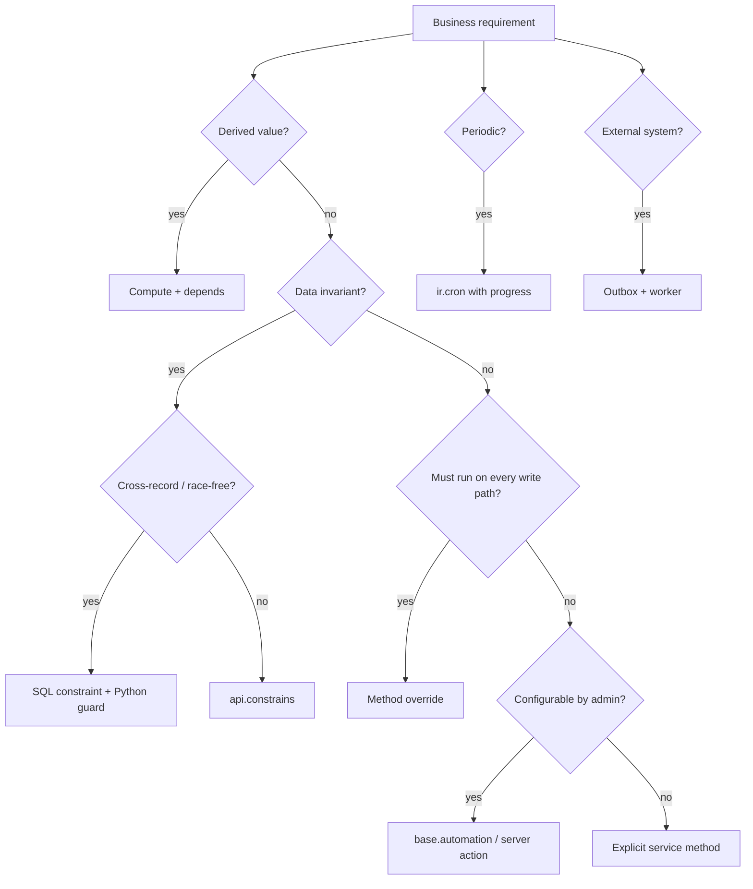

# Reglas de negocio, eventos y disparadores de automatización

> **Propósito.** Odoo ofrece al menos ocho mecanismos que parecen «reglas de negocio». Se activan en momentos distintos, con garantías distintas, y no son intercambiables. Este capítulo ofrece una matriz de decisión y la semántica interna de cada uno.

---

## 1. Catálogo de disparadores

| Mecanismo | Se activa cuando | Transacción | Eludible | Persistido | Mejor para |
|---|---|---|---|---|---|
| cálculo `@api.depends` | cambio de dependencia, al leer | la misma | no | si `store=True` | valores derivados |
| `@api.constrains` | crear/escribir, después de establecer campos | la misma | no | no | invariantes de datos |
| restricción SQL | INSERT/UPDATE | la misma | no (BD) | esquema | unicidad, rangos |
| `@api.onchange` | edición en la interfaz, antes de guardar | sin transacción | sí (RPC/importación) | no | solo ayuda de UX |
| sobrescritura de `create`/`write` | cualquier escritura | la misma | no | no | invariantes entre registros, valores por defecto |
| seguimiento de `mail.thread` | escritura en campo con seguimiento | la misma | mediante contexto | sí (`mail.message`) | auditoría/historial |
| `base.automation` | crear/escribir/tiempo/mensaje | la misma (tiempo: cron) | se puede desactivar | sí | reglas configurables sin código |
| `ir.actions.server` | botón/automatización/cron | la misma | depende | sí | acciones procedimentales |
| `ir.cron` | planificador | transacción propia | no | sí | trabajos periódicos |
| `bus.bus` | envío explícito | pre/postcommit | no | transitorio | notificaciones de interfaz |
| Controlador/webhook | HTTP externo | la misma | no | no | integraciones |

**[INVARIANT]** Solo los cálculos, las restricciones y las sobrescrituras de métodos tienen garantizado ejecutarse en **todas** las rutas de escritura. Las reglas onchange y las de nivel de interfaz no.

---

## 2. Los campos calculados como reglas

### 2.1 Semántica

- Un cálculo almacenado se recalcula cuando cambia cualquiera de las dependencias declaradas.
- Un cálculo no almacenado se ejecuta al acceder; no se persiste y no se puede buscar sin un método `search`.
- Los métodos de cálculo deben ser puros con respecto al conjunto de registros: mismas entradas → mismas salidas, sin efectos secundarios.

### 2.2 Completitud de las dependencias

```python
# WRONG: missing partner_id in dependencies
@api.depends('partner_id.country_id')
def _compute_country_code(self):
    for rec in self:
        rec.country_code = rec.partner_id.country_id.code
```

El ORM considera que `partner_id.country_id` depende tanto de `partner_id` como de `country_id`, pero **no** de que `partner_id.country_id` se reasigne mediante una escritura relacionada que no toca `partner_id`. En la práctica, incluya la ruta completa y pruebe los escenarios de reasociación.

### 2.3 Cálculos recursivos

Un cálculo que lee un campo que también escribe crea un ciclo. El ORM se detiene tras 10 iteraciones de punto fijo y registra «Too many iterations for recomputing fields!» (`orm/environments.py:366`). Se trata de un error silencioso de rendimiento y corrección.

**[WARNING]** No use `@api.depends` en un campo que se modifica dentro del método de cálculo. Use un inverso o un disparador de recálculo dedicado.

---

## 3. Restricciones

### 3.1 Restricciones de Python

```python
@api.constrains('date_start', 'date_end')
def _check_dates(self):
    for rec in self:
        if rec.date_start and rec.date_end and rec.date_start > rec.date_end:
            raise ValidationError(_("Start date must be before end date."))
```

- Se ejecutan después de `create`/`write`, incluidas las importaciones y RPC.
- Reciben el conjunto de registros modificados, pero el decorador no indica qué campos cambiaron; se deben comprobar todos los registros.
- Deben ser deterministas y baratas; se ejecutan dentro de la transacción y pueden bloquear importaciones grandes.
- No consulte tablas grandes sin un índice.

### 3.2 Restricciones SQL

```python
class MyModel(models.Model):
    _name = 'my.model'
    _sql_constraints = [
        ('code_uniq', 'UNIQUE(code)', 'Code must be unique.'),
    ]
```

Odoo 19 también admite el objeto de tabla declarativo `models.Constraint`:

```python
_name_uniq = models.Constraint('UNIQUE(name)', 'Name must be unique.')
```

- Aplicadas por PostgreSQL, por lo tanto, libres de condiciones de carrera.
- Las violaciones se manifiestan como `IntegrityError`, convertidas en `ValidationError` por el contenedor de reintentos.
- Añadir una restricción a una tabla con duplicados existentes falla durante la actualización del módulo; limpie los datos primero.

### 3.3 `@api.ondelete`

```python
@api.ondelete(at_uninstall=False)
def _unlink_check(self):
    if self.state != 'draft':
        raise UserError(_("Only draft records can be deleted."))
```

`at_uninstall=False` significa que la comprobación se omite durante la desinstalación del módulo, lo que permite la limpieza. Úselo para proteger asientos contables publicados y documentos de stock confirmados.

---

## 4. Onchange: comodidad exclusiva de la interfaz

```python
@api.onchange('partner_id')
def _onchange_partner_id(self):
    if self.partner_id:
        self.pricelist_id = self.partner_id.property_product_pricelist
    return {'warning': {'title': ..., 'message': ...}}
```

Hechos:

- Se ejecuta en el cliente web sobre un **registro nuevo** en memoria, antes de guardar.
- **No** lo ejecutan `create` por RPC, las importaciones, el cron ni la escritura de otro modelo.
- Puede devolver un diccionario `warning` o `domain`; no puede persistir nada.
- Usa registros `NewId`; las asignaciones relacionales pueden quedar sin resolver hasta guardar.

**[INVARIANT]** Nunca se debe confiar en onchange para la integridad de los datos. Si un valor debe establecerse siempre, use un cálculo/valor por defecto o una sobrescritura de `create`.

---

## 5. Las sobrescrituras de métodos como reglas

`create`, `write`, `unlink` y los métodos de transición de estado son el único lugar para aplicar reglas entre registros que deben sobrevivir a todos los puntos de entrada.

### 5.1 Orden dentro de `write`

1. comprobaciones de acceso,
2. validación de campos,
3. protección de inversos/cálculos,
4. `modified(before=True)` relacional,
5. escrituras de campos en el orden de `write_sequence`,
6. `modified()` después,
7. métodos inversos,
8. restricciones de Python,
9. comprobación de compañía.

Una sobrescritura que llama a `super().write(vals)` **después** de su propia lógica se ejecuta demasiado tarde para las restricciones, pero demasiado pronto para el posprocesamiento. Elija deliberadamente:

```python
def write(self, vals):
    # pre-condition
    res = super().write(vals)
    # post-effect (same transaction)
    return res
```

### 5.2 Guardas de recursión

Una sobrescritura de `write` que escribe el mismo modelo puede entrar en recursión. Use indicadores de contexto o compare valores:

```python
def write(self, vals):
    res = super().write(vals)
    if not self.env.context.get('_my_guard'):
        self.with_context(_my_guard=True).write({'computed_flag': True})
    return res
```

**Advertencia:** los indicadores de contexto son por entorno y pueden filtrarse a llamadas anidadas. Es preferible usar `self.env.protecting` o un método privado dedicado.

---

## 6. Seguimiento con `mail.thread`

### 6.1 Cómo funciona el seguimiento

- Los campos declarados con `tracking=True` se registran en `mail.tracking.value` cuando cambian.
- `_track_get_fields()` devuelve los campos con seguimiento, filtrados por acceso y contexto.
- `_track_subtype(initial_values)` decide el subtipo del mensaje (`mail.mt_comment`, subtipos personalizados).
- Los mensajes de seguimiento los publica `mail.thread.write()` después de la escritura.
- `tracking_disable=True` en el contexto suprime el seguimiento (lo usan las importaciones/migraciones).

Fuente: `addons/mail/models/mail_thread.py:527-760`, `mail_tracking_value.py:9`.

### 6.2 Coste

Cada escritura con seguimiento puede:

- crear un `mail.message`,
- crear N filas de `mail.tracking.value`,
- actualizar los seguidores,
- programar notificaciones,
- enviar correos (asíncrono).

**[WARNING]** El seguimiento de un campo que se escribe en un bucle de alta frecuencia (p. ej., `sequence`, `state` en movimientos de stock) puede generar millones de mensajes. Audite las declaraciones de seguimiento en modelos de gran volumen.

### 6.3 Subtipos y seguidores

- Los seguidores reciben notificaciones según sus preferencias de subtipo.
- `message_subscribe()` añade seguidores; `message_post()` les notifica.
- Las notas internas se distinguen de los comentarios por el subtipo y por `is_internal`.
- Las plantillas de correo se renderizan con QWeb y pueden incluir adjuntos.

---

## 7. Acciones automatizadas (`base.automation`)

### 7.1 Tipos de disparador [V19]

`base_automation.trigger` admite:

| Disparador | Se activa | Notas |
|---|---|---|
| `on_create` | después de crear | se aplican los dominios de filtro |
| `on_create_or_write` | después de crear/escribir | disparador dominante |
| `on_write` | después de escribir | alias obsoleto |
| `on_unlink` | antes/después de eliminar | limitado |
| `on_change` | onchange de interfaz | no transaccional |
| `on_stage_set` | cambio del campo de etapa | CRM/proyecto |
| `on_user_set` | cambio del campo de usuario | asignación |
| `on_tag_set` | etiqueta añadida | CRM |
| `on_state_set` | cambio del campo de estado | genérico |
| `on_priority_set` | cambio de prioridad | genérico |
| `on_archive` / `on_unarchive` | cambio de estado activo | genérico |
| `on_time` | se alcanza el campo de fecha | impulsado por cron |
| `on_time_created` | tras un retardo desde la creación | impulsado por cron |
| `on_time_updated` | tras un retardo desde la actualización | impulsado por cron |
| `on_message_received` | correo entrante | mail.thread |
| `on_message_sent` | correo saliente | mail.thread |
| `on_webhook` | webhook externo | integración |

### 7.2 Modelo de ejecución

- Las automatizaciones se evalúan **después** de la escritura que las activa, en la misma transacción.
- `filter_pre_domain` selecciona los registros candidatos antes de la acción; `filter_domain` filtra después.
- `__action_done` en el contexto evita la reejecución recursiva sobre los mismos registros.
- Las acciones son registros `ir.actions.server`, que se ejecutan en orden de secuencia.
- Los fallos provocan una excepción y revierten toda la transacción, salvo que la acción los capture.

**[WARNING]** Una automatización que escribe el mismo modelo puede activarse a sí misma. La guarda `__action_done` de Odoo ayuda, pero no es una solución general; diseñe las automatizaciones para que sean idempotentes y estén filtradas de forma estricta.

### 7.3 Automatizaciones basadas en tiempo

- `on_time` usa un cron (`base_automation.ir_cron_...`) que examina los registros cuyo campo de fecha cae dentro de la ventana.
- El examen se basa en dominios; sin un índice en el campo de fecha, se convierte en un recorrido completo de la tabla.
- El intervalo del cron se adapta al retardo configurado más pequeño (`_get_cron_interval`), entre 1 minuto y 4 horas.

---

## 8. Acciones de servidor

### 8.1 Tipos

`ir.actions.server.state`:

| Estado | Comportamiento | ¿Seguro para administradores no confiables? |
|---|---|---|
| `object_write` | actualizar un campo/ruta | sí |
| `object_create` | crear un registro | sí |
| `object_copy` | duplicar | sí |
| `code` | ejecutar Python mediante `safe_eval` | **no** — código de confianza |
| `webhook` | HTTP POST a una URL | sí, pero con riesgo de SSRF |
| `multi` | ejecutar acciones hijas | depende |

### 8.2 `safe_eval` no es un entorno aislado

`safe_eval` restringe las funciones integradas y bloquea las importaciones (`tools/safe_eval.py:318-422`). **No** impide:

- leer cualquier registro que el usuario en ejecución pueda leer (`env`),
- llamar a cualquier método de modelo,
- escribir datos,
- exfiltrar datos mediante `env['ir.config_parameter']`,
- el agotamiento de recursos (bucles, búsquedas grandes).

**[INVARIANT]** Trate las acciones de servidor de tipo `code` como **código de confianza**. Restrinja la pertenencia a `base.group_system`; audite los cambios en `ir.act_server.code`; nunca exponga la creación de acciones de servidor a usuarios del portal.

### 8.3 Contexto de ejecución

El contexto de evaluación incluye `env`, `model`, `record`, `records`, `time`, `datetime`, `dateutil`, `uid`, `user`, `context`, `log`. En Odoo 19, `env` es el entorno actual; `sudo()` está disponible y se usa indebidamente con frecuencia.

### 8.4 Webhooks

- Se configuran con URL, campos y encabezados opcionales.
- Se ejecutan de forma síncrona en la transacción, salvo que se difieran.
- Sin reintentos, sin firma por defecto y sin clave de idempotencia.
- Riesgo de SSRF: un administrador puede apuntar un webhook a servicios internos.

**[WARNING]** Para integraciones en producción, no use los webhooks de `ir.actions.server` como mecanismo principal de entrega. Use un outbox + worker con reintentos, tiempos de espera y firmas.

---

## 9. El cron como motor de reglas

Los trabajos de `ir.cron` son acciones de servidor ejecutadas según una programación. Son adecuados para:

- conciliación y limpieza,
- recordatorios y escalados,
- sincronización externa,
- generación de informes,
- recálculo por lotes.

**No** son adecuados para:

- reglas en tiempo real (latencia),
- entrega exactamente una vez (reintentos),
- transacciones monolíticas largas (tiempos de espera).

Véase `02-transactions.md` §6 para la API de progreso y las reglas de concurrencia.

---

## 10. Eventos del bus

`bus.bus` sirve para la sincronización de la interfaz, no para eventos de negocio:

- efímero (GC tras la retención),
- como máximo una vez,
- sin garantía de orden entre canales,
- sin persistencia para clientes sin conexión.

Úselo para indicar a la interfaz «este registro ha cambiado» y deje que la interfaz vuelva a obtener los datos a través del ORM (que aplica el control de acceso).

**[WARNING]** Nunca se deben incluir datos sensibles en la carga útil del bus. Los canales son adivinables a menos que se deriven de un secreto; el bus no es una frontera de autorización.

---

## 11. Elección del mecanismo adecuado



### 11.1 Reglas de decisión

- **Cálculo** para cualquier valor derivable de datos almacenados.
- **Restricción** para cualquier condición que nunca deba ser falsa.
- **Sobrescritura** para la orquestación entre modelos.
- **Automatización** para reglas específicas del cliente que cambian sin necesidad de despliegue.
- **Cron** para trabajo basado en tiempo o por lotes.
- **Outbox** para una entrega externa fiable.
- **Bus** solo para la frescura de la interfaz.

---

## 12. Pruebas de reglas y disparadores

| Tipo de regla | Enfoque de prueba |
|---|---|
| Cálculo | escribir la dependencia, comprobar el recálculo; probar con varios registros |
| Restricción | comprobar `ValidationError` en create/write no válido |
| Restricción SQL | inserción duplicada, comprobar `IntegrityError`/`ValidationError` |
| Onchange | prueba con `Form` o llamada directa a `onchange`; no confiar en él para los datos |
| Sobrescritura | crear/escribir a través del ORM, comprobar los efectos secundarios |
| Seguimiento | comprobar el recuento de `mail.message` / `mail.tracking.value` |
| Automatización | crear `base.automation`, activar la escritura, comprobar el efecto de la acción |
| Acción de servidor | ejecutar con `with_context(active_id=...)`, comprobar el resultado |
| Cron | llamar al método directamente en un `TransactionCase`; probar la idempotencia |
| Bus | comprobar las filas de `bus.bus` después de la confirmación (hook de postcommit) |

**[WARNING]** Las pruebas que dependen de `env.cr.commit()` son lentas y filtran estado. Es preferible usar `TransactionCase` y comprobar dentro de la transacción; pruebe los hooks de confirmación por separado con `SavepointCase`/`HttpCase`.

---

## 13. Índice de evidencia

| Tema | Archivo |
|---|---|
| Decoradores | `orm/decorators.py:83-357` |
| Ejecución de cálculos | `orm/models.py:4953` |
| Validación de restricciones | `orm/models.py:3960` |
| Onchange | `orm/models.py` (`onchange`), `orm/decorators.py:189` |
| Seguimiento | `addons/mail/models/mail_thread.py:527-760` |
| Disparadores de automatización | `addons/base_automation/models/base_automation.py:156-200` |
| Ejecución de automatizaciones | `base_automation.py:693-790` |
| Tipos de acción de servidor | `addons/base/models/ir_actions.py:586-680` |
| safe_eval | `tools/safe_eval.py:318-422` |
| Bus | `addons/bus/models/bus.py:88-200` |
| Cron | `addons/base/models/ir_cron.py:91-500` |

Continúe con `05-security.md`.
