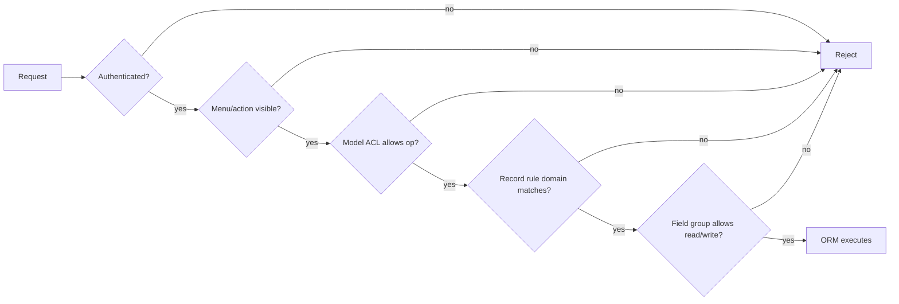

# Modelo de seguridad — ACL, reglas de registro, campos y límites de privilegios

> **Advertencia.** La seguridad de Odoo es declarativa y por capas. Una capa ausente no implica denegación por defecto. La mayoría de las brechas reales en Odoo no son inyecciones SQL; son `sudo()` demasiado amplios, reglas de registro ausentes en modelos personalizados, controladores de portal sin comprobaciones de acceso y permisos concedidos a `base.group_user` porque «era más fácil».

---

## 1. Las cinco puertas



| Puerta | Almacenamiento | Alcance | Omisión |
|---|---|---|---|
| Autenticación | sesión, `res.users` | petición | rutas `auth='none'` |
| Grupos de menú/acción | `ir.ui.menu.groups_id`, `ir.actions.*.groups_id` | UI | RPC directo |
| ACL de modelo | `ir.model.access` | modelo + operación + grupo | `sudo()` |
| Regla de registro | `ir.rule` | dominio de fila + operación + grupo | `sudo()`, matices de `active_test` |
| Grupos de campo | `groups=` en el campo | lectura/escritura de campo | `sudo()` |

**[INVARIANT]** La visibilidad en la UI **no** es seguridad. Un menú o un botón ocultos no impiden una llamada RPC. Cada modelo y método expuesto por RPC debe aplicar las ACL y las reglas.

---

## 2. ACL de modelo

### 2.1 Estructura

```csv
id,name,model_id:id,group_id:id,perm_read,perm_write,perm_create,perm_unlink
access_my_model_user,my.model.user,model_my_model,base.group_user,1,0,0,0
access_my_model_manager,my.model.manager,model_my_model,my_module.group_manager,1,1,1,1
```

Campos: `name`, `model_id`, `group_id` (anulable = global) y cuatro booleanos.

Semántica:

- Si **cualquier** ACL coincidente concede la operación, se permite el acceso.
- Una ACL global (`group_id = NULL`) concede a todos, incluidos los usuarios de portal y públicos.
- La ausencia total de ACL implica ningún acceso, incluso para los usuarios internos.
- Las ACL se almacenan en caché por usuario y se invalidan al cambiar (`ir.model.access.check`).

Origen: `addons/base/models/ir_model.py:2080-2200`.

### 2.2 Errores habituales

| Error | Efecto |
|---|---|
| ACL sobre `base.group_user` para un modelo sensible | cualquier usuario interno puede leer/escribir |
| Sin ACL para un modelo nuevo | `AccessError` incluso para los administradores (salvo con sudo) |
| ACL sin reglas de registro | todas las filas visibles para el grupo |
| ACL para `base.group_portal` con escritura | los usuarios de portal pueden modificar registros |
| Olvidar `ir.model.access.csv` en el manifiesto | modelo inutilizable tras la instalación |

**[WARNING]** Durante la instalación de un módulo, Odoo registra una advertencia para los modelos concretos sin ACL (`modules/loading.py:290`). Esa advertencia debe tratarse como un bloqueante de la versión.

---

## 3. Reglas de registro

### 3.1 Estructura

Campos de `ir.rule`:

| Campo | Significado |
|---|---|
| `model_id` | modelo destino |
| `domain_force` | dominio Python evaluado por usuario |
| `groups` | grupos a los que se aplica la regla; vacío = global |
| `perm_read/write/create/unlink` | operaciones |
| `active` | desactivación lógica |

Evaluación (`ir_rule._compute_domain`):

1. Se recopilan las reglas del modelo y la operación en las que `active` es verdadero y el indicador de la operación también.
2. Las reglas globales (sin grupos) se combinan con **AND**.
3. Las reglas de grupo se combinan con **OR** dentro de los grupos del usuario.
4. El dominio combinado se combina con AND con las reglas globales.
5. Si el usuario es superusuario (`env.su`), no se aplica ninguna regla.

Origen: `addons/base/models/ir_rule.py:113-175`.

### 3.2 Ejemplo

```xml
<record id="rule_my_model_company" model="ir.rule">
    <field name="name">My Model: multi-company</field>
    <field name="model_id" ref="model_my_model"/>
    <field name="domain_force">['|', ('company_id', '=', False), ('company_id', 'in', company_ids)]</field>
    <field name="groups" eval="[(4, ref('base.group_user'))]"/>
</record>
```

Contexto de evaluación disponible: `user`, `company_id`, `company_ids`. `company_ids` es la lista de compañías **permitidas** para la sesión, no todas las compañías.

### 3.3 Reglas en modelos heredados

`_compute_domain` añade las reglas de los padres de `_inherits` como `parent_field any domain`. Esto significa que:

- una regla sobre `ir.actions.server` también restringe `ir.cron`,
- una regla sobre `product.template` también restringe `product.product` si está delegado,
- las reglas **no** se heredan automáticamente a través de `_inherit` (misma tabla), porque se trata del mismo modelo.

### 3.4 Reglas y `active_test`

Las reglas de registro se aplican también a los registros archivados, salvo que el dominio filtre `active` explícitamente. `search()` añade `active=True` de forma predeterminada (`active_test`), pero `browse()` + lectura no. Un usuario podría leer un registro archivado que no encuentra en una lista.

### 3.5 Rendimiento

Las reglas de registro se convierten en subconsultas/joins SQL en cada búsqueda. Una regla con `child_of` sobre una jerarquía grande, o con un campo evaluado en Python, puede resultar costosa. Las reglas se almacenan en caché por `(uid, model, mode, allowed_company_ids)`, pero el SQL se sigue ejecutando en cada consulta.

**[WARNING]** Una regla con `domain_force = [(0, '=', 1)]` es la forma correcta de denegar todo; un dominio vacío `[]` significa **permitir todo**, no denegar todo.

---

## 4. Seguridad a nivel de campo

```python
secret = fields.Char(groups='base.group_system')
```

- El campo se elimina de `fields_get()` para los usuarios no autorizados.
- Su lectura genera `AccessError` (salvo con `sudo`).
- Su escritura se bloquea mediante `_check_field_access`.
- No oculta la columna en informes SQL ni en exportaciones creadas por usuarios autorizados.

**[WARNING]** Los grupos de campo son una comodidad de UI/API, no un cifrado. Un usuario con acceso a la base de datos o con un generador de informes puede seguir leyendo la columna.

### 4.1 `_check_company`

La coherencia de compañía es independiente de las ACL:

```python
partner_id = fields.Many2one('res.partner', check_company=True)
```

- `_check_company_auto = True` en el modelo valida todos los campos `check_company=True` en la creación/escritura.
- Evita vínculos entre compañías, no lecturas entre compañías.
- Se omite con SQL directo.

---

## 5. `sudo()` y límites de privilegios

### 5.1 Semántica

| Llamada | `uid` | `su` | ACL/reglas | Campos de auditoría |
|---|---|---|---|---|
| `record.sudo()` | sin cambios | True | omitidas | uid original |
| `record.with_user(2)` | 2 | False | evaluadas como el usuario 2 | 2 |
| `record.sudo().with_user(2)` | 2 | True | omitidas | 2 |
| `env['model'].sudo()` | sin cambios | True | omitidas | uid original |

**[INVARIANT]** `sudo()` debe justificarse en el punto de llamada. Es preferible:

```python
# Good: scoped read for a computed field, documented
price = self.sudo().env['product.pricelist'].browse(...).price_get(...)
```

a:

```python
# Bad: entire method runs as superuser
def action_do(self):
    self = self.sudo()
    ...
```

### 5.2 Patrones peligrosos

| Patrón | Riesgo |
|---|---|
| `self.sudo().write(vals)` en un método público | escalada de privilegios |
| `sudo()` en un controlador antes de `check_access` | omite las reglas de portal |
| `sudo()` para «corregir» un error de acceso | oculta una regla ausente |
| `sudo()` en un cálculo con `compute_sudo=True` (predeterminado) | filtra valores restringidos |
| `sudo()` en un cron con contexto de usuario | el rastro de auditoría miente |

### 5.3 Patrón recomendado

```python
def action_approve(self):
    self.check_access('write')            # enforce caller's rights
    records = self._filtered_access('write')
    records._approve_as_system()          # narrow sudo inside
```

Conviene mantener la superficie privilegiada lo más pequeña posible y hacerla explícita en el nombre del método.

---

## 6. Usuarios de portal, públicos y de sitio web

| Tipo de usuario | Grupo | Acceso típico |
|---|---|---|
| Interno | `base.group_user` | backend, sujeto a ACL/reglas |
| Portal | `base.group_portal` | registros propios mediante controladores de portal |
| Público | `base.group_public` | sitio web, sin backend |
| Sistema | `base.group_system` | ajustes, acciones de servidor, peligroso |

Reglas de seguridad del portal:

- Los usuarios de portal solo deben ver registros vinculados a su partner comercial.
- Los controladores deben llamar a `check_access('read')` y apoyarse en las reglas de registro.
- `portal.mixin` genera tokens de acceso para enlaces no autenticados; los tokens son credenciales de portador.
- Nunca debe exponerse un registro por id sin una comprobación de acceso; la enumeración de id es trivial.

**[WARNING]** Las rutas `auth='public'` se ejecutan como el usuario público. Si llaman a `sudo()`, se convierten en endpoints privilegiados no autenticados. Debe auditarse cada `sudo()` en los controladores de sitio web/portal.

---

## 7. Seguridad multicompañía

- `allowed_company_ids` en el contexto determina las compañías visibles.
- Las reglas de registro suelen incluir `company_id in company_ids or company_id = False`.
- `env.company` es la compañía activa; `env.companies` es el conjunto permitido.
- Los campos dependientes de la compañía se resuelven según `env.company`.
- Las fugas de datos entre compañías ocurren cuando un modelo carece de un campo `company_id` o de una regla.

Lista de verificación para un nuevo modelo de negocio:

- [ ] `company_id = fields.Many2one('res.company', required=True, index=True, default=lambda self: self.env.company)`
- [ ] regla de registro con `company_ids`
- [ ] `check_company=True` en los campos relacionales
- [ ] `_check_company_auto = True`
- [ ] pruebas con dos compañías

---

## 8. Autenticación y sesiones

- Cookie de sesión `session_id`, HttpOnly, firmada y almacenada en el servidor.
- Se requiere token CSRF para las rutas `http` que cambian estado (`csrf=True` predeterminado).
- JSON-RPC usa la cookie de sesión; las claves de API usan `Authorization: Bearer` o `X-Odoo-Database`.
- `auth='none'` desactiva la autenticación de sesión; solo debe usarse para comprobaciones de estado y activos públicos.
- El hash de contraseñas usa PBKDF2 (o Argon2 según la configuración); nunca debe almacenarse texto plano.
- 2FA (`auth_totp`) está disponible; debe exigirse para los administradores.

**[WARNING]** La cabecera `X-Odoo-Database` permite seleccionar la base de datos. En despliegues multiinquilino, debe restringirse `dbfilter` y nunca debe exponerse públicamente el endpoint de listado de bases de datos.

---

## 9. Inyección SQL y SQL directo

El ORM parametriza las consultas. El SQL directo es la excepción:

```python
# SAFE
self.env.cr.execute("SELECT id FROM res_partner WHERE name = %s", (name,))

# UNSAFE
self.env.cr.execute(f"SELECT id FROM res_partner WHERE name = '{name}'")
```

Debe usarse `odoo.tools.SQL` para identificadores componibles:

```python
from odoo.tools import SQL
self.env.cr.execute(SQL("SELECT %s FROM %s", SQL.identifier('name'), SQL.identifier(table)))
```

**[INVARIANT]** Nunca debe interpolarse entrada del usuario en SQL, incluidos los nombres de tabla/columna. Deben validarse los identificadores contra `ir.model.fields` si son dinámicos.

---

## 10. Seguridad de carga de archivos y adjuntos

- El acceso a `ir.attachment` sigue las reglas del registro vinculado; los adjuntos independientes usan `res_model`/`res_id`.
- Los nombres de archivo se sanean, pero el contenido no se analiza.
- `attachment=True` almacena en el filestore con una ruta con hash; el acceso directo al sistema de archivos omite la seguridad de Odoo.
- Los adjuntos públicos (`public=True`) se sirven sin autenticación; nunca deben marcarse como públicos los archivos sensibles.
- Las cargas SVG pueden contener scripts; deben servirse con `Content-Disposition: attachment` o sanearse.

---

## 11. Acciones de servidor, automatizaciones y ejecución de código

- Las acciones de servidor de tipo `code` se ejecutan con el entorno del usuario actual (o con `sudo` si la acción lo invoca).
- Solo `base.group_system` debería crearlas/editarlas.
- Los cambios en `ir.actions.server.code` no se versionan de forma predeterminada; debe habilitarse la auditoría de `base.group_system` o usarse un módulo.
- Los administradores pueden crear automatizaciones y estas se ejecutan en cada escritura; deben tratarse como código.
- Los webhooks pueden apuntar a URL internas (SSRF); debe restringirse la salida en la capa de red.

---

## 12. Lista de verificación de revisión de seguridad

### Modelo

- [ ] ACL para cada operación y cada grupo previsto.
- [ ] Ninguna ACL global salvo que sea intencionadamente pública.
- [ ] Reglas de registro por compañía/propiedad.
- [ ] `company_id` presente e indexado.
- [ ] `check_company=True` en las relaciones entre compañías.
- [ ] `_check_company_auto = True`.
- [ ] `@api.ondelete` protege los estados irreversibles.
- [ ] Grupos de campo en los campos sensibles.
- [ ] Ningún `sudo()` en puntos de entrada públicos sin justificación.

### Controlador

- [ ] `auth` es el mínimo necesario.
- [ ] `check_access` antes de leer/escribir.
- [ ] CSRF habilitado para los cambios de estado.
- [ ] Entrada validada y acotada.
- [ ] Sin enumeración de id de registro sin reglas.
- [ ] Sin secretos en respuestas ni en registros.

### Integración

- [ ] Claves de API limitadas a un usuario dedicado con grupos mínimos.
- [ ] Limitación de tasa en el proxy inverso.
- [ ] Firmas de webhook verificadas.
- [ ] Patrón outbox para una entrega fiable.
- [ ] Credenciales fuera de la base de datos cuando sea posible.

### Operaciones

- [ ] `dbfilter` restringe las bases de datos por host.
- [ ] Endpoint de listado de bases de datos deshabilitado en producción.
- [ ] `admin_passwd` robusta y rotada.
- [ ] Las copias de seguridad incluyen el filestore y son restaurables.
- [ ] Registro de auditoría (`ir.logging`, `mail.tracking`) conservado.
- [ ] PostgreSQL no expuesto públicamente.
- [ ] Los workers se ejecutan como no root con un montaje de código de solo lectura.

---

## 13. Índice de evidencias

| Tema | Archivo |
|---|---|
| Modelo de ACL y comprobación | `addons/base/models/ir_model.py:2080-2200` |
| Reglas de registro | `addons/base/models/ir_rule.py:15-175` |
| Evaluación del dominio de reglas | `ir_rule.py:141-175` |
| Cálculo de grupos | `addons/base/models/res_users.py:258`, `447`, `1034` |
| Acceso a campos | `orm/models.py:3369-3400`, `orm/fields.py:1649` |
| `check_access` | `orm/models.py:4100-4160` |
| Sesión/autenticación | `http.py:1793-2000`, `addons/base/models/ir_http.py` |
| `safe_eval` | `tools/safe_eval.py:318-422` |
| Seguridad de adjuntos | `addons/base/models/ir_attachment.py` |

Continúa con el volumen 2: flujos de negocio de extremo a extremo.
