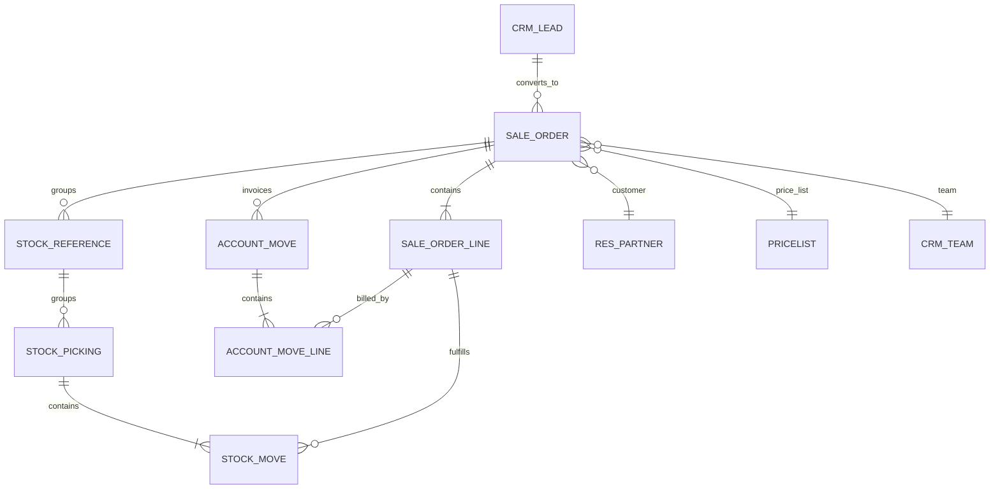
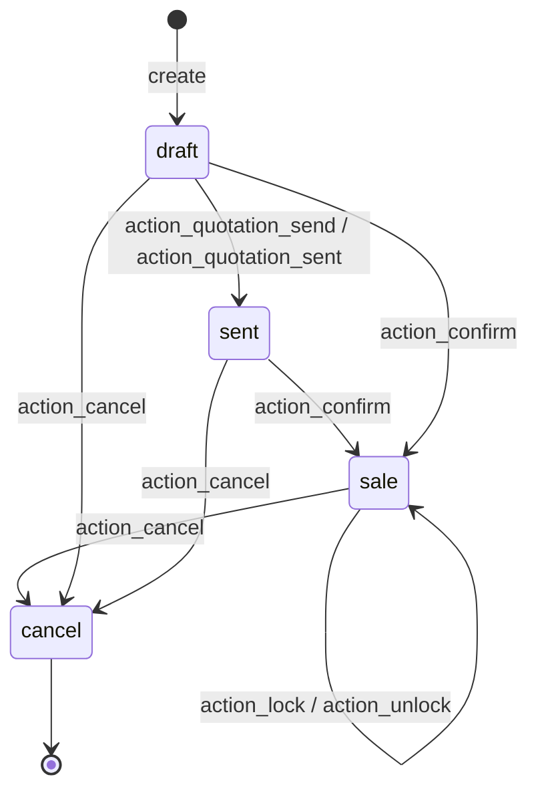
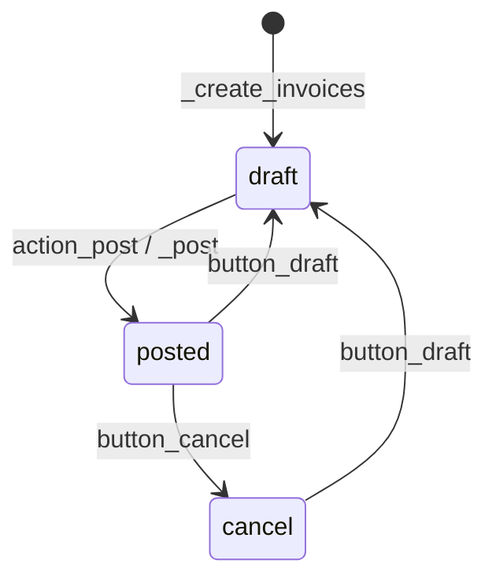
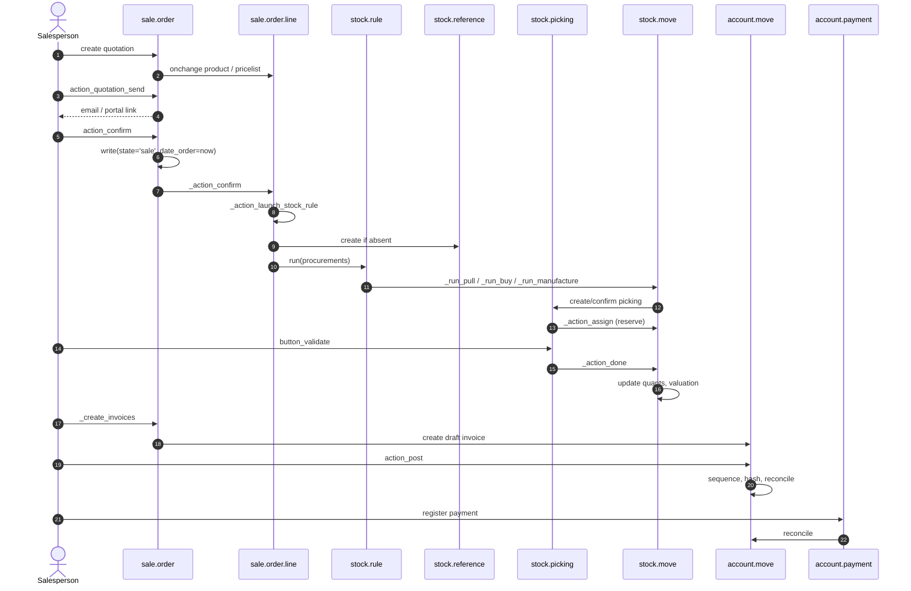
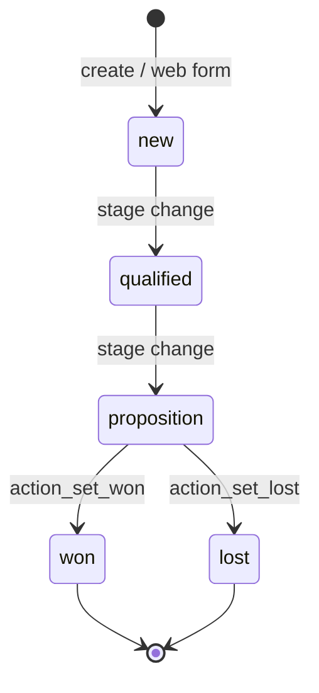

# Flujo — Ventas y CRM (del presupuesto al cobro)

> **Módulos cubiertos.** `sale`, `sale_stock`, `sale_mrp`, `sale_project`, `crm`, `sales_team`, `account` (solo generación de facturas).
> **Versión.** Odoo 19.0 Enterprise. Los cambios específicos de ventas en la v19 se marcan con **[V19]**.

---

## 1. Actores y puntos de entrada

| Actor | Punto de entrada | Efecto |
|---|---|---|
| Comercial | Formulario de presupuesto | crea `sale.order` (borrador) |
| Cliente | Presupuesto del portal | acepta/firma, puede pagar un anticipo |
| Responsable de ventas | Confirmar / Bloquear | `action_confirm`, `action_lock` |
| Almacén | Validación de la entrega | `stock.picking.button_validate` |
| Contable | Publicación de la factura | `account.move.action_post` |
| Proveedor de pago | Callback de la transacción | estado de `payment.transaction` |
| Automatización | `base.automation` / cron | recordatorios, escalado |

---

## 2. Mapa de modelos



Herencia clave:

| Modelo | Núcleo | Extensiones |
|---|---|---|
| `sale.order` | `sale/models/sale_order.py` | `sale_stock`, `sale_mrp`, `sale_project`, `sale_crm`, `sale_management`, `website_sale` |
| `sale.order.line` | `sale/models/sale_order_line.py` | `sale_stock`, `sale_mrp`, `sale_project`, `sale_service` |
| `crm.lead` | `crm/models/crm_lead.py` | `sale_crm`, `website_crm`, `crm_phone_validation` |
| `account.move` | `account/models/account_move.py` | `sale`, `sale_stock`, `sale_mrp`, `sale_project` |

---

## 3. Máquinas de estados

### 3.1 `sale.order`



| Estado | Significado | Editable | Facturable |
|---|---|---|---|
| `draft` | presupuesto | sí | no |
| `sent` | presupuesto enviado al cliente | sí | no |
| `sale` | pedido de venta confirmado | limitado | sí |
| `cancel` | cancelado | no (salvo reinicio) | no |

**En Odoo 19 no existe el estado `done`.** «Done» es el booleano `locked`, que bloquea las modificaciones pero no cambia `state`. La documentación antigua y los módulos de terceros aún pueden comprobar `state == 'done'`; esas comprobaciones son código muerto.

`action_quotation_send()` abre el compositor de correo; la transición a `sent` la escribe el compositor (`action_quotation_sent()` es el método directo de «marcar como enviado»).

Origen: `sale/models/sale_order.py:26-31` (`SALE_ORDER_STATE`), `:77-81` (`locked`), `:1167` (`action_confirm`), `:1319-1333` (`action_lock`/`action_unlock`/`action_cancel`).

### 3.2 `crm.lead`

CRM **no tiene campo `state`** [V19]. El embudo es:

- `stage_id` — etapa kanban, ordenada por `sequence`,
- `won_status` — `won`, `lost`, `pending`,
- `active` — archivado o no,
- `probability` — 0–100.

Las etapas ganadas requieren una probabilidad de 100; marcar como perdido archiva el lead y establece la probabilidad en 0. `action_set_won`, `action_set_lost` y `action_archive` son las transiciones.

Origen: `crm/models/crm_lead.py:123-134`, `222-233`, `612-620`.

### 3.3 `account.move` (factura)



`_create_invoices()` crea facturas en **borrador**. La publicación es una acción contable independiente. `invoice_status` en el pedido de venta está determinado por las cantidades, no por los pagos.

---

## 4. Secuencia de extremo a extremo



### 4.1 Detalle de la confirmación

`action_confirm()`:

1. `_confirmation_error_message()` — el estado debe ser `draft`/`sent`, cada línea que no sea de sección debe tener un producto.
2. `order_line._validate_analytic_distribution()` — las cuentas analíticas deben estar completas.
3. `write(_prepare_confirmation_values())` — establece `state='sale'`, `date_order=now`.
4. `_action_confirm()` — **punto de extensión**; el núcleo no hace nada.
5. `_should_be_locked()` → `action_lock()` si el ajuste «bloquear pedidos confirmados» está habilitado.
6. correo de confirmación opcional (contexto `send_email`).

Los efectos secundarios reales residen en las sobrescrituras de `_action_confirm()`:

| Módulo | Sobrescritura | Efecto |
|---|---|---|
| `sale_stock` | `_action_launch_stock_rule()` | crea aprovisionamientos/pickings |
| `sale_project` | crea proyecto/tareas | entrega de servicios |
| `sale_crm` | actualiza los ingresos de la oportunidad | vínculo con CRM |
| `sale_mrp` | vincula OF mediante `stock.reference` | demanda de fabricación |

**[WARNING]** `sale_stock` y `sale_project` no dependen entre sí. El orden de sus sobrescrituras de `_action_confirm()` lo determina la topología de carga de módulos, no la semántica del negocio. Si su módulo necesita un orden concreto, declare las dependencias en consecuencia.

### 4.2 Aprovisionamiento en la v19 [V19]

- `stock.reference` es el objeto de agrupación de documentos (en esta compilación no existe `procurement.group`).
- `sale_stock` crea un `stock.reference` con el nombre del pedido de venta si no existe.
- `_prepare_procurement_values()` pasa `reference_ids`, `sale_line_id`, `date_planned`, `date_deadline`, `route_ids`, `warehouse_id`, `location_final_id`.
- `stock.rule.run()` resuelve la ruta y llama a `_run_pull`, `_run_buy` o `_run_manufacture`.
- Los pickings se agrupan por referencia; un solo pedido de venta puede producir varios pickings (varios pasos, pedidos pendientes, envío directo).

Origen: `sale_stock/models/sale_order_line.py:280-430`, `stock/models/stock_rule.py:453`.

### 4.3 Entrega

`stock.picking.button_validate()`:

1. confirma los pickings en borrador,
2. `_sanity_check()` — cantidades, lotes, paquetes,
3. `_pre_action_done_hook()` — asistente de pedido pendiente si es parcial,
4. `_action_done()` → `stock.move._action_done()`,
5. las líneas de movimiento actualizan los quants (`_update_available_quantity`),
6. se establece/actualiza el valor del movimiento (`stock.move.value`; la cantidad restante FIFO se deriva de él),
7. creación de pedido pendiente si no se ha entregado por completo.

El `delivery_status` del pedido de venta se calcula a partir de los pickings:

| Valor | Condición |
|---|---|
| `pending` | ningún picking realizado |
| `started` | algún picking realizado, ninguna cantidad entregada |
| `partial` | algún picking realizado y parte de la cantidad entregada |
| `full` | todos los pickings realizados/cancelados |

Origen: `sale_stock/models/sale_order.py:33-41`, `:90-103`.

### 4.4 Facturación

`_create_invoices(grouped=False, final=False, date=None)`:

1. comprobación de permisos (crear `account.move` o escribir en el pedido de venta),
2. `_prepare_invoice()` — valores de cabecera del pedido de venta,
3. `_get_invoiceable_lines(final)` — líneas con `qty_to_invoice != 0`, se conservan secciones/notas,
4. los anticipos reciben una sección dedicada y una línea negativa en la factura final,
5. agrupación por `(company, partner, shipping, currency, fiscal position)` salvo que `grouped=True`,
6. `account.move.sudo().create(...)` — facturas en **borrador**,
7. los totales negativos se convierten en abonos cuando `final=True`,
8. se publica un mensaje de vínculo de origen.

`date` se acepta pero **no se usa** en esta compilación; no debe confiarse en él para antefechar facturas.

Origen: `sale/models/sale_order.py:1500-1693`.

### 4.5 Semántica del estado de facturación

`invoice_status` se calcula a partir de `sale.order.line.invoice_status`:

| Estado de línea | Significado |
|---|---|
| `no` | nada que facturar |
| `to invoice` | queda cantidad/importe |
| `invoiced` | facturado por completo (publicado o en borrador) |
| `upselling` | se entregó más de lo pedido |

Importante: `qty_invoiced` incluye las líneas de factura en **borrador**, mientras que `amount_invoiced` solo cuenta las publicadas. Una factura en borrador ya reduce `qty_to_invoice`; eliminarla o cancelarla restaura la cantidad. Esta es una fuente frecuente de confusión en las pruebas de integración.

---

## 5. Puntos de decisión y protecciones

| Decisión | Protección | Modo de fallo |
|---|---|---|
| ¿Se puede confirmar? | `state in ('draft','sent')`, todas las líneas tienen producto | `UserError` |
| ¿Bloquear tras confirmar? | `sale.group_auto_done_setting` | ninguno (bloqueo automático) |
| ¿Crear entrega? | el producto `type == 'consu'` y la ruta produce una regla | sin picking, el pedido sigue confirmado |
| ¿Facturar sobre lo pedido o lo entregado? | `product.invoice_policy` (`order`/`delivery`) | `qty_to_invoice` permanece en 0 |
| ¿Permitir cancelar? | `not locked`, sin pickings realizados | `UserError` |
| ¿Permitir reducir la cantidad? | no por debajo de la cantidad entregada | `UserError` |
| ¿Agrupar facturas? | `_get_invoice_grouping_keys()` | varias facturas |
| ¿Anticipo? | líneas `is_downpayment` | diferencias de impuestos/redondeo |

### 5.1 Matriz de política de facturación

| Tipo de producto | `invoice_policy` | Cantidad facturable |
|---|---|---|
| Servicio | `order` | cantidad pedida |
| Servicio | `delivery` | cantidad entregada (partes de horas) |
| Mercancía | `order` | cantidad pedida |
| Mercancía | `delivery` | cantidad entregada |
| Combo | n/a | líneas de componentes |

**[INVARIANT]** Cambiar `invoice_policy` después de la confirmación no modifica retroactivamente `qty_to_invoice` en las líneas ya facturadas. Debe probarse la transición de forma explícita.

---

## 6. Precios, impuestos y moneda

### 6.1 Cadena de cálculo del precio

```
list_price
  -> pricelist rules (product/category/global, min qty, date)
  -> currency conversion (pricelist currency -> SO currency)
  -> discount (%)
  -> taxes (excluded or included)
  -> price_subtotal / price_tax / price_total
```

Métodos clave:

| Método | Función |
|---|---|
| `product.pricelist._get_product_price` | precio base para partner/cantidad/fecha |
| `sale.order.line._compute_price_unit` | aplica la lista de precios |
| `sale.order.line._compute_discount` | descuento predeterminado |
| `account.tax._get_tax_details` | motor de impuestos de Odoo 19 |
| `sale.order.line._prepare_invoice_lines_vals_list` | asigna a las líneas de factura |

**[WARNING]** Las ediciones manuales de precios están protegidas: el campo `technical_price_unit` almacena el valor derivado de la lista de precios y el recálculo solo sobrescribe `price_unit` cuando este coincide con el valor técnico. Una sobrescritura que escriba `price_unit` directamente puede romper esta protección.

### 6.2 Posición fiscal

- Determina la asignación de impuestos y de cuentas.
- Se selecciona de la dirección de envío del partner de forma predeterminada.
- Cambiarla recalcula los impuestos de las líneas (`action_update_taxes` / cálculo).
- **No** cambia el precio; cambia los tipos de impuesto y las cuentas.

### 6.3 Multimoneda

- `currency_id` proviene de la lista de precios; en su defecto, de la moneda de la compañía.
- `currency_rate` se almacena en `date_order`.
- La moneda de la factura es la del pedido de venta; la contabilidad convierte a la moneda de la compañía en la fecha de publicación.
- Las diferencias de cambio se generan en la conciliación, no en la creación de la factura.

### 6.4 Anticipos

- Se crean como una línea de producto con `is_downpayment=True`.
- Se facturan por separado (factura de anticipo).
- En la factura final, el anticipo se revierte con una cantidad negativa para que el total coincida con el total del pedido.
- Los impuestos de los anticipos deben coincidir con los de la factura final; de lo contrario, el saldo final es incorrecto.

**[WARNING]** Anticipo + descuento + precios con impuestos incluidos es la combinación más propensa a errores en las ventas de Odoo. Debe probarse con la configuración de impuestos exacta que se use en producción.

---

## 7. Embudo de CRM

### 7.1 Ciclo de vida del lead



- Las etapas son por equipo (`crm.stage.team_id`) y se ordenan por `sequence`.
- `won_status` es independiente de `stage_id`; un lead puede estar en una etapa «Won» pero seguir en `pending` si está mal configurado.
- La conversión a presupuesto invoca la creación de `sale.order` con `opportunity_id`.
- `sale_crm` actualiza `crm.lead.expected_revenue` a partir de los pedidos de venta confirmados.

### 7.2 Conversión de lead a pedido de venta

`crm.lead.action_create_sale_order()` (o el botón «Nuevo presupuesto»):

1. valida que el lead no esté perdido,
2. crea un `sale.order` con partner, moneda, equipo, usuario y campaña,
3. vincula `opportunity_id`,
4. puede copiar la descripción en las líneas del pedido.

**[WARNING]** Convertir el mismo lead dos veces crea dos pedidos de venta. No existe una restricción de unicidad sobre `sale.order.opportunity_id`; si su proceso la requiere, debe imponerla en código personalizado.

---

## 8. Impacto contable

| Evento | Asiento contable | Origen |
|---|---|---|
| Factura publicada | Debe clientes / Haber ingresos / Haber impuestos | `account.move._post` |
| CMV (valoración en tiempo real) | Debe gasto / Haber valoración de existencias | `stock_account` en la **publicación de la factura de cliente**, no en la entrega |
| Pago de cliente | Debe banco / Haber clientes | `account.payment` |
| Conciliación | conciliación parcial/total, diferencia de cambio | `account.move.line._reconcile_plan` |
| Anticipo | Debe banco / Haber clientes (factura de anticipo) | `sale.advance.payment.inv` |
| Abono | reversión de las líneas de factura | `account.move._reverse_moves` |

**[INVARIANT]** Los ingresos se reconocen en la publicación de la factura, no en la entrega, salvo que su localización/módulo implemente el devengo. Los ingresos diferidos requieren módulos del estilo de `account_deferred` o lógica personalizada.

---

## 9. Modos de fallo y resolución de problemas

| Síntoma | Causa probable | Comprobación |
|---|---|---|
| Pedido confirmado pero sin entrega | sin ruta/regla para el producto/almacén | `stock.rule` para la categoría de producto/almacén |
| Entrega creada pero no reservada | sin stock, `reservation_method='at_confirm'` frente a manual | `stock.move.state`, quants |
| `qty_to_invoice` permanece en 0 | política de facturación `delivery` y nada entregado | `sale.order.line.qty_delivered` |
| El total de la factura difiere del pedido | impuestos, posición fiscal, tipo de cambio, descuento | detalle de impuestos, `invoice_currency_rate` |
| No se puede cancelar el pedido | bloqueado o picking realizado | `locked`, `picking_ids.state` |
| Líneas de factura duplicadas | `_create_invoices` llamado dos veces sin protección de final | `invoice_ids`, `qty_invoiced` |
| Anticipo no deducido | factura final sin `final=True` o anticipo no publicado | `is_downpayment`, `invoice_ids` |
| El portal muestra un precio incorrecto | lista de precios no aplicada al usuario de portal | `pricelist_id`, `_get_product_price` |

### 9.1 Fragmentos ORM de diagnóstico

```python
so = env['sale.order'].browse(so_id)
print(so.state, so.locked, so.invoice_status, so.delivery_status)
for line in so.order_line:
    print(line.product_id.display_name, line.product_uom_qty, line.qty_delivered,
          line.qty_invoiced, line.qty_to_invoice, line.invoice_status)
print(so.stock_reference_ids, so.picking_ids.mapped('state'))
print(so.invoice_ids.mapped(lambda m: (m.name, m.state, m.amount_total)))
```

---

## 10. Puntos de extensión

| Hook | ¿Seguro? | Uso |
|---|---|---|
| `_prepare_confirmation_values` | seguro | añadir campos al confirmar |
| `_action_confirm` | medio | efectos secundarios; llamar a super |
| `_prepare_invoice` | seguro | valores de cabecera de factura |
| `_get_invoiceable_lines` | medio | facturabilidad personalizada |
| `_prepare_invoice_lines_vals_list` | medio | asignación de líneas de factura |
| `_create_account_invoices` | medio | reemplazar la creación de facturas |
| `_action_launch_stock_rule` | arriesgado | cambios en el aprovisionamiento |
| `_get_qty_procurement` | arriesgado | lógica de entregado/cantidad |
| `action_confirm` | arriesgado | sobrescritura completa de la orquestación |
| `_compute_invoice_status` | arriesgado | semántica del estado |

### 10.1 Receta de personalización segura

1. Añadir campos mediante `_inherit`.
2. Añadir validación mediante `@api.constrains`.
3. Extender `_prepare_invoice` y `_prepare_invoice_lines_vals_list` en lugar de reescribir `_create_invoices`.
4. Usar `_action_confirm` solo para efectos secundarios que no puedan calcularse.
5. No cambiar nunca los valores de `state`; añadir un booleano/selección aparte.

---

## 11. Escenarios de prueba

| Escenario | Aserción |
|---|---|
| Presupuesto → confirmar | estado `sale`, `date_order` establecido, picking creado |
| Confirmar con producto ausente | `UserError` |
| Confirmar pedido bloqueado | no se pueden modificar las líneas |
| Entrega parcial | `delivery_status='partial'`, existe pedido pendiente |
| Facturar cantidad pedida | las líneas de factura coinciden con las del pedido |
| Facturar cantidad entregada | factura solo tras la entrega |
| Anticipo → factura final | el total final coincide con el total del pedido |
| Cancelar pedido confirmado | pickings cancelados, facturas canceladas |
| Multimoneda | el importe en moneda de la compañía usa el tipo de la fecha de publicación |
| Posición fiscal | impuestos/cuentas reasignados |
| Acceso al portal | el cliente solo ve sus propios pedidos |

---

## 12. Índice de evidencias

| Tema | Archivo:línea |
|---|---|
| Estados del pedido de venta | `sale/models/sale_order.py:26-31` |
| `action_confirm` | `sale/models/sale_order.py:1167` |
| `_action_confirm` | `sale/models/sale_order.py:1232` |
| Bloqueo/desbloqueo/cancelación | `sale/models/sale_order.py:1319-1333` |
| Estado de facturación | `sale/models/sale_order.py:619-664` |
| `_create_invoices` | `sale/models/sale_order.py:1551` |
| Preparación de la factura | `sale/models/sale_order.py:1412` |
| Aprovisionamiento | `sale_stock/models/sale_order_line.py:280-430` |
| Estado de entrega | `sale_stock/models/sale_order.py:33-103` |
| Validación del picking | `stock/models/stock_picking.py:1413` |
| Movimiento realizado | `stock/models/stock_move.py:2244` |
| Lead de CRM | `crm/models/crm_lead.py:84-233` |
| Tipo de producto [V19] | `product/models/product_template.py:54-62` |

Continúa con `02-purchase.md`.
