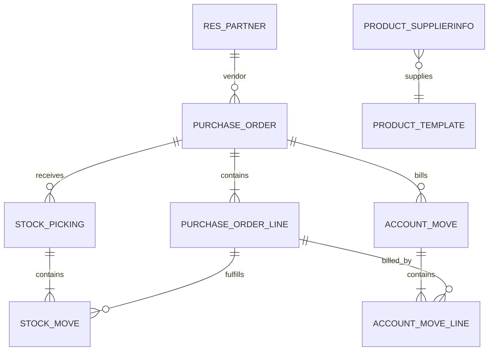
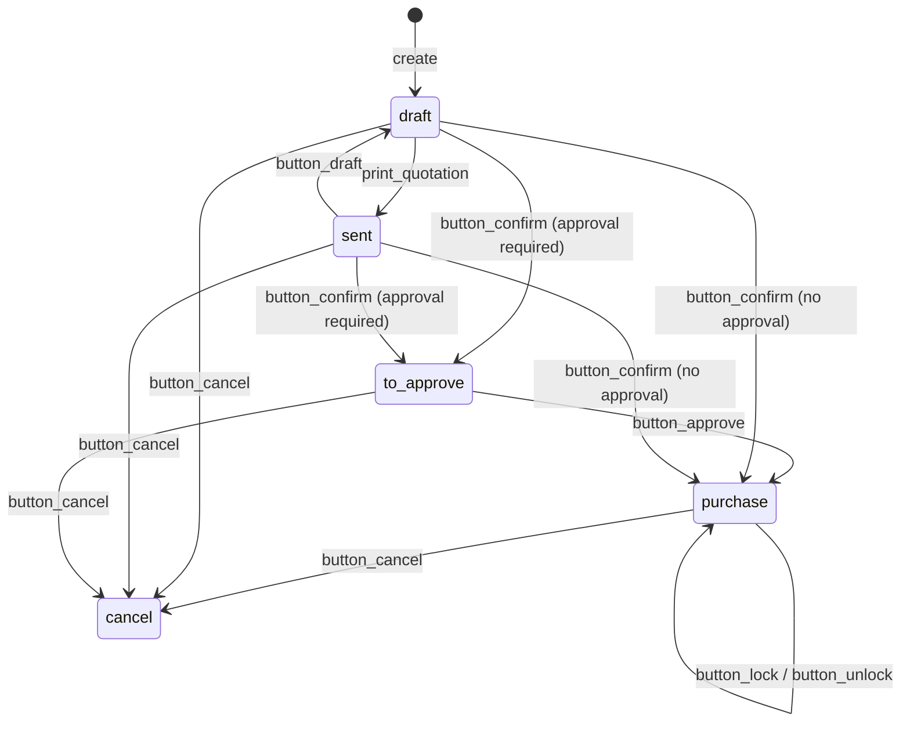
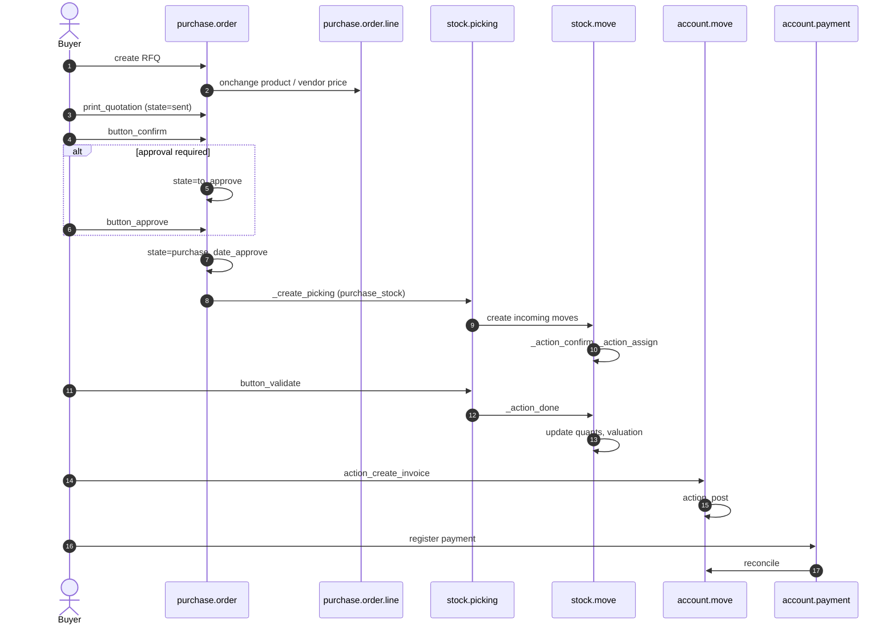

# Flujo — Compras (de la solicitud a las cuentas por pagar)

> **Módulos cubiertos.** `purchase`, `purchase_stock`, `account`, `account_3way_match` (Enterprise).
> **Versión.** Odoo 19.0 Enterprise. En esta compilación, Compras **no tiene estado `done`**.

---

## 1. Actores y documentos

| Actor | Documento | Modelo |
|---|---|---|
| Comprador | Solicitud de presupuesto | `purchase.order` (`draft`/`sent`) |
| Responsable de compras | Aprobación | `purchase.order` (`to approve` → `purchase`) |
| Proveedor | Presupuesto / confirmación del pedido | PDF/portal |
| Almacén | Recepción | `stock.picking` (entrada) |
| Contable | Factura de proveedor | `account.move` (`in_invoice`) |
| Controller financiero | Conciliación a tres bandas | `account.move.release_to_pay` |
| Tesorería | Pago | `account.payment` |

---

## 2. Mapa de modelos

Herencia clave:

| Modelo | Núcleo | Extensiones |
|---|---|---|
| `purchase.order` | `purchase/models/purchase_order.py` | `purchase_stock`, `purchase_mrp`, `purchase_requisition`, `account_3way_match` |
| `purchase.order.line` | `purchase/models/purchase_order_line.py` | `purchase_stock`, `purchase_mrp` |
| `stock.picking` | `stock/models/stock_picking.py` | `purchase_stock` |
| `account.move` | `account/models/account_move.py` | `purchase`, `account_3way_match` |

---

## 3. Máquina de estados

### 3.1 `purchase.order`

| Estado | Significado | Editable | Recepción creada |
|---|---|---|---|
| `draft` | SdP | sí | no |
| `sent` | SdP enviada | sí | no |
| `to approve` | pendiente del responsable | limitado | no |
| `purchase` | pedido de compra confirmado | limitado | sí (al confirmar) |
| `cancel` | cancelado | no | no |

`locked` es un booleano independiente; un pedido de compra bloqueado no se puede cancelar ni editar. **No existe el estado `done`**; la recepción no cambia el estado del pedido. El estado «terminado» se infiere de `qty_received >= product_qty` y de `invoice_status`.

Origen: `purchase/models/purchase_order.py:105-116`, `:625-655`.

### 3.2 `stock.picking` (recepción)

La misma máquina de estados que todas las transferencias:

`draft → confirmed → assigned → done`, con `waiting` para movimientos encadenados y `cancel`.

Una recepción se crea en `confirmed` y pasa a `assigned` cuando se reservan los quants. En los movimientos de entrada, normalmente no se requiere reserva; el picking puede permanecer en `confirmed` hasta la validación.

---

## 4. Secuencia de extremo a extremo

### 4.1 Detalle de la confirmación

`button_confirm()`:

1. omitir los pedidos que no estén en `draft`/`sent`,
2. `_confirmation_error_message()` — cada línea que no sea de sección necesita un producto,
3. `_validate_analytic_distribution()`,
4. `_add_supplier_to_product()` — crea un `product.supplierinfo` si el proveedor aún no está registrado (máximo 10 proveedores),
5. `_approval_allowed()`:
   - `po_double_validation = 'one_step'` → aprobar,
   - `'two_step'` y total por debajo de `po_double_validation_amount` → aprobar,
   - el usuario está en `purchase.group_purchase_manager` → aprobar,
   - en caso contrario, `state='to approve'`.
6. `button_approve()` escribe `state='purchase'`, `date_approve=now` y bloquea si `po_lock='lock'`.

Origen: `purchase/models/purchase_order.py:615-639`, `:1251-1260`.

### 4.2 Creación de la recepción [V19]

`purchase_stock._create_picking()`:

1. solo para `state == 'purchase'` y al menos un producto `consu`,
2. reutilizar un picking existente no terminado si lo hay,
3. `_prepare_picking()` → `stock.picking` con `picking_type_id` = entrada,
4. `order_line._create_stock_moves(picking)`:
   - omitir los productos que no sean `consu`,
   - calcular el precio unitario con impuestos incluidos,
   - dividir cantidades para satisfacer los destinos de movimientos vinculados (MTO/venta),
5. `_action_confirm()` y después `_action_assign()`,
6. confirmar los pickings hacia delante creados por reglas push,
7. eliminar una recepción vacía,
8. publicar un mensaje de vínculo de origen.

Origen: `purchase_stock/models/purchase_order.py:375-410`, `purchase_stock/models/purchase_order_line.py:206-237`.

### 4.3 Validación de la recepción

`stock.picking.button_validate()` sigue el flujo común de inventario (véase `03-inventory.md`):

- comprobación de integridad de cantidades/lotes/paquetes,
- asistente de pedido pendiente para recepciones parciales,
- `_action_done()` → líneas de movimiento → quants,
- valoración: el valor del movimiento de entrada = precio de compra (+ costes en destino si los hay),
- `qty_received` en la línea del pedido de compra se calcula a partir de los movimientos de entrada realizados,
- la conciliación de la factura de proveedor usa `qty_received` frente a `qty_invoiced`.

### 4.4 Factura de proveedor

`purchase.order.action_create_invoice()`:

1. `_prepare_invoice()` — proveedor, moneda, condiciones de pago, posición fiscal,
2. iterar las líneas, conservando secciones/subsecciones,
3. `line._prepare_account_move_line()` — cuenta, impuesto, distribución analítica, cantidad,
4. agrupar por `(company, partner, currency)`,
5. crear `account.move` con `move_type='in_invoice'` en **borrador**,
6. los totales negativos se convierten en abonos de proveedor (`action_switch_move_type`),
7. los adjuntos opcionales se vinculan y puede ejecutarse OCR/extracción.

Origen: `purchase/models/purchase_order.py:760-850`.

**[INVARIANT]** La factura se crea en borrador. La publicación (`action_post`) es un paso contable independiente y puede bloquearse por fechas de bloqueo, falta de partner, total negativo o detección de referencia de proveedor duplicada.

---

## 5. Semántica de cantidades y facturación

| Campo | Definición | Origen |
|---|---|---|
| `product_qty` | cantidad pedida en la UdM del pedido de compra | `purchase.order.line` |
| `qty_received` | cantidad de entrada realizada (menos devoluciones) | calculada a partir de los movimientos de stock |
| `qty_invoiced` | cantidad en facturas de proveedor publicadas/en borrador | calculada a partir de `account.move.line` |
| `qty_to_invoice` | `qty_received` o `product_qty` menos `qty_invoiced` según la política | calculada |
| `invoice_status` | `no` / `to invoice` / `invoiced` | `_get_invoiced` |

### 5.1 Política de control

`product.purchase_method` (o la sobrescritura en `purchase.order.line`):

| Política | Cantidad facturable |
|---|---|
| `purchase` (sobre cantidades pedidas) | `product_qty` |
| `receive` (sobre cantidades recibidas) | `qty_received` |

**[WARNING]** Si la política es `receive` y la recepción es parcial, la factura solo puede cubrir la cantidad recibida salvo que se modifique manualmente. La facturación excesiva se bloquea mediante el cálculo de `qty_to_invoice`, no mediante una restricción de base de datos.

### 5.2 Conciliación a tres bandas [ENTERPRISE]

`account_3way_match` calcula `release_to_pay` en las facturas de proveedor:

- `yes` — cantidad recibida >= cantidad facturada,
- `no` — no se recibió nada,
- `exception` — discrepancia de cantidad o precio.

Es informativo salvo que un flujo de trabajo personalizado bloquee el pago. Odoo no impide publicar una factura con exceso de facturación de forma predeterminada; solo la marca. Si sus controles lo requieren, impóngalo con una restricción.

Origen: `addons/account_3way_match/models/account_invoice.py:14-120`.

---

## 6. Puntos de decisión

| Decisión | Regla | Consecuencia |
|---|---|---|
| ¿Se requiere aprobación? | `po_double_validation` de la compañía, importe, grupo de responsables | `to approve` frente a `purchase` |
| ¿Crear recepción? | al menos un producto `consu` | sin recepción para servicios |
| ¿Dividir la recepción? | cantidad parcial / ajuste de pedidos pendientes | picking de pedido pendiente |
| ¿Facturar sobre el pedido o la recepción? | `product.purchase_method` | cantidad facturable |
| ¿Costes en destino? | `stock.landed.cost` | ajuste de valoración |
| ¿Moneda? | lista de precios del proveedor/moneda del pedido de compra | ganancia/pérdida por tipo de cambio en el pago |
| ¿Impuesto? | impuestos del proveedor + posición fiscal | líneas de impuesto de la factura |
| ¿Bloqueo? | `company.po_lock` | sin edición/cancelación |

---

## 7. Devoluciones y correcciones

### 7.1 Devolución de compra

- Crear un picking de devolución a partir de la recepción con el asistente `stock.return.picking` (`action_create_returns()`).
- Los movimientos de devolución realizados reducen `qty_received`.
- Crear un abono de proveedor (`account.move` `in_refund`) o usar el asistente de devolución.
- Si la factura ya está publicada, usar una nota de crédito, no editar la factura.

### 7.2 Diferencia de precio

Si el precio de la factura de proveedor difiere del precio del pedido de compra:

- la línea de factura mantiene el precio del proveedor,
- la diferencia de `price_unit` no se contabiliza automáticamente en una cuenta de desviación de precios en el núcleo,
- `account_3way_match` marca `exception`,
- los módulos personalizados pueden contabilizar un asiento de desviación.

**[WARNING]** El núcleo de Odoo no implementa un flujo contable completo de desviación de precio de compra (PPV). Si se requiere PPV, especifique las cuentas y las reglas de contabilización de forma explícita; no asuma que la revalorización del coste estándar lo absorberá.

---

## 8. Costes en destino

`stock.landed.cost` distribuye costes adicionales (transporte, aduanas, seguros) entre los movimientos recibidos:

1. seleccionar el/los picking(s),
2. añadir líneas de coste con un método de reparto (`equal`, `by_quantity`, `by_current_cost_price`, `by_weight`, `by_volume`),
3. validar → crea ajustes de valor equivalentes a `stock.valuation.layer` en los movimientos (en la v19, ajustes de `stock.move.value`),
4. asiento contable: Debe existencias / Haber gasto o cuentas por pagar.

**[WARNING]** Los costes en destino aplicados después de vender la mercancía modifican el CMV de forma retroactiva. Deben aplicarse antes de la entrega o ejecutar el ajuste de valoración de forma explícita.

---

## 9. Impacto contable [V19]

| Evento | Comportamiento contable |
|---|---|
| Recepción | se establece `stock.move.value`; no hay asiento de mayor por movimiento para un movimiento normal de proveedor→stock |
| Factura de proveedor | Debe gasto (o entrada de stock configurada) / Debe impuesto / Haber cuentas por pagar |
| Diferencia de precio | el núcleo no la contabiliza como PPV; `account_3way_match` marca excepciones |
| Pago | Debe cuentas por pagar / Haber banco; diferencia de cambio si la moneda difiere |
| Devolución | reversión del valor de la recepción y abono de proveedor |
| Coste en destino | ajuste de valor en los movimientos; asiento de mayor cuando se valida el coste en destino |
| Cierre de stock | `action_close_stock_valuation` concilia el libro mayor de valoración de existencias con `stock.move.value` |

Las cuentas exactas dependen de la categoría de producto (`property_stock_valuation_account_id`, `account_stock_variation_id`, `account_stock_expense_id`) y del ajuste de valoración (`real_time` frente a `periodic`). Véanse `04-accounting.md` §8 y `03-inventory.md` §5.4.

---

## 10. Modos de fallo

| Síntoma | Causa | Comprobación |
|---|---|---|
| La confirmación pasa a `to approve` inesperadamente | umbral de validación en dos pasos | `company.po_double_validation`, importe |
| No se crea recepción | todos los productos son servicios, o no hay tipo de picking de entrada | `product.type`, configuración del almacén |
| Recepción no reservada | política de reserva de entradas | `stock.move.state` |
| No se puede facturar la cantidad completa | política `receive`, recepción parcial | `qty_received`, `qty_to_invoice` |
| El total de la factura difiere | impuestos, moneda, descuento, coste en destino | detalle de impuestos, `invoice_currency_rate` |
| Factura de proveedor duplicada | sin detección de duplicados | `account.move` `ref`, `_check_duplicate_supplier_reference` |
| No se puede cancelar el pedido de compra | bloqueado o facturas publicadas | `locked`, `invoice_ids.state` |
| Valoración de stock incorrecta | falta de precio en el movimiento, método de coste incorrecto | `stock.move.value` |

---

## 11. Puntos de extensión

| Hook | Uso | Riesgo |
|---|---|---|
| `_prepare_picking` | personalizar la cabecera de la recepción | bajo |
| `_prepare_stock_moves` | personalizar los valores de movimiento | medio |
| `_create_picking` | reemplazar la creación de la recepción | alto |
| `_prepare_invoice` | cabecera de la factura | bajo |
| `_prepare_account_move_line` | asignación de líneas de factura | medio |
| `_approval_allowed` | matriz de aprobación personalizada | medio |
| `button_confirm` | añadir validaciones | alto |
| `_add_supplier_to_product` | automatización del catálogo de proveedores | bajo |

---

## 12. Escenarios de prueba

| Escenario | Aserción |
|---|---|
| SdP → confirmar (un paso) | estado `purchase`, existe recepción |
| SdP → confirmar (dos pasos) | estado `to approve`, sin recepción |
| El responsable aprueba | estado `purchase`, `date_approve` establecido |
| Recepción parcial | `qty_received < product_qty`, pedido pendiente |
| Facturar sobre lo recibido | `qty_to_invoice == qty_received - qty_invoiced` |
| Intento de facturación excesiva | bloqueado o marcado |
| Devolución a proveedor | `qty_received` disminuye, nota de crédito |
| Coste en destino | el valor del movimiento aumenta, asiento contable cuadrado |
| Multimoneda | el importe en moneda de la compañía usa el tipo de la fecha del pedido de compra |
| Pedido de compra bloqueado | editar/cancelar genera `UserError` |

---

## 13. Índice de evidencias

| Tema | Archivo:línea |
|---|---|
| Estados del pedido de compra | `purchase/models/purchase_order.py:105-116` |
| Confirmar/aprobar | `purchase/models/purchase_order.py:615-639` |
| Regla de aprobación | `purchase/models/purchase_order.py:1251-1260` |
| Cancelar/bloquear | `purchase/models/purchase_order.py:641-655` |
| Creación de la factura | `purchase/models/purchase_order.py:760-850` |
| Estado de facturación | `purchase/models/purchase_order.py:47-68` |
| Creación de la recepción | `purchase_stock/models/purchase_order.py:375-410` |
| Preparación del movimiento de stock | `purchase_stock/models/purchase_order_line.py:206-237` |
| Conciliación a tres bandas | `account_3way_match/models/account_invoice.py:14-120` |

Continúa con `03-inventory.md`.
