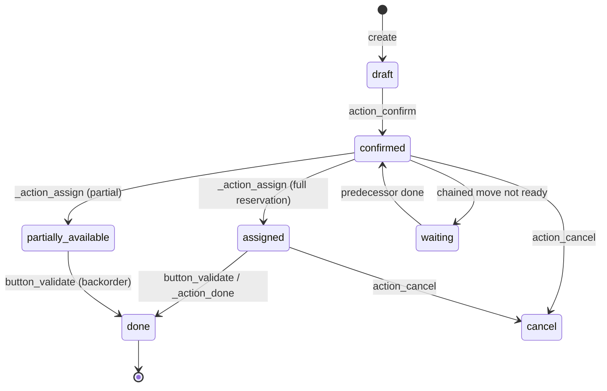
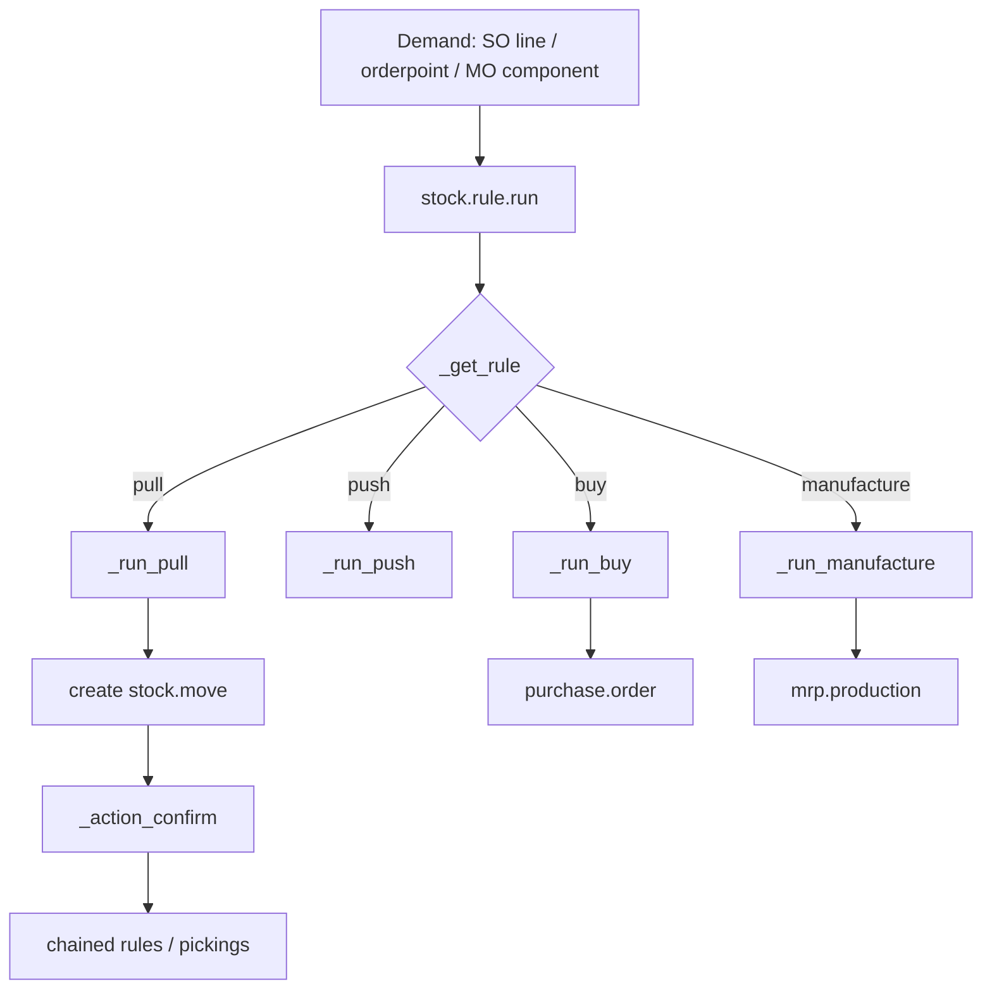
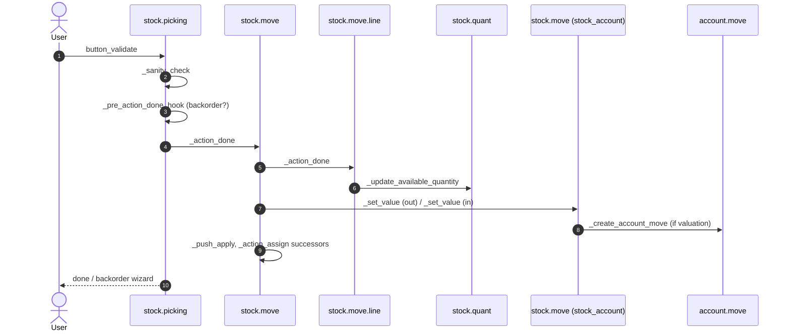

# Flujo — Inventario y valoración de stock

> **Módulos cubiertos.** `stock`, `stock_account`, `stock_landed_costs`, `product`, `uom`, `purchase_stock`, `sale_stock`.
> **Versión.** Odoo 19.0 Enterprise. El inventario cambió sustancialmente en la v19: `procurement.group` y `stock.valuation.layer` ya no existen; la valoración reside en `stock.move.value` y `product.value`; la UdM es un árbol.

---

## 1. El modelo de inventario en una página

| Concepto | Modelo | Significado |
|---|---|---|
| Producto | `product.product` | variante; `is_storable` distingue los bienes almacenados |
| Ubicación | `stock.location` | nodo físico/lógico; `usage` determina el comportamiento |
| Almacén | `stock.warehouse` | raíz de configuración: rutas, tipos de picking, ubicaciones |
| Tipo de picking | `stock.picking.type` | plantilla de operación (entrada, salida, interna, fabricación) |
| Picking | `stock.picking` | documento que agrupa movimientos |
| Movimiento | `stock.move` | demanda de una cantidad desde A hasta B |
| Línea de movimiento | `stock.move.line` | detalle real de ejecución (lote, paquete, propietario, cantidad) |
| Quant | `stock.quant` | cantidad disponible/reservada por producto/ubicación/lote/paquete/propietario |
| Regla | `stock.rule` | cómo se satisface la demanda (pull/push/compra/fabricación) |
| Ruta | `stock.route` | conjunto ordenado de reglas |
| Referencia | `stock.reference` | [V19] documento que agrupa y sustituye a `procurement.group` |

### 1.1 Ubicaciones y tipos de uso

| Uso | Comportamiento | Reserva |
|---|---|---|
| `internal` | stock propio | sí |
| `supplier` | origen proveedor | no |
| `customer` | destino cliente | no |
| `inventory` | contrapartida de ajuste | no |
| `production` | fabricación | sí (componentes) |
| `transit` | entre almacenes/entre compañías | sí |
| `view` | solo estructural | n/a |

**[INVARIANT]** Un movimiento de `supplier` a `internal` es una recepción; de `internal` a `customer` es una entrega; de `internal` a `internal` es una transferencia. Los campos `usage`, y no el nombre del tipo de picking, determinan el comportamiento de reserva y valoración.

---

## 2. Máquinas de estados

### 2.1 `stock.picking`



El `state` del picking se **calcula** a partir de sus movimientos (`_compute_state`); no se escribe directamente. Estados de los movimientos:

`draft → waiting | confirmed → partially_available → assigned → done`, más `cancel`.

### 2.2 `stock.quant`

Sin máquina de estados. `quantity` y `reserved_quantity` son numéricos; `available_quantity = quantity - reserved_quantity`. Se permite un quant con cantidad negativa si la configuración de la ubicación/producto lo permite.

---

## 3. Aprovisionamiento: cómo la demanda se convierte en movimientos



### 3.1 Orden de resolución de reglas

`_get_rule(product, location, values)` busca reglas pull para la ubicación de destino, recorriendo la jerarquía de ubicaciones hacia arriba. Prioridad de `_search_rule`:

1. `route_ids` explícitas en los valores de aprovisionamiento,
2. rutas de embalaje,
3. rutas del producto + rutas de la categoría de producto,
4. rutas del almacén.

Dentro de una ruta, las reglas se ordenan por `route_sequence` y luego por `sequence`. Gana la primera regla que coincide.

Fuente: `stock/models/stock_rule.py:567-650`.

### 3.2 Pull frente a push

- **Pull**: una demanda en el destino desencadena un movimiento desde el origen (p. ej., la entrega hace pull desde el stock; si es insuficiente, MTO hace pull desde el proveedor).
- **Push**: un movimiento hacia una ubicación desencadena un movimiento de salida posterior (p. ej., la recepción hace push a control de calidad y luego a stock).
- `procure_method`:
  - `make_to_stock`: tomar del stock si hay disponible; de lo contrario, esperar.
  - `make_to_order`: crear un movimiento encadenado desde el proveedor/fabricación.
  - `mts_else_mto`: elegir según la previsión en el momento de la creación.

**[WARNING]** `mts_else_mto` evalúa la previsión en el momento del aprovisionamiento. En condiciones de concurrencia, dos demandas pueden ver stock suficiente y ambas elegir MTS, lo que provoca una escasez posterior. El envoltorio de reintentos no soluciona esto; es una decisión de configuración del negocio.

### 3.3 Rutas de varios pasos

| Ruta | Pasos | Uso típico |
|---|---|---|
| Recibir en 1 paso | proveedor → stock | simple |
| Recibir en 2 pasos | proveedor → entrada → stock | calidad/ubicación dirigida |
| Recibir en 3 pasos | proveedor → entrada → calidad → stock | regulado |
| Entregar en 1 paso | stock → cliente | simple |
| Entregar en 2 pasos | stock → salida → cliente | preparación |
| Entregar en 3 pasos | stock → pick → pack → cliente | comercio electrónico |
| Cross-dock | proveedor → salida → cliente | sin almacenamiento |
| Envío directo | proveedor → cliente | envío directo |

Cada paso crea un picking; los movimientos se encadenan con `move_dest_ids`. La confirmación del primer picking desencadena `_action_assign` en el siguiente cuando el predecesor está terminado.

### 3.4 Reglas de reabastecimiento

`stock.warehouse.orderpoint`:

- `product_min_qty`, `product_max_qty`, `qty_multiple`, `trigger` (`auto`/`manual`).
- El planificador (`stock.rule.run_scheduler`) calcula `qty_to_order = max - virtual_available`, redondea al múltiplo y crea un aprovisionamiento.
- `virtual_available` incluye entradas/salidas dentro del horizonte del plazo de entrega; las claves de contexto cambian el horizonte.
- El planificador es un cron (`stock.scheduler_cron`) y procesa las compañías por separado.

**[WARNING]** Las reglas de reabastecimiento utilizan cantidades de previsión que dependen de movimientos confirmados pero no realizados. Los documentos cancelados o retrasados distorsionan la previsión. Supervise `qty_to_order` y el registro del planificador.

---

## 4. Reserva y quants

### 4.1 Reserva

`stock.move._action_assign()`:

1. buscar quants candidatos mediante `_gather` usando la estrategia de retirada,
2. calcular la cantidad disponible (`quantity - reserved_quantity`),
3. crear/actualizar `stock.move.line` con `reserved_qty`,
4. actualizar `stock.quant.reserved_quantity` mediante `_update_reserve_quantity`,
5. establecer el estado del movimiento en `assigned` o `partially_available`.

Estrategias de retirada (`product.category.removal_strategy_id` o ubicación):

| Estrategia | Orden |
|---|---|
| `fifo` | primero el `in_date` más antiguo (predeterminado) |
| `lifo` | primero el `in_date` más reciente |
| `closest` | ubicación más cercana por nombre completo |
| `least_packages` | primero el menor número de paquetes (A* sobre el contenido de los paquetes) |
| FEFO | orden por fecha de caducidad/retirada; requiere fechas de caducidad y el contexto `with_expiration` |

Las estrategias son registros `product.removal` (definidos por datos), seleccionados por `product.category.removal_strategy_id` o `stock.location.removal_strategy_id`; el código de quants selecciona el comportamiento según la cadena del método.

Fuente: `stock/models/stock_quant.py:771-900`, `stock/models/stock_move.py:2041`.

### 4.2 Actualizaciones de quants

`_update_available_quantity(product, location, quantity, reserved_quantity, lot, package, owner)`:

- obtiene el quant exacto (`strict=True`),
- bloquea una fila con `try_lock_for_update` (SKIP LOCKED),
- actualiza `quantity` o `reserved_quantity`,
- crea un quant si no existe,
- mantiene `in_date` como la fecha de entrada más antigua.

**[INVARIANT]** Nunca escriba `stock.quant.quantity` directamente desde código personalizado. Utilice siempre `_update_available_quantity` para que las reservas, `in_date` y la valoración sigan siendo coherentes.

### 4.3 Stock negativo

Los quants negativos se permiten cuando:

- la ubicación lo permite (`usage` interno),
- el producto no está sujeto a seguimiento por lote con restricciones estrictas,
- el movimiento se fuerza/valida sin stock suficiente.

El stock negativo distorsiona la valoración FIFO/AVCO y el coste de las ventas (COGS). Active «bloquear stock negativo» a nivel de categoría de producto o de almacén si el negocio lo requiere.

### 4.4 Lotes y números de serie

- `tracking='lot'` o `'serial'` en el producto.
- `stock.move.line.lot_id` identifica el lote movido.
- `stock.lot` almacena `name`, `product_id`, `expiration_date`, `removal_date`, `alert_date`.
- Los quants se obtienen por `lot_id`; los duplicados se fusionan con `_quant_tasks`, no se evitan mediante una restricción única de la base de datos.
- Los números de serie deben tener cantidad 1 por quant; Odoo no lo impone a nivel de base de datos en todos los flujos.

**[WARNING]** Crear una línea de movimiento sin lote para un producto con seguimiento genera un error en la validación. Las importaciones masivas que omiten la interfaz deben establecer los lotes explícitamente.

### 4.5 Paquetes y propietarios

- `stock.package` agrupa líneas de movimiento; `package_id` (origen) y `result_package_id` (destino).
- `owner_id` admite stock en consignación: mercancía propiedad de un tercero pero almacenada en una ubicación propia.
- La valoración y la disponibilidad tienen en cuenta al propietario.

---

## 5. Validación y valoración

### 5.1 Secuencia de `button_validate`



Detalles clave:

- `_action_done` primero cancela los movimientos sin cantidad realizada y después procesa las líneas de movimiento realizadas.
- `picked` es una puerta booleana: una línea de movimiento con cantidad pero `picked=False` no se valida (comportamiento de la v19).
- Los quants se actualizan por línea de movimiento, disminuyendo la ubicación de origen y aumentando la de destino.
- Se crean pedidos pendientes para las cantidades no realizadas, salvo que `cancel_backorder` esté establecido.
- Los movimientos sucesores se asignan después de la validación (`_trigger_assign`).

Fuente: `stock/models/stock_picking.py:1256-1480`, `stock/models/stock_move.py:2244-2320`.

### 5.2 Valoración en la v19 [V19]

En esta versión **no existe `stock.valuation.layer`**. En su lugar:

- `stock.move.value` almacena el valor total del movimiento.
- `stock.move.remaining_qty` / `remaining_value` rastrean las capas FIFO.
- `product.value` es una pista de auditoría de los cambios manuales de valor (precio estándar, precio de lote, valor del movimiento).
- `product.standard_price` es el coste actual.
- En los movimientos de salida, `_set_value()` consume capas FIFO o utiliza el precio estándar.
- En los movimientos de entrada, `_set_value()` determina el valor por prioridad:
  1. valor manual (`product.value` con `move_id`),
  2. líneas de factura de proveedor / factura,
  3. coste de producción,
  4. precio de presupuesto (pedido de venta/pedido de compra),
  5. devoluciones,
  6. precio estándar,
  7. costes adicionales (costes en destino).

Fuente: `stock_account/models/stock_move.py:193-470`, `product_value.py:1-120`.

### 5.3 Métodos de coste

| Método | Valor de entrada | Valor de salida |
|---|---|---|
| `standard` | precio estándar | precio estándar |
| `fifo` | coste real; capa por recepción | coste de la capa más antigua |
| `average` (AVCO) | media ponderada | media actual |

Para FIFO, `_run_fifo` consume capas; para AVCO, `_update_standard_price` recalcula la media después de cada recepción. El AVCO valorado por lote (`lot_valuated=True`) calcula medias por lote.

### 5.4 Asientos contables [V19]

Odoo 19 **no** publica un asiento contable de valoración de stock por cada recepción o entrega. El valor autoritativo reside en `stock.move.value`; la contabilidad se concilia por separado.

`stock.move._create_account_move()` se ejecuta solo cuando `_should_create_account_move()` es verdadero:

- el producto es almacenable y el movimiento está valorado,
- la valoración es `real_time`,
- la ubicación de origen o destino tiene un `valuation_account_id` (producción, inventario, desecho, tránsito),
- la cantidad no es cero.

Publica un asiento entre la cuenta de valoración de stock del producto y la cuenta de valoración de la ubicación en `company.account_stock_journal_id`.

Para los movimientos ordinarios de proveedor/cliente, el efecto financiero proviene de:

- **Líneas de COGS en facturas de cliente** — `stock_account.account_move._post()` añade líneas con `display_type='cogs'` (Debe gasto / Haber valoración de stock) para productos almacenables con valoración en tiempo real;
- **Cierre de valoración de stock** — `res.company.action_close_stock_valuation()` compara `product.total_value` con el saldo de valoración de stock publicado y registra un asiento de cierre. El cron `_cron_post_stock_valuation` se ejecuta a diario o mensualmente según `company.inventory_period` (`manual` requiere una ejecución explícita);
- **Variación continental** — `_get_continental_realtime_variation_vals()` registra la variación de inventario del periodo.

Fuente: `stock_account/models/stock_move.py:661-670`, `stock_account/models/account_move.py:29-40`, `stock_account/models/res_company.py:49-148`, `:238-320`.

**[WARNING]** No asuma que validar una recepción incrementa inmediatamente la cuenta de valoración de stock. Ejecute el proceso de cierre (o el cron) y concilie `stock_value()` con `stock_accounting_value()`; de lo contrario, el balance y el informe de inventario divergirán.

### 5.5 Métodos de coste y contabilidad

| Configuración | Origen del valor | Asiento contable |
|---|---|---|
| `standard` | precio estándar | COGS en factura + ajustes de cierre |
| `fifo` | capas FIFO en los movimientos | COGS en factura + ajustes de cierre |
| `average` | media ponderada | COGS en factura + ajustes de cierre |
| Valoración periódica | cálculo de cierre | solo asiento de cierre |
| Tiempo real + ubicación valorada | `value` del movimiento | asiento a nivel de movimiento + conciliación de cierre |

La distinción anglosajona/continental es menos visible en la v19 que en versiones anteriores, pero las cuentas siguen siendo importantes:

- `property_stock_valuation_account_id` — activo de inventario,
- `account_stock_variation_id` — contrapartida de variación/COGS,
- `account_stock_expense_id` — gasto de variación continental,
- `property_stock_journal` / `account_stock_journal_id` — diario de valoración.

Pruebe un ciclo completo: compra → recepción → factura → venta → entrega → factura → cierre de stock, y concilie la cuenta de valoración de stock después de cada paso.

---

## 6. Devoluciones, desechos y ajustes

### 6.1 Devoluciones

- `stock.return.picking.action_create_returns()` crea un picking inverso con enlaces `origin_returned_move_id`.
- Los movimientos de devolución tienen `to_refund=True` cuando deben reducir la cantidad del documento original.
- La valoración invierte el valor original (restauración de la capa FIFO o ajuste de la media).
- La cantidad vinculada del pedido de venta/compra se reduce si `to_refund`.

### 6.2 Desecho

- `stock.scrap` crea un movimiento a una ubicación de desecho (`usage='inventory'`).
- El desecho se valora como un movimiento de salida; la cuenta de contrapartida es la cuenta de valoración de la ubicación de desecho o la cuenta de gasto del producto.
- El desecho puede realizarse desde un picking o de forma independiente.

### 6.3 Ajuste de inventario

- `stock.quant.inventory_quantity` es la cantidad contada.
- `action_apply_inventory` crea un movimiento de ajuste hacia/desde la ubicación de inventario.
- `inventory_quantity_set` rastrea si el usuario cambió el valor.
- El ajuste se valora al coste estándar (o FIFO para los incrementos).

**[WARNING]** Los ajustes de inventario no requieren un documento físico; son una operación privilegiada. Restrinja `stock.group_stock_manager` y audite los movimientos resultantes.

### 6.4 Recuento cíclico

El núcleo de Odoo incluye ajustes de inventario y recuentos de `stock.quant`, pero no un motor completo de programación de recuentos cíclicos. Se necesitan funcionalidades de estilo `stock_cycle_count` de Enterprise o módulos personalizados para la programación ABC, las hojas de recuento y la aprobación de diferencias.

---

## 7. Puntos de decisión

| Decisión | Factor | Efecto |
|---|---|---|
| ¿Reservar al confirmar? | `picking_type.reservation_method` | `at_confirm` frente a `by_date` frente a `manual` |
| ¿Crear pedido pendiente? | `picking_type.create_backorder` | nunca / preguntar / siempre |
| ¿Usar lote? | seguimiento del producto | requisito de línea de movimiento |
| ¿Permitir negativo? | configuración de categoría/almacén | la validación se realiza/falla |
| ¿Valorar a? | método de coste | capa FIFO frente a estándar |
| ¿Publicar asiento de valoración? | `property_valuation` de la categoría de producto | tiempo real frente a manual |
| ¿Empujar al siguiente paso? | reglas de ruta | picking encadenado |
| ¿Dividir? | paquete/propietario/lote | varias líneas de movimiento |

---

## 8. Rendimiento y bloqueos

### 8.1 Rutas de acceso frecuente

- `_gather` → `search` sobre `stock_quant` con producto/ubicación/lote/paquete/propietario. Requiere índices compuestos; el núcleo los crea mediante `_table_objects` y los índices de campo.
- `_update_available_quantity` → bloqueo de fila por quant. Contención en productos populares.
- `_action_done` → actualizaciones de quants por línea de movimiento; agrupe por producto/ubicación cuando sea posible.
- `virtual_available` → agregado sobre quants y movimientos; costoso en catálogos grandes.
- Cron de `stock.quant` `_quant_tasks` → fusiona duplicados, limpia quants a cero.

### 8.2 Evitación de interbloqueos

- Ordene los identificadores de producto/ubicación antes de las operaciones masivas.
- Evite validar dos pickings con productos solapados en paralelo; el envoltorio de reintentos los serializará, pero el rendimiento cae.
- Utilice la semántica `SKIP LOCKED` donde lo hace el núcleo; no añada `FOR UPDATE` sobre quants en código personalizado sin un orden claro.

### 8.3 Patrones de consulta

```sql
-- On hand by product/location
SELECT product_id, location_id, SUM(quantity), SUM(reserved_quantity)
FROM stock_quant
WHERE company_id = %s
GROUP BY product_id, location_id;

-- Moves not yet done
SELECT id, product_id, product_uom_qty, quantity, state
FROM stock_move
WHERE state IN ('confirmed','partially_available','assigned')
ORDER BY date;
```

---

## 9. Modos de fallo

| Síntoma | Causa | Comprobación |
|---|---|---|
| Picking atascado en `confirmed` | sin stock / método de reserva manual | quants, `_action_assign` |
| `assigned` pero no se puede validar | `picked=False` en las líneas de movimiento | `move_line_ids.picked` |
| Stock negativo tras la validación | cantidad forzada / sin bloqueo | cantidad del quant |
| COGS incorrecto | método de coste, precio de factura ausente, stock negativo | `stock.move.value`, capas |
| Quants duplicados | `_update_available_quantity` concurrente | ejecutar `_quant_tasks` / fusionar |
| Pedido pendiente no creado | `create_backorder='never'` | tipo de picking |
| Asiento de valoración desequilibrado | cuentas ausentes en la categoría | cuentas de la categoría de producto |
| La devolución no reduce la cantidad del pedido de venta | `to_refund=False` | opción del asistente de devolución |
| Desajuste de lote/número de serie | lote no establecido en la línea de movimiento | líneas de movimiento |

---

## 10. Puntos de extensión

| Hook | Uso | Riesgo |
|---|---|---|
| `_get_rule` | selección personalizada de rutas | alto |
| `_get_stock_move_values` | añadir campos al movimiento | medio |
| `_action_assign` | reserva personalizada | alto |
| `_prepare_move_line_vals` | línea de movimiento personalizada | medio |
| `_action_done` | efectos posteriores a la validación | muy alto |
| `_update_available_quantity` | lógica personalizada de quants | muy alto |
| `_get_value_data` | valoración personalizada | alto |
| `_get_account_move_line_vals` | cuentas personalizadas | alto |
| `_should_create_account_move` | omitir/posponer la valoración | medio |

**[INVARIANT]** Nunca sobrescriba `_action_done` sin llamar a `super()` y sin comprender los pedidos pendientes, las reglas push y la valoración. Es el método más peligroso de todo el inventario.

---

## 11. Escenarios de prueba

| Escenario | Afirmación |
|---|---|
| Recepción en 1 paso | el quant aumenta, el asiento de valoración está equilibrado |
| Recepción parcial | se crea pedido pendiente, `qty_received` parcial |
| Reserva de entrega | `reserved_quantity` del quant aumenta |
| Validación de entrega | el quant disminuye; se determina el valor del movimiento; COGS posteriormente en la factura |
| Devolución | quant restaurado, valor invertido |
| Desecho | el quant disminuye, asiento de desecho |
| Ajuste de inventario | el quant coincide con la cantidad contada |
| FIFO | el valor de salida usa la capa más antigua |
| AVCO | precio estándar recalculado |
| Ruta de varios pasos | pickings encadenados creados y asignados |
| Envío directo | sin quant interno, movimiento de proveedor a cliente |
| Seguimiento por lote | validación bloqueada sin lote |

---

## 12. Índice de evidencias

| Tema | Archivo:línea |
|---|---|
| Modelo de quant | `stock/models/stock_quant.py:20-120` |
| Obtención y disponibilidad | `stock_quant.py:771-850` |
| Actualización de quant | `stock_quant.py:1038-1095` |
| Ejecución de regla | `stock/models/stock_rule.py:453-510` |
| Resolución de reglas | `stock_rule.py:567-650` |
| Pull | `stock_rule.py:290-400` |
| Asignación de movimiento | `stock/models/stock_move.py:2041` |
| Movimiento realizado | `stock_move.py:2244-2320` |
| Validación de picking | `stock/models/stock_picking.py:1413-1480` |
| Picking realizado | `stock_picking.py:1256-1300` |
| Valoración | `stock_account/models/stock_move.py:193-470` |
| Valor del producto | `stock_account/models/product_value.py:1-120` |
| Árbol de UdM [V19] | `uom/models/uom_uom.py:18-100` |

Continúe con `04-accounting.md`.
