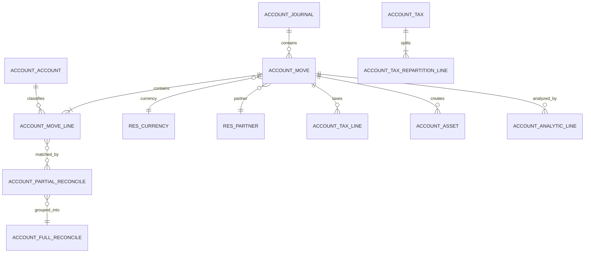
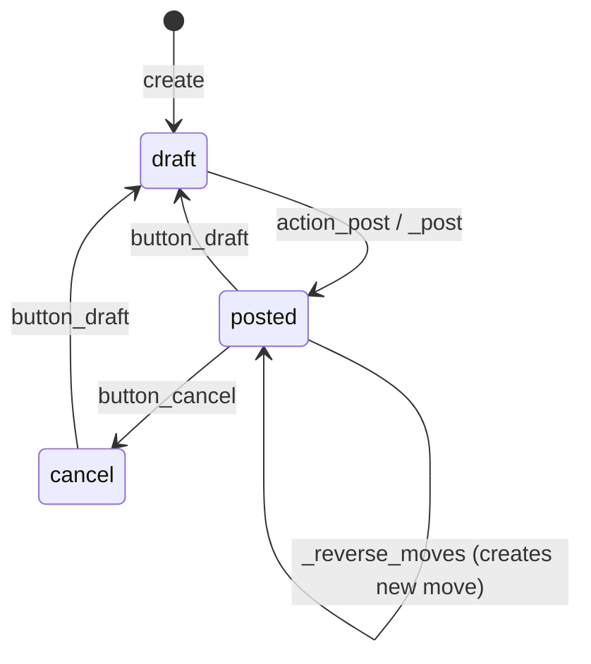
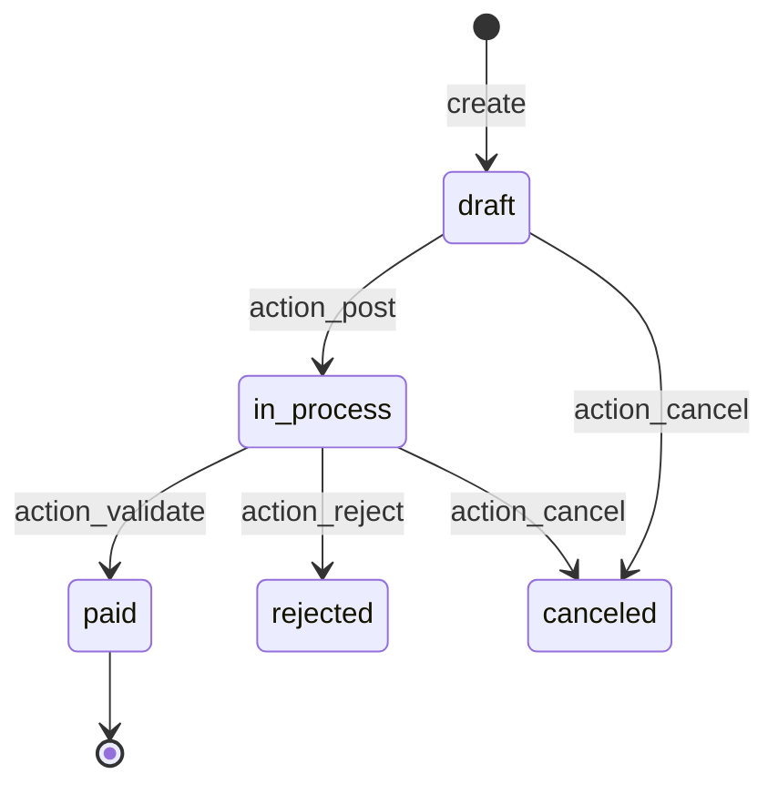

# Flujo — Contabilidad (de la factura a los estados financieros)

> **Módulos cubiertos.** `account`, `account_asset`, `account_reports` (Enterprise), `account_accountant`, `account_edi_ubl_cii`, `account_3way_match`.
> **Versión.** Odoo 19.0 Enterprise. El motor de impuestos de Odoo 19 es un **pipeline de funciones puras**; muchos puntos de extensión anteriores a la 18 están obsoletos.

---

## 1. El modelo contable



| Objeto | Significado | Invariante clave |
|---|---|---|
| `account.journal` | contenedor de numeración y libro contable | una secuencia por diario/periodo |
| `account.account` | nodo del plan contable | `account_type` determina los informes |
| `account.move` | asiento contable / factura / pago | equilibrado, inmutabilidad al publicar |
| `account.move.line` | línea de debe/haber | suma(debe) = suma(haber) por asiento |
| `account.partial.reconcile` | importe conciliado entre dos líneas | residuo actualizado de forma atómica |
| `account.full.reconcile` | grupo de parciales que cierra líneas | uno por conjunto totalmente conciliado |
| `account.tax` | definición de impuesto | las líneas de reparto deben sumar 100 % |
| `account.payment` | documento de pago | publica un asiento y concilia |
| `account.asset` | activo amortizable | tabla de amortización |

---

## 2. Ciclo de vida del asiento



### 2.1 Flujo de `_post(soft=True)`

1. comprobación de permisos (`account.group_account_invoice` o sudo),
2. validaciones específicas de factura:
   - desajuste del total en edición rápida,
   - banco del socio archivado/no válido,
   - total negativo (debe ser una nota de crédito),
   - socio ausente,
   - fecha de factura ausente (se usa la de hoy por defecto),
   - la sobrescritura de `stock_account` crea líneas de COGS para productos almacenables con valoración en tiempo real **antes** de `super()._post()`,
3. `_check_balanced(container)` — **gestor de contexto** que valida debe=haber y desencadena la sincronización dinámica de líneas,
4. `_sync_dynamic_lines(container)` — recalcula las líneas de impuestos, las condiciones de pago y el redondeo,
5. `to_post.write({'state': 'posted', 'posted_before': True})`,
6. asignación de secuencia (`_set_next_sequence`) para los asientos sin numerar,
7. cadena de hash si `restrict_mode_hash_table`,
8. `_reconcile_marked()` para las líneas marcadas para conciliación,
9. actualizaciones de rango del socio,
10. las facturas con total cero desencadenan `_invoice_paid_hook`,
11. el commit lo gestiona el envoltorio de la petición, no este método.

Fuente: `account/models/account_move.py:5574-5805`.

### 2.2 Comprobación de equilibrio

`_check_balanced` es un gestor de contexto, no un método booleano. Envuelve un bloque y lanza `UserError` si el asiento está desequilibrado después del bloque. `_sync_dynamic_lines` recalcula:

- las líneas de impuestos a partir de las líneas base,
- las líneas de condiciones de pago (por cobrar/por pagar),
- las líneas de redondeo,
- las líneas de criterio de caja cuando procede.

**[INVARIANT]** Nunca escriba directamente el debe/haber de `account.move.line` sin volcar los cambios y volver a comprobar el equilibrio. Utilice los ayudantes `_prepare_*` o `Command` sobre `line_ids` y deje que `_sync_dynamic_lines` recalcule.

### 2.3 Inmutabilidad tras la publicación

Una vez publicado:

- `name` está asignado y no puede cambiar,
- `date` está restringida por las fechas de bloqueo,
- no se pueden añadir/eliminar `line_ids` salvo mediante asistentes específicos,
- los asientos con hash no pueden modificarse en absoluto,
- las correcciones requieren `button_draft` (si se permite), una reversión o un asiento de ajuste.

`button_draft` comprueba `_check_draftable()` y las fechas de bloqueo. `button_cancel` solo se permite para asientos que no están conciliados ni bloqueados.

### 2.4 Reversión

`_reverse_moves(default_values_list, cancel=False)`:

- crea un nuevo asiento con el debe/haber invertido,
- vincula `reversed_entry_id`,
- opcionalmente concilia la reversión con el original (`move_reverse_cancel`),
- **no** elimina el original.

**[WARNING]** `cancel=True` en una factura crea una nota de crédito y la concilia; no cambia el original a `cancel`. Utilice `button_cancel` solo para asientos en borrador o no conciliados.

---

## 3. Secuencias y cadena de hash

### 3.1 Asignación de secuencias

`sequence.mixin._locked_increment`:

- determina el formato a partir de la última secuencia del diario/periodo,
- bloquea una entrada de índice única actualizando una fila publicada,
- incrementa una caché local de la transacción,
- ante una violación de unicidad, vuelve a un punto de guardado y reintenta.

Esto produce una numeración casi sin huecos por diario y periodo. Los huecos se producen cuando una transacción asigna un número y posteriormente se revierte.

Fuente: `account/models/sequence_mixin.py:355-425`.

**[WARNING]** Publicar miles de facturas en una sola transacción mantiene el bloqueo de secuencia durante toda la transacción y serializa la publicación por diario. Procese por lotes y confirme entre lotes si su proceso lo permite.

### 3.2 Cadena de hash

Cuando `journal.restrict_mode_hash_table` está habilitado:

- cada asiento publicado recibe un `inalterable_hash` (`$version$hex`),
- el hash cubre campos seleccionados más el hash anterior de la cadena,
- se bloquea la edición de un asiento con hash,
- la cadena puede verificarse con el informe de integridad.

Las versiones y los campos cubiertos se definen en `_get_integrity_hash_fields` (`account_move.py:4590`). La cadena es por diario y prefijo de secuencia. Un asiento ausente o alterado rompe la verificación.

**[INVARIANT]** El encadenamiento de hash es un control de inalterabilidad, no una copia de seguridad ni una cadena de bloques. No impide que un administrador de base de datos elimine registros; solo hace detectable la manipulación.

---

## 4. Impuestos

### 4.1 Definición de impuestos

`account.tax`:

| Campo | Significado |
|---|---|
| `amount`, `amount_type` | porcentaje/fijo/división |
| `price_include` | impuesto incluido en el precio |
| `include_base_amount` | los impuestos posteriores se aplican sobre base+impuesto |
| `tax_group_id` | agrupación para informes |
| `repartition_line_ids` | reparto base/impuesto por factor y cuenta |
| `invoice_repartition_line_ids` / `refund_repartition_line_ids` | específicos de la dirección |
| `tax_exigibility` | en factura o en pago (criterio de caja) |
| `analytic` | distribución analítica |
| `l10n_*` | campos de localización |

### 4.2 Pipeline de impuestos de Odoo 19 [V19]

El motor es un conjunto de funciones puras sobre diccionarios de «líneas base»:

```
_prepare_product_base_line_for_taxes_computation(line)
  -> _add_tax_details_in_base_lines(base_lines, company)
  -> _round_base_lines_tax_details(base_lines, company, tax_lines=...)
  -> _aggregate_base_lines_tax_details(...)
  -> _aggregate_base_lines_aggregated_values(...)
```

Métodos clave:

| Método | Propósito |
|---|---|
| `_get_tax_details(price_unit, currency, quantity, product, partner, ...)` | calcular los detalles del impuesto para una base única |
| `_add_tax_details_in_base_lines` | adjuntar los datos de impuesto a las líneas base |
| `_round_base_lines_tax_details` | redondear por impuesto/grupo, gestionar el redondeo global |
| `_aggregate_base_lines_tax_details` | agrupar para las líneas de impuesto |
| `compute_all` | envoltorio compatible con el comportamiento heredado |

Fuente: `account/models/account_tax.py:1137`, `:4972`.

**[WARNING]** Odoo 19 ha declarado obsoletos varios ayudantes anteriores a la 18 (`_compute_taxes`, `_prepare_invoice_aggregated_taxes`). Si los sobrescribe, verifíquelos con el código fuente de la 19; pueden ser adaptadores o haber sido eliminados. Prefiera el pipeline de funciones puras.

### 4.3 Líneas de reparto

Cada impuesto tiene líneas de reparto para la base y el impuesto:

- `factor_percent` — proporción del impuesto (p. ej., 50 % deducible),
- `repartition_type` — `base` o `tax`,
- `account_id` — cuenta de sobrescritura,
- `use_in_tax_closing` — trasladar al asiento de cierre.

La suma de `factor_percent` para las líneas base debe ser 100; lo mismo para las líneas de impuesto. Un impuesto mal configurado produce asientos desequilibrados o incorrectos.

### 4.4 Impuestos con precio incluido

Cuando `price_include=True`:

- el precio unitario incluye el impuesto,
- la base se calcula hacia atrás: `base = price / (1 + rate)`,
- el redondeo puede producir una diferencia de 1 céntimo, absorbida por una línea de redondeo,
- `round_globally` cambia la granularidad del redondeo.

### 4.5 Criterio de caja

`tax_exigibility='on_payment'`:

- el impuesto no se reconoce al publicar la factura,
- se crea un asiento de criterio de caja en la conciliación (`_create_tax_cash_basis_moves`),
- el asiento de criterio de caja invierte la línea de impuesto y registra el impuesto en la cuenta de criterio de caja.

**[WARNING]** El criterio de caja requiere que la configuración del diario/cuenta sea correcta; una cuenta de criterio de caja ausente registra silenciosamente en la predeterminada. Pruebe con un pago e inspeccione el asiento generado.

### 4.6 Posiciones fiscales

`account.fiscal.position` asigna:

- impuestos (`tax_ids` / `tax_ids` inverso),
- cuentas (`account_ids`),
- reglas de país/provincia,
- aplicación automática según el socio.

Se aplica cuando se crea la factura y puede volver a aplicarse (`action_update_fpos_values`). No cambia los precios, solo la asignación de impuestos/cuentas.

---

## 5. Conciliación

### 5.1 Conciliación parcial y total

- `account.partial.reconcile` vincula una línea de debe y una de haber con `amount` y `debit_amount_currency`/`credit_amount_currency`.
- `account.full.reconcile` agrupa los parciales que cierran completamente un conjunto de líneas.
- `amount_residual` en una línea = importe original - suma(parciales).
- `matched_debit_ids` / `matched_credit_ids` son la relación.

### 5.2 `_reconcile_plan`

`account.move.line._reconcile_plan(plan)`:

1. `_optimize_reconciliation_plan` aplana y agrupa,
2. `_check_balanced` + `_sync_dynamic_lines` sobre los asientos implicados,
3. `_prepare_reconciliation_plan` calcula los importes parciales y las diferencias de cambio,
4. crea los parciales,
5. crea los asientos de diferencia de cambio,
6. crea los asientos de criterio de caja,
7. crea las conciliaciones totales,
8. desencadena `_invoice_paid_hook` cuando las facturas quedan pagadas.

Fuente: `account/models/account_move_line.py:2793-2950`.

### 5.3 Diferencias de cambio

Cuando una factura en moneda extranjera se paga a un tipo diferente:

- los parciales se crean en ambas monedas,
- la diferencia residual se registra en la cuenta de ganancia/pérdida por diferencia de cambio,
- se crea un nuevo asiento y se vincula mediante `exchange_move_id`.

### 5.4 Conciliación de pagos

Asistente `account.payment.register`:

1. calcula el importe a pagar por línea,
2. gestiona las condonaciones y los descuentos por pronto pago,
3. crea `account.payment` + asiento contable,
4. concilia la línea de por cobrar/por pagar del pago con las líneas de la factura.

**[WARNING]** El registro de pagos utiliza el importe **residual**, no el total de la factura. Las facturas parcialmente pagadas producen varios parciales. Si el pago está en una moneda diferente, el asistente calcula el importe en la moneda de la compañía a la fecha del pago.

---

## 6. Pagos

Máquina de estados de `account.payment`:



- `action_post` pasa a `in_process` (o a `paid` para cuentas de efectivo).
- `action_validate` marca como pagado (normalmente lo hace la conciliación bancaria).
- El asiento contable lo crea y publica `action_post`.
- Las cuentas de cobros/pagos pendientes se utilizan hasta la conciliación bancaria.

---

## 7. Activos

`account.asset`:

| Campo | Significado |
|---|---|
| `state` | `draft`, `open`, `paused`, `close`, `cancelled` |
| `method` | `linear`, `degressive`, `linear-limit` |
| `method_number` / `method_period` | número de amortizaciones, meses del periodo |
| `prorata_date` | inicio del prorrateo temporal |
| `original_value` | coste de adquisición |
| `book_value` | valor neto contable |
| `depreciation_move_ids` | asientos generados |

`_create_depreciation_moves` genera un asiento por periodo. La tabla de amortización se recalcula cuando cambian el valor del activo, el método o las fechas.

**[WARNING]** Dar de baja un activo antes del final de su vida útil requiere un asistente de baja que registre la ganancia/pérdida. Eliminar manualmente los asientos de amortización deja la tabla inconsistente.

---

## 8. Contabilidad de la valoración de stock [V19]

Véase `03-inventory.md` §5.4. Configuración clave:

- `product.category.property_stock_valuation_account_id` — activo de inventario,
- `account.account.account_stock_variation_id` — contrapartida de variación/COGS,
- `account.account.account_stock_expense_id` — gasto de variación continental,
- `company.account_stock_journal_id` — diario de valoración,
- `stock.location.valuation_account_id` — solo ubicaciones de producción/inventario/desecho/tránsito.

| Evento | Comportamiento en la v19 |
|---|---|
| Recepción | se establece `stock.move.value`; sin asiento contable por movimiento para el flujo normal proveedor→stock |
| Factura de proveedor | Debe gasto/entrada configurada / Haber por pagar |
| Entrega | se consume `stock.move.value` (FIFO/AVCO); sin asiento de COGS en la entrega |
| Factura de cliente | líneas de COGS creadas en `_post` (Debe gasto / Haber valoración de stock) |
| Cierre de stock | `res.company.action_close_stock_valuation()` concilia el libro mayor con `stock.move.value` |
| Coste en destino | ajuste de valor; asiento contable en la validación |

**[INVARIANT]** La cuenta de valoración de stock se concilia mediante el proceso de cierre, no mediante cada movimiento. Si `stock_value()` y `stock_accounting_value()` divergen, ejecute el cierre e investigue la diferencia antes de publicar.

**[WARNING]** La configuración anterior a la 18 `property_stock_account_input_categ_id` / `output_categ_id` ya no existe en esta versión. No traslade a ciegas las asignaciones de cuentas antiguas; utilice las cuentas de variación/gasto de la v19.

---

## 9. Fechas de bloqueo

Campos de la compañía (`account/models/company.py:76-112`):

| Campo | Bloquea |
|---|---|
| `fiscalyear_lock_date` | publicación/modificación de asientos anteriores a la fecha (personal contable) |
| `tax_lock_date` | cambios en la declaración de impuestos |
| `sale_lock_date` | asientos del diario de ventas |
| `purchase_lock_date` | asientos del diario de compras |
| `hard_lock_date` | a todos, incluido el personal contable (excepto sudo con grupo de excepción) |

Las fechas de bloqueo se aplican en Python, no en PostgreSQL. Una actualización directa por SQL las omite.

---

## 10. Contabilidad analítica

- `account.analytic.account` — árbol de planes/cuentas analíticas.
- `account.analytic.line` — apunte del diario analítico.
- `analytic.mixin` añade `analytic_distribution` (JSONB) a las líneas de factura.
- La distribución es una asignación `{account_id: percent}`; los porcentajes deben sumar 100.
- Las líneas analíticas se crean al publicar para los asientos publicados, y en eventos de stock/gasto para algunos módulos.
- `account.analytic.plan` agrupa cuentas; los informes agregan por plan.

**[WARNING]** La validación de la distribución analítica se produce al publicar la factura y al validar el stock. Una distribución incompleta lanza `UserError`; una distribución que suma más de 100 se rechaza.

---

## 11. Informes y `account_reports` de Enterprise

`account_reports` (Enterprise) es un **motor de informes independiente**, no solo vistas:

- las definiciones de informes son clases Python + datos XML,
- las expresiones se evalúan contra consultas SQL/códigos de cuenta,
- los informes admiten exploración en detalle, comparación y exportación,
- los informes de impuestos utilizan un motor SQL genérico con etiquetas,
- los informes diferidos (ingresos/gastos diferidos) crean asientos de ajuste.

El núcleo `account` proporciona las vistas de libro contable, balance de comprobación y libro mayor. Enterprise añade estados financieros, informes de impuestos, auditoría y consolidación.

**[WARNING]** Las expresiones personalizadas de informes son similares a código y se evalúan en el motor de informes. No están cubiertas por el modelo de seguridad estándar del ORM; restrinja el acceso a los diseñadores de informes.

---

## 12. Puntos de decisión e invariantes

| Decisión | Regla |
|---|---|
| ¿Se puede publicar? | equilibrio, socio, fecha, fecha de bloqueo, diario, secuencia |
| ¿Se puede pasar a borrador? | sin hash, sin bloqueo, sin conciliar |
| ¿Se puede cancelar? | en borrador o publicado sin conciliar |
| ¿Impuesto incluido? | `price_include` + base calculada hacia atrás |
| ¿Criterio de caja? | `tax_exigibility='on_payment'` |
| ¿Redondeo global? | `tax_calculation_rounding_method` de la compañía |
| ¿Diferencia de cambio? | residual multidivisa en la conciliación |
| ¿Activo? | indicadores `asset` de la categoría de producto + línea de factura |

**[INVARIANT]** Todo asiento publicado debe cumplir `sum(debit) == sum(credit)` en la moneda de la compañía. Las líneas en moneda extranjera también llevan `amount_currency` y `currency_id`; el equilibrio siempre se expresa en la moneda de la compañía.

---

## 13. Modos de fallo

| Síntoma | Causa | Comprobación |
|---|---|---|
| No se puede publicar por «desequilibrado» | falta la línea de impuesto/redondeo | `line_ids`, `_sync_dynamic_lines` |
| Secuencia duplicada | publicación concurrente / nombre manual | bloqueo de secuencia, unicidad de `name` |
| Cadena de hash rota | asiento con hash editado/eliminado | informe de integridad |
| Impuesto incorrecto | posición fiscal, price_include, reparto | detalles del impuesto |
| El pago no concilia | socio/cuenta/moneda diferentes | residuales, tipo de cuenta |
| Falta la diferencia de cambio | misma moneda o sin tipo de cambio | `res.currency.rate` |
| Error de fecha de bloqueo | fecha anterior al bloqueo | fechas de bloqueo de la compañía |
| Activo no creado | configuración de activo de la categoría de producto | campos de `account_asset` |
| Falta el COGS | valoración manual / sin cuenta de stock | cuentas de la categoría de producto |
| Desajuste en los informes | tipos de cuenta/etiquetas incorrectos | `account.account.account_type` |

---

## 14. Escenarios de prueba

| Escenario | Afirmación |
|---|---|
| Publicar factura de cliente | equilibrada, secuencia asignada, estado publicado |
| Publicar desequilibrada | `UserError` de `_check_balanced` |
| Revertir factura | nuevo asiento, vinculado, equilibrado |
| Registrar pago parcial | residual reducido, parcial creado |
| Pago total | conciliación total, factura pagada |
| Pago multidivisa | asiento de diferencia de cambio |
| Precio con impuesto incluido | base + impuesto = total |
| Impuesto de criterio de caja | asiento de impuesto en el pago |
| Amortización de activo | la tabla y los asientos coinciden |
| Fecha de bloqueo | publicación anterior a la fecha bloqueada |
| Cadena de hash | la verificación pasa; la edición se bloquea |

---

## 15. Índice de evidencias

| Tema | Archivo:línea |
|---|---|
| Modelo de asiento | `account/models/account_move.py:74` |
| `_post` | `account_move.py:5574` |
| `action_post` | `account_move.py:6164` |
| `_check_balanced` | `account_move.py:2780` |
| `_sync_dynamic_lines` | `account_move.py:3765` |
| `button_draft` / `button_cancel` | `account_move.py:6253`, `6368` |
| Campos de hash | `account_move.py:4590-4630` |
| Bloqueo de secuencia | `account/models/sequence_mixin.py:355` |
| Conciliación | `account/models/account_move_line.py:2793` |
| Detalles del impuesto | `account/models/account_tax.py:1137`, `4972` |
| Publicación de pagos | `account/models/account_payment.py:1126` |
| Registro de pagos | `account/wizard/account_payment_register.py:993` |
| Fechas de bloqueo | `account/models/company.py:76-112` |
| Activo | `account_asset/models/account_asset.py` |

Continúe con `05-manufacturing.md`.
