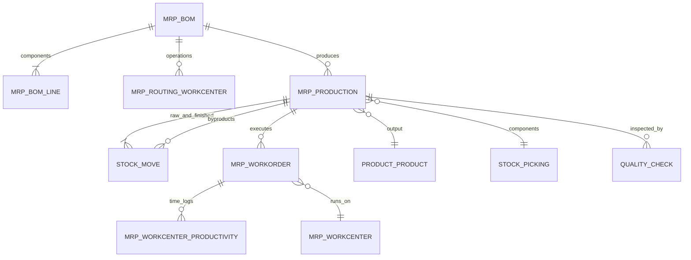
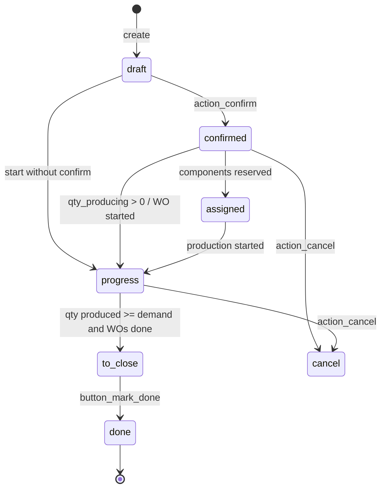
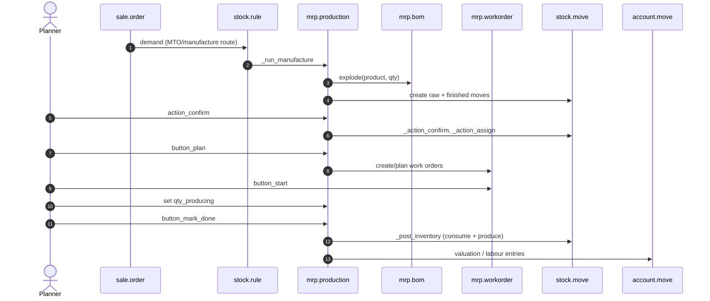

# Flujo — Fabricación (del plan a la producción)

> **Módulos cubiertos.** `mrp`, `mrp_account`, `mrp_subcontracting`, `mrp_workorder` (Enterprise), `quality`, `quality_mrp`, `stock_account`.
> **Versión.** Odoo 19.0 Enterprise. El estado de la orden de fabricación (OF) se **calcula** a partir de los movimientos y las órdenes de trabajo; no se escribe directamente.

---

## 1. Mapa de modelos



| Modelo | Función |
|---|---|
| `mrp.bom` | receta: salida, cantidad, componentes, operaciones, indicador de fantasma |
| `mrp.bom.line` | componente + cantidad + UdM + atributos |
| `mrp.routing.workcenter` | operación: centro de trabajo, duración, secuencia |
| `mrp.production` | orden de fabricación |
| `mrp.workorder` | instancia de ejecución de la operación |
| `mrp.workcenter` | capacidad, calendario, coste |
| `mrp.workcenter.productivity` | seguimiento del tiempo (productivo, tiempo de inactividad, rendimiento) |
| `mrp.unbuild` | fabricación inversa |
| `quality.check` | punto de inspección |

---

## 2. Máquina de estados

### 2.1 `mrp.production`



`state` se **calcula** (`_compute_state`, `mrp_production.py:573`):

- `draft` — sin movimientos o sin guardar,
- `cancel` — todos los movimientos de producto terminado cancelados,
- `done` — todos los movimientos de materias primas y producto terminado hechos/cancelados,
- `to_close` — órdenes de trabajo hechas/canceladas, o sin OT y cantidad producida >= demanda,
- `progress` — cualquier OT en curso/hecha, cantidad en producción > 0, o cualquier movimiento de materia prima realizado,
- en caso contrario, `confirmed`.

**[WARNING]** Dado que el estado se calcula, escribir `state='done'` directamente es incorrecto. Utilice `button_mark_done()` (que registra el inventario) o `action_confirm()`.

### 2.2 `mrp.workorder`

`blocked → ready → progress → done`, más `cancel`. Transiciones:

| Método | Efecto |
|---|---|
| `button_start` | establece `progress`, inicia el seguimiento del tiempo |
| `button_finish` | establece `done`, detiene el seguimiento, calcula la duración |
| `button_pending` | detiene el temporizador del usuario actual, registra la productividad |
| `end_all` | cierra todos los temporizadores de productividad abiertos de la orden de trabajo |

La preparación de la orden de trabajo depende de la disponibilidad de componentes y de las operaciones predecesoras (`blocked_by_workorder_ids`).

### 2.3 `mrp.workcenter.productivity`

Rastrea `date_start`, `date_end`, `duration`, `loss_id` (motivo de pérdida) y la categoría de eficacia relacionada (`productive`, `performance`, `quality`, `availability`), además de `user_id`. Se utiliza para análisis de costes y de estilo OEE.

---

## 3. Lista de materiales

### 3.1 Tipos de LdM

| Tipo | Comportamiento |
|---|---|
| Normal | componentes + operaciones |
| Fantasma (kit) | se explota en el padre; sin OF independiente |
| Subcontratación | producida por un subcontratista; se envían los componentes |
| Específica de variante | `product_tmpl_id` + `product_id` + valores de atributo |
| Alternativa | `bom_ids` en el producto, seleccionada por `sequence`/fecha |

### 3.2 Algoritmo de explosión [V19]

`mrp.bom.explode(product, quantity, picking_type, never_attribute_values)`:

1. comenzar con las líneas propias de la LdM,
2. para cada línea, si el componente tiene una LdM **fantasma**, sustituir la línea por las líneas de esa LdM (recursivo, BFS iterativo),
3. convertir las cantidades usando factores de UdM,
4. **redondear hacia arriba** las cantidades de los componentes hoja al redondeo de la UdM (`rounding_method='UP'`),
5. `_round_last_line_done` permite un ajuste final,
6. devolver `(boms_done, lines_done)` con referencias al padre para la trazabilidad.

Fuente: `mrp/models/mrp_bom.py:419-474`.

**[INVARIANT]** Las LdM fantasma nunca crean su propia OF; sus componentes aparecen en la OF padre. Una LdM fantasma con operaciones se trata de forma especial: si la LdM padre tiene las mismas operaciones, no se duplican.

### 3.3 Cantidad de componente

```
component_qty = (mo_qty / bom.product_qty) * bom_line.product_qty
```

y luego se convierte a la UdM del componente. El redondeo hacia arriba en el nivel hoja es intencionado: no se puede consumir una fracción de unidad si la UdM es discreta. Esto puede provocar un consumo excesivo en comparación con una explosión puramente matemática.

### 3.4 Subproductos y cuota de coste

- `mrp.bom.byproduct_ids` definen salidas con un porcentaje `cost_share`.
- El coste del producto terminado se reduce por la cuota de coste del subproducto.
- Los subproductos con `cost_method` FIFO/AVCO obtienen un `price_unit` derivado del coste total; los subproductos con coste estándar utilizan su precio estándar.

Fuente: `mrp_account/models/mrp_production.py:57-94`.

---

## 4. Secuencia de extremo a extremo



### 4.1 Rutas de creación

| Ruta | Método | Resultado |
|---|---|---|
| Manual | `mrp.production.create` | OF en borrador |
| Pedido de venta | `stock.rule._run_manufacture` | OF confirmada vinculada al pedido de venta |
| Regla de reabastecimiento | planificador → ruta de fabricación | OF confirmada |
| Subcontratación | `mrp_subcontracting` | OF en la ubicación del subcontratista |
| Desmontaje | `mrp.unbuild` | OF inversa |

### 4.2 Confirmación

`action_confirm()`:

1. `_check_company()`,
2. forzar la UdM de la OF a la UdM del producto para las salidas con seguimiento por número de serie,
3. `move_raw_ids._adjust_procure_method()` — decidir MTS/MTO por componente,
4. `moves._action_confirm(merge=False)`,
5. `workorder_ids._action_confirm()`, establecer el modo de coste,
6. `move_raw_ids._trigger_scheduler()` — desencadenar el reabastecimiento de los componentes que faltan,
7. confirmar los pickings de componentes,
8. establecer `state='confirmed'` solo para las OF en borrador.

Fuente: `mrp/models/mrp_production.py:1625-1668`.

### 4.3 Reserva

`action_assign()` → `move_raw_ids._action_assign()`. La disponibilidad de componentes se refleja en `reservation_state` (`confirmed`, `assigned`, `waiting`) y `components_availability_state`.

### 4.4 Planificación

`button_plan()`:

- confirma las OF en borrador,
- `_plan_workorders()` programa las operaciones en los centros de trabajo utilizando el calendario y la capacidad del centro de trabajo,
- respeta las dependencias de `blocked_by_workorder_ids`,
- calcula `date_planned_start`/`date_planned_finished`.

**[WARNING]** La planificación solo tiene capacidad finita a nivel de centro de trabajo; no resuelve una optimización global de la programación. Para APS avanzado, integre un planificador externo.

### 4.5 Producción

- `qty_producing` es la cantidad que se está produciendo en la operación actual.
- `_set_qty_producing()` escala las cantidades de los componentes a la cantidad producida.
- `button_start` de la orden de trabajo inicia el seguimiento del tiempo; `button_finish` lo detiene.
- `_post_inventory()` consume los movimientos de materias primas realizados y produce los movimientos de producto terminado.
- `button_mark_done()` envuelve `_post_inventory`, divide los pedidos pendientes, cierra las órdenes de trabajo y establece `is_locked`.

Fuente: `mrp/models/mrp_production.py:1402`, `:1907-1980`, `:2219-2290`.

### 4.6 Pedidos pendientes y divisiones

`_split_productions()` crea OF de pedido pendiente para la cantidad no producida. El consumo de componentes se asigna proporcionalmente; `cancel_remaining_qty` cancela en lugar de dividir. El pedido pendiente conserva `production_group_id` y los enlaces de referencia.

---

## 5. Valoración y coste

### 5.1 Coste del producto terminado

`mrp_account._cal_price(consumed_moves)`:

```
total_cost = sum(consumed move values)
           + workcenter cost (workorder._cal_cost())
           + extra_cost * quantity
finished_unit_cost = total_cost * (1 - byproduct_cost_share/100) / produced_qty
```

- Para productos terminados FIFO/AVCO, `price_unit` se establece a partir de este total.
- Para productos con coste estándar, `price_unit` es el precio estándar del producto.
- Coste de la orden de trabajo = duración × coste del centro de trabajo por hora (incluido el coste del empleado si está configurado).

Fuente: `mrp_account/models/mrp_production.py:57-94`.

### 5.2 Registro de mano de obra

`_post_labour()` (`mrp_account` de Enterprise):

- solo para valoración en tiempo real y una ubicación de producción con cuenta de valoración,
- agrupa los costes de las órdenes de trabajo por cuenta de gasto,
- registra Debe producción en curso (WIP) / Haber gasto de mano de obra,
- vincula el apunte contable a las líneas de productividad.

### 5.3 WIP

El trabajo en curso no es un informe estándar independiente en el núcleo. Se representa mediante:

- componentes de materias primas consumidos pero aún no terminados (el valor reside en la ubicación de producción),
- mano de obra registrada en WIP,
- productos terminados aún no recibidos.

`mrp_account`/`account_reports` de Enterprise pueden proporcionar informes de WIP; verifique su localización.

### 5.4 Desechos y subproductos

- El desecho crea un movimiento de salida hacia una ubicación de desecho, valorado a coste.
- Los subproductos crean movimientos de entrada con una cuota de coste; el coste del producto principal se reduce en consecuencia.

---

## 6. Subcontratación

`mrp_subcontracting`:

1. Una LdM de subcontratación tiene un `subcontractor_id` y componentes.
2. Un pedido de compra con un producto subcontratado crea una recepción y una OF de subcontratación en la ubicación del subcontratista.
3. Los componentes se transfieren al subcontratista (transferencia interna a una ubicación `subcontractor`).
4. El subcontratista produce; la recepción del producto terminado desencadena la finalización de la OF.
5. La valoración incluye el coste de los componentes + el coste del servicio de subcontratación.

El estado y la propiedad son delicados:

- la ubicación del subcontratista es `internal` con `subcontractor_id`,
- los componentes siguen siendo de su propiedad hasta que se consumen,
- la OF está vinculada a la línea del pedido de compra y a la recepción.

**[WARNING]** Las devoluciones de subcontratación, el desecho en el subcontratista y la escasez de componentes están poco documentados. Pruebe el ciclo completo, incluida una devolución de componentes y un rechazo de producto terminado.

---

## 7. Integración con calidad

`quality` / `quality_mrp`:

- `quality.point` define desencadenantes (operación, producto, tipo de picking) y un tipo de prueba (apto/no apto, medición, imagen, instrucciones).
- Los controles se crean en la confirmación, al inicio/fin de la orden de trabajo, o en la recepción/entrega.
- Un control fallido puede establecer `quality_state='fail'`, registrar una ubicación de fallo y (según el flujo/módulo) bloquear la operación; verifique el comportamiento de `quality_mrp`/`quality_control` para su versión.
- `quality.check` se vincula a `mrp.production`, `mrp.workorder`, `stock.move.line`.

**[WARNING]** Los controles de calidad no sustituyen a la cuarentena de inventario. Un control fallido puede registrar una ubicación de fallo, pero los bienes siguen presentes físicamente; utilice ubicaciones y desechos para aislarlos.

---

## 8. Puntos de decisión

| Decisión | Factor | Efecto |
|---|---|---|
| ¿Fabricar o comprar? | ruta, existencia de LdM | OF frente a pedido de compra |
| ¿Fantasma? | tipo de LdM | explotar en el padre |
| ¿Órdenes de trabajo? | operaciones de la LdM | planificación/seguimiento del tiempo |
| ¿Reserva? | disponibilidad de componentes | `assigned` frente a `confirmed` |
| ¿Backflush? | `consumption` de la LdM | consumir lo reservado frente a lo escaneado |
| ¿Dividir? | `qty_producing < product_qty` | OF de pedido pendiente |
| ¿Subproductos? | subproductos de la LdM | cuota de coste |
| ¿Subcontratar? | subcontratista de la LdM | pedido de compra + OF |
| ¿Puerta de calidad? | puntos de calidad | bloquear/permitir |

### 8.1 Modos de consumo

| Modo | Comportamiento |
|---|---|
| `strict` | consumir exactamente la cantidad de la LdM; advertir/bloquear si no coincide |
| `flexible` | permitir más/menos, registrar la diferencia |
| `warning` | permitir pero advertir |

El modo está en `mrp.bom.consumption` y se copia a la OF.

---

## 9. Modos de fallo

| Síntoma | Causa | Comprobación |
|---|---|---|
| OF atascada en `confirmed` | componentes no disponibles | `reservation_state`, quants |
| No se puede marcar como hecha | movimientos de materias primas no realizados / desajuste de cantidad | `move_raw_ids.picked`, `qty_producing` |
| Coste del producto terminado incorrecto | valor de componente ausente, coste del centro de trabajo, cuota de subproducto | `_cal_price`, valores de movimiento |
| OF en `to_close` pero no hecha | OT no finalizadas | `workorder_ids.state` |
| El fantasma crea una OF | tipo de LdM incorrecto | `bom.type` |
| Consumo excesivo | redondeo hacia arriba / modo flexible | `consumption`, líneas de movimiento |
| Bucle de pedidos pendientes | qty_producing 0 / lógica de división | `_split_productions` |
| Recepción de subcontratación bloqueada | transferencia de componentes no realizada | ubicación del subcontratista, movimientos |
| Control de calidad no creado | configuración de desencadenantes | `quality.point` |

---

## 10. Puntos de extensión

| Hook | Uso | Riesgo |
|---|---|---|
| `_compute_state` | lógica de estado personalizada | alto (calculado) |
| `action_confirm` | antes/después de la confirmación | medio |
| `_post_inventory` | consumo personalizado | muy alto |
| `_cal_price` | cálculo de costes personalizado | alto |
| `_get_quantity_to_backorder` | lógica de división | medio |
| `button_mark_done` | orquestación | alto |
| `explode` | explosión personalizada de la LdM | alto |
| `_plan_workorders` | programación | alto |

---

## 11. Escenarios de prueba

| Escenario | Afirmación |
|---|---|
| OF simple | consumir componentes, producir el terminado, valor correcto |
| LdM fantasma | sin OF para el kit, componentes en el padre |
| Producción parcial | OF de pedido pendiente creada |
| Flujo de orden de trabajo | inicio/fin registra el tiempo, coste incluido |
| Subproducto | cuota de coste aplicada |
| Subcontratación | transferencia de componentes + recepción + OF hecha |
| Fallo de calidad | operación bloqueada |
| Desmontaje | componentes devueltos, valor invertido |
| Desecho | el quant disminuye, asiento de desecho |

---

## 12. Índice de evidencias

| Tema | Archivo:línea |
|---|---|
| Cálculo del estado de la OF | `mrp/models/mrp_production.py:573-620` |
| Confirmación | `mrp_production.py:1625-1668` |
| Planificación | `mrp_production.py:1708-1760` |
| Registro de inventario | `mrp_production.py:1907-1980` |
| Marcar como hecha | `mrp_production.py:2219-2290` |
| División | `mrp_production.py:1981-2100` |
| Explosión de LdM | `mrp/models/mrp_bom.py:419-474` |
| Coste | `mrp_account/models/mrp_production.py:57-94` |
| Mano de obra | `mrp_account/models/mrp_production.py:101-130` |
| Orden de trabajo | `mrp/models/mrp_workorder.py:656-780` |
| Subcontratación | `mrp_subcontracting/models/mrp_production.py` |
| Calidad | `quality/models/quality.py` (`quality.point`, `quality.check`) |

Continúe con `06-cross-module.md` para el grafo de documentos.
