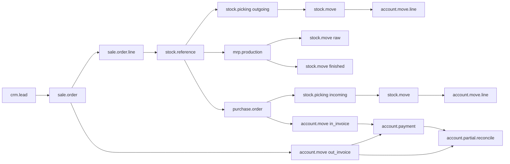
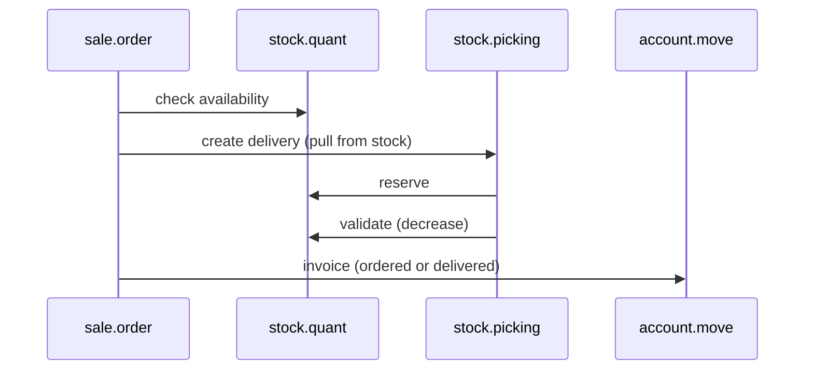
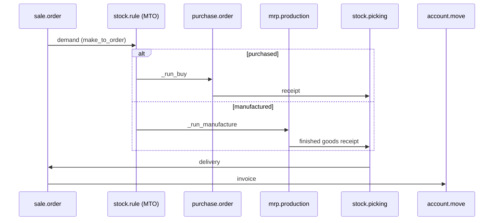
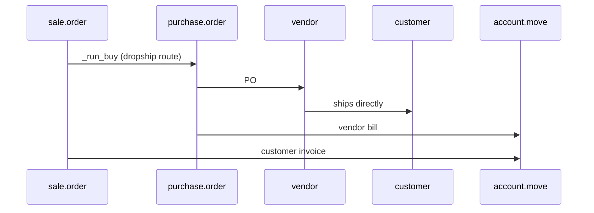
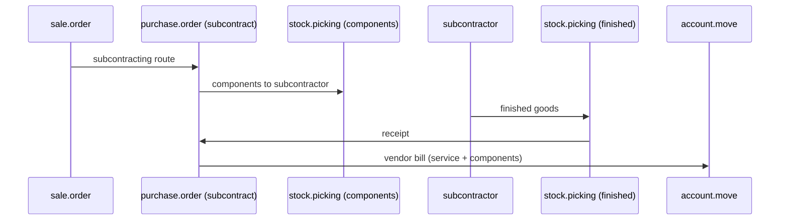

# Flujo documental entre módulos

> **Objetivo.** Ningún módulo de Odoo es una isla. Este capítulo describe cómo una demanda comercial se convierte en documentos de aprovisionamiento, fabricación, logística y contabilidad, y dónde el acoplamiento es laxo o peligroso.

---

## 1. El grafo documental



Cada flecha es una relación de base de datos, no un evento:

| Desde | Hasta | Campo |
|---|---|---|
| Línea de pedido de venta | movimiento de stock | `stock.move.sale_line_id` |
| Pedido de venta | referencia | `sale.order.stock_reference_ids` |
| Referencia | movimientos | `stock.reference.move_ids` |
| OF | referencia | `mrp.production.reference_ids` |
| Línea de pedido de compra | movimiento de stock | `stock.move.purchase_line_id` |
| Movimiento | asiento de valoración | `stock.move.account_move_id` |
| Movimiento de stock | línea de factura | mediante vínculos de línea de PV/PC (`sale_order_line_invoice_rel`, `purchase_line_id`) |
| Factura | pago | `account.partial.reconcile` |
| OF | línea de pedido de venta | mediante referencia + `sale_line_id` en el movimiento de producto terminado |

---

## 2. Flujo de fabricación contra stock (MTS)



- No hay documento de aprovisionamiento; la entrega se nutre del stock existente.
- Si el stock es insuficiente, el picking permanece en `confirmed` (o `partially_available`).
- Las reglas de reabastecimiento reponen de forma asíncrona; el pedido de venta no espera por ellas a menos que se configure MTO.

## 3. Flujo de fabricación bajo pedido (MTO)



- La ruta de la línea del pedido de venta determina si se compra o se fabrica.
- `procure_method='make_to_order'` crea un movimiento encadenado; la entrega espera la recepción o la OF.
- Los plazos de entrega se propagan a través de `date_planned`/`date_deadline`.

## 4. Flujo de envío directo



- No hay quant interno; los movimientos van del proveedor al cliente.
- La valoración suele ser nula o de traspaso según la configuración.
- La entrega al cliente puede no tener picking si el proveedor envía directamente; la trazabilidad depende de las referencias del pedido de compra y del pedido de venta.

## 5. Flujo de subcontratación



## 6. Flujo intercompañía

`account_inter_company_rules` puede crear automáticamente:

- un pedido de venta en la compañía B cuando la compañía A confirma un pedido de compra,
- un pedido de compra en la compañía B cuando la compañía A confirma un pedido de venta,
- facturas y facturas de proveedor espejadas.

Restricciones clave:

- los productos deben ser compartidos o estar mapeados,
- los contactos deben estar vinculados (`res.partner` con compañía),
- los impuestos y las posiciones fiscales deben existir en ambas compañías,
- la conversión de moneda usa la fecha del documento.

**[WARNING]** La automatización intercompañía duplica el volumen documental y puede crear bucles si ambas compañías tienen reglas recíprocas. Se debe probar con una base de datos de dos compañías y con protecciones explícitas de idempotencia.

---

## 7. Flujos de proyecto y servicios

`sale_project` y `sale_timesheet`:

- Un pedido de venta confirmado crea un proyecto y/o tareas.
- Las hojas de horas son registros `account.analytic.line` vinculados a `sale.order.line`.
- La política de facturación `delivery` factura la cantidad entregada de la hoja de horas.
- Los hitos pueden desencadenar la facturación (facturación por hitos de `sale_project`).

Puntos de acoplamiento:

- `project.project` ← `sale.order.project_id`,
- `project.task` ← `sale.order.line.task_id`,
- `account.analytic.line` ← `so_line` + `project_id`,
- la creación de la factura usa `qty_delivered` de las hojas de horas.

---

## 8. Flujos de suscripción y alquiler

`sale_subscription` de Enterprise:

- los planes recurrentes generan facturas según una programación,
- `sale.subscription` es un modelo separado (no `sale.order`),
- la facturación se impulsa mediante cron y `next_invoice_date`,
- el prorrateo, la venta adicional y la cancelación son específicos de las suscripciones.

`rental`:

- las líneas de pedido de venta se convierten en pickings de alquiler y devoluciones,
- el precio se calcula por periodo, con recargos por retraso,
- la disponibilidad de stock considera el periodo de alquiler.

**[WARNING]** Las suscripciones y los alquileres son exclusivos de Enterprise. No se debe asumir que sus modelos existan en una implantación Community; se deben proteger las importaciones con `depends` y comprobaciones de funcionalidad.

---

## 9. Flujo del TPV

`point_of_sale`:

- Los pedidos del TPV son `pos.order`, no `sale.order`,
- el pago es inmediato; los movimientos de stock se crean al validar,
- los asientos contables se generan por sesión o por pedido según la configuración,
- las devoluciones y los reembolsos usan cantidades negativas en `pos.order.line`.

La integración con el resto del ERP se realiza mediante movimientos de stock, asientos contables y registros de contactos. No existe un pedido de venta.

---

## 10. Matriz de decisión: ¿qué documento para cada demanda?

| Fuente de demanda | Documento | Ruta | Efecto en stock | Contabilidad |
|---|---|---|---|---|
| Pedido de cliente, stock disponible | PV → entrega | MTS | salida | factura + coste de las ventas |
| Pedido de cliente, sin stock, compra | PV → PC → recepción → entrega | MTO compra | entrada y luego salida | factura de proveedor + factura de cliente |
| Pedido de cliente, sin stock, fabricación | PV → OF → recepción → entrega | MTO fabricación | consumo + producción | valoración de OF + factura de cliente |
| Pedido de cliente, envío directo | PV → PC → cliente | envío directo | ninguna | factura de proveedor + factura de cliente |
| Reabastecimiento | punto de pedido → PC/OF | automática | entrada | factura de proveedor / OF |
| Transferencia interna | picking | interna | movimiento | ninguna (salvo valoración) |
| Desecho | desecho | inventario | salida | gasto por desecho |
| Recuento de inventario | ajuste | inventario | delta | ajuste |

---

## 11. Riesgos de acoplamiento

| Riesgo | Mecanismo | Mitigación |
|---|---|---|
| El orden de sobrescritura depende de la carga de módulos | MRO | declarar `depends`, probar la matriz de módulos |
| Aprovisionamiento circular | bucles MTO (A compra a B, B compra a A) | detectar mediante auditoría de rutas/reglas |
| Facturación duplicada | `_create_invoices` llamado dos veces | protección sobre `qty_to_invoice`, clave de idempotencia |
| Documentos huérfanos | un PV cancelado deja PC/OF en borrador | propagar la cancelación (`propagate_cancel`) |
| Desajuste stock/factura | cantidad entregada ≠ cantidad facturada | informe de conciliación |
| Bucle intercompañía | reglas recíprocas | idempotencia, protecciones por compañía |
| Recursión de automatizaciones | la automatización escribe en el mismo modelo | filtros estrictos, `__action_done` |
| Deriva cambiaria | las fechas de los documentos difieren | usar tipos de cambio de la fecha del documento, conciliar diferencias de cambio |

---

## 12. Consultas de trazabilidad

```sql
-- SO → pickings → moves
SELECT so.name, sp.name, sm.product_id, sm.product_uom_qty, sm.state
FROM sale_order so
JOIN stock_reference_sale_rel r ON r.sale_id = so.id
JOIN stock_reference_move_rel rm ON rm.reference_id = r.reference_id
JOIN stock_move sm ON sm.id = rm.move_id
JOIN stock_picking sp ON sp.id = sm.picking_id
WHERE so.id = %s;

-- SO → invoices → payments
SELECT so.name, am.name, am.state, am.amount_total, ap.name, ap.state
FROM sale_order so
JOIN sale_order_line sol ON sol.order_id = so.id
JOIN sale_order_line_invoice_rel rel ON rel.order_line_id = sol.id
JOIN account_move_line aml ON aml.id = rel.invoice_line_id
JOIN account_move am ON am.id = aml.move_id
LEFT JOIN account_partial_reconcile pr ON pr.debit_move_id = aml.id OR pr.credit_move_id = aml.id
LEFT JOIN account_move ap ON ap.id = pr.credit_move_id
WHERE so.id = %s;
```

---

## 13. Índice de evidencia

| Tema | Archivo |
|---|---|
| Aprovisionamiento de ventas | `sale_stock/models/sale_order_line.py:280-430` |
| Reglas de stock | `stock/models/stock_rule.py:290-650` |
| Creación de OF | `mrp/models/mrp_production.py`, `stock_rule.py:_run_manufacture` |
| Creación de PC | `purchase_stock/models/stock_rule.py` |
| Envío directo | `stock/models/stock_rule.py`, `purchase_stock` |
| Subcontratación | `mrp_subcontracting/models/` |
| Intercompañía | `account_inter_company_rules/models/` |
| Proyecto | `sale_project/models/`, `sale_timesheet/models/` |
| Suscripción | `sale_subscription/models/` (Enterprise) |
| TPV | `point_of_sale/models/` |

A continuación, el volumen 3: diseño de base de datos.
