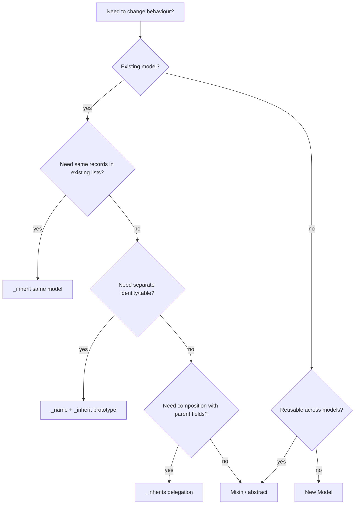

# Diseño de base de datos II — estrategias de herencia y efectos en el esquema

> **Pregunta central.** Odoo tiene tres mecanismos de herencia con tres huellas distintas en la base de datos. Elegir el incorrecto es una decisión estructural costosa de revertir.

---

## 1. Comparación

| Mecanismo | Declaración | Tabla | Columnas | Polimorfismo | Uso típico |
|---|---|---|---|---|---|
| Extensión | `_inherit = 'x'` (sin `_name`) | la misma tabla | añadidas | no | añadir campos o comportamiento a un modelo existente |
| Prototipo | `_name = 'y'`, `_inherit = 'x'` | tabla nueva | todos los campos del padre copiados | no | modelo especializado que comparte comportamiento |
| Delegación | `_inherits = {'x': 'x_id'}` | tabla nueva | solo FK + campos propios | no | composición, envoltorio 1:1 |
| Mixin abstracto | `_name`, `_abstract = True` | ninguna | ninguna | n/a | campos y métodos reutilizables |

**No existe la herencia con tabla unida** (joined-table) en el sentido de JPA/Hibernate. `_inherits` es composición, no un subtipo polimórfico. Las consultas sobre el padre nunca devuelven filas del hijo.

---

## 2. Herencia por extensión (`_inherit`)

### 2.1 Definición

```python
class ResPartner(models.Model):
    _inherit = 'res.partner'

    loyalty_tier = fields.Selection([('bronze', 'Bronze'), ('gold', 'Gold')])
```

### 2.2 Efecto en el esquema

```sql
ALTER TABLE res_partner ADD COLUMN loyalty_tier VARCHAR;
```

- No se crea una tabla nueva.
- Las filas existentes reciben el valor predeterminado (o NULL).
- Un campo obligatorio sin valor predeterminado falla en una tabla no vacía, salvo que Odoo pueda calcularlo.
- Los índices y las restricciones se añaden a la tabla existente.

### 2.3 Ensamblaje de la clase

El registro construye una clase nueva cuyo MRO incluye la extensión:

```
registry['res.partner']
  -> ResPartner (my_module)
  -> ResPartner (base)
  -> ...
  -> Model
```

Consecuencias:

- `super()` en `my_module` llama a `base` y a todos los módulos intermedios.
- Las definiciones de campo se fusionan; una redefinición sustituye atributos, pero no la identidad del campo.
- `_order`, `_rec_name`, `_check_company_auto` pueden ser sobrescritos por el último módulo del MRO.
- Un módulo que no depende del módulo propio puede seguir envolviendo su método si se carga después.

**[INVARIANT]** Todo módulo que extiende un modelo debe declarar en `depends` el módulo que define dicho modelo. De lo contrario, el orden de carga queda indefinido y `super()` puede omitir comportamiento del núcleo.

### 2.4 Redefinición de campos

```python
# module A
name = fields.Char(required=True)

# module B (depends on A)
name = fields.Char(required=False, index=True)
```

El campo final es la definición de B, fusionada sobre A. Los atributos que no se vuelven a especificar pueden conservar los valores de A según la ruta de fusión (`_base_fields__`). Esto es sutil; evite redefinir campos del núcleo salvo que sea necesario.

---

## 3. Herencia por prototipo (`_name` + `_inherit`)

### 3.1 Definición

```python
class MyInvoice(models.Model):
    _name = 'my.invoice'
    _inherit = 'account.move'
```

### 3.2 Efecto en el esquema

- Crea `my_invoice` con **todos los campos almacenados** de `account_move` (columnas copiadas).
- **No** copia datos.
- **No** crea una FK hacia `account_move`.
- Los métodos se heredan mediante el MRO de Python; `super()` funciona.

### 3.3 Cuándo usarla

- Se necesita una tabla separada con una estructura en gran medida idéntica.
- Se desea numeración, seguridad y ciclo de vida independientes.
- Se acepta un esquema duplicado y la ausencia de consultas polimórficas.

### 3.4 Cuándo no usarla

- Se necesita que el registro aparezca en las listas e informes del modelo padre: use `_inherit` en su lugar.
- Se necesita una identidad compartida: use `_inherits`.
- Solo se necesita comportamiento: use un mixin.

**[WARNING]** La herencia por prototipo copia las columnas en el momento de instalar el módulo. Los cambios posteriores en el esquema del padre **no** se propagan automáticamente. Se debe añadir el mismo campo al hijo o escribir una migración.

---

## 4. Herencia por delegación (`_inherits`)

### 4.1 Definición

```python
class IrCron(models.Model):
    _name = 'ir.cron'
    _inherits = {'ir.actions.server': 'ir_actions_server_id'}

    ir_actions_server_id = fields.Many2one(
        'ir.actions.server', required=True, ondelete='cascade', delegate=True)
```

### 4.2 Efecto en el esquema

```
ir_cron
├── id                    PK
├── ir_actions_server_id  FK → ir_act_server.id (required, cascade)
├── cron_name
├── interval_number
├── interval_type
├── nextcall
└── ...
```

Los campos del padre (`name`, `code`, `state`, `model_id`) **no** son columnas de `ir_cron`; son campos relacionados que se resuelven a través de la FK.

### 4.3 Comportamiento

- `create()` crea el padre y después el hijo.
- `write()` reparte los valores entre el padre y el hijo.
- `read()` une el padre.
- `unlink()` elimina el hijo y aplica la cascada al padre (o lo restringe).
- Las reglas de registro del padre se aplican al hijo mediante `_compute_domain` (`parent_field any domain`).
- Las colisiones de nombres de campo se resuelven con el **último** padre en el orden de `_inherits`.

### 4.4 Requisitos

El campo delegado debe ser:

- `Many2one`,
- `required=True`,
- `ondelete='cascade'` o `'restrict'`,
- `delegate=True`.

Odoo lanza `TypeError` durante la construcción del registro si falta alguno (`orm/model_classes.py:465-480`).

### 4.5 Cuándo usarla

- Una composición 1:1 real en la que el hijo es una especialización de una acción o documento compartido.
- Se desean los campos y métodos del padre sin duplicar columnas.
- Se acepta el coste de escritura en varias tablas y la complejidad de las reglas.

### 4.6 Cuándo no usarla

- Modelos de gran volumen: cada lectura une el padre.
- Modelos con ciclos de vida divergentes.
- Cuando se necesita seguridad independiente en padre e hijo; las reglas son complicadas.
- Cuando los nombres de campo colisionan entre padres.

---

## 5. Mixins abstractos

```python
class MailThread(models.AbstractModel):
    _name = 'mail.thread'
    _description = 'Email Thread'
```

- Sin tabla ni columnas.
- Los campos se copian en cada modelo concreto que hereda el mixin.
- Los métodos se incorporan al MRO.
- Ideal para comportamiento transversal (seguimiento, actividades, portal, UTM).

**[WARNING]** Los mixins con campos almacenados añaden columnas a todos los modelos que los adoptan. `mail.thread` añade `message_main_attachment_id`, `website_message_ids` y otros; `mail.activity.mixin` añade campos de actividad. Mida el impacto en el esquema antes de adoptar un mixin pesado.

---

## 6. MRO y orden de sobrescritura

### 6.1 Orden de carga

Los módulos se cargan por fases según la profundidad de dependencias (`modules/module_graph.py`). Dentro de una fase, el orden es `(depth, name)`. El MRO de la clase del registro se construye a partir de las definiciones de modelo en **orden de carga inverso**, de modo que el último módulo cargado queda primero en el MRO.

Ejemplo con `sale`, `sale_stock` y `sale_mrp`:

```
registry['sale.order']
  -> SaleOrder (sale_mrp)     # loaded last
  -> SaleOrder (sale_stock)
  -> SaleOrder (sale)
  -> ... mixins ...
```

`super()._action_confirm()` desde `sale_mrp` llama a `sale_stock` y después a `sale`.

### 6.2 Módulos hermanos

Si `sale_stock` y `sale_project` sobrescriben ambos `_action_confirm()` y ninguno depende del otro, su orden relativo lo determina el orden de carga (profundidad y luego nombre), no la lógica de negocio. Esta es una fuente real de no determinismo entre instalaciones con conjuntos de módulos distintos.

**[INVARIANT]** Si el comportamiento de su módulo depende de que la sobrescritura de otro módulo se ejecute antes o después, declare una dependencia (aunque sea débil) o use hooks explícitos.

### 6.3 Errores frecuentes con `super()`

| Error | Consecuencia |
|---|---|
| No llamar a `super()` | rompe otros módulos y los invariantes del núcleo |
| Llamar a `super()` dos veces | efectos secundarios duplicados |
| Cambiar la firma | `TypeError` en las sobrescrituras posteriores |
| Usar `super(MyClass, self)` | MRO incorrecto tras reconstruir el registro |
| Asumir que `self` es un solo registro | errores de `ensure_one` o procesamiento parcial silencioso |

---

## 7. Reglas de fusión del esquema

| Elemento | Comportamiento de fusión |
|---|---|
| Nombre de campo | un único objeto de campo; atributos fusionados |
| `_order` | gana la última definición |
| `_rec_name` | gana la última definición no vacía |
| `_check_company_auto` | gana la última definición |
| `_sql_constraints` | unión (los nombres deben ser únicos) |
| `_table_objects` | unión |
| `_inherits` | unión de padres |
| `_parent_store` | debe ser coherente; cambiarlo después requiere una migración |
| `_log_access` | se fija al crear la tabla; cambiarlo después es peligroso |
| `_table` | se fija; cambiarlo crea una tabla nueva y deja la antigua |

**[WARNING]** Cambiar `_table`, `_log_access` o `_parent_store` en un modelo existente es una migración de esquema, no un cambio de código. Odoo no moverá los datos.

---

## 8. Árbol de decisión de herencia



---

## 9. Implicaciones para la migración

| Cambio | ¿Requiere migración? |
|---|---|
| Añadir un campo opcional | no (columna automática) |
| Añadir un campo obligatorio | sí (valor predeterminado o relleno, luego NOT NULL) |
| Renombrar un campo | sí (añadir el nuevo, copiar, eliminar el antiguo) |
| Eliminar un campo | sí (eliminar o archivar) |
| Cambiar el tipo | sí (convertir, validar; puede requerir USING) |
| Cambiar `_table` | sí (crear, copiar y eliminar) |
| Cambiar `_inherits` | sí (añadir la FK, rellenar y eliminar las columnas antiguas) |
| Cambiar `_parent_store` | sí (calcular `parent_path`) |
| Cambiar `_log_access` | sí (añadir o eliminar las columnas de auditoría) |
| Añadir una restricción SQL | sí (limpiar antes los duplicados) |

### 9.1 Patrón de renombrado seguro

```python
# 1. add new column in module A (optional, no constraint)
new_code = fields.Char(index=True)

# 2. migration: copy data
env.cr.execute("UPDATE my_table SET new_code = old_code WHERE new_code IS NULL")

# 3. migration: add constraint/index
env.cr.execute("CREATE UNIQUE INDEX ... ON my_table(new_code)")

# 4. later module: drop old column
env.cr.execute("ALTER TABLE my_table DROP COLUMN old_code")
```

Nunca renombre en un solo paso en producción; ejecute la copia en una ventana de mantenimiento y valide el resultado.

---

## 10. Antipatrones

| Antipatrón | Problema |
|---|---|
| Heredar por prototipo un modelo enorme por un solo campo | esquema duplicado y carga de mantenimiento |
| `_inherits` en una tabla de gran volumen | cada lectura une el padre |
| `_inherit` sin `depends` | MRO indefinido |
| Sobrescribir `create`/`write` sin `super()` | rompe otros módulos |
| Volver a declarar un campo del núcleo para cambiar un atributo | semántica de fusión inesperada |
| Cambiar `_table` en un modelo en uso | tabla huérfana + pérdida de datos |
| Usar `_inherits` para consultas polimórficas | las consultas del padre no ven a los hijos |
| Almacenar datos de negocio en un modelo transitorio | se vacían tras ~1 hora |

---

## 11. Índice de evidencia

| Tema | Archivo |
|---|---|
| Ensamblaje de la clase de modelo | `orm/model_classes.py:1-140` |
| Atributos `_inherit` / `_inherits` | `orm/models.py:400-460` |
| Validación de `_inherits` | `orm/model_classes.py:465-480` |
| Generación de campos heredados | `orm/model_classes.py:482-520` |
| Fases de carga | `modules/module_graph.py:26-160` |
| Fusión de campos | `orm/fields.py:414-491` |
| `_table_query` | `orm/models.py:493` |
| Almacenamiento del padre | `orm/models.py:3070-3120` |

A continuación, `03-er-model.md`.
