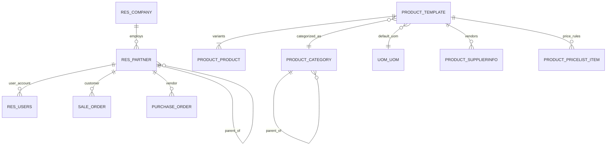
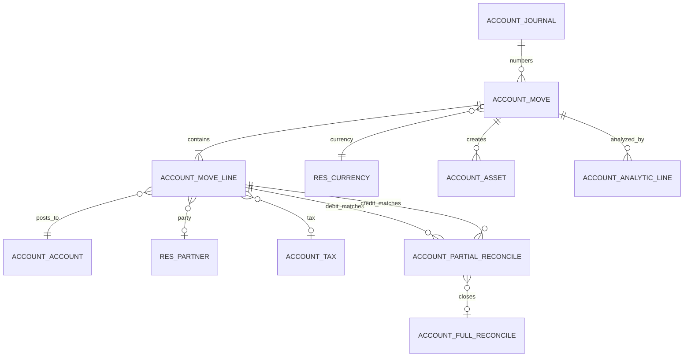
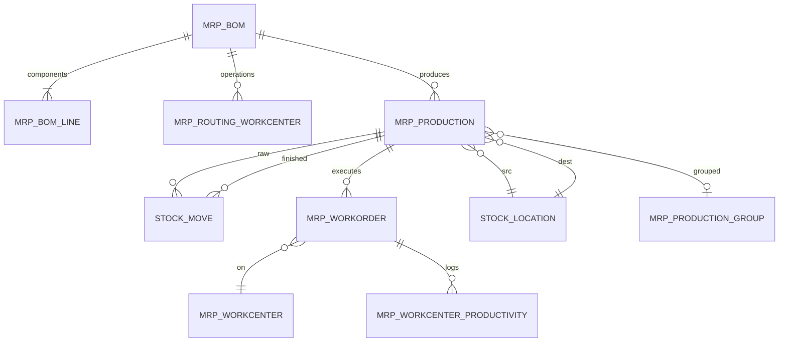

# Diseño de base de datos III — Modelo entidad-relación central

> **Alcance.** Las tablas físicas que importan para la elaboración de informes, la integración y la migración. No se trata de un diccionario de datos completo (1.469 módulos requerirían miles de páginas); cubre las entidades centrales de comercio, logística, contabilidad y fabricación, además de los campos ocultos con los que tropiezan los desarrolladores.

---

## 1. Núcleo de terceros y productos



### 1.1 `res_partner`

| Columna | Tipo | Notas |
|---|---|---|
| `id` | serial | PK |
| `name` | varchar (¿jsonb si está traducido? índice de `name`) | nombre para mostrar |
| `parent_id` | int FK autorreferente | jerarquía de compañías |
| `parent_path` | varchar | ruta materializada (`/1/4/7/`) |
| `is_company` | bool | compañía frente a contacto |
| `type` | varchar | `contact`, `invoice`, `delivery`, `other` |
| `commercial_partner_id` | int FK autorreferente | raíz calculada para el negocio |
| `vat` | varchar indexado | identificador fiscal |
| `email`, `phone`, `street`, `city`, `zip`, `country_id` | | dirección |
| `lang`, `tz` | | configuración regional |
| `active` | bool | marca de archivo |
| `customer_rank`, `supplier_rank` | int | contadores de uso |
| `company_id` | int FK | multicompañía |
| `create_uid`, `create_date`, `write_uid`, `write_date` | | auditoría |

**Semántica oculta:**

- `commercial_partner_id` es la entidad de facturación; un contacto la hereda de la compañía matriz. Los informes deben agrupar por `commercial_partner_id`, no por `id`.
- `parent_path` permite usar `child_of` sin CTE recursivas.
- `customer_rank`/`supplier_rank` se incrementan al publicar facturas, no al crear pedidos de venta o de compra.

### 1.2 `product_template` / `product_product`

`product_product` usa `_inherits = {'product.template': 'product_tmpl_id'}`. Los campos de la plantilla se delegan, no se duplican.

| Columna de `product_template` | Notas |
|---|---|
| `name` | `jsonb` traducido |
| `type` | `consu`, `service`, `combo` [V19] |
| `is_storable` | booleano añadido por `stock`; distingue bienes de consumibles |
| `categ_id` | categoría (cuentas, rutas, cálculo de costes) |
| `uom_id` | UoM predeterminada |
| `list_price`, `standard_price` | venta/coste |
| `sale_ok`, `purchase_ok` | |
| `tracking` | `none`, `lot`, `serial` (de stock) |
| `invoice_policy` | `order`, `delivery` (de sale) |
| `purchase_method` | `purchase`, `receive` (de purchase) |
| `volume`, `weight` | logística |
| `active` | archivo |

| Columna de `product_product` | Notas |
|---|---|
| `product_tmpl_id` | FK, obligatoria, cascade |
| `default_code` | referencia interna |
| `barcode` | casi única |
| `product_template_attribute_value_ids` | tabla de relación para atributos de variante |

**[V19]** `type='product'` ya no existe; los bienes almacenables son `type='consu'` + `is_storable=True`. Cualquier código personalizado que compruebe `type == 'product'` está muerto. Este es uno de los errores de actualización más comunes.

### 1.3 `uom_uom` [V19]

| Columna | Notas |
|---|---|
| `relative_uom_id` | unidad padre (árbol) |
| `relative_factor` | multiplicador respecto al padre |
| `factor` | factor absoluto calculado hasta la raíz |
| `rounding` | calculado a partir de `decimal.precision` ("Product Unit") |
| `category_id` | **eliminado** en la v19 |

La conversión recorre el árbol hasta la raíz. No hay redondeo por categoría. El código que consulta `category_id` o presupone una categoría plana debe reescribirse.

---

## 2. Ventas y aprovisionamiento

```mermaid
erDiagram
    SALE_ORDER ||--|{ SALE_ORDER_LINE : contains
    SALE_ORDER }o--|| RES_PARTNER : customer
    SALE_ORDER }o--|| RES_CURRENCY : currency
    SALE_ORDER }o--|| CRM_TEAM : team
    SALE_ORDER ||--o{ STOCK_REFERENCE : groups
    STOCK_REFERENCE ||--o{ STOCK_MOVE : groups
    STOCK_REFERENCE ||--o{ STOCK_PICKING : groups
    STOCK_PICKING ||--|{ STOCK_MOVE : contains
    STOCK_MOVE ||--|{ STOCK_MOVE_LINE : executes
    STOCK_MOVE }o--|| PRODUCT_PRODUCT : product
    STOCK_MOVE }o--|| STOCK_LOCATION : from
    STOCK_MOVE }o--|| STOCK_LOCATION : to
    STOCK_MOVE_LINE }o--o| STOCK_LOT : lot
    STOCK_MOVE_LINE }o--o| STOCK_QUANT : updates
    SALE_ORDER_LINE ||--o{ STOCK_MOVE : fulfills
    SALE_ORDER ||--o{ ACCOUNT_MOVE : invoices
```

### 2.1 `sale_order`

| Columna | Tipo | Notas |
|---|---|---|
| `name` | varchar | secuencia, única |
| `state` | varchar | `draft`/`sent`/`sale`/`cancel` |
| `locked` | bool | reemplazo de "done" |
| `partner_id` | int FK | cliente |
| `partner_invoice_id`, `partner_shipping_id` | int FK | direcciones |
| `pricelist_id`, `currency_id` | int FK | fijación de precios |
| `currency_rate` | float | tasa en `date_order` |
| `date_order` | timestamp | fecha de confirmación |
| `commitment_date` | timestamp | entrega prometida |
| `picking_policy` | varchar | `direct`/`one` (de sale_stock) |
| `warehouse_id` | int FK | de sale_stock |
| `company_id` | int FK | |
| `team_id`, `user_id` | int FK | titularidad |
| `amount_untaxed`, `amount_tax`, `amount_total` | numeric | calculado almacenado |
| `invoice_status` | varchar | calculado |
| `delivery_status` | varchar | calculado (sale_stock) |
| `client_order_ref`, `origin`, `reference` | varchar | referencias externas |
| `note` | text/html | |
| `campaign_id`, `medium_id`, `source_id` | int FK | UTM |

**Campos ocultos:**

- `technical_price_unit` en `sale.order.line`: precio derivado de la lista de precios que se usa para detectar sobrescrituras manuales.
- `qty_invoiced_posted` frente a `qty_invoiced`: facturas publicadas frente a todas las facturas.
- `invoice_ids` es un M2M calculado, no una columna; la relación pasa por las líneas de factura.
- `amount_to_invoice` se calcula a partir de importes sin impuestos, no se almacena.
- `duplicated_order_ids` se calcula para la detección de duplicados.

### 2.2 `stock_reference` [V19]

| Columna | Notas |
|---|---|
| `id` | PK |
| `name` | referencia (nombre de SO/PO/MO) |

Relaciones:

- `stock_reference_move_rel(reference_id, move_id)`
- `stock.reference.picking_ids` se calcula a partir de los movimientos.

Esto sustituye a `procurement.group` de versiones anteriores. Cualquier módulo que consulte `procurement_group_id` debe portarse.

### 2.3 `stock_move`

| Columna | Tipo | Notas |
|---|---|---|
| `product_id` | int FK | |
| `product_uom_qty` | numeric | demanda |
| `product_qty` | numeric | demanda en la UoM del producto, cálculo/inverso almacenado |
| `quantity` | numeric | cantidad realizada (v19) |
| `product_uom` | int FK | |
| `location_id`, `location_dest_id` | int FK | |
| `location_final_id` | int FK | destino final para varios pasos |
| `picking_id` | int FK | |
| `state` | varchar | `draft`/`waiting`/`confirmed`/`partially_available`/`assigned`/`done`/`cancel` |
| `picked` | bool | puerta de validación |
| `procure_method` | varchar | `make_to_stock`/`make_to_order`/`mts_else_mto` |
| `rule_id` | int FK | regla que lo creó |
| `reference_ids` | M2M | agrupación de documentos |
| `origin`, `origin_returned_move_id` | | trazabilidad |
| `sale_line_id`, `purchase_line_id`, `raw_material_production_id`, `production_id` | int FK | enlaces de origen |
| `value` | numeric | valoración de la v19 |
| `account_move_id` | int FK | asiento de valoración |
| `is_inventory`, `scrap_id` | | ajustes/desecho |

**Semántica oculta:**

- `product_uom_qty` es la demanda; `quantity` es lo realizado. Nunca deben compararse directamente sin conversión de UoM.
- `picked` debe ser verdadero para que se valide una línea de movimiento; una cantidad por sí sola no basta.
- `product_qty` se almacena para informes, pero es un inverso calculado de la demanda.
- `state` se calcula para los pickings, pero se escribe para los movimientos.

### 2.4 `stock_move_line`

| Columna | Notas |
|---|---|
| `move_id`, `picking_id` | padres |
| `product_id`, `product_uom_id` | |
| `quantity` | cantidad realizada en la UoM del movimiento |
| `quantity_product_uom` | cantidad realizada en la UoM del producto |
| `lot_id`, `lot_name` | lote/serie |
| `package_id`, `result_package_id` | paquetes |
| `owner_id` | consignación |
| `location_id`, `location_dest_id` | ubicaciones reales |
| `picked` | puerta de validación |
| `date` | fecha efectiva |
| `consume_line_ids` / `produce_line_ids` | trazabilidad de OF |

### 2.5 `stock_quant`

| Columna | Notas |
|---|---|
| `product_id`, `location_id` | clave |
| `lot_id`, `package_id`, `owner_id` | dimensiones |
| `quantity` | disponible |
| `reserved_quantity` | reservado |
| `available_quantity` | calculado |
| `in_date` | fecha FIFO/LIFO |
| `inventory_quantity`, `inventory_diff_quantity` | interfaz de ajuste |
| `company_id` | |

La unicidad de los quant **no** se garantiza mediante una restricción de base de datos en esta compilación. `_update_available_quantity` reúne los quants coincidentes y bloquea una fila; las inserciones concurrentes pueden crear duplicados, que `_quant_tasks()._merge_quants()` limpia periódicamente. No se debe presuponer que exista un índice único.

---

## 3. Contabilidad



### 3.1 `account_move`

| Columna | Notas |
|---|---|
| `name` | secuencia, `/` hasta la publicación |
| `state` | `draft`/`posted`/`cancel` |
| `move_type` | `entry`, `out_invoice`, `out_refund`, `in_invoice`, `in_refund`, `out_receipt`, `in_receipt` |
| `journal_id` | FK |
| `date` | fecha contable |
| `invoice_date`, `invoice_date_due` | fechas de factura |
| `partner_id`, `commercial_partner_id` | |
| `currency_id`, `company_currency_id` | |
| `invoice_currency_rate` | tasa en la fecha de factura |
| `amount_untaxed`, `amount_tax`, `amount_total` | almacenados |
| `amount_residual` | restante |
| `payment_state` | `not_paid`/`partial`/`paid`/`in_payment`/`blocked` |
| `inalterable_hash`, `secure_sequence_number` | cadena de hash |
| `restrict_mode_hash_table` | indicador relacionado del diario |
| `posted_before` | seguimiento de republicaciones |
| `auto_post` | publicación automática futura |
| `reversed_entry_id`, `reversal_move_ids` | cadena de reversión |
| `tax_cash_basis_rec_id` | origen de criterio de caja |
| `statement_line_id` | origen de extracto bancario |

**Campos ocultos:**

- `line_ids` incluye **todas** las líneas: producto, impuesto, condiciones de pago, redondeo, secciones. `invoice_line_ids` es solo el subconjunto de producto/visualización.
- `amount_total_signed` está en moneda de la compañía; `amount_total` está en moneda del documento.
- `name` es `/` hasta la publicación; los informes deben filtrar `state='posted'`.
- `sequence_prefix` / `sequence_number` se almacenan para la detección de huecos.
- `made_sequence_gap` marca el primer hueco.

### 3.2 `account_move_line`

| Columna | Notas |
|---|---|
| `move_id`, `journal_id` | padres |
| `account_id` | FK, obligatoria |
| `debit`, `credit`, `balance` | moneda de la compañía |
| `amount_currency`, `currency_id` | moneda del documento |
| `partner_id` | tercero |
| `display_type` | `product`/`cogs`/`tax`/`discount`/`rounding`/`payment_term`/section/note |
| `tax_line_id` | marcador de línea de impuesto |
| `tax_repartition_line_id` | reparto |
| `tax_ids` | impuestos de la línea base (M2M) |
| `tax_base_amount` | |
| `amount_residual`, `amount_residual_currency` | conciliación |
| `reconciled` | calculado |
| `full_reconcile_id` | |
| `matching_number` | agrupación |
| `sale_line_ids`, `purchase_line_id` | enlaces de origen |
| `sale_line_ids` | M2M a `sale.order.line` (`sale_order_line_invoice_rel`) |
| `analytic_distribution` | JSONB |

**Convención de signos:** `balance = debit - credit`. Una cuenta por cobrar es un débito; una cuenta por pagar es un crédito. Los informes que suman `balance` deben invertir los pasivos para su presentación.

### 3.3 Tablas de conciliación

| Tabla | Columnas |
|---|---|
| `account_partial_reconcile` | `debit_move_id`, `credit_move_id`, `amount`, `debit_amount_currency`, `credit_amount_currency`, `exchange_move_id`, `max_date` |
| `account_full_reconcile` | `name`, `exchange_move_id` |

Una línea está totalmente conciliada cuando `amount_residual = 0` y `full_reconcile_id` está establecido. La conciliación parcial actualiza los residuales sin cerrar la línea.

### 3.4 Impuestos

| Tabla | Propósito |
|---|---|
| `account_tax` | definición del impuesto |
| `account_tax_repartition_line` | reparto base/impuesto, factor, cuenta, etiquetas |
| `account_tax_group` | agrupación para informes |
| `account_tax_tag` | etiquetas de informe |
| `account_fiscal_position` | cabecera de mapeo |
| `account_fiscal_position_tax` | mapeo de impuestos |
| `account_fiscal_position_account` | mapeo de cuentas |

---

## 4. Fabricación



### 4.1 `mrp_production`

| Columna | Notas |
|---|---|
| `name` | secuencia |
| `state` | calculado: `draft`/`confirmed`/`progress`/`to_close`/`done`/`cancel` |
| `product_id`, `product_qty`, `product_uom_id` | salida |
| `bom_id` | receta |
| `qty_producing` | cantidad del lote actual |
| `qty_produced` | calculado |
| `location_src_id`, `location_dest_id`, `location_final_id` | |
| `date_start`, `date_finished`, `date_deadline` | |
| `reservation_state` | `confirmed`/`assigned`/`waiting` |
| `consumption` | `strict`/`flexible`/`warning` |
| `is_locked`, `is_planned` | |
| `production_group_id` | agrupación de pedidos pendientes |
| `reference_ids` | agrupación de documentos |
| `extra_cost` | coste adicional por unidad |
| `lot_producing_ids` | lotes de salida |

### 4.2 `mrp_workorder`

| Columna | Notas |
|---|---|
| `production_id`, `operation_id`, `workcenter_id` | |
| `state` | `pending`/`ready`/`progress`/`done`/`cancel` |
| `qty_production`, `qty_producing`, `qty_produced` | |
| `date_start`, `date_finished`, `duration_expected`, `duration` | |
| `blocked_by_workorder_ids` | dependencias |
| `costs_hour` | instantánea del coste del centro de trabajo |

### 4.3 `mrp_workcenter_productivity`

| Columna | Notas |
|---|---|
| `workorder_id`, `workcenter_id`, `user_id` | |
| `date_start`, `date_end`, `duration` | minutos |
| `loss_id` | productivo/rendimiento/tiempo de inactividad |
| `account_move_line_id` | enlace al asiento de mano de obra |

---

## 5. Tablas transversales del sistema

| Tabla | Propósito | Claves |
|---|---|---|
| `ir_model_data` | ID XML | (`module`, `name`) único |
| `ir_attachment` | archivos | `res_model`, `res_id`, `checksum` |
| `ir_cron` | tareas programadas | delegado `ir_actions_server_id` |
| `ir_logging` | registros del servidor (si está habilitado) | `create_date` |
| `mail_message` | mensajes | `model`, `res_id` |
| `mail_followers` | suscripciones | `res_model`, `res_id`, `partner_id` |
| `mail_activity` | actividades | `res_model`, `res_id` |
| `bus_bus` | notificaciones transitorias | `channel`, `create_date` |
| `ir_config_parameter` | configuración clave/valor | `key` única |
| `ir_sequence` | numeración de documentos | `code` |
| `res_groups` / `res_users` | seguridad | relaciones M2M |
| `ir_rule` / `ir_model_access` | seguridad de filas/modelos | |

---

## 6. Columnas ocultas y heredadas

| Tabla | Columna | Por qué está oculta |
|---|---|---|
| `sale_order_line` | `technical_price_unit` | línea base de la lista de precios para detectar precios manuales |
| `sale_order_line` | `qty_invoiced_posted` | cantidad solo de facturas publicadas, no se muestra en la interfaz |
| `sale_order` | `currency_rate` | instantánea histórica de la tasa |
| `stock_move` | `product_qty` | cálculo almacenado en la UoM del producto |
| `stock_move` | `picking_type_id` | cálculo almacenado para informes |
| `stock_move_line` | `quantity_product_uom` | cantidad convertida |
| `stock_quant` | `in_date` | ordenación FIFO/LIFO |
| `account_move` | `secure_sequence_number` | índice de la cadena de hash |
| `account_move` | `made_sequence_gap` | marcador del primer hueco |
| `account_move_line` | `matching_number` | agrupación de conciliación |
| `account_move_line` | `parent_state` | relacionado almacenado para filtrado rápido |
| `mrp_production` | `product_uom_qty` | cantidad total calculada |
| `mrp_production` | `qty_produced` | calculado a partir de los movimientos |
| `product_template` | `is_storable` | indicador de stock de la v19 |
| `product_product` | `product_tmpl_id` | FK de delegación |
| `res_partner` | `parent_path` | jerarquía materializada |
| `res_partner` | `commercial_partner_id` | raíz de facturación |

### 6.1 Eliminadas o renombradas en la v19

| Antigua | Nueva | Impacto |
|---|---|---|
| `procurement.group` | `stock.reference` | las consultas/sobrescrituras se rompen |
| `stock.valuation.layer` | `stock.move.value` / `product.value` | los informes de valoración se rompen |
| `product.type='product'` | `type='consu'` + `is_storable` | los filtros de stock se rompen |
| `uom.category` / `uom_id.category_id` | árbol `relative_uom_id` | las conversiones se rompen |
| `sale.order.state='done'` | booleano `locked` | las comprobaciones de estado se rompen |
| `purchase.order.state='done'` | sin estado done | las comprobaciones de estado se rompen |

**[WARNING]** Estas diferencias no son cosméticas. Cualquier SQL, informe o integración personalizados que hagan referencia a las columnas antiguas fallarán silenciosamente o devolverán datos incorrectos después de la migración.

---

## 7. Patrones de unión para informes

### 7.1 Margen de ventas

```sql
SELECT so.name, pt.name->>'en_US' AS product,
       sol.product_uom_qty, sol.qty_delivered,
       sol.price_subtotal, sol.price_unit,
       pp.standard_price * sol.qty_delivered AS cost,
       sol.price_subtotal - pp.standard_price * sol.qty_delivered AS margin
FROM sale_order_line sol
JOIN sale_order so ON so.id = sol.order_id
JOIN product_product pp ON pp.id = sol.product_id
JOIN product_template pt ON pt.id = pp.product_tmpl_id
WHERE so.state = 'sale';
```

### 7.2 Stock disponible por ubicación

```sql
SELECT pp.default_code, pt.name->>'en_US', sl.complete_name,
       SUM(sq.quantity) AS qty, SUM(sq.reserved_quantity) AS reserved
FROM stock_quant sq
JOIN product_product pp ON pp.id = sq.product_id
JOIN product_template pt ON pt.id = pp.product_tmpl_id
JOIN stock_location sl ON sl.id = sq.location_id
WHERE sl.usage = 'internal'
GROUP BY pp.default_code, pt.name, sl.complete_name;
```

### 7.3 Balance de sumas y saldos

```sql
SELECT aa.code, aa.name->>'en_US', SUM(aml.debit) AS debit, SUM(aml.credit) AS credit,
       SUM(aml.balance) AS balance
FROM account_move_line aml
JOIN account_move am ON am.id = aml.move_id
JOIN account_account aa ON aa.id = aml.account_id
WHERE am.state = 'posted' AND am.date <= %s
GROUP BY aa.code, aa.name
ORDER BY aa.code;
```

---

## 8. Índice de evidencias

| Tema | Archivo |
|---|---|
| Campos de terceros | `addons/base/models/res_partner.py:148-306` |
| Campos de producto | `addons/product/models/product_template.py:44-173` |
| Delegación de producto | `addons/product/models/product_product.py:19-42` |
| Árbol de UoM | `addons/uom/models/uom_uom.py:18-100` |
| Campos de venta | `addons/sale/models/sale_order.py:54-326` |
| Campos de línea de venta | `addons/sale/models/sale_order_line.py:34-309` |
| Referencia de stock | `addons/stock/models/stock_reference.py` |
| Campos de movimiento de stock | `addons/stock/models/stock_move.py:24-184` |
| Línea de movimiento de stock | `addons/stock/models/stock_move_line.py:21-95` |
| Campos de quant | `addons/stock/models/stock_quant.py:20-115` |
| Asiento contable | `addons/account/models/account_move.py:109-589` |
| Línea de asiento contable | `addons/account/models/account_move_line.py:32-321` |
| Campos de OF | `addons/mrp/models/mrp_production.py:80-273` |

Continúe con `04-indexes-performance.md`.
