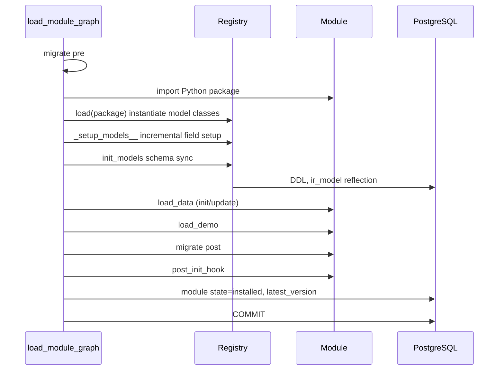
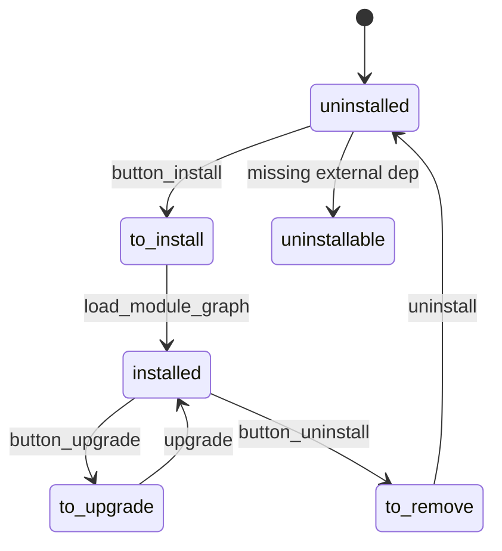

# Relaciones entre módulos I — Manifiesto, carga y semántica de dependencias

> **Versión.** Odoo 19.0 Enterprise, 1.469 módulos (656 Community + 813 Enterprise). Las estadísticas de este capítulo proceden de un análisis estático de todos los `__manifest__.py` de este árbol.

---

## 1. Esquema del manifiesto

Un módulo es un paquete de Python con `__manifest__.py` que devuelve un dict. El manifiesto se analiza y se convierte en `odoo.modules.module.Manifest` con valores predeterminados y normalización.

### 1.1 Referencia de claves

| Clave | Tipo | Efecto | Advertencia |
|---|---|---|---|
| `name` | str | nombre legible | requerido por convención, no se impone |
| `version` | str | versión del módulo (`19.0.1.0.0`) | determina la selección de scripts de migración |
| `license` | str | `LGPL-3`, `OEEL-1`, `OPL-1` | solo metadatos; no se impone |
| `author`, `website`, `summary`, `description` | str | metadatos | |
| `category` | str | agrupación en el menú Aplicaciones | texto libre |
| `depends` | list[str] | dependencias duras | determina el orden de carga |
| `data` | list[str] | XML/CSV que se cargan al instalar y actualizar | el orden importa; las referencias hacia delante fallan |
| `demo` | list[str] | datos de demostración | solo si `with_demo` |
| `auto_install` | bool or list[str] | se instala automáticamente cuando las dependencias están instaladas | la lista debe ser un subconjunto de `depends` |
| `application` | bool | se muestra como aplicación, no como módulo | solo interfaz |
| `installable` | bool | se puede instalar | `False` para imágenes de test/iot |
| `external_dependencies` | dict | Python/binarios requeridos | solo se comprueba al instalar/actualizar |
| `assets` | dict | paquetes de recursos | las claves son nombres de paquete |
| `pre_init_hook`, `post_init_hook`, `uninstall_hook` | str | hooks del ciclo de vida | se requiere idempotencia |
| `countries` | list[str] | aplicabilidad de la localización | lo usa la lógica de auto-instalación |
| `sequence` | int | orden en Aplicaciones | |
| `price`, `currency`, `support`, `live_test_url` | | metadatos de la tienda de aplicaciones | el servidor no los usa |
| `bootstrap`, `configurator_snippets`, `new_page_templates` | | metadatos de sitio web/tema | específicos del módulo |

### 1.2 Claves heredadas/ignoradas

| Clave | Estado |
|---|---|
| `demo_xml`, `update_xml`, `init_xml` | heredadas, ignoradas |
| `test` | heredada, ignorada |
| `web` | heredada, ignorada |
| `js`, `css` | heredadas, ignoradas (use `assets`) |
| `active` | no es una clave del manifiesto |

### 1.3 Semántica de `auto_install`

Tres formas:

```python
'auto_install': False            # never automatic
'auto_install': True             # automatic when all depends are installed
'auto_install': ['sale', 'stock'] # automatic when these specific deps are installed
```

Reglas (`addons/base/models/ir_module.py:407-434`):

- `True` se normaliza al conjunto de `depends`.
- Una lista debe ser un subconjunto de `depends`; de lo contrario, el manifiesto genera un error de aserción.
- El módulo se instala cuando todas las dependencias `auto_install_required` están instaladas/por instalar/por actualizar **y al menos una está por instalar**.
- Los módulos específicos de un país también requieren que coincida el país de la compañía.
- `--skip-auto-install` desactiva el cierre.

**[WARNING]** Las cadenas de auto-instalación son la razón por la que instalar `account` en una base de datos Enterprise puede arrastrar docenas de módulos (`account_accountant`, `account_reports`, `account_asset`, `account_edi_ubl_cii`, ...). Compruebe siempre el cierre antes de estimar una instalación.

### 1.4 Dependencias externas

```python
'external_dependencies': {
    'python': ['zeep', 'phonenumbers'],
    'bin': ['wkhtmltopdf'],
    'apt': {'zeep': 'python3-zeep'},   # hint only
}
```

- Las comprueba `ir.module.module.check_external_dependencies()` al instalar/actualizar.
- No se comprueban al iniciar el servidor.
- No se instalan automáticamente.
- Una dependencia ausente bloquea la instalación con un mensaje para el usuario.
- `apt` es una sugerencia para Debian/Ubuntu; no se ejecuta.

En este árbol, 14 módulos declaran dependencias externas; solo `zeep` se puede importar en el entorno de análisis.

---

## 2. Proceso de carga

### 2.1 Construcción del grafo

`ModuleGraph` (`modules/module_graph.py`) construye un DAG a partir de `depends`:

- **modo de carga** (inicio normal): `base` en la fase 0, todos los demás módulos instalados en la fase 1, ordenados por `(depth, name)`.
- **modo de actualización** (instalar/actualizar): las fases alternan entre módulos que necesitan inicialización de esquema y los que no, de modo que las dependencias siempre se cargan antes que los dependientes.
- Los módulos de prueba (`test_*`) se ordenan inmediatamente después de su última dependencia.

Profundidad = ruta más larga hasta `base`. En este árbol: profundidad máxima 18 (`industry_fsm_repair`), media 10,47.

### 2.2 Pasos por módulo



Hechos importantes sobre el orden:

- `pre_init_hook` se ejecuta **antes** de la carga de modelos.
- `post_init_hook` se ejecuta **después** de la carga de datos, la demo, la post-migración y las traducciones, pero **antes** de que se escriba `state='installed'`.
- `uninstall_hook` se ejecuta durante la desinstalación, antes del borrado de datos.
- `post_load` no es una clave de manifiesto admitida en esta compilación (0 apariciones).

### 2.3 Límites de transacción

- La instalación/actualización de cada módulo confirma al final (`modules/loading.py:270`).
- Un fallo revierte la transacción de ese módulo, pero deja instalados los módulos confirmados anteriormente.
- Por lo tanto, `-u all` es una secuencia de transacciones por módulo, no una actualización atómica.

**[WARNING]** Una actualización fallida puede dejar la base de datos en un estado mixto (algunos módulos actualizados y otros no). Ejecute siempre las actualizaciones sobre una copia y restaure si se produce un fallo; no «corrija hacia delante» en producción sin una copia de seguridad.

---

## 3. Semántica de dependencias

### 3.1 Manifiesto frente a importaciones de Python

| Tipo de dependencia | Declarada en | Efecto |
|---|---|---|
| Módulo duro | `depends` | orden de carga, instalación, disponibilidad de datos |
| Importación de Python | sentencia `import` | fallo en tiempo de ejecución si el módulo no está presente |
| Referencia a ID XML | `ref="module.xmlid"` | fallo de carga de datos si el módulo no está presente |
| FK de BD | `_inherits`, `Many2one` | dependencia de esquema |
| Blanda/opcional | `if env['x']` / `hasattr` | alternativa en tiempo de ejecución |
| Auto-instalación | `auto_install` | cierre de instalación implícito |

**[INVARIANT]** Todo módulo cuyos modelos, IDs XML, vistas o símbolos de Python se referencien debe estar en `depends`. Un `try/except ImportError` de Python no sustituye a una dependencia; oculta errores de configuración.

### 3.2 IDs XML de datos

- `ref="sale.action_quotations"` requiere que `sale` esté instalado.
- `env.ref('sale.action_quotations')` genera una excepción si falta (salvo que `raise_if_not_found=False`).
- Los archivos de datos se cargan en el orden del manifiesto; una referencia a un registro definido más adelante en el mismo módulo falla.
- `noupdate` afecta a las actualizaciones, no al orden de carga.

### 3.3 Claves foráneas de la base de datos

- Un `Many2one` a un modelo de otro módulo crea una FK solo si ese modelo tiene tabla.
- `_inherits` requiere que el modelo padre exista al construir el registro.
- La desinstalación de un módulo con FK dependientes está bloqueada salvo que `ondelete` lo permita.

### 3.4 Dependencias circulares

Hay **0 ciclos de dependencia** en este árbol (Kahn/Tarjan sobre 3.234 aristas). El grafo es un DAG por construcción y por política.

¿Puede existir un ciclo? Técnicamente, un ciclo en el manifiesto haría que el grafo no se pudiera resolver; la carga de Odoo fallaría o entraría en bucle. En la práctica:

- Las importaciones circulares a nivel de Python son habituales y legales porque el registro de modelos se difiere.
- Las referencias circulares a nivel de datos se resuelven cargando primero un lado y actualizándolo después.
- Los ciclos a nivel de módulo están prohibidos; se rompen con un tercer módulo o con una dependencia blanda.

### 3.5 Community frente a Enterprise

- 656 módulos Community, 813 módulos Enterprise.
- Licencias Enterprise: 762 `OEEL-1`, 47 `LGPL-3` de puente/prueba, 4 `OPL-1`.
- **0 módulos Community dependen directamente de módulos Enterprise** en este árbol.
- Los módulos Enterprise pueden depender de módulos Community (normal).
- No existe ninguna clave de manifiesto exclusiva de Enterprise; la distinción es repositorio + licencia.

**[WARNING]** Un módulo personalizado que dependa de un módulo Enterprise no se puede instalar en una base de datos Community. Declare la dependencia explícitamente para que la instalación falle de forma limpia, en lugar de fallar en tiempo de importación.

---

## 4. Estadísticas de dependencias (este árbol)

| Métrica | Valor |
|---|---|
| Módulos | 1.469 |
| Instalables | 1.467 |
| Aristas de dependencia | 3.234 |
| Ciclos | 0 |
| Dependencias de manifiesto ausentes | 0 |
| Archivos de datos/demo ausentes | 0 |
| `auto_install` verdadero | 1.006 (735 `True`, 271 listas) |
| Módulos con `external_dependencies` | 14 |
| Módulos de aplicación | 78 |
| Profundidad máxima | 18 (`industry_fsm_repair`) |
| Profundidad media | 10,47 |

### 4.1 Mayor fan-in

| Módulo | Dependientes | Licencia |
|---|---|---|
| `account` | 165 | LGPL-3 |
| `account_reports` | 119 | OEEL-1 |
| `mail` | 77 | LGPL-3 |
| `point_of_sale` | 68 | LGPL-3 |
| `account_edi_ubl_cii` | 48 | LGPL-3 |
| `base` | 47 | LGPL-3 |
| `web` | 47 | LGPL-3 |
| `base_vat` | 46 | LGPL-3 |
| `hr_payroll` | 35 | OEEL-1 |
| `website` | 34 | LGPL-3 |
| `sale` | 33 | LGPL-3 |
| `stock` | 16 | LGPL-3 |
| `purchase` | 16 | LGPL-3 |
| `mrp` | 17 | LGPL-3 |

Un fan-in alto implica un radio de impacto alto. Un cambio en `account` o `account_reports` afecta a cientos de módulos; pruebe el cierre completo, no solo el módulo inmediato.

### 4.2 Distribución de profundidad

La mayoría de los módulos se sitúan en profundidades de 9 a 13. Las cadenas profundas indican dependencias por capas (localización → contabilidad → informes → paneles). También implican que un fallo en una dependencia profunda bloquea todo lo que está por encima.

---

## 5. Semántica de desinstalación

La desinstalación de un módulo:

1. ejecuta `uninstall_hook(env)` si se ha declarado;
2. elimina sus registros de datos mediante `ir.model.data` (solo los registros con IDs XML de ese módulo);
3. elimina sus tablas si el modelo ya no lo proporciona ningún módulo;
4. elimina sus campos de las tablas compartidas (las columnas **no** se eliminan);
5. elimina sus vistas, acciones, menús y reglas de seguridad;
6. marca el módulo como `uninstalled`.

Riesgos:

- **Pérdida de datos:** se eliminan los registros con IDs XML del módulo.
- **Columnas huérfanas:** los campos de las tablas compartidas permanecen.
- **Referencias rotas:** otros módulos pueden seguir haciendo referencia a IDs XML eliminados.
- **Datos personalizados:** los registros sin IDs XML no se eliminan, pero pueden quedar inaccesibles.

**[INVARIANT]** Nunca desinstale un módulo en producción sin una copia de seguridad y una comprobación de dependencias (`ir.module.module.downstream_dependencies`). Desinstalar `account` o `base` equivale en la práctica a restablecer la base de datos.

---

## 6. Máquina de estados de los módulos



Los estados se almacenan en `ir_module_module.state`. Una actualización fallida puede dejar `to_upgrade`; una instalación fallida puede dejar `to_install`. La recuperación requiere registros, una copia de seguridad o SQL manual (como último recurso).

---

## 7. Reglas de diseño de manifiestos

- [ ] Todo módulo referenciado está en `depends`.
- [ ] Los archivos de `data` están ordenados: seguridad → datos → vistas → acciones → menús.
- [ ] `auto_install` es intencionado; documente el cierre.
- [ ] `external_dependencies` incluye toda importación que no sea de la biblioteca estándar.
- [ ] `license` se ajusta a sus obligaciones de distribución.
- [ ] `version` sigue el formato `19.0.x.y.z`.
- [ ] Los hooks son idempotentes y rápidos.
- [ ] No hay datos de prueba/demo en `data`.
- [ ] No hay rutas absolutas en `data`/`assets`.
- [ ] `installable=False` solo para artefactos no desplegables.

---

## 8. Índice de evidencia

| Tema | Archivo |
|---|---|
| Clase Manifest | `modules/module.py:180-620` |
| Grafo/fases | `modules/module_graph.py:26-317` |
| Proceso de carga | `modules/loading.py:115-340` |
| Lógica de instalación de módulos | `addons/base/models/ir_module.py:300-450` |
| Dependencias externas | `addons/base/models/ir_module.py:351-376` |
| Gestor de migraciones | `modules/migration.py` |
| Estadísticas | Obtenidas de `addons/*/__manifest__.py` en este árbol |

Continúe con `02-module-map.md`.
