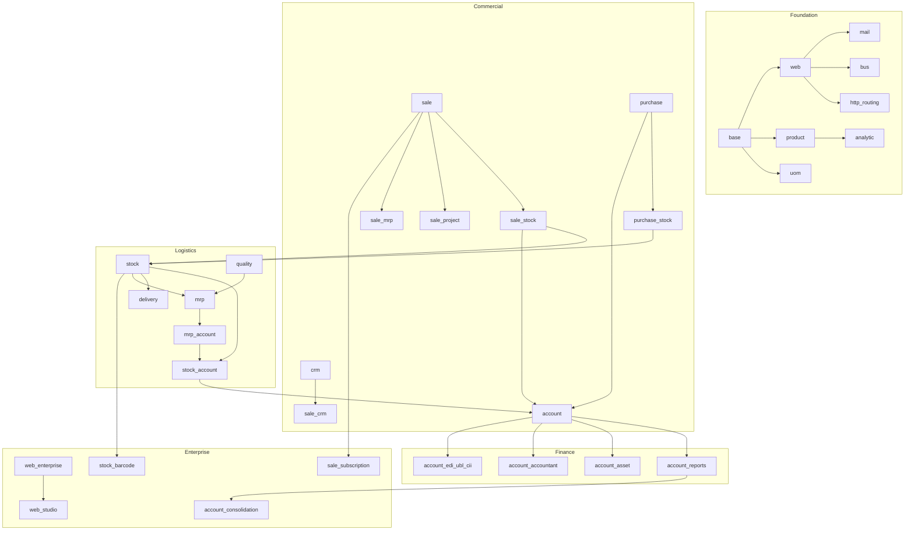
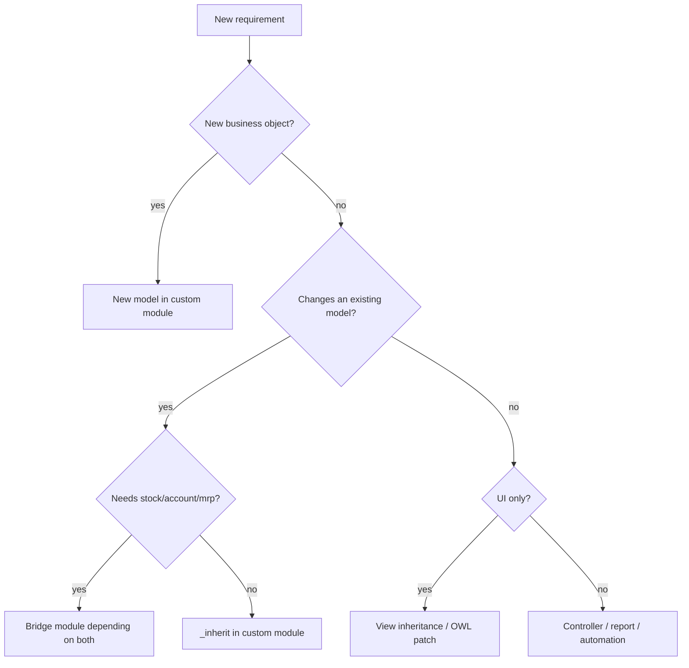

# Relaciones entre módulos II — Mapa de la plataforma y clústeres de dependencias

> **Propósito.** Un mapa mental de 1.469 módulos, agrupados por capa arquitectónica y clúster de negocio, con los módulos puente que los conectan. Úselo para delimitar el análisis de impacto y decidir dónde debe ubicarse una personalización.

---

## 1. Mapa por capas



---

## 2. Clúster fundacional

| Módulo | Función | Fan-in | Notas |
|---|---|---|---|
| `base` | ORM, seguridad, partners, compañías, módulos | 47 | siempre instalado |
| `web` | SPA de backend, vistas, recursos, RPC | 47 | cliente OWL |
| `mail` | mensajería, seguidores, actividades | 77 | mixin usado en todas partes |
| `bus` | notificaciones por websocket | 5 | PostgreSQL NOTIFY |
| `product` | producto/plantilla/variante, UdM | alto | maestro comercial principal |
| `uom` | unidades de medida | alto | modelo de árbol v19 |
| `analytic` | planes/cuentas analíticas | alto | contabilidad de costes |
| `base_setup` | marco de ajustes | 23 | `res.config.settings` |
| `base_automation` | reglas sin código | 25 | desencadenadores |
| `base_import` | importación CSV/XLS | 7 | |
| `html_editor` | texto enriquecido | 11 | sustituye a summernote |
| `web_tour` | tours de incorporación | 14 | |
| `iap` | compras integradas en la aplicación | 16 | servicios externos |
| `portal` | portal de clientes | 26 | |
| `website` | CMS público | 34 | |
| `http_routing` | enrutamiento/redirecciones de URL | 7 | |

**Regla:** los módulos personalizados dependen casi siempre de `base`, `web` y uno o varios de `mail`, `product`, `account`, `stock`.

---

## 3. Clúster comercial

| Módulo | Depende de | Añade |
|---|---|---|
| `sale` | `sales_team`, `account_payment`, `product`, `utm`, `portal` | presupuestos, pedidos, facturas |
| `sale_management` | `sale`, `digest` | interfaz de la aplicación, ajustes avanzados |
| `sale_stock` | `sale`, `stock_account` | entrega, aprovisionamiento |
| `sale_mrp` | `mrp`, `sale_stock` | OF para pedidos de venta |
| `sale_project` | `sale_management`, `project_account` | proyectos/tareas a partir de pedidos de venta |
| `sale_timesheet` | `sale_project`, `hr_timesheet` | tiempo facturable |
| `sale_purchase` | `sale`, `purchase` | envío directo/pedido de compra desde pedido de venta |
| `sale_loyalty` | `sale`, `loyalty` | cupones, promociones |
| `sale_subscription` [ENT] | `sale_management`, `account_accountant` | facturas recurrentes |
| `sale_renting` [ENT] | `sale`, `web_gantt` | periodos de alquiler |
| `crm` | `sales_team`, `mail`, `calendar`, `utm` | leads/oportunidades |
| `sale_crm` | `sale`, `crm` | presupuesto a partir de un lead |
| `purchase` | `account` | SdP, pedidos de compra, facturas de proveedor |
| `purchase_stock` | `purchase`, `stock` | recepciones |
| `purchase_mrp` | `purchase_stock`, `mrp` | compra de subcontratación/kit |
| `purchase_requisition` | `purchase` | pedidos marco |

**Los módulos puente** son donde reside el comportamiento:

- `sale_stock` es el puente entre ventas e inventario; es responsable de `_action_launch_stock_rule`, `delivery_status` y `picking_policy`.
- `sale_mrp` es el puente entre ventas y fabricación; vincula las OF mediante `stock.reference`.
- `purchase_stock` es el puente entre compras e inventario; es responsable de `_create_picking`.
- `sale_purchase` es el puente para el envío directo y las operaciones intercompañía.

**[INVARIANT]** Nunca coloque lógica de stock en `sale` ni lógica de compras en `stock`. Utilice el módulo puente o cree uno nuevo; de lo contrario, creará una dependencia oculta que rompe las instalaciones independientes.

---

## 4. Clúster logístico

| Módulo | Función |
|---|---|
| `stock` | movimientos, quants, pickings, rutas, reglas |
| `stock_account` | valoración, COGS, diario de stock |
| `stock_delivery` | marco de integración de transportistas |
| `delivery_*` | conectores de transportistas (DHL, UPS, FedEx, ...) |
| `stock_landed_costs` | asignación de flete/aduanas |
| `stock_barcode` [ENT] | interfaz de códigos de barras |
| `stock_enterprise` [ENT] | informes/adiciones de cohortes |
| `mrp` | LdM, OF, órdenes de trabajo |
| `mrp_account` | valoración de fabricación |
| `mrp_workorder` [ENT] | interfaz de planta, registro de tiempos |
| `mrp_plm` [ENT] | órdenes de cambio de ingeniería |
| `mrp_subcontracting` | subcontratación |
| `quality` / `quality_mrp` | puntos de inspección |
| `maintenance` | mantenimiento de equipos |
| `repair` | órdenes de reparación |

---

## 5. Clúster financiero

| Módulo | Función |
|---|---|
| `account` | asientos contables, facturas, impuestos, conciliación |
| `account_accountant` [ENT] | interfaz completa de la aplicación de contabilidad |
| `account_reports` [ENT] | estados financieros, informes fiscales |
| `account_asset` [ENT] | activos fijos |
| `account_budget` [ENT] | presupuestos |
| `account_consolidation` [ENT] | consolidación multicompañía |
| `account_edi` | marco de facturación electrónica |
| `account_edi_ubl_cii` | formatos UBL/CII |
| `account_peppol` | PEPPOL de la UE |
| `account_followup` [ENT] | reclamación de pagos (dunning) |
| `account_batch_payment` [ENT] | pagos por lotes |
| `account_3way_match` [ENT] | control de compras |
| `account_inter_company_rules` | automatización intercompañía |
| `account_intrastat` [ENT] | Intrastat de la UE |
| `l10n_*` | localizaciones por país (245 módulos con `countries`) |

**Regla de localización:** instale exactamente un plan contable `l10n_<country>` por compañía. Varios planes en una misma compañía corrompen el plan contable. La multicompañía puede usar localizaciones diferentes.

---

## 6. Clúster Enterprise

Los módulos Enterprise no constituyen una plataforma separada; son complementos con licencias `OEEL-1`/`OPL-1`.

| Área | Módulos |
|---|---|
| Contabilidad | `account_accountant`, `account_reports`, `account_asset`, `account_budget`, `account_consolidation`, `account_followup`, `account_batch_payment`, `account_3way_match`, `account_intrastat` |
| Ventas | `sale_subscription`, `sale_renting`, `sale_amazon`, `sale_shopee`, `sale_lazada`, `sale_tiktok` |
| Servicio de campo | `industry_fsm`, `industry_fsm_sale`, `industry_fsm_repair` |
| RR. HH. | `hr_payroll`, `hr_appraisal`, `hr_recruitment_reports`, `planning` |
| Marketing | `marketing_automation`, `social`, `mass_mailing_sms` |
| Productividad | `documents`, `knowledge`, `sign`, `approvals`, `web_studio` |
| Logística | `stock_barcode`, `mrp_workorder`, `mrp_plm`, `quality_control` |
| Sitio web | `website_sale_dashboard`, `website_helpdesk`, `website_appointment` |
| IA | `ai`, `ai_app`, `ai_fields`, `ai_document` |

**[WARNING]** Los módulos Enterprise usan con frecuencia `auto_install=True`. Instalar una aplicación Community en una base de datos Enterprise puede arrastrar dependencias Enterprise y cambiar menús, permisos y modelos de datos. Verifique el cierre.

---

## 7. Módulos de aplicación (las 78 «apps»)

Las aplicaciones son módulos con `application=True`; aparecen como mosaicos de primer nivel en el menú Aplicaciones. No tienen nada especial desde el punto de vista arquitectónico. Ejemplos:

| Aplicación | Módulo | Depende de |
|---|---|---|
| Ventas | `sale_management` | `sale`, `digest` |
| Compras | `purchase` | `account` |
| Inventario | `stock` | `product`, `barcodes_gs1_nomenclature`, `digest` |
| Fabricación | `mrp` | `product`, `stock`, `resource` |
| Contabilidad | `accountant` | `account_reports` |
| Facturación | `account` | `base_setup`, `product`, `analytic`, `portal` |
| CRM | `crm` | `sales_team`, `mail`, `calendar`, `utm` |
| Proyecto | `project` | `analytic`, `mail`, `portal`, `rating`, `resource` |
| Sitio web | `website` | `web`, `html_editor`, `http_routing`, `portal` |
| Comercio electrónico | `website_sale` | `website`, `sale`, `delivery` |
| TPV | `point_of_sale` | `stock_account`, `barcodes`, `html_editor` |
| Helpdesk | `helpdesk` | `mail`, `utm`, `rating`, `portal` |
| Servicio de campo | `industry_fsm` | `project_enterprise`, `timesheet_grid` |
| Suscripciones | `sale_subscription` | `account_accountant`, `sale_management` |

**[WARNING]** Instalar una aplicación instala todo su cierre de dependencias, incluidos los módulos de auto-instalación. La interfaz de Aplicaciones muestra un recuento simplificado; el número real de módulos puede ser entre 10 y 50 veces mayor.

---

## 8. Módulos puente y servicios compartidos

| Servicio compartido | Implementado por | Usado por |
|---|---|---|
| Mensajería/seguimiento | `mail` | todos los módulos de negocio |
| Programación de actividades | `mail.activity.mixin` | CRM, pedidos de venta, proyecto, helpdesk |
| Acceso al portal | `portal` | pedidos de venta, facturas, tickets, proyectos |
| Atribución UTM | `utm` | CRM, pedidos de venta, sitio web, marketing |
| Valoraciones | `rating` | proyecto, helpdesk, entrega |
| Distribución analítica | `analytic` | pedidos de venta, facturas, gastos, partes de horas |
| Moneda | `res.currency` | todos los modelos monetarios |
| UdM | `uom` | producto, stock, compras, ventas, mrp |
| Secuencia | `ir.sequence` | todos los documentos |
| Adjuntos | `ir.attachment` | todos los documentos |
| Bus | `bus` | notificaciones de la interfaz |
| Cron | `ir.cron` | todo el trabajo programado |
| Configuración | `ir.config_parameter` | indicadores de funcionalidad, integraciones |

---

## 9. Reglas de análisis de impacto

Al cambiar un módulo, estime el radio de impacto por el fan-in:

| Fan-in | Radio de impacto | Estrategia de prueba |
|---|---|---|
| > 100 | toda la plataforma | regresión completa + prueba de actualización |
| 30–100 | clúster principal | regresión del clúster + flujos clave |
| 10–30 | varias aplicaciones | aplicaciones afectadas + integración |
| 3–10 | local | módulo + dependientes directos |
| 0–2 | aislado | pruebas del módulo |

Use esta consulta para listar los dependientes:

```sql
SELECT d.name
FROM ir_module_module_dependency dep
JOIN ir_module_module d ON d.id = dep.module_id
JOIN ir_module_module m ON m.id = dep.depend_id
WHERE m.name = 'account' AND d.state = 'installed';
```

O en Python:

```python
module = env['ir.module.module'].search([('name', '=', 'account')])
dependents = module.downstream_dependencies()
```

---

## 10. Dónde ubicar una personalización



**Reglas:**

1. Nunca modifique el código fuente del núcleo. Use `_inherit` y herencia de vistas.
2. Coloque el pegamento entre módulos en un módulo puente; no haga que `sale` dependa de `stock`.
3. Coloque la lógica específica del sector en un módulo `industry_*` o `l10n_*`, no en `sale`.
4. Coloque la configuración en `res.config.settings`, no en el código.
5. Coloque las correcciones de datos puntuales en scripts de migración, no en `post_init_hook`.

---

## 11. Índice de evidencia

| Tema | Archivo |
|---|---|
| Lista de módulos | `addons/*/__manifest__.py` |
| Indicadores de aplicación | `application` del manifiesto |
| Estadísticas de dependencias | Obtenidas de `addons/*/__manifest__.py` en este árbol |
| Lógica de auto-instalación | `addons/base/models/ir_module.py:407-434` |
| Dependencias descendentes | `addons/base/models/ir_module.py` (`downstream_dependencies`) |
| Localizaciones | `addons/l10n_*/__manifest__.py` |

Continúe con `03-extension-points.md`.
