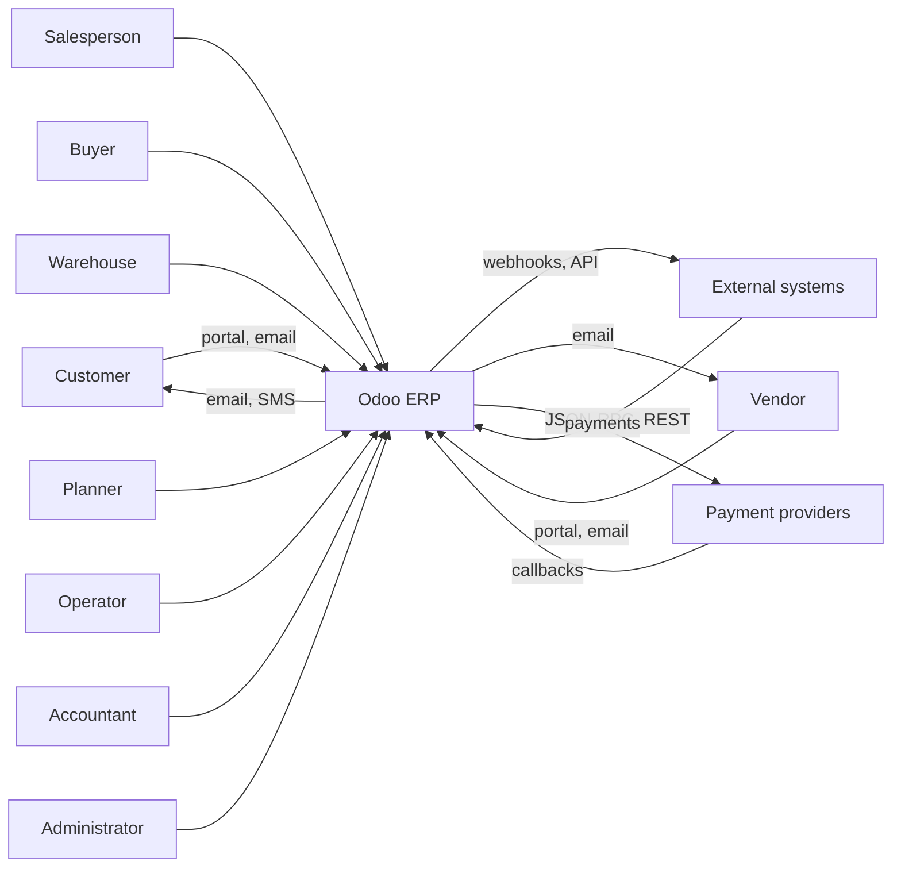

# Ingeniería de software I — Modelo de casos de uso

> **Notación.** Diagrama UML de casos de uso en Mermaid, complementado con un catálogo textual. Cada caso de uso tiene un ID, actores, disparador, precondiciones, flujo principal, alternativas, poscondiciones y los módulos y métodos de Odoo que lo materializan.

---

## 1. Actores

| Actor | Tipo | Descripción |
|---|---|---|
| Comercial | humano | crea presupuestos y sigue oportunidades |
| Responsable de ventas | humano | aprueba descuentos y pedidos, bloquea |
| Cliente | externo | presupuesto por portal, pago y entrega |
| Comprador | humano | SdP, pedidos de compra |
| Responsable de compras | humano | aprobación, estrategia de proveedores |
| Proveedor | externo | presupuesto, entrega y factura |
| Operador de almacén | humano | recepciones, entregas y recuentos |
| Planificador de fabricación | humano | OF, órdenes de trabajo y planificación |
| Operador de máquina | humano | ejecución en planta |
| Contable | humano | facturas, pagos, conciliación y cierre |
| Controller financiero | humano | informes, presupuestos y auditoría |
| Responsable de RR. HH. | humano | empleados, nómina y ausencias |
| Administrador | humano | usuarios, grupos, módulos y configuración |
| Cliente de integración | sistema | API, webhook, ETL |
| Planificador de tareas | sistema | tareas cron |
| Motor de automatización | sistema | base.automation, acciones de servidor |
| Proveedor de pagos | externo | callbacks de transacción |

---

## 2. Contexto del sistema

---

## 3. Diagrama de casos de uso

```mermaid
flowchart TB
    subgraph Sales
        UC1[Create quotation]
        UC2[Apply pricelist/discount]
        UC3[Confirm order]
        UC4[Approve exception]
        UC5[Deliver order]
        UC6[Invoice order]
        UC7[Register payment]
    end
    subgraph Purchasing
        UC8[Create RFQ]
        UC9[Approve PO]
        UC10[Receive goods]
        UC11[Record vendor bill]
        UC12[Pay vendor]
    end
    subgraph Inventory
        UC13[Transfer stock]
        UC14[Adjust inventory]
        UC15[Return goods]
        UC16[Scrap]
    end
    subgraph Manufacturing
        UC17[Create BoM]
        UC18[Plan MO]
        UC19[Execute work orders]
        UC20[Close MO]
    end
    subgraph Accounting
        UC21[Post invoice]
        UC22[Reconcile bank]
        UC23[Close period]
        UC24[Report financials]
    end
    subgraph Platform
        UC25[Manage users/access]
        UC26[Install/upgrade module]
        UC27[Run integration]
        UC28[Schedule job]
    end

    SP --> UC1
    SP --> UC2
    SP --> UC3
    SM[Sales Manager] --> UC4
    C --> UC3
    WH --> UC5
    AC --> UC6
    AC --> UC7
    BU --> UC8
    PM[Purchase Manager] --> UC9
    WH --> UC10
    AC --> UC11
    AC --> UC12
    WH --> UC13
    WH --> UC14
    WH --> UC15
    WH --> UC16
    PL --> UC17
    PL --> UC18
    OP --> UC19
    PL --> UC20
    AC --> UC21
    AC --> UC22
    CO[Controller] --> UC23
    CO --> UC24
    AD --> UC25
    AD --> UC26
    I[Integration] --> UC27
    SCH[Scheduler] --> UC28
```

---

## 4. Catálogo de casos de uso

### UC-01 Crear presupuesto

| Campo | Valor |
|---|---|
| Actores | Comercial, Cliente |
| Disparador | Solicitud del cliente |
| Precondiciones | El cliente existe; el catálogo de productos está configurado; hay una tarifa disponible |
| Flujo principal | 1. Crear `sale.order` (borrador). 2. Añadir líneas; el onchange de producto establece la UdM, el precio y los impuestos. 3. La tarifa calcula el precio. 4. Establecer condiciones de pago y posición fiscal. 5. Guardar. 6. Enviar el presupuesto. |
| Alternativas | A1: precio específico del cliente → sobrescritura manual del precio. A2: falta un impuesto → configurar el impuesto o la posición fiscal. A3: límite de crédito superado → advertencia o bloqueo. |
| Poscondiciones | `state='draft'` o `'sent'`; enlace al PDF o al portal disponible |
| Implementación | `sale.order`, `sale.order.line`, `product.pricelist`, `account.tax` |

### UC-02 Aplicar tarifa o descuento

| Campo | Valor |
|---|---|
| Actores | Comercial, Responsable de ventas |
| Precondiciones | Reglas de tarifa configuradas; límites de descuento establecidos |
| Flujo principal | 1. Se selecciona la tarifa a partir del contacto o de la compañía. 2. `_compute_price_unit` aplica las reglas. 3. Se introduce el descuento. 4. Se calculan los impuestos. 5. Se recalculan los totales. |
| Alternativas | A1: descuento por encima del límite → aprobación del responsable. A2: cambio de moneda → recálculo del tipo de cambio. |
| Poscondiciones | `price_unit`, `discount`, `price_subtotal`, `price_tax`, `price_total` coherentes |
| Implementación | `product.pricelist._get_product_price`, `sale.order.line._compute_price_unit`, `account.tax._get_tax_details` |

### UC-03 Confirmar pedido

| Campo | Valor |
|---|---|
| Actores | Comercial, Cliente (portal) |
| Precondiciones | El presupuesto tiene líneas con productos; estado `draft`/`sent`; sin bloqueo |
| Flujo principal | 1. `action_confirm`. 2. Validar las líneas. 3. Escribir `state='sale'`, `date_order`. 4. Sobrescrituras de `_action_confirm`. 5. El aprovisionamiento crea la entrega, la OF o el pedido de compra. 6. Bloqueo o correo opcionales. |
| Alternativas | A1: falta el producto → `UserError`. A2: sin ruta → pedido confirmado pero sin entrega. A3: límite de crédito → advertencia. A4: distribución analítica no válida → `UserError`. |
| Poscondiciones | `state='sale'`; pickings, OF y pedidos de compra creados; `delivery_status='pending'` |
| Implementación | `sale.order.action_confirm`, `_action_confirm`, `sale_stock._action_launch_stock_rule` |

### UC-04 Aprobar excepción

| Campo | Valor |
|---|---|
| Actores | Responsable de ventas |
| Precondiciones | El pedido supera el umbral de descuento, margen o crédito; la regla de aprobación está configurada |
| Flujo principal | 1. Se marca el pedido (campo personalizado o automatización). 2. El responsable revisa el margen y el crédito. 3. Aprueba → se establece el campo. 4. Se permite la confirmación. |
| Alternativas | A1: rechazo → cancelación o revisión del presupuesto. |
| Poscondiciones | Aprobación registrada con usuario y fecha |
| Implementación | `base.automation`, campos personalizados, sobrescritura de `sale.order` |

### UC-05 Entregar pedido

| Campo | Valor |
|---|---|
| Actores | Operador de almacén, Cliente |
| Precondiciones | Pedido de venta confirmado; el picking existe; hay stock disponible o se acepta el pedido pendiente |
| Flujo principal | 1. Abrir el picking. 2. Reservar (`_action_assign`). 3. Establecer cantidades, lotes y paquetes. 4. `button_validate`. 5. Se actualizan los quants; asiento de valoración. 6. Pedido pendiente si es parcial. |
| Alternativas | A1: sin stock → `confirmed`/`partial`. A2: se requiere lote pero falta → error. A3: discrepancia de paquetes → error. |
| Poscondiciones | Picking en `done`; `qty_delivered` actualizado; `delivery_status` parcial o completo |
| Implementación | `stock.picking.button_validate`, `stock.move._action_done`, `stock.quant._update_available_quantity` |

### UC-06 Facturar pedido

| Campo | Valor |
|---|---|
| Actores | Contable, Comercial |
| Precondiciones | Pedido de venta en `sale`; cantidad facturable > 0 (según la política) |
| Flujo principal | 1. `_create_invoices`. 2. Preparar la cabecera y las líneas. 3. Crear un `account.move` en borrador. 4. Revisar. 5. `action_post`. 6. Secuencia y hash. |
| Alternativas | A1: nada que facturar → `UserError`. A2: impuesto o posición fiscal incorrectos → editar el borrador. A3: pago anticipado → factura de anticipo. |
| Poscondiciones | Factura publicada; `qty_invoiced` actualizado; `invoice_status` actualizado |
| Implementación | `sale.order._create_invoices`, `account.move._post` |

### UC-07 Registrar pago

| Campo | Valor |
|---|---|
| Actores | Contable, Proveedor de pagos |
| Precondiciones | Factura publicada; diario bancario configurado |
| Flujo principal | 1. Abrir el asistente de pago. 2. Seleccionar importe, fecha y método. 3. Crear `account.payment`. 4. Publicar. 5. Conciliar con la factura. 6. Conciliación bancaria opcional. |
| Alternativas | A1: pago parcial → conciliación parcial. A2: diferencia de cambio → asiento por diferencia de cambio. A3: cancelación de saldo → línea de cancelación. |
| Poscondiciones | `payment_state='paid'`/`partial`; saldo residual actualizado |
| Implementación | `account.payment.register`, `account.move.line._reconcile_plan` |

### UC-08 Crear SdP

| Campo | Valor |
|---|---|
| Actores | Comprador, Proveedor |
| Precondiciones | El proveedor existe; el producto es comprable |
| Flujo principal | 1. Crear un `purchase.order` en borrador. 2. Añadir líneas; el precio del proveedor procede de `product.supplierinfo`. 3. Establecer la moneda y las condiciones de pago. 4. Enviar la SdP. |
| Alternativas | A1: sin precio de proveedor → precio manual. A2: el proveedor no es proveedor del producto → `_add_supplier_to_product` al confirmar. |
| Poscondiciones | SdP en `draft`/`sent` |
| Implementación | `purchase.order`, `purchase.order.line` |

### UC-09 Aprobar pedido de compra

| Campo | Valor |
|---|---|
| Actores | Responsable de compras |
| Precondiciones | SdP lista; umbral de aprobación configurado |
| Flujo principal | 1. `button_confirm`. 2. Validar. 3. Si se requiere aprobación → `to approve`. 4. `button_approve` del responsable. 5. `state='purchase'`. 6. Se crea la recepción. |
| Alternativas | A1: por debajo del umbral → aprobación automática. A2: omisión por el grupo de responsables. A3: ajuste de compañía bloqueado → bloqueo tras la aprobación. |
| Poscondiciones | Pedido de compra en `purchase`; la recepción existe |
| Implementación | `purchase.order.button_confirm`, `button_approve`, `purchase_stock._create_picking` |

### UC-10 Recibir mercancía

| Campo | Valor |
|---|---|
| Actores | Operador de almacén |
| Precondiciones | Pedido de compra confirmado; picking de entrada |
| Flujo principal | 1. Abrir la recepción. 2. Establecer cantidades y lotes. 3. Validar. 4. Quants y valoración. 5. `qty_received` actualizado. |
| Alternativas | A1: parcial → pedido pendiente. A2: recepción en exceso → permitida o con advertencia. A3: fallo de calidad → bloqueo o desecho. |
| Poscondiciones | Recepción en `done`; stock incrementado |
| Implementación | `stock.picking.button_validate`, valoración de `stock_account` |

### UC-11 Registrar factura de proveedor

| Campo | Valor |
|---|---|
| Actores | Contable, Proveedor |
| Precondiciones | Existe el pedido de compra o la recepción; se ha recibido la factura de proveedor |
| Flujo principal | 1. `action_create_invoice` o factura manual. 2. Cotejar líneas y cantidades. 3. Publicar. 4. Marca de conciliación a tres bandas. |
| Alternativas | A1: discrepancia de precio o cantidad → excepción. A2: factura duplicada → bloqueada. A3: abono → reembolso. |
| Poscondiciones | Factura publicada; `invoice_status='invoiced'` cuando se ha facturado por completo |
| Implementación | `purchase.order.action_create_invoice`, `account.move._post`, `account_3way_match` |

### UC-12 Pagar al proveedor

| Campo | Valor |
|---|---|
| Actores | Contable |
| Precondiciones | Factura publicada; fecha de vencimiento |
| Flujo principal | 1. Asistente de pago. 2. Crear y publicar el pago. 3. Conciliar la cuenta a pagar. 4. Conciliación bancaria. |
| Alternativas | A1: pago por lotes. A2: diferencia de cambio. A3: descuento por pronto pago. |
| Poscondiciones | Factura pagada o parcialmente pagada |
| Implementación | `account.payment`, `account.payment.register` |

### UC-13 Transferir stock

| Campo | Valor |
|---|---|
| Actores | Operador de almacén |
| Precondiciones | Ubicaciones internas; producto almacenable |
| Flujo principal | 1. Crear un picking interno. 2. Añadir movimientos. 3. Reservar. 4. Validar. 5. Se mueven los quants. |
| Alternativas | A1: sin stock → en espera. A2: ruta de varios pasos → pickings encadenados. |
| Poscondiciones | Stock transferido; sin asiento de valoración salvo valoración por ubicación |
| Implementación | `stock.picking`, `stock.move` |

### UC-14 Ajustar inventario

| Campo | Valor |
|---|---|
| Actores | Responsable de almacén |
| Precondiciones | Recuento realizado; permiso |
| Flujo principal | 1. Abrir `stock.quant`. 2. Introducir la cantidad contada. 3. Aplicar. 4. Movimiento de ajuste. 5. Valoración. |
| Alternativas | A1: desviación por encima del umbral → aprobación. A2: seguimiento por lote → recuento por lote. |
| Poscondiciones | El quant coincide con el recuento; pista de auditoría |
| Implementación | `stock.quant._apply_inventory` |

### UC-15 Devolver mercancía

| Campo | Valor |
|---|---|
| Actores | Almacén, Cliente |
| Precondiciones | Existe la entrega o recepción original |
| Flujo principal | 1. Crear el picking de devolución. 2. Recibir e inspeccionar. 3. Validar. 4. Abono o reembolso. |
| Alternativas | A1: devolución parcial. A2: desecho en lugar de reposición. A3: pedido de sustitución. |
| Poscondiciones | Stock restituido o desechado; reversión financiera |
| Implementación | `stock.return.picking.action_create_returns`, `account.move._reverse_moves` |

### UC-16 Desecho

| Campo | Valor |
|---|---|
| Actores | Operador de almacén |
| Precondiciones | Producto en stock; ubicación de desecho |
| Flujo principal | 1. Crear el desecho. 2. Establecer cantidad y motivo. 3. Validar. 4. Disminución del quant; asiento de gasto. |
| Alternativas | A1: desecho desde una OF → desecho de componentes. |
| Poscondiciones | Stock reducido; desecho registrado |
| Implementación | `stock.scrap` |

### UC-17 Crear LdM

| Campo | Valor |
|---|---|
| Actores | Ingeniero de fabricación |
| Precondiciones | Producto, componentes y centros de trabajo |
| Flujo principal | 1. Crear `mrp.bom`. 2. Añadir componentes y UdM. 3. Añadir operaciones y centros de trabajo. 4. Establecer el modo de consumo. |
| Alternativas | A1: LdM fantasma. A2: LdM específica de variante. A3: subproductos. |
| Poscondiciones | LdM utilizable en OF |
| Implementación | `mrp.bom`, `mrp.bom.line`, `mrp.routing.workcenter` |

### UC-18 Planificar OF

| Campo | Valor |
|---|---|
| Actores | Planificador |
| Precondiciones | OF confirmada; componentes y hoja de ruta |
| Flujo principal | 1. `button_plan`. 2. Las órdenes de trabajo se programan en los centros de trabajo. 3. Se calculan las fechas. 4. Se comprueba la capacidad. |
| Alternativas | A1: sin capacidad → fechas posteriores. A2: faltan componentes → se planifica igualmente, en espera. |
| Poscondiciones | `is_planned=True`; fechas de las órdenes de trabajo establecidas |
| Implementación | `mrp.production.button_plan`, `_plan_workorders` |

### UC-19 Ejecutar órdenes de trabajo

| Campo | Valor |
|---|---|
| Actores | Operador de máquina |
| Precondiciones | OF planificada; componentes reservados |
| Flujo principal | 1. Iniciar la orden de trabajo. 2. Registrar tiempo y cantidad. 3. Finalizar. 4. Siguiente operación. |
| Alternativas | A1: pausa o tiempo de inactividad. A2: fallo de control de calidad. A3: dividir la producción. |
| Poscondiciones | Orden de trabajo finalizada; tiempo y coste registrados |
| Implementación | `mrp.workorder.button_start/button_finish`, `mrp.workcenter.productivity` |

### UC-20 Cerrar OF

| Campo | Valor |
|---|---|
| Actores | Planificador |
| Precondiciones | Producción completada; órdenes de trabajo finalizadas |
| Flujo principal | 1. `button_mark_done`. 2. Consumir componentes. 3. Producir el producto terminado. 4. Valorar. 5. Cerrar o generar pedido pendiente. |
| Alternativas | A1: parcial → pedido pendiente. A2: sobreconsumo. A3: desecho. |
| Poscondiciones | OF en `done`; stock y valoración actualizados |
| Implementación | `mrp.production.button_mark_done`, `_post_inventory`, `_cal_price` |

### UC-21 Publicar factura

| Campo | Valor |
|---|---|
| Actores | Contable |
| Precondiciones | Factura en borrador cuadrada; periodo abierto |
| Flujo principal | 1. `action_post`. 2. Validar. 3. Sincronizar las líneas de impuestos y de pago. 4. Secuencia. 5. Hash. |
| Alternativas | A1: descuadre → error. A2: fecha de bloqueo → error. A3: falta el contacto → error. |
| Poscondiciones | Asiento publicado; inmutable |
| Implementación | `account.move._post` |

### UC-22 Conciliar banco

| Campo | Valor |
|---|---|
| Actores | Contable |
| Precondiciones | Extracto bancario importado; diario configurado |
| Flujo principal | 1. Abrir la conciliación. 2. Cotejar las líneas. 3. Crear cancelaciones de saldo. 4. Validar. |
| Alternativas | A1: sin coincidencia → cuenta transitoria. A2: diferencia de cambio. A3: extracto duplicado. |
| Poscondiciones | Extracto conciliado; pagos validados |
| Implementación | `account.bank.statement.line`, modelos de conciliación |

### UC-23 Cerrar periodo

| Campo | Valor |
|---|---|
| Actores | Controller financiero |
| Precondiciones | Todos los asientos publicados; conciliaciones realizadas |
| Flujo principal | 1. Revisar el balance de comprobación. 2. Publicar ajustes. 3. Establecer las fechas de bloqueo. 4. Generar informes. 5. Archivar. |
| Alternativas | A1: factura tardía → asiento de ajuste. A2: revalorización por tipo de cambio. A3: periodificaciones. |
| Poscondiciones | Periodo bloqueado; estados financieros generados |
| Implementación | `account.move`, fechas de bloqueo, `account_reports` |

### UC-24 Generar informes financieros

| Campo | Valor |
|---|---|
| Actores | Controller financiero, Auditor |
| Precondiciones | Asientos publicados; acceso a informes |
| Flujo principal | 1. Seleccionar el informe y el periodo. 2. Desglosar. 3. Exportar. |
| Alternativas | A1: consolidación multicompañía. A2: conversión multidivisa. |
| Poscondiciones | Informe generado |
| Implementación | `account_reports` [ENT] |

### UC-25 Gestionar usuarios y accesos

| Campo | Valor |
|---|---|
| Actores | Administrador |
| Precondiciones | Derechos de administrador |
| Flujo principal | 1. Crear el usuario. 2. Asignar grupos. 3. Establecer las compañías. 4. Probar el acceso. |
| Alternativas | A1: usuario del portal. A2: usuario de API. A3: aplicación de 2FA. |
| Poscondiciones | El usuario solo puede acceder a los datos previstos |
| Implementación | `res.users`, `res.groups`, ACL, reglas |

### UC-26 Instalar o actualizar un módulo

| Campo | Valor |
|---|---|
| Actores | Administrador, DevOps |
| Precondiciones | Copia de seguridad; prueba en preproducción |
| Flujo principal | 1. Añadir el módulo a la ruta de addons. 2. Actualizar la lista de aplicaciones. 3. Instalar o actualizar. 4. Ejecutar las migraciones. 5. Probar. |
| Alternativas | A1: falta una dependencia → error. A2: fallo de migración → restaurar. |
| Poscondiciones | Módulo instalado; esquema y datos migrados |
| Implementación | `ir.module.module`, `load_module_graph`, `MigrationManager` |

### UC-27 Ejecutar integración

| Campo | Valor |
|---|---|
| Actores | Cliente de integración |
| Precondiciones | Usuario de API; credenciales; contrato |
| Flujo principal | 1. Autenticarse. 2. Llamar a JSON-RPC o REST. 3. Validar. 4. Procesar de forma idempotente. 5. Devolver el resultado. |
| Alternativas | A1: reintento → idempotencia. A2: error de validación → 4xx. A3: fallo parcial → outbox. |
| Poscondiciones | Datos sincronizados; evento registrado |
| Implementación | Controladores, `service.model.retrying`, outbox |

### UC-28 Programar tarea

| Campo | Valor |
|---|---|
| Actores | Planificador de tareas, Administrador |
| Precondiciones | Cron configurado |
| Flujo principal | 1. Reclamar la tarea. 2. Ejecutar. 3. Confirmar el progreso. 4. Reprogramar. |
| Alternativas | A1: fallo → espera progresiva o desactivación. A2: ejecución concurrente → bloqueo. |
| Poscondiciones | Tarea completada o reprogramada |
| Implementación | `ir.cron` |

---

## 5. Matriz de trazabilidad

| Caso de uso | Módulos | Métodos clave | Pruebas |
|---|---|---|---|
| UC-01/02/03 | sale, product, account | `action_confirm`, `_compute_price_unit` | pruebas de sale |
| UC-05 | sale_stock, stock | `_action_launch_stock_rule`, `button_validate` | pruebas de sale_stock |
| UC-06/07 | account | `_create_invoices`, `_post`, `_reconcile_plan` | pruebas de account |
| UC-08/09/10/11 | purchase, purchase_stock, account | `button_confirm`, `_create_picking` | pruebas de purchase |
| UC-13/14/15/16 | stock, stock_account | `_action_done`, `_apply_inventory` | pruebas de stock |
| UC-17/18/19/20 | mrp, mrp_account | `explode`, `button_plan`, `_post_inventory` | pruebas de mrp |
| UC-21/22/23/24 | account, account_reports | `_post`, `_reconcile_plan` | pruebas de account |
| UC-25 | base | `res.users`, `ir.rule` | pruebas de base |
| UC-26 | base, modules | `load_module_graph` | pruebas de módulos |
| UC-27/28 | http, ir.cron | `retrying`, `_process_job` | pruebas de integración |

---

## 6. Reglas de calidad de los casos de uso

- [ ] Cada caso de uso tiene una poscondición medible.
- [ ] Cada flujo alternativo tiene una respuesta del sistema.
- [ ] Cada caso de uso se corresponde con al menos una prueba.
- [ ] Los actores son roles, no personas con nombre.
- [ ] El límite del sistema es explícito (qué hace Odoo frente a lo externo).
- [ ] Las excepciones se modelan, no se ocultan.

Continúe con `02-domain-model.md`.
