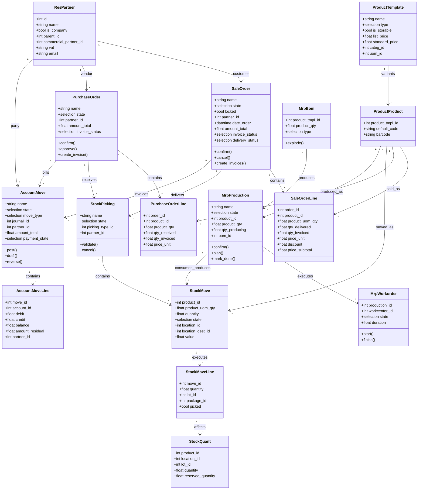

# Ingeniería de software II — Modelo de dominio y agregados

> **Propósito.** Un modelo del dominio de negocio independiente de la tecnología tal como lo implementa Odoo, junto con los límites (agregados) que determinan las reglas de transacción y consistencia. Se utiliza para revisiones de diseño, incorporación de personal y análisis de brechas.

---

## 1. Lenguaje ubicuo

| Término | Significado | Modelo de Odoo |
|---|---|---|
| Parte | una persona u organización | `res.partner` |
| Producto | un bien o servicio vendible, comprable o almacenable | `product.template` / `product.product` |
| Presupuesto | una oferta no vinculante | `sale.order` (draft/sent) |
| Pedido de venta | un compromiso confirmado de entrega | `sale.order` (sale) |
| Demanda | una necesidad de cantidad en una ubicación | `stock.move` (procurement) |
| Cumplimiento | ejecución de la demanda | `stock.picking` / `stock.move.line` |
| Inventario | cantidad disponible por ubicación y lote | `stock.quant` |
| Pedido de compra | un compromiso de compra | `purchase.order` |
| Recepción | ejecución de una entrada | `stock.picking` (incoming) |
| Factura de proveedor | factura del proveedor | `account.move` (`in_invoice`) |
| Factura de cliente | la factura emitida por la empresa | `account.move` (`out_invoice`) |
| Pago | movimiento de dinero | `account.payment` |
| Asiento contable | registro por partida doble | `account.move` (`entry`) |
| Orden de fabricación | un compromiso de producción | `mrp.production` |
| Lista de materiales | receta | `mrp.bom` |
| Orden de trabajo | ejecución de una operación | `mrp.workorder` |
| Valoración | valor monetario del stock | `stock.move.value` |
| Referencia | agrupación de documentos | `stock.reference` [V19] |

---

## 2. Diagrama de clases principal



---

## 3. Agregados y límites de consistencia

Un agregado es un conjunto de objetos que se tratan como una unidad para las transacciones. Odoo no impone los límites de los agregados de forma estructural; son convenciones.

### 3.1 Agregado del pedido de venta

```
SaleOrder
├── SaleOrderLine[]
├── StockReference[] (via sale_stock)
└── AccountMove[] (invoices, by reference)
```

**Invariantes:**

- una línea de pedido pertenece exactamente a un pedido;
- totales = suma de los totales de las líneas (base imponible + impuestos);
- los pedidos confirmados no se pueden editar (salvo los campos permitidos);
- un pedido bloqueado no se puede cancelar;
- el estado de facturación deriva de las cantidades de las líneas.

**Límite de transacción:** la confirmación de un pedido y la creación del aprovisionamiento deben ser una sola transacción. Si el aprovisionamiento falla, el pedido no debe quedar confirmado sin ninguna intención de entrega.

### 3.2 Agregado del pedido de compra

```
PurchaseOrder
├── PurchaseOrderLine[]
├── StockPicking[] (receipts)
└── AccountMove[] (bills)
```

**Invariantes:**

- `qty_received` ≤ o ≥ `product_qty` según la política de recepción en exceso;
- `qty_invoiced` ≤ cantidad facturable (salvo sobrescritura manual);
- un pedido de compra cancelado no tiene recepciones abiertas;
- un pedido de compra bloqueado no se puede editar ni cancelar.

### 3.3 Agregado del movimiento de stock

```
StockPicking
├── StockMove[]
│   └── StockMoveLine[]
└── StockQuant updates (side effect)
```

**Invariantes:**

- la suma de las cantidades de las líneas de movimiento = cantidad realizada del movimiento;
- una línea de movimiento debe tener un lote para los productos con seguimiento;
- los quants son la referencia autorizada de la cantidad disponible; los movimientos son intenciones;
- los movimientos validados son inmutables.

### 3.4 Agregado de la factura

```
AccountMove
├── AccountMoveLine[] (product, tax, payment terms, rounding)
└── AccountPartialReconcile[] (via lines)
```

**Invariantes:**

- sum(debit) = sum(credit) por asiento;
- los asientos publicados son inmutables;
- residual = importe - conciliado;
- las líneas de impuestos derivan de las líneas base;
- las condiciones de pago suman el total.

### 3.5 Agregado de fabricación

```
MrpProduction
├── StockMove[] (raw, finished, byproducts)
├── MrpWorkorder[]
│   └── MrpWorkcenterProductivity[]
└── StockMoveLine[] (consumption/production)
```

**Invariantes:**

- cantidad producida ≤ demanda + política de sobreproducción;
- los componentes consumidos corresponden a la LdM (estricta o flexible);
- la duración de la orden de trabajo ≥ 0;
- el estado deriva de los movimientos y las órdenes de trabajo.

---

## 4. Reglas entre agregados

| Regla | Aplicada por | Consistencia |
|---|---|---|
| Pedido de venta → entrega | aprovisionamiento en la misma transacción | fuerte |
| Pedido de venta → factura | `_create_invoices` en la misma transacción | fuerte |
| Pedido de compra → recepción | `_create_picking` al confirmar | fuerte |
| Pedido de compra → factura | `action_create_invoice` | fuerte |
| Entrega → valoración | `_action_done` → `_create_account_move` | fuerte |
| Factura → pago | transacción separada (asistente) | eventual |
| OF → pedido de venta | vínculo por referencia, no una transacción | eventual |
| Intercompañía | documentos y transacciones separados | eventual |

**[WARNING]** Las operaciones entre agregados que abarcan varias llamadas RPC son eventualmente consistentes. Se deben diseñar la idempotencia y la conciliación para ellas.

---

## 5. Catálogo de invariantes del dominio

### 5.1 Comercial

- Una línea de presupuesto debe referenciar un producto (o ser una línea de visualización).
- Un pedido confirmado no se puede editar salvo en los campos permitidos.
- Los descuentos no pueden superar los límites configurados sin aprobación.
- La moneda debe coincidir con la tarifa o convertirse explícitamente.
- La cantidad facturada no puede superar la cantidad facturable (según la política).

### 5.2 Inventario

- Cantidad disponible = suma de las cantidades de los quants.
- Cantidad reservada ≤ cantidad disponible (salvo que se permita stock negativo).
- Un movimiento realizado no se puede modificar.
- Un producto con seguimiento requiere un lote en cada línea de movimiento.
- Un paquete no se puede dividir entre ubicaciones en un mismo movimiento.

### 5.3 Contabilidad

- Todo asiento publicado está cuadrado.
- Un asiento publicado tiene una secuencia única por diario y periodo.
- Un asiento con hash no se puede modificar.
- Una línea conciliada tiene un residual de 0 o una conciliación completa.
- Las fechas de bloqueo impiden publicar antes de esa fecha.

### 5.4 Fabricación

- Una LdM no puede contenerse a sí misma (ni directamente ni a través de fantasmas).
- Las cantidades de los componentes son positivas.
- La secuencia de las órdenes de trabajo sigue la hoja de ruta.
- La cantidad terminada no puede superar la cantidad de la OF sin sobreproducción.

---

## 6. Eventos de dominio (conceptuales)

Odoo no dispone de un bus de eventos de dominio, pero estos son los cambios de estado significativos:

| Evento | Emitido por | Consumidores |
|---|---|---|
| QuoteConfirmed | `sale.order.action_confirm` | stock, project, CRM, correo |
| DeliveryValidated | `stock.picking._action_done` | valoración de stock, estado del pedido de venta |
| InvoicePosted | `account.move._post` | conciliación, informes, correo |
| PaymentRegistered | `account.payment.action_post` | conciliación |
| POConfirmed | `purchase.order.button_approve` | stock, correo |
| ReceiptValidated | `stock.picking._action_done` | cantidad del pedido de compra, valoración |
| MOCompleted | `mrp.production.button_mark_done` | stock, valoración, pedido de venta |
| InventoryAdjusted | `stock.quant._apply_inventory` | valoración, auditoría |

Para una integración fiable, se deben envolver en un outbox (véase `01-business-logic/03-service-layer.md` §6.2).

---

## 7. Correspondencia con la implementación

| Concepto de dominio | Modelo | Tabla | Raíz de agregado |
|---|---|---|---|
| Parte | `res.partner` | `res_partner` | sí |
| Producto | `product.template` | `product_template` | sí |
| Variante | `product.product` | `product_product` | no (delegada) |
| Presupuesto/Pedido | `sale.order` | `sale_order` | sí |
| Línea de pedido | `sale.order.line` | `sale_order_line` | no |
| Cumplimiento | `stock.picking` | `stock_picking` | sí |
| Movimiento | `stock.move` | `stock_move` | no |
| Línea de movimiento | `stock.move.line` | `stock_move_line` | no |
| Inventario | `stock.quant` | `stock_quant` | sí (por clave) |
| Compra | `purchase.order` | `purchase_order` | sí |
| Factura | `account.move` | `account_move` | sí |
| Línea de asiento | `account.move.line` | `account_move_line` | no |
| OF | `mrp.production` | `mrp_production` | sí |
| LdM | `mrp.bom` | `mrp_bom` | sí |
| Orden de trabajo | `mrp.workorder` | `mrp_workorder` | no |

---

## 8. Reglas de modelado para dominios personalizados

1. **Una raíz de agregado por transacción.** No se deben modificar dos raíces en un mismo método salvo que la operación de negocio lo requiera.
2. **Referenciar por id, no por incrustación.** Usar many2one, no campos copiados.
3. **Aplicar los invariantes en la raíz.** Los modelos hijos validan sus propios campos, pero las reglas que afectan a varios hijos corresponden a la raíz.
4. **Usar máquinas de estados de forma explícita.** Todo campo de estado necesita una tabla de transiciones.
5. **Nombrar los estados como participios pasados** (`confirmed`, `done`) y las acciones como verbos (`confirm`, `validate`).
6. **Evitar los indicadores booleanos que duplican el estado.** `locked` es una excepción porque es ortogonal.
7. **Modelar el dinero con su moneda.** Nunca se debe almacenar un importe monetario sin su moneda.
8. **Modelar las cantidades con su UdM.** Nunca se debe almacenar una cantidad sin su unidad.
9. **Modelar el tiempo en UTC.** Convertir solo en la presentación.
10. **Documentar los campos derivados.** Si es calculado, indicar a partir de qué.

---

## 9. Índice de evidencias

| Tema | Archivo |
|---|---|
| Contacto | `addons/base/models/res_partner.py` |
| Producto | `addons/product/models/product_template.py` |
| Ventas | `addons/sale/models/sale_order.py` |
| Stock | `addons/stock/models/stock_move.py`, `stock_quant.py` |
| Compras | `addons/purchase/models/purchase_order.py` |
| Contabilidad | `addons/account/models/account_move.py` |
| MRP | `addons/mrp/models/mrp_production.py` |

Continúe con `03-sequence-diagrams.md`.
