# Ingeniería de software III — Diagramas de secuencia

> **Propósito.** Secuencias de llamadas a nivel ejecutable para los flujos más importantes. Cada diagrama nombra los métodos reales y el límite de transacción. Se utilizan como base para revisiones de diseño, depuración y diseño de pruebas.

---

## 1. Ciclo de vida de una petición HTTP

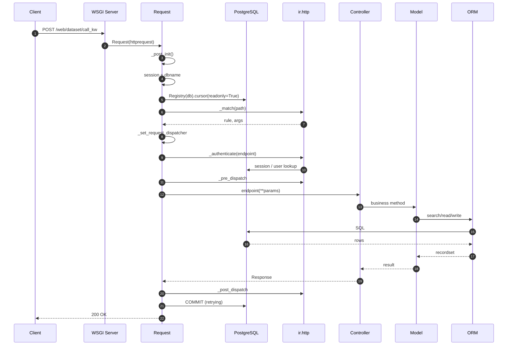

**Límite de transacción:** desde la creación del cursor hasta el commit de `retrying`. Las excepciones revierten los cambios; los fallos de serialización se reintentan hasta 5 veces.

---

## 2. Confirmación del pedido de venta

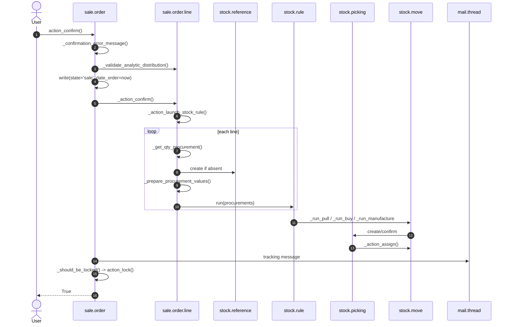

**Alternativas:**

- producto ausente → `UserError` antes de cualquier escritura;
- sin regla → pedido de venta confirmado, sin picking (registro o excepción);
- contexto `send_email` → correo de confirmación tras el commit o la puesta en cola;
- ajuste de bloqueo automático → `locked=True`.

---

## 3. Del pedido de compra a la recepción

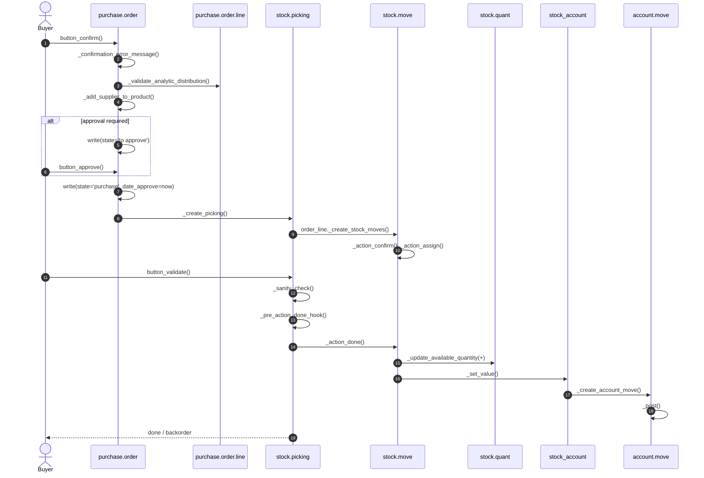

---

## 4. Entrega y factura

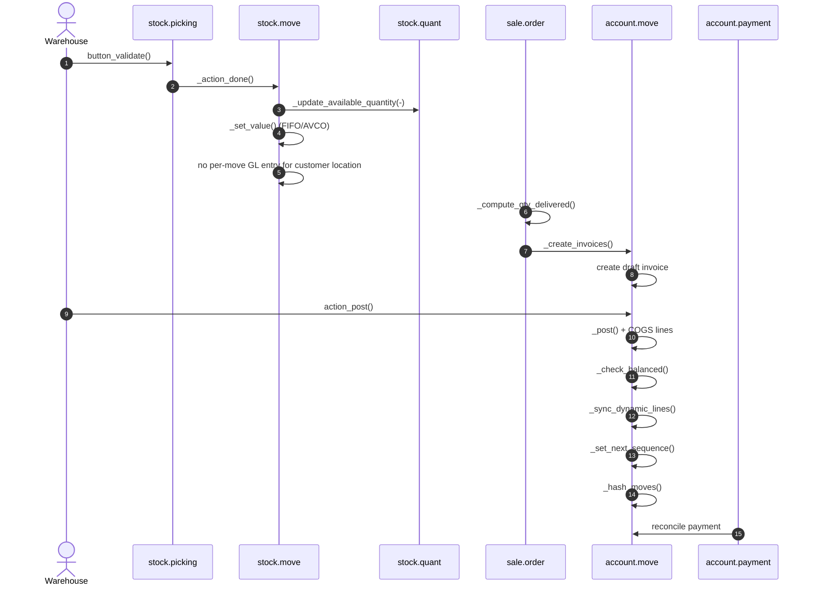

---

## 5. Funcionamiento interno de la publicación de facturas

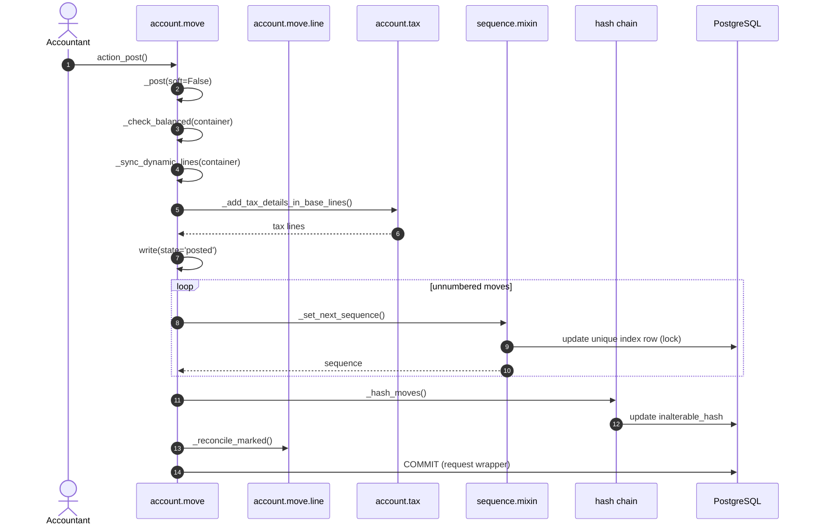

---

## 6. Pago y conciliación

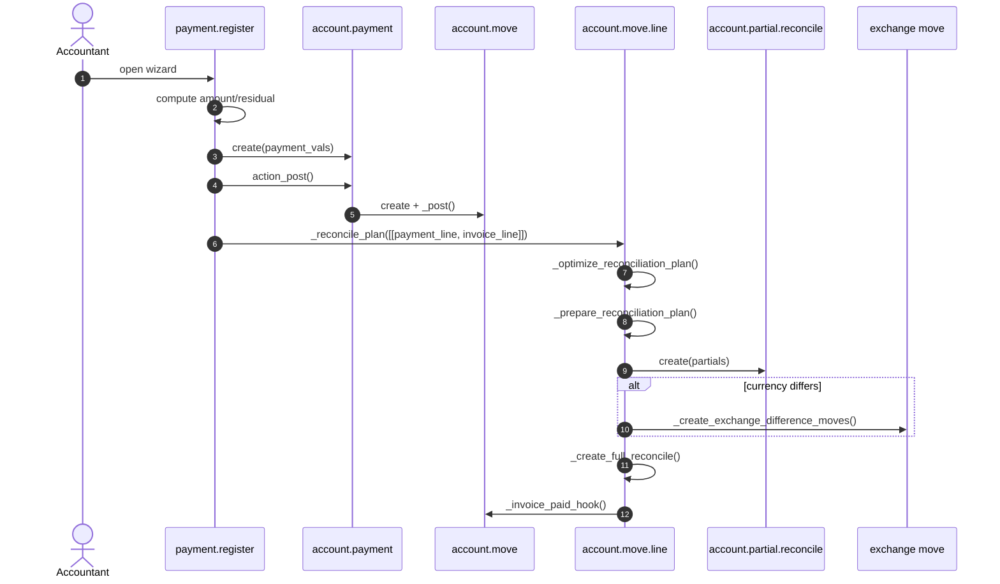

---

## 7. Finalización de la orden de fabricación

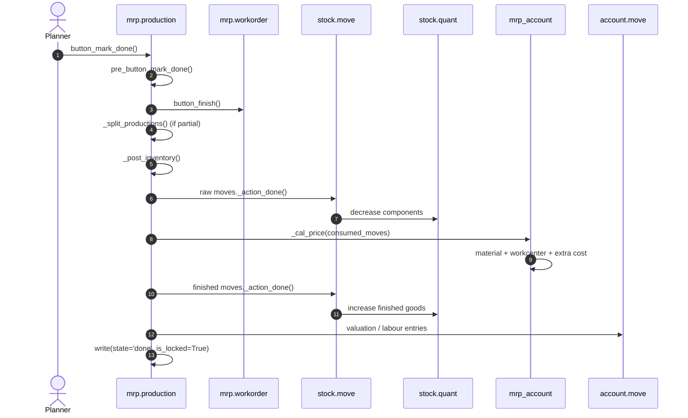

---

## 8. Ejecución de tareas cron

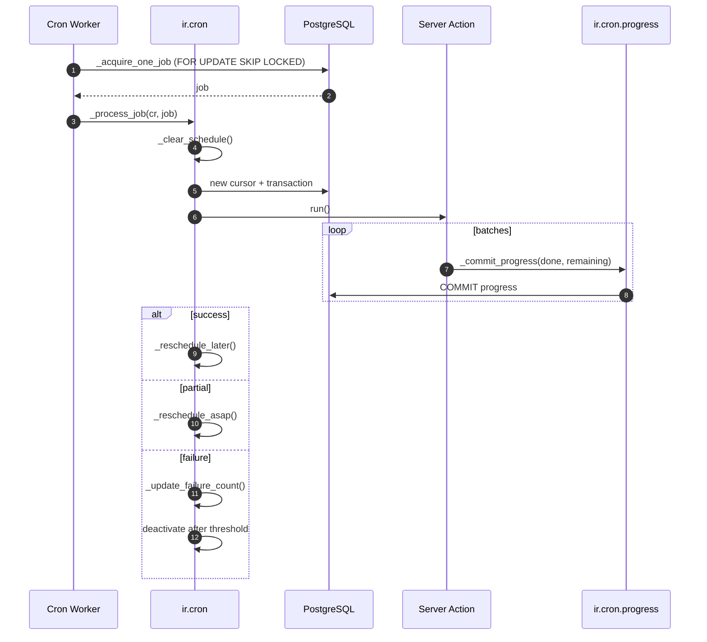

---

## 9. Integración externa con reintentos

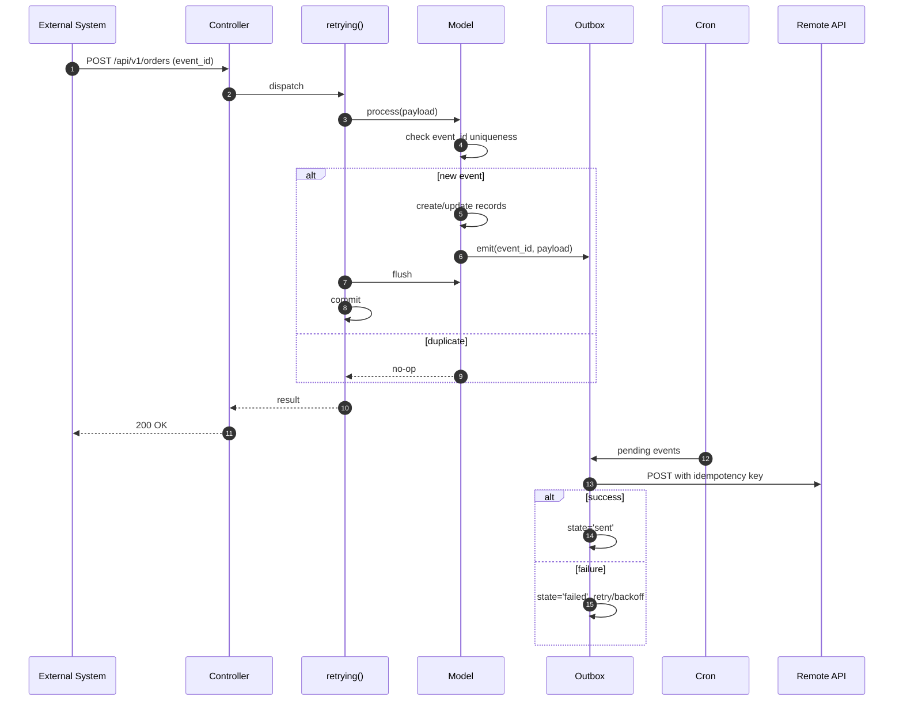

---

## 10. Notificación por bus

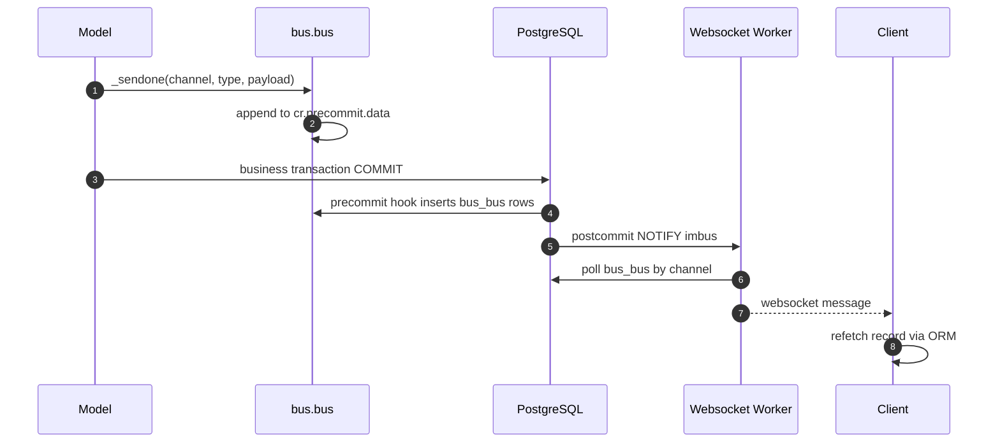

---

## 11. Secuencia de fallo y reintento

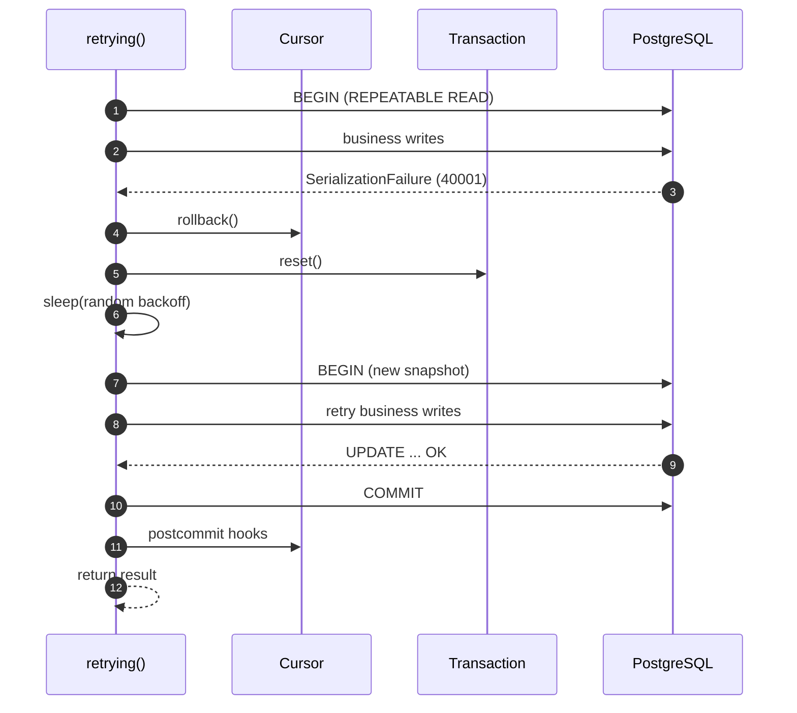

**[INVARIANT]** El método de negocio debe ser idempotente; los efectos secundarios externos deben diferirse o asociarse a una clave.

---

## 12. Convenciones de los diagramas

- Toda flecha es una llamada síncrona salvo que sea discontinua (`-->>`) o explícitamente asíncrona.
- `alt`/`else` son decisiones; `loop` es iteración.
- El límite de transacción se indica en el pie de figura, no se sobreentiende.
- Los nombres de los métodos son el anclaje estable; los números de línea no se muestran en los diagramas.
- Los actores son roles, no sistemas, salvo que el sistema sea externo.

---

## 13. Índice de evidencias

| Flujo | Archivo |
|---|---|
| Petición | `http.py:1793-2340`, `service/model.py:160` |
| Confirmación del pedido de venta | `sale/models/sale_order.py:1167`, `sale_stock/models/sale_order_line.py:280` |
| Recepción del pedido de compra | `purchase/models/purchase_order.py:625`, `purchase_stock/models/purchase_order.py:375` |
| Entrega | `stock/models/stock_picking.py:1413`, `stock_move.py:2244` |
| Factura | `account/models/account_move.py:5574` |
| Pago | `account/wizard/account_payment_register.py:993`, `account_move_line.py:2793` |
| OF | `mrp/models/mrp_production.py:2219`, `mrp_account/models/mrp_production.py:57` |
| Cron | `addons/base/models/ir_cron.py:399` |
| Bus | `addons/bus/models/bus.py:111-160` |

Continúe con `04-activity-diagrams.md`.
