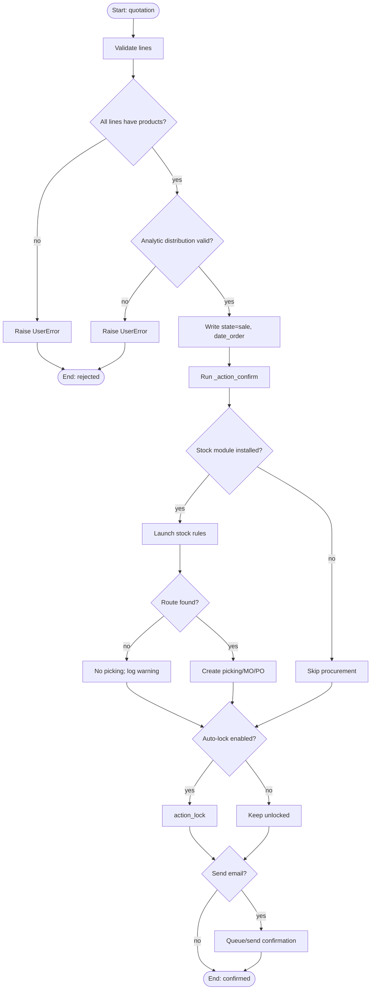
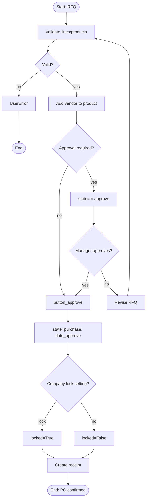
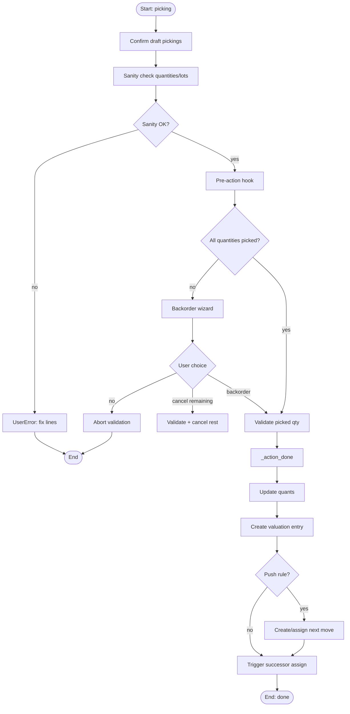
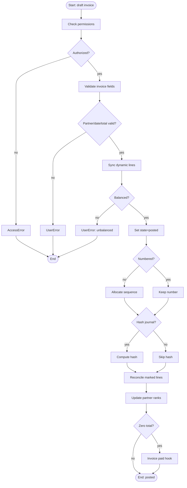
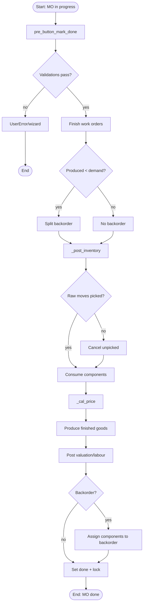
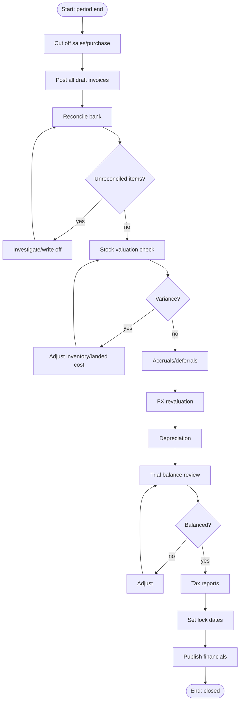
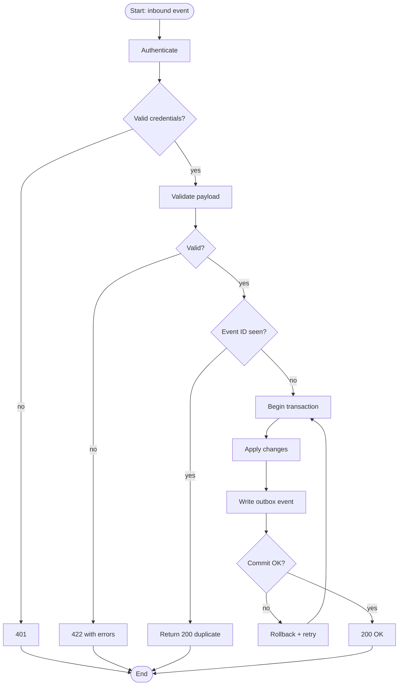
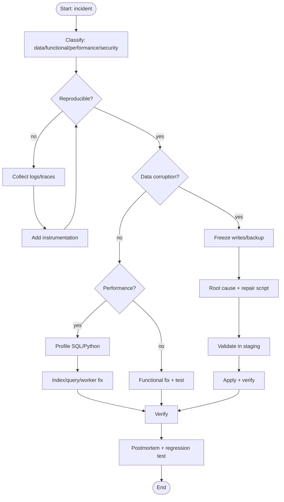

# Ingeniería de software IV — Diagramas de actividad y mapeo a BPMN

> **Propósito.** Vistas orientadas a decisiones de los mismos flujos. Cada diagrama de actividad se puede convertir directamente a BPMN: los rectángulos son tareas, los rombos son compuertas exclusivas, las barras paralelas son compuertas paralelas y los carriles (swimlanes) son roles.

---

## 1. Reglas de mapeo a BPMN

| Constructo Mermaid | Elemento BPMN |
|---|---|
| `[Start]` / `[End]` | evento de inicio/fin |
| `[Action]` | tarea |
| `{Decision?}` | compuerta exclusiva (XOR) |
| ramas paralelas | compuerta paralela (AND) |
| `subgraph Lane` | pool/carril |
| flecha con condición | flujo de secuencia con condición |
| evento de temporizador | evento intermedio de captura por temporizador |
| evento de mensaje | evento de captura/emisión de mensaje |

---

## 2. Confirmación de pedido de venta

### 2.1 Notas sobre BPMN

- `Validate lines` y `Write state` son tareas de servicio en el carril de Ventas.
- `Route found?` es la compuerta de negocio clave; en BPMN, documente la regla de resolución de ruta.
- `Create picking/MO/PO` es un subproceso con su propio diagrama.
- El temporizador para la expiración del presupuesto es un evento de temporizador límite en la tarea de presupuesto.

---

## 3. Aprobación de compra

**Datos de decisión:** `company.po_double_validation`, `po_double_validation_amount`, `purchase.group_purchase_manager`.

---

## 4. Validación de entrega

**Rutas de excepción:** lote faltante, división de paquetes, stock negativo bloqueado, conflicto de reservas, cuenta de valoración faltante.

---

## 5. Contabilización de factura

---

## 6. Finalización de fabricación

---

## 7. Cierre de mes

---

## 8. Procesamiento de integraciones

**Nota:** la escritura en el outbox se realiza en la misma transacción; la entrega es un cron independiente. Este es el único patrón fiable sin un broker.

---

## 9. Triaje de incidencias de soporte

---

## 10. Mapeo de actividades a pruebas

| Diagrama de actividad | Enfoque de prueba |
|---|---|
| Confirmación de ventas | guardas, aprovisionamiento, bloqueo, correo |
| Aprobación de compra | umbral, grupo de gerentes, recepción |
| Validación de entrega | parcial, lotes, paquetes, pedido pendiente |
| Contabilización de factura | equilibrio, fecha de bloqueo, secuencia, hash |
| Finalización de OF | consumo, pedido pendiente, valoración |
| Cierre de mes | conciliación, FX, fechas de bloqueo |
| Integración | idempotencia, reintento, outbox |
| Triaje de incidencias | runbooks, observabilidad |

---

## 11. Lista de verificación para la exportación a BPMN

- [ ] Cada decisión tiene un flujo predeterminado.
- [ ] Cada tarea tiene un propietario (carril).
- [ ] Cada evento tiene un disparador (mensaje/temporizador/señal).
- [ ] Las rutas de excepción terminan o iteran, nunca quedan colgando.
- [ ] Los objetos de datos (SO, picking, factura) se referencian, no se duplican.
- [ ] Los temporizadores son explícitos (expiración de presupuesto, condiciones de pago, SLA).
- [ ] Los subprocesos están vinculados a sus propios diagramas.

---

## 12. Índice de evidencia

| Flujo | Archivo |
|---|---|
| Ventas | `sale/models/sale_order.py:1167` |
| Compra | `purchase/models/purchase_order.py:625` |
| Entrega | `stock/models/stock_picking.py:1413` |
| Factura | `account/models/account_move.py:5574` |
| OF | `mrp/models/mrp_production.py:2219` |
| Integración | `service/model.py:160` |
| Cierre | `account/models/company.py:76-112` |

Continúe con `05-state-machines.md`.
