# Ingeniería de software V — Referencia de máquinas de estados

> **Propósito.** Un único lugar para verificar estados legales, transiciones y disparadores. Cada transición nombra el método que la ejecuta; los estados calculados lo indican explícitamente.

---

## 1. Principios de las máquinas de estados en Odoo

- Un campo de estado suele ser un `Selection` con `copy=False` e `index=True`.
- Las transiciones son **métodos**, no escrituras directas. Escribir `state` directamente omite las guardas.
- Algunos estados son **calculados** (`stock.picking`, `mrp.production`); escribirlos es un error.
- `locked`/`active` son booleanos ortogonales, no estados.
- Las automatizaciones y las importaciones pueden escribir el estado si omiten los métodos; aplique guardas en `write` si es necesario.

---

## 2. Pedido de venta

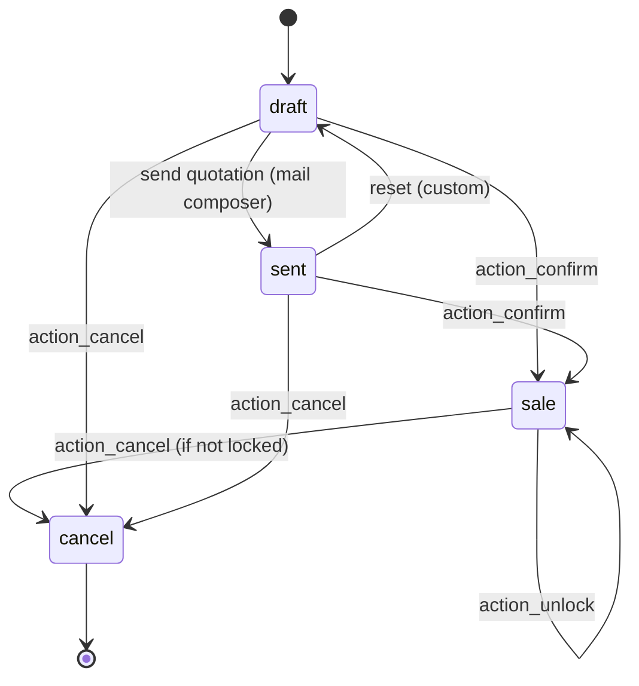

| Desde | Hasta | Disparador | Guarda |
|---|---|---|---|
| `draft` | `sale` | `action_confirm` | todas las líneas tienen producto |
| `sent` | `sale` | `action_confirm` | ídem |
| `draft`/`sent`/`sale` | `cancel` | `action_cancel` | no bloqueado |
| cualquiera | `sale` (bloqueado) | `action_lock` | confirmado |
| `sale` (bloqueado) | `sale` | `action_unlock` | gerente |
| — | — | `locked` | booleano independiente |

**No existe el estado `done`.** `invoice_status` y `delivery_status` son calculados, no estados.

Fuente: `sale/models/sale_order.py:26-81`, `:1167-1333`.

---

## 3. Lead de CRM

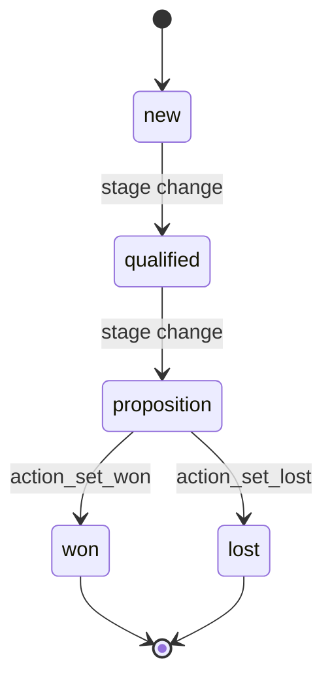

| Concepto | Campo | Valores |
|---|---|---|
| Etapa | `stage_id` | configurable, ordenado por `sequence` |
| Resultado | `won_status` | `won`, `lost`, `pending` |
| Archivo | `active` | `True`/`False` |
| Probabilidad | `probability` | 0–100 |

**No existe el campo `state`.** Ganado requiere probabilidad 100; perdido archiva y establece 0.

Fuente: `crm/models/crm_lead.py:123-233`, `:612-620`.

---

## 4. Pedido de compra

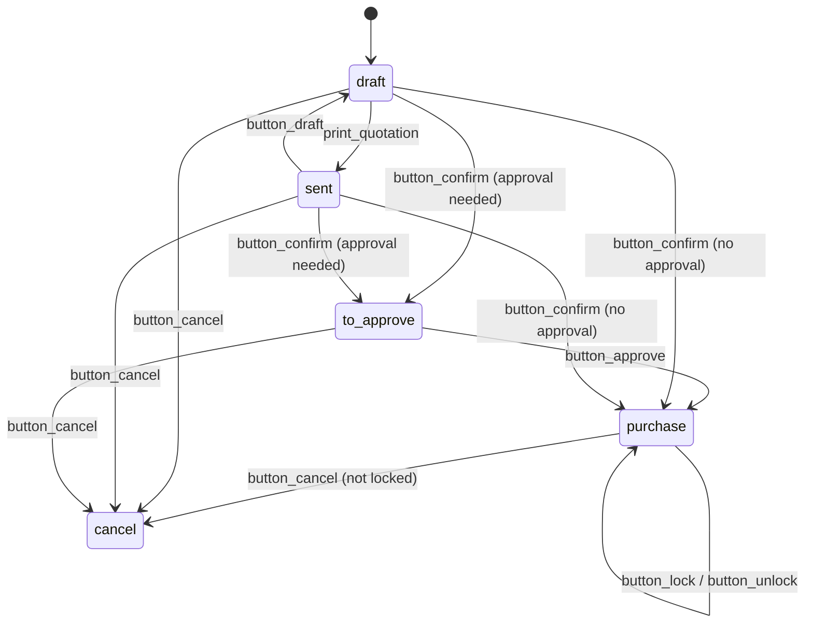

| Desde | Hasta | Disparador | Guarda |
|---|---|---|---|
| `draft`/`sent` | `purchase` | `button_confirm` → `button_approve` | aprobación permitida |
| `draft`/`sent` | `to approve` | `button_confirm` | aprobación requerida |
| `to approve` | `purchase` | `button_approve` | gerente/umbral |
| cualquiera | `cancel` | `button_cancel` | no bloqueado, sin facturas de proveedor contabilizadas |
| `purchase` | `purchase` | `button_lock` | — |

**No existe el estado `done`.** `qty_received` e `invoice_status` indican la finalización.

Fuente: `purchase/models/purchase_order.py:105-116`, `:615-655`.

---

## 5. Picking de stock

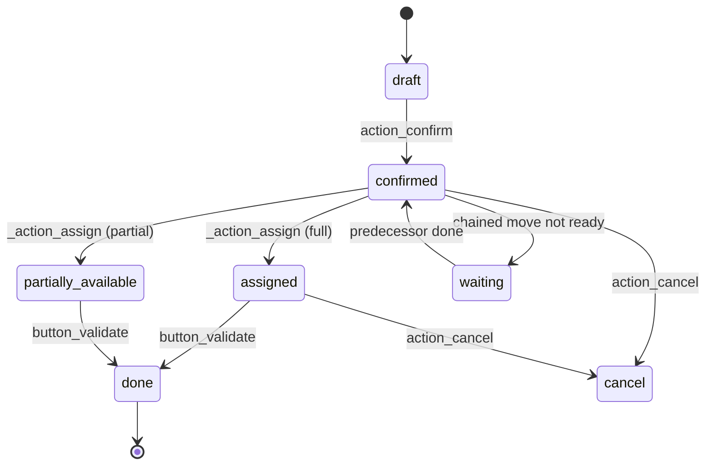

| Estado | Significado | ¿Calculado? |
|---|---|---|
| `draft` | no confirmado | sí |
| `waiting` | predecesor no completado | sí |
| `confirmed` | esperando disponibilidad | sí |
| `assigned` | totalmente reservado | sí |
| `done` | validado | sí |
| `cancel` | cancelado | sí |

`state` se calcula a partir de los movimientos (`_compute_state`). Estados de movimiento: `draft`, `waiting`, `confirmed`, `partially_available`, `assigned`, `done`, `cancel`.

Fuente: `stock/models/stock_picking.py:575-590`, `:816`, `stock_move.py:107-120`.

---

## 6. Movimiento de stock / línea de movimiento

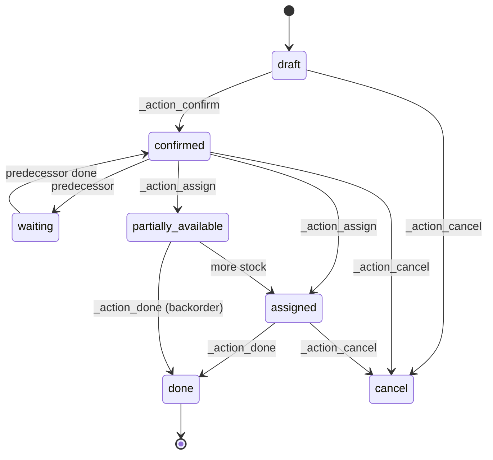

**Compuerta `picked`:** una línea de movimiento con cantidad pero con `picked=False` no se valida. Este es un comportamiento de la v19 y una causa frecuente de «¿por qué se ignora mi cantidad?».

---

## 7. Quant de stock

No hay máquina de estados. Campos numéricos:

| Campo | Significado |
|---|---|
| `quantity` | disponible físico (on hand) |
| `reserved_quantity` | reservado |
| `available_quantity` | `quantity - reserved_quantity` |
| `inventory_quantity` | valor contado (UI) |

Un quant puede ser negativo si se permite. No existen `done`/`cancel`.

---

## 8. Movimiento contable (asiento contable / factura)

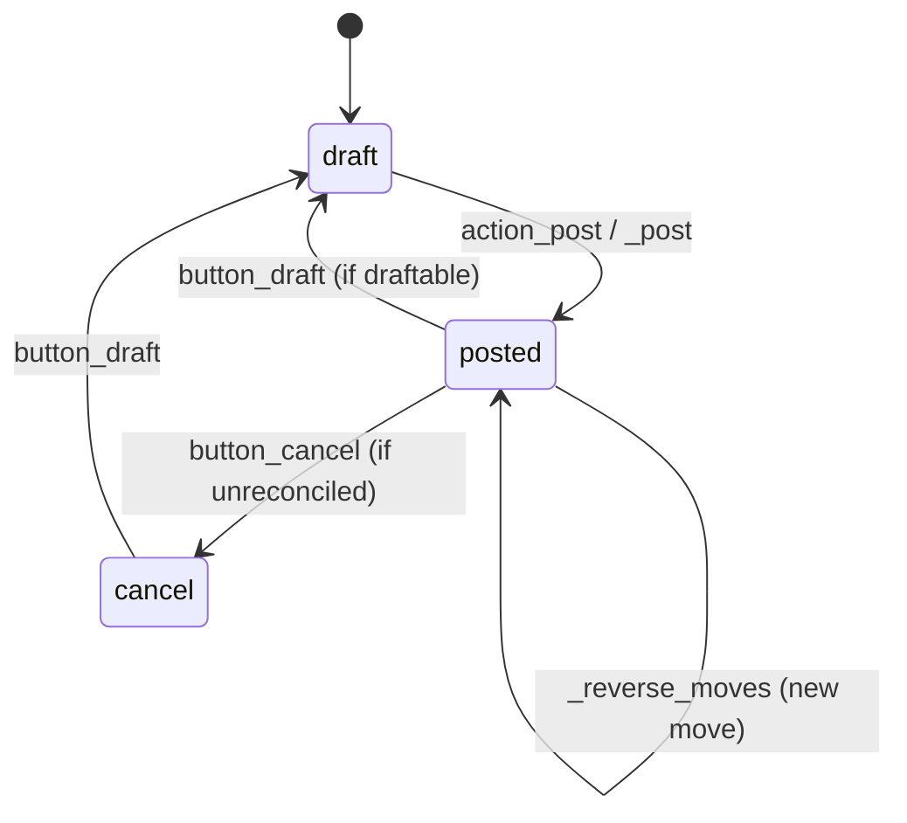

| Desde | Hasta | Disparador | Guarda |
|---|---|---|---|
| `draft` | `posted` | `action_post` | cuadrado, contacto, fecha, fecha de bloqueo |
| `posted` | `draft` | `button_draft` | sin hash, no bloqueado, no conciliado |
| `posted` | `cancel` | `button_cancel` | no conciliado |
| `cancel` | `draft` | `button_draft` | — |

`payment_state`: `not_paid`, `partial`, `paid`, `in_payment`, `blocked` (calculado a partir de la conciliación).

Fuente: `account/models/account_move.py:130-160`, `:5574-5800`, `:6253`, `:6368`.

---

## 9. Pago contable

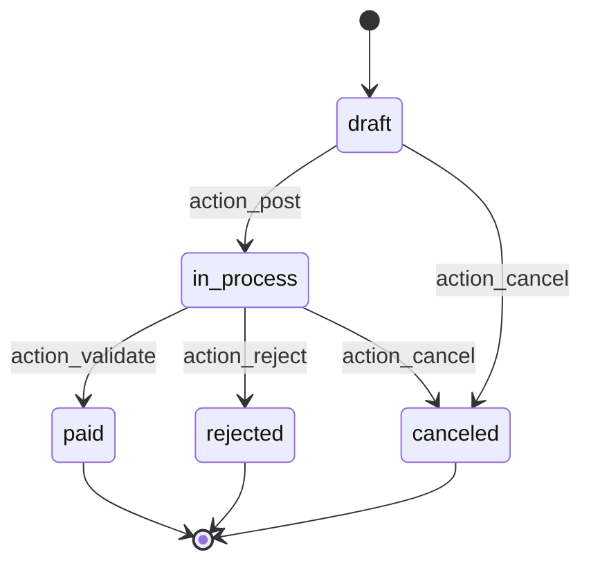

Las cuentas de efectivo pueden pasar directamente a `paid` al contabilizar.

Fuente: `account/models/account_payment.py:1126-1160`.

---

## 10. Activo contable

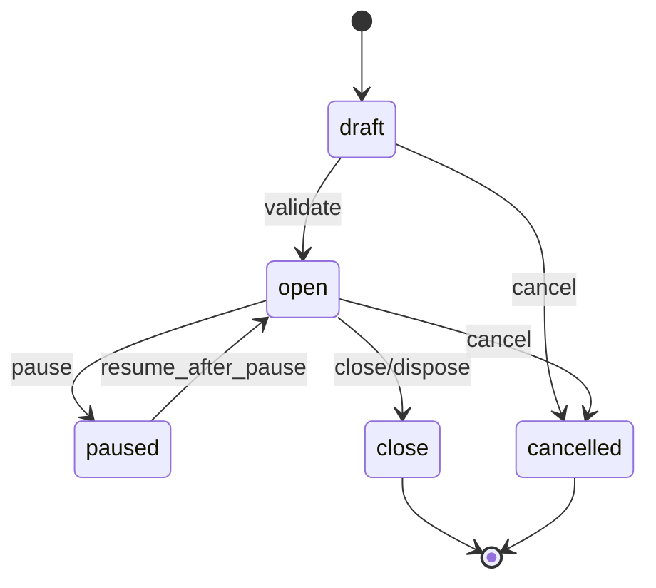

El estado `model` lo utilizan las *plantillas* de activos (modelos de activos), no un activo individual.

Los asientos de amortización se generan mientras el estado es `open`; la pausa detiene la amortización futura. Los métodos son `validate`, `pause`, `resume_after_pause` y las acciones de cierre/cancelación.

Fuente: `account_asset/models/account_asset.py:32-46`, `:865`, `:993`, `:1002`.

---

## 11. Orden de fabricación

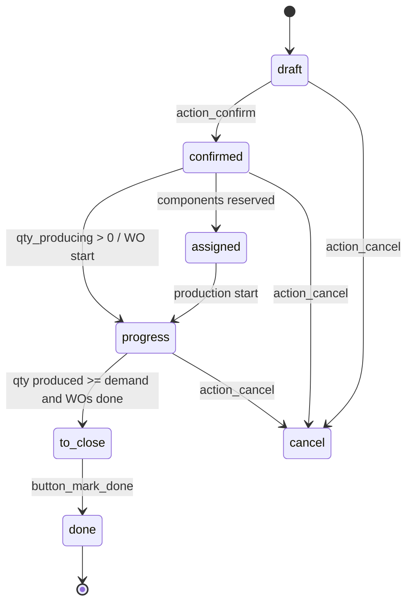

`state` es **calculado** (`_compute_state`):

| Condición | Estado |
|---|---|
| sin movimientos/sin guardar | `draft` |
| todos los movimientos de producto terminado cancelados | `cancel` |
| todos los movimientos de materias primas y de producto terminado hechos/cancelados | `done` |
| OT hechas/canceladas, o sin OT y producido >= demanda | `to_close` |
| cualquier OT en curso/hecha, cantidad en producción > 0, o materias primas recogidas | `progress` |
| en caso contrario | `confirmed` |

Fuente: `mrp/models/mrp_production.py:177-200`, `:573-620`.

---

## 12. Orden de trabajo

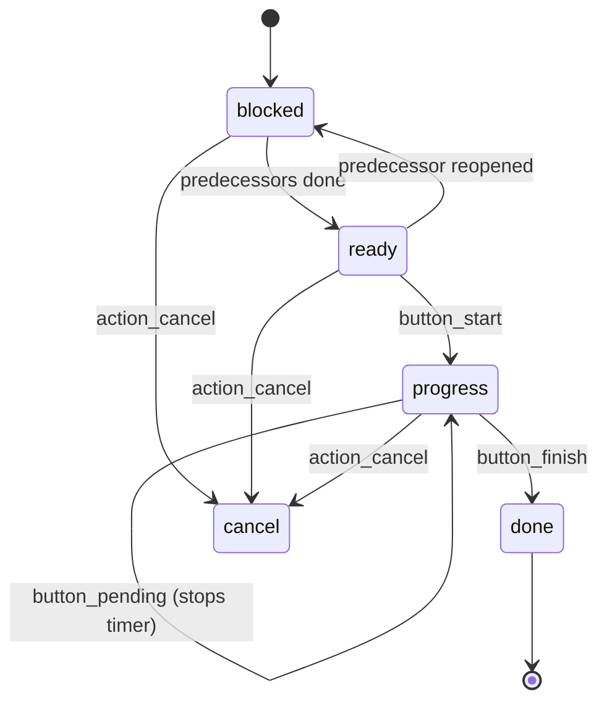

| Estado | Significado |
|---|---|
| `blocked` | esperando una operación predecesora o el desbloqueo del centro de trabajo |
| `ready` | puede iniciarse |
| `progress` | registro de tiempo en curso |
| `done` | finalizada |
| `cancel` | cancelada |

`button_pending()` detiene el temporizador del usuario actual; por sí solo no cambia el estado. Las transiciones de estado se calculan mediante `_compute_state`.

Fuente: `mrp/models/mrp_workorder.py:66-74`, `:656-780`.

---

## 13. Módulo

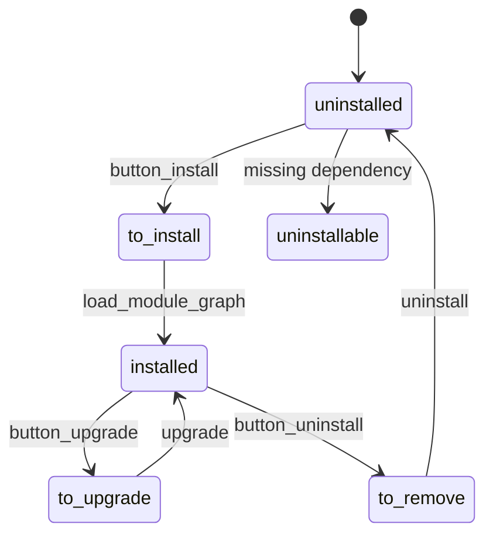

Fuente: `addons/base/models/ir_module.py`.

---

## 14. Trabajo cron (ciclo de vida, no un campo de estado)

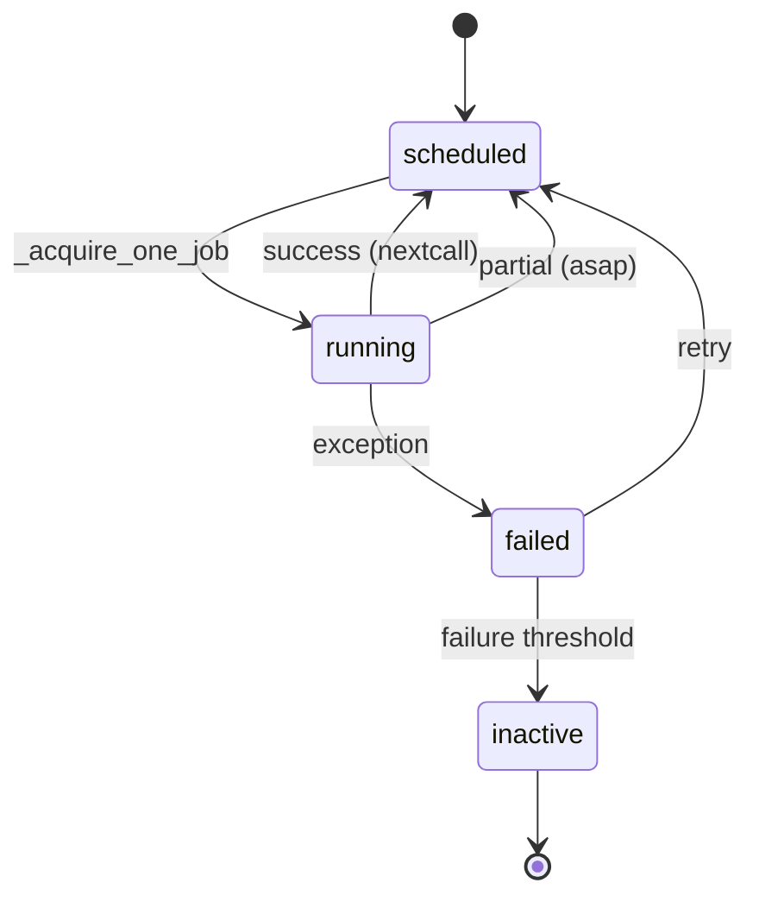

Campos: `active`, `nextcall`, `lastcall`, `failure_count`, `first_failure_date`. El progreso está en `ir.cron.progress`.

Fuente: `addons/base/models/ir_cron.py:91-130`, `:399-500`.

---

## 15. Matriz de pruebas de transiciones

| Máquina | Ruta feliz | Fallo de guarda | Concurrente | Idempotencia |
|---|---|---|---|---|
| Pedido de venta | draft → sale | producto faltante | doble confirmación | confirmar dos veces |
| Compra | draft → purchase | aprobación | doble aprobación | confirmar dos veces |
| Picking | draft → done | sin stock/lote | dos operadores | validar dos veces |
| Factura | draft → posted | descuadre/bloqueo | contención de secuencia | contabilizar dos veces |
| Pago | draft → paid | banco no confiable | conciliar la misma línea | registrar dos veces |
| OF | draft → done | sin componentes | dos operadores | marcar como hecha dos veces |
| Cron | scheduled → done | excepción | dos workers | ejecutar dos veces |

**[INVARIANT]** Toda transición debe ser segura de invocar dos veces. Si no lo es, añada una guarda de estado y una prueba.

---

## 16. Índice de evidencia

| Máquina | Archivo |
|---|---|
| Venta | `addons/sale/models/sale_order.py:26-81`, `1167-1333` |
| CRM | `addons/crm/models/crm_lead.py:123-233` |
| Compra | `addons/purchase/models/purchase_order.py:105-116`, `615-655` |
| Picking | `addons/stock/models/stock_picking.py:575-590`, `816` |
| Movimiento | `addons/stock/models/stock_move.py:107-120`, `2244` |
| Movimiento contable | `addons/account/models/account_move.py:130-160`, `5574` |
| Pago | `addons/account/models/account_payment.py:1126` |
| Activo | `addons/account_asset/models/account_asset.py` |
| OF | `addons/mrp/models/mrp_production.py:177-200`, `573` |
| Orden de trabajo | `addons/mrp/models/mrp_workorder.py:656` |
| Módulo | `addons/base/models/ir_module.py` |
| Cron | `addons/base/models/ir_cron.py:91-130` |

Continúe con `06-nfr.md`.
