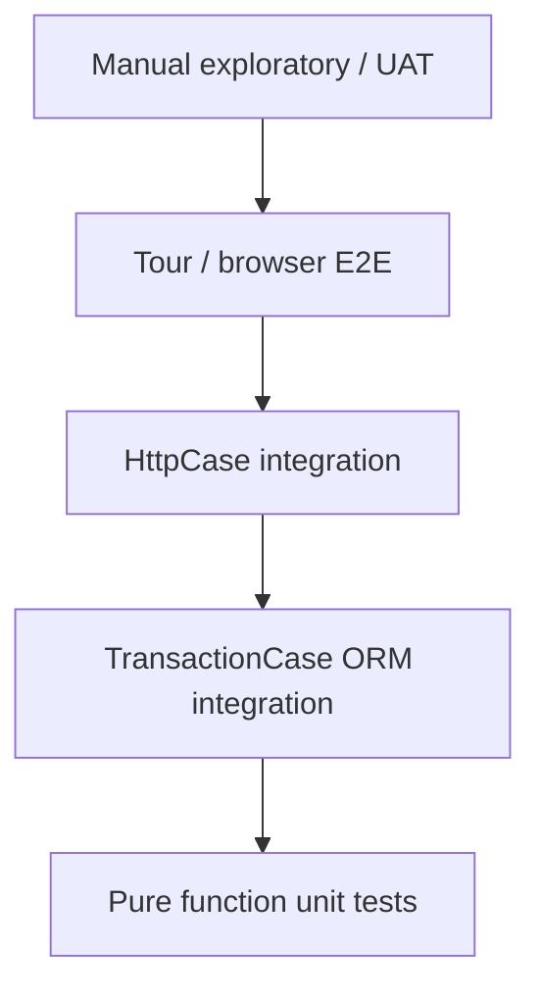
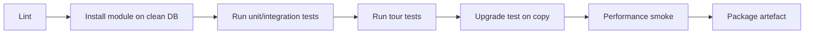

# Ingeniería de software VII — Estrategia de pruebas para personalizaciones de Odoo

> **Premisa.** Las pruebas de Odoo no son pruebas unitarias genéricas. Se ejecutan dentro de un registro real, una transacción real y, normalmente, una base de datos real. El framework proporciona herramientas para cada capa; usar la incorrecta produce pruebas lentas, inestables o sin sentido.

---

## 1. Pirámide de pruebas para Odoo



| Capa | Velocidad | Confianza | Uso |
|---|---|---|---|
| Unitaria pura | ms | lógica | precios, matemática de impuestos, validadores |
| `TransactionCase` | 100 ms–2 s | comportamiento del ORM | invariantes, cálculos, flujos |
| `HttpCase` | 1–10 s | HTTP/autenticación/portal | controladores, JSON-RPC, portal |
| Tour | 10–60 s | flujo de UI | recorridos críticos de usuario |
| Manual/UAT | horas | adecuación al negocio | aceptación |

---

## 2. Clases base de prueba

| Clase | Transacción | Uso |
|---|---|---|
| `BaseCase` | ninguna | ayudantes, sin fixture de BD |
| `TransactionCase` | una transacción, revertida | la mayoría de las pruebas del ORM |
| `SingleTransactionCase` | una transacción para la clase | configuración costosa compartida entre pruebas |
| `HttpCase` | cliente HTTP + BD | controladores, portal, tours |
| `Form` | `NewId` en memoria | pruebas de onchange/similares a la UI |

**[WARNING]** `SavepointCase` no está presente en Odoo 19. Utilice `SingleTransactionCase` para fixtures a nivel de clase.

Fuente: `odoo/tests/common.py:302`, `:990`, `:1171`, `:2196`; `odoo/tests/form.py:27`.

---

## 3. Qué probar

### 3.1 Invariantes

Cada `@api.constrains`, restricción SQL y guarda de estado necesita una prueba negativa.

```python
def test_end_before_start_rejected(self):
    with self.assertRaises(ValidationError):
        self.env['my.entity'].create({
            'date_start': '2026-02-01',
            'date_end': '2026-01-01',
        })
```

### 3.2 Cálculos

Pruebe cada dependencia y el procesamiento por lotes de múltiples registros.

```python
def test_total_recomputes_on_line_change(self):
    order = self.env['sale.order'].create({...})
    line = order.order_line[0]
    line.product_uom_qty = 5
    self.assertEqual(order.amount_untaxed, 5 * line.price_unit)
```

### 3.3 Transiciones de estado

Pruebe la ruta feliz, el fallo de guarda y la doble invocación.

```python
def test_confirm_twice_is_idempotent(self):
    order.action_confirm()
    with self.assertRaises(UserError):
        order.action_confirm()
```

### 3.4 Seguridad

- la ACL deniega por defecto,
- la regla de registro restringe filas,
- el grupo de campos oculta el campo,
- el usuario del portal solo ve sus propios registros,
- `sudo()` no filtra datos.

```python
def test_portal_user_sees_only_own_orders(self):
    order = self._create_order(partner=self.portal_partner)
    other = self._create_order(partner=self.other_partner)
    visible = self.env['sale.order'].with_user(self.portal_user).search([])
    self.assertIn(order, visible)
    self.assertNotIn(other, visible)
```

### 3.5 Multicompañía

Cree dos compañías, compruebe que el acceso entre compañías está bloqueado y que `_check_company` genera un error.

### 3.6 Concurrencia

`TransactionCase` no puede probar dos transacciones. Utilice:

- `HttpCase` con dos cursores,
- una prueba dedicada de `CursorCase`/hilos,
- pruebas de integración contra un servidor real.

```python
def test_sequence_concurrent(self):
    # spawn threads with separate cursors, assert unique names
    ...
```

### 3.7 Rendimiento

```python
def test_confirm_query_count(self):
    with self.assertQueryCount(50):
        order.action_confirm()
```

Establezca presupuestos realistas; un recuento que cambia en cada parche es una carga de mantenimiento. Pruebe la ruta caliente, no todos los métodos.

### 3.8 Tours

```python
def test_create_order_tour(self):
    self.start_tour('/web', 'my_module_create_order', login='admin')
```

Los tours son grabaciones de JavaScript; detectan regresiones de UI, pero son más lentos e inestables. Úselos para 3–5 recorridos críticos, no para todas las pantallas.

---

## 4. Datos de prueba

### 4.1 Fixtures

- cree los registros mínimos en `setUpClass`,
- use `self.env.ref()` para los datos estándar (compañía, grupos, impuestos),
- evite suposiciones sobre datos de demostración,
- aísle la compañía/moneda por prueba cuando pruebe multicompañía.

### 4.2 Fábricas

```python
def _make_partner(self, **vals):
    base = {'name': 'Test Partner', 'is_company': True}
    return self.env['res.partner'].create({**base, **vals})

def _make_order(self, partner=None, lines=1):
    partner = partner or self._make_partner()
    return self.env['sale.order'].create({
        'partner_id': partner.id,
        'order_line': [Command.create({
            'product_id': self.product.id,
            'product_uom_qty': 1,
        }) for _ in range(lines)],
    })
```

### 4.3 Datos de demostración

Nunca dependa de los datos de demostración en las pruebas. Cambian entre versiones y no se instalan en producción. Cree lo que necesite.

---

## 5. Organización de las pruebas

```
my_module/
├── tests/
│   ├── __init__.py
│   ├── common.py            # shared fixtures
│   ├── test_invariants.py
│   ├── test_flows.py
│   ├── test_security.py
│   ├── test_performance.py
│   └── test_tours.py
```

- `tests/__init__.py` importa los módulos de prueba.
- El ejecutor de pruebas de Odoo descubre los módulos de prueba.
- Etiquete las pruebas (`@tagged('post_install', '-at_install')`) para controlar cuándo se ejecutan.
- Use `@tagged('slow')` para las pruebas largas y exclúyalas de la CI rápida.

---

## 6. Pipeline de CI



### 6.1 Etapas

| Etapa | Comando | Puerta |
|---|---|---|
| Lint | `ruff`, `pylint-odoo`, `eslint` | sin errores |
| Instalación | `odoo-bin -d test -i my_module --stop-after-init` | salida 0 |
| Pruebas | `odoo-bin -d test -u my_module --test-enable --stop-after-init` | todas pasan |
| Tours | `--test-tags /my_module:TestTour` | todas pasan |
| Actualización | restaurar copia de producción, `-u my_module` | sin errores |
| Seguridad | `bandit`, escaneo de dependencias | sin hallazgos altos |
| Rendimiento | umbrales de `assertQueryCount` | dentro del presupuesto |

### 6.2 Estrategia de base de datos de prueba

- cree una BD plantilla con `base` + dependencias,
- clone por pipeline (`CREATE DATABASE ... TEMPLATE ...`),
- nunca ejecute pruebas en producción,
- restablezca secuencias/fixtures entre ejecuciones.

### 6.3 Pruebas inestables

Causas frecuentes:

- pruebas dependientes del tiempo (`fields.Datetime.now()`),
- datos aleatorios sin semillas,
- tours con animaciones/asincronía,
- estado compartido a nivel de clase,
- API externas.

Se corrige congelando el tiempo (`freeze_time`), sembrando el azar, esperando a los selectores y aislando el estado.

---

## 7. Pruebas de actualización

1. restaure una copia de producción,
2. instale la nueva versión del módulo,
3. ejecute los scripts de migración,
4. ejecute las pruebas del módulo,
5. ejecute los flujos de humo,
6. compare los totales clave (balance de comprobación, valor del stock, pedidos abiertos),
7. revise los registros en busca de advertencias (`Missing not-null`, `no access rules`).

---

## 8. UAT y aceptación

| Artefacto | Contenido |
|---|---|
| Plan de UAT | escenarios, roles, datos, resultados esperados |
| Guiones de UAT | paso a paso, capturas de pantalla |
| Trazabilidad | requisito → caso de uso → prueba |
| Aprobación | responsable de negocio por dominio |
| Registro de defectos | gravedad, responsable, versión de corrección |

La UAT no es una demostración. Utilice datos similares a los de producción y roles reales; pruebe las excepciones (devoluciones, cancelaciones, pagos parciales), no solo las rutas felices.

---

## 9. Antipatrones de prueba

| Antipatrón | Problema |
|---|---|
| Probar solo la ruta feliz | guardas sin probar |
| Afirmar sobre ids | frágil entre BD |
| Depender de datos de demostración | faltan en producción |
| `cr.commit()` en las pruebas | filtra estado, rompe el aislamiento |
| Dormir en lugar de esperar | inestable |
| Una única prueba gigante | difícil de diagnosticar |
| Simular el ORM | no prueba nada real |
| Sin pruebas de seguridad | errores de privilegios |
| Sin presupuesto de rendimiento | regresiones inadvertidas |
| Tours para todo | CI lenta e inestable |

---

## 10. Objetivos de cobertura

| Área | Objetivo |
|---|---|
| Invariantes de modelos personalizados | 100% de las restricciones |
| Transiciones de estado | 100% de las transiciones + guardas |
| Seguridad | cada modelo/regla |
| Flujos críticos | de extremo a extremo |
| Migraciones | ejecución en seco + aserciones de datos |
| Rendimiento | solo rutas calientes |

La cobertura de líneas es una métrica débil en Odoo; la cobertura de comportamiento importa más.

---

## 11. Índice de evidencia

| Tema | Archivo |
|---|---|
| Clases base de prueba | `odoo/tests/common.py:302`, `990`, `1171`, `2196` |
| Ayudante de formulario | `odoo/tests/form.py:27` |
| Recuento de consultas | `odoo/tests/common.py:604` |
| Inicio de tour | `odoo/tests/common.py:2555` |
| Cargador de pruebas | `odoo/tests/loader.py` |
| Etiquetas | `odoo/tests/suite.py` |

Continúe con el volumen 7: gestión de proyectos.
