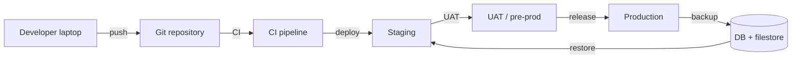
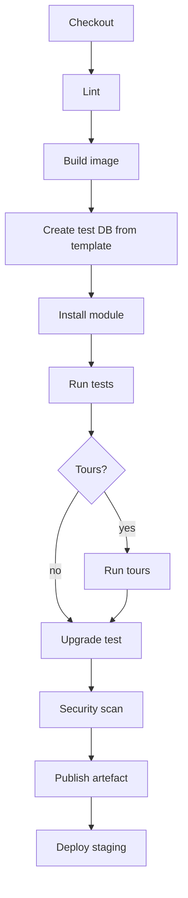

# Gestión de proyectos V — Entornos, CI/CD y operaciones

> **Objetivo.** Entornos reproducibles, pruebas automatizadas, copias de seguridad probadas y un proceso de publicación que pueda revertirse. El runtime monolítico de Odoo convierte la paridad de entornos y el estado de la base de datos en los dos mayores riesgos operativos.

---

## 1. Topología de entornos



| Entorno | Propósito | Datos | Acceso |
|---|---|---|---|
| Dev | desarrollo, pruebas unitarias | sintéticos | desarrolladores |
| CI | compilación/pruebas | base de datos de plantilla | pipeline |
| Staging | integración, rendimiento | copia anonimizada de producción | equipo |
| UAT | aceptación de negocio | copia anonimizada de producción | usuarios clave |
| Prod | producción real | reales | restringido |

**[INVARIANT]** Nunca se debe probar en producción. Nunca se deben copiar datos de producción a desarrollo sin anonimización/neutralización.

---

## 2. Copias de base de datos

### 2.1 Procedimiento de copia

```bash
# 1. stop writes or use a snapshot
pg_dump -Fc -d prod_db -f prod_db.dump
rsync -a /opt/odoo/filestore/prod_db/ /backup/filestore/prod_db/

# 2. create target
createdb -T template0 staging_db
pg_restore -d staging_db prod_db.dump

# 3. restore filestore
rsync -a /backup/filestore/prod_db/ /opt/odoo/filestore/staging_db/

# 4. neutralize
odoo-bin neutralize -d staging_db --config=/etc/odoo/odoo.conf
```

### 2.2 Neutralización

`odoo-bin neutralize` ejecuta `data/neutralize.sql` por cada módulo instalado:

- desactiva los servidores de correo saliente,
- desactiva los proveedores de pago,
- borra las claves de API/webhooks,
- cambia las programaciones de cron,
- restablece la imagen de marca.

**[WARNING]** Las integraciones personalizadas necesitan su propio `neutralize.sql`, o la copia de staging llamará a las API de producción.

### 2.3 Anonimización

Si se deben eliminar datos personales:

- sustituir nombres, correos electrónicos y teléfonos de los socios,
- ofuscar el NIF/IBAN,
- eliminar los adjuntos con datos personales,
- mantener la integridad relacional.

La anonimización es un script personalizado; el núcleo no la proporciona.

---

## 3. Desarrollo local

### 3.1 Estructura típica

```
project/
├── odoo/                    # submodule or pip install
├── enterprise/              # licensed addons (if any)
├── custom/                  # your modules
├── config/odoo.conf
├── docker-compose.yml
└── scripts/
```

### 3.2 Aspectos esenciales de `odoo.conf`

```ini
[options]
addons_path = /opt/odoo/addons,/opt/odoo/enterprise,/opt/custom
data_dir = /var/lib/odoo
db_host = db
db_port = 5432
db_user = odoo
db_password = ***
admin_passwd = ***
workers = 0
limit_time_cpu = 600
limit_time_real = 1200
log_level = info
```

### 3.3 Docker Compose (desarrollo)

```yaml
services:
  db:
    image: postgres:16
    environment:
      POSTGRES_DB: odoo
      POSTGRES_USER: odoo
      POSTGRES_PASSWORD: odoo
    volumes:
      - db:/var/lib/postgresql/data
  odoo:
    image: odoo:19.0
    depends_on: [db]
    ports: ["8069:8069"]
    volumes:
      - ./config:/etc/odoo
      - ./custom:/mnt/extra-addons
      - data:/var/lib/odoo
    command: ["odoo", "-c", "/etc/odoo/odoo.conf"]
volumes:
  db:
  data:
```

**[WARNING]** La imagen `odoo:19.0` puede no coincidir con la compilación de su código fuente Enterprise. Para producción, se debe construir una imagen a partir del commit exacto del código fuente y los requisitos.

---

## 4. Pipeline de CI



### 4.1 Ejemplo de job

```yaml
test:
  image: odoo:19.0
  services:
    - postgres:16
  script:
    - odoo -d test -i my_module --stop-after-init --without-demo=all
    - odoo -d test -u my_module --test-enable --stop-after-init --log-level=test
  artifacts:
    when: always
    paths: [test.log]
```

### 4.2 Etiquetas de prueba

```bash
odoo -d test -u my_module --test-enable --test-tags /my_module:TestFlow
odoo -d test -u my_module --test-enable --test-tags /my_module:TestTour
```

### 4.3 Job de actualización

```bash
# restore a production copy into CI
pg_restore -d upgrade_test prod.dump
odoo -d upgrade_test -u my_module --stop-after-init
# run smoke tests
```

---

## 5. Gestión de versiones

### 5.1 Versionado

- Módulos de Odoo: `19.0.<major>.<minor>.<patch>`.
- Etiquetas de Git: `v19.0.1.0.0`.
- Base de datos: registrar el commit desplegado y las versiones de los módulos en `ir_module_module.latest_version`.

### 5.2 Lista de verificación de publicación

- [ ] registro de cambios,
- [ ] scripts de migración revisados,
- [ ] actualización de staging probada,
- [ ] aprobación de UAT,
- [ ] copia de seguridad verificada,
- [ ] ventana de mantenimiento programada,
- [ ] plan de reversión,
- [ ] prueba de humo posterior al despliegue.

### 5.3 Pasos de despliegue

```bash
# 1. put the app in maintenance mode (reverse proxy)
# 2. stop workers (keep DB)
systemctl stop odoo
# 3. backup DB + filestore
# 4. deploy code
git checkout v19.0.1.0.0
# 5. upgrade modules
odoo-bin -c /etc/odoo/odoo.conf -d prod -u my_module --stop-after-init
# 6. start workers
systemctl start odoo
# 7. smoke test
curl -f https://erp.example.com/web/health
```

### 5.4 Reversión

```bash
systemctl stop odoo
dropdb prod && createdb -T template0 prod
pg_restore -d prod backup.dump
rsync -a /backup/filestore/prod/ /var/lib/odoo/filestore/prod/
git checkout previous-tag
systemctl start odoo
```

Se debe probar la reversión en staging. Una reversión que nunca se ha ejecutado es un plan, no una capacidad.

---

## 6. Copia de seguridad y restauración

| Elemento | Frecuencia | Retención |
|---|---|---|
| Volcado completo de la base de datos | diaria | 30 días |
| Archivado de WAL | continua | 7 días |
| Filestore | incremental diaria | 30 días |
| Copia externa | diaria | 90 días |
| Prueba de restauración | mensual | registro |

### 6.1 Validación de la restauración

- [ ] La base de datos arranca.
- [ ] El registro se carga sin errores.
- [ ] El inicio de sesión funciona.
- [ ] Existen los registros clave (pedidos de venta, facturas, stock).
- [ ] Los adjuntos se abren.
- [ ] Los informes se generan.
- [ ] Los trabajos de cron están programados.

---

## 7. Monitorización

### 7.1 Infraestructura

- CPU, RAM, disco, red,
- conexiones a PostgreSQL, bloqueos, retraso de replicación, bloat,
- tamaño/crecimiento del filestore,
- 5xx/latencia del proxy inverso.

### 7.2 Aplicación

- `/web/health` (si está habilitado) o un controlador ligero,
- número de fallos de cron,
- profundidad de la cola de correo,
- acumulación del bus,
- outbox de integración pendiente/fallido,
- solicitudes de larga duración.

### 7.3 Alertas

| Alerta | Umbral |
|---|---|
| HTTP 5xx | > 1 % durante 5 min |
| latencia p95 | > 2 s durante 10 min |
| conexiones a la base de datos | > 80 % del máximo |
| transacción larga | > 5 min |
| fallos de cron | > 3 consecutivos |
| disco | > 80 % |
| fallo de copia de seguridad | cualquiera |
| retraso de replicación | > 60 s |

---

## 8. Operaciones de seguridad

- aplicar parches al SO/PostgreSQL/Odoo mensualmente,
- rotar secretos y claves de API,
- revisar las cuentas de administrador trimestralmente,
- exigir 2FA para los administradores,
- restringir el acceso de red a la base de datos,
- escanear las dependencias,
- revisar los logs en busca de anomalías,
- probar la restauración y la respuesta a incidentes.

---

## 9. Guías operativas

Mantenga guías operativas breves y probadas:

1. iniciar/detener/reiniciar los workers,
2. restaurar la base de datos + filestore,
3. sustituir un worker fallido,
4. desbloquear un cron atascado,
5. investigar una espera de bloqueo,
6. desactivar una integración,
7. revertir una publicación,
8. gestionar un incidente de seguridad,
9. soporte al cierre de mes.

Cada guía operativa: disparador, impacto, pasos, verificación, escalado.

---

## 10. Índice de evidencias

| Tema | Archivo |
|---|---|
| Opciones de configuración | `tools/config.py` |
| Neutralización | `modules/neutralize.py` |
| Cron | `addons/base/models/ir_cron.py` |
| Filestore | `addons/base/models/ir_attachment.py` |
| Salud/HTTP | `http.py`, `addons/base/models/ir_http.py` |

Continúe con `06-risk-register.md`.
