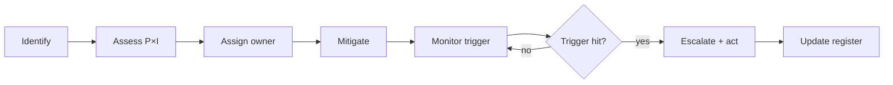

# Gestión de proyectos VI — Registro de riesgos y manual de mitigación

> **Uso.** Revisar en cada puerta y mensualmente durante la entrega. Un riesgo sin propietario y sin disparador es un deseo.

---

## 1. Puntuación

| Probabilidad | Puntuación | Impacto | Puntuación |
|---|---|---|---|
| Muy baja | 1 | Insignificante | 1 |
| Baja | 2 | Menor | 2 |
| Media | 3 | Moderado | 3 |
| Alta | 4 | Grave | 4 |
| Muy alta | 5 | Crítico | 5 |

`Risk score = probability × impact`. Prioridad: ≥ 15 crítico, 9–14 alto, 5–8 medio, ≤ 4 bajo.

---

## 2. Registro de riesgos

| ID | Riesgo | P | I | Puntuación | Mitigación | Propietario | Disparador |
|---|---|---|---|---|---|---|---|
| R-01 | Expansión del alcance | 4 | 4 | 16 | control de cambios, backlog, aprobación del patrocinador | PM | nuevas solicitudes sin CR |
| R-02 | Datos maestros deficientes | 4 | 5 | 20 | perfilado de datos, sprints de depuración, asignación de propietarios | Datos | duplicados > 5 % |
| R-03 | Lagunas de localización | 3 | 5 | 15 | revisión por el contable, experto del país, prueba temprana | Funcional | discrepancia de impuestos/informes |
| R-04 | Integración subestimada | 4 | 4 | 16 | contrato primero, spike, sandbox | Arquitecto | API sin documentar |
| R-05 | Rendimiento con volumen | 3 | 4 | 12 | prueba de carga similar a producción, índices | Arquitecto | p95 > objetivo |
| R-06 | Fragilidad del código personalizado | 3 | 4 | 12 | pruebas, revisión, sin ediciones del núcleo | Responsable de desarrollo | tasa de hotfix |
| R-07 | La actualización rompe el código personalizado | 3 | 5 | 15 | versión fijada, pruebas de migración | Arquitecto | nueva versión de Odoo |
| R-08 | Incidente de seguridad/privacidad | 2 | 5 | 10 | revisión de ACL/reglas, prueba de penetración, 2FA | Seguridad | anomalía de acceso |
| R-09 | Usuario clave no disponible | 4 | 3 | 12 | suplentes designados, calendario | PM | UAT no realizada |
| R-10 | Baja adopción | 3 | 5 | 15 | gestión del cambio, formación, embajadores | Cambio | métricas de inicio de sesión/tareas |
| R-11 | Pérdida en la migración de datos | 2 | 5 | 10 | conciliación, copia de seguridad, ejecuciones de prueba | Datos | discrepancia de filas/totales |
| R-12 | Desbordamiento del paso a producción | 3 | 4 | 12 | ensayo, guía operativa, margen | PM | tiempo > plan |
| R-13 | Restricción de proveedor/licencia | 2 | 4 | 8 | revisión de contrato, legal | Patrocinador | auditoría de licencias |
| R-14 | Sorpresa de autoinstalación | 3 | 3 | 9 | auditoría de cierre, lista de módulos fijada | Arquitecto | módulo inesperado |
| R-15 | Duplicación de cron/integraciones | 3 | 4 | 12 | idempotencia, bloqueos advisory, monitorización | Arquitecto | registros duplicados |
| R-16 | Fallo en el cierre contable | 2 | 5 | 10 | ejecución en paralelo, conciliación | Contralor | retraso del cierre |
| R-17 | Carencia de filestore/copia de seguridad | 2 | 5 | 10 | prueba de copia de seguridad, copia externa | DevOps | fallo de restauración |
| R-18 | Pérdida de conocimiento | 3 | 3 | 9 | documentación, trabajo por parejas, traspaso | PM | salida de persona clave |

---

## 3. Riesgos principales en detalle

### R-01 Expansión del alcance

**Por qué ocurre:** Odoo hace que los cambios pequeños parezcan fáciles («solo hay que añadir un campo»). Cada campo desencadena vistas, seguridad, informes, migraciones y pruebas.

**Mitigación:**

- alcance de referencia con una lista explícita de lo que queda fuera del alcance,
- solicitud de cambio con esfuerzo/impacto,
- el patrocinador aprueba los cambios de alcance,
- refinamiento del backlog, no solicitudes en los pasillos.

**Disparador:** más de 2 elementos no planificados en un sprint.

### R-02 Datos maestros deficientes

**Por qué ocurre:** los sistemas heredados tienen duplicados, campos ausentes, unidades de medida inconsistentes y NIF no válidos.

**Mitigación:**

- perfilar los datos en el descubrimiento (recuentos, nulos, duplicados),
- definir reglas de registro maestro,
- sprints de depuración antes de la migración,
- conciliación por entidad.

**Disparador:** tasa de duplicados > 5 %, campos obligatorios ausentes > 10 %.

### R-03 Lagunas de localización

**Por qué ocurre:** el módulo `l10n_<country>` puede no cubrir un impuesto, un formato de factura electrónica o un informe concretos.

**Mitigación:**

- el contable revisa el plan contable/impuestos desde el principio,
- probar un ciclo de facturación completo con casos fiscales reales,
- reservar presupuesto para informes personalizados,
- verificar la facturación electrónica con el sandbox de la autoridad tributaria.

**Disparador:** discrepancia en el informe de impuestos o factura electrónica rechazada.

### R-04 Integración subestimada

**Por qué ocurre:** las API externas no están documentadas, tienen límites de tasa o son semánticamente diferentes.

**Mitigación:**

- spike de la API antes del compromiso,
- pruebas de contrato,
- claves de idempotencia,
- outbox + reintento,
- sandbox con datos realistas.

**Disparador:** ambigüedad en el mapeo, 4xx/5xx repetidos.

### R-05 Rendimiento con volumen

**Por qué ocurre:** las demostraciones usan 100 registros; producción tiene millones.

**Mitigación:**

- conjunto de datos similar a producción,
- pruebas de rendimiento al doble del pico,
- índices/consultas compuestas,
- réplica de lectura para informes,
- estrategia de archivado.

**Disparador:** p95 supera el objetivo en un 20 %.

### R-07 La actualización rompe el código personalizado

**Por qué ocurre:** las API internas cambian, los modelos se eliminan, las vistas se reestructuran.

**Mitigación:**

- fijar la versión de Odoo para el proyecto,
- evitar las API privadas cuando sea posible,
- pruebas de migración sobre una copia,
- presupuesto de actualización (10–30 % de la construcción),
- supervisar las notas de la versión.

**Disparador:** nueva versión mayor/menor.

### R-10 Baja adopción

**Por qué ocurre:** no se involucró a los usuarios, la formación fue una demostración, los procesos cambiaron sin soporte.

**Mitigación:**

- usuarios clave en el diseño y la UAT,
- formación por rol,
- red de embajadores,
- procedimientos operativos estándar (SOP),
- métricas de adopción (inicios de sesión, transacciones, soluciones improvisadas).

**Disparador:** uso inferior al 70 % tras 2 semanas.

### R-15 Procesamiento duplicado

**Por qué ocurre:** reintentos, doble clic, solapamiento de cron, repetición de webhooks.

**Mitigación:**

- claves de idempotencia/restricciones únicas,
- guardas de estado,
- bloqueos advisory para cron,
- outbox con deduplicación,
- monitorización de duplicados.

**Disparador:** documento de factura/pago/stock duplicado.

---

## 4. Proceso de revisión de riesgos

Cadencia:

- semanal durante la construcción,
- diaria durante la UAT y el paso a producción,
- mensual durante el soporte intensivo posterior a la puesta en marcha,
- en cada puerta.

---

## 5. Incidencia frente a riesgo

| | Riesgo | Incidencia |
|---|---|---|
| Naturaleza | puede ocurrir | ya ha ocurrido |
| Propietario | propietario del riesgo | propietario de la incidencia |
| Acción | mitigación | resolución |
| Seguimiento | registro | ticket |

No se debe permitir que las incidencias se disfracen de riesgos; necesitan resolución, no mitigación.

---

## 6. Planificación de contingencias

| Escenario | Disparador | Respuesta |
|---|---|---|
| Puesta en marcha bloqueada | defecto crítico | retrasar, corregir, volver a probar |
| Datos inconsistentes | varianza en la conciliación | revertir, corregir, recargar |
| Integración caída | interrupción externa | cola/outbox, alternativa manual |
| Rendimiento inaceptable | p95 > 2× objetivo | revertir, ajustar, volver a probar |
| Incidente de seguridad | brecha/filtración | aislar, notificar, investigar |
| Salida de persona clave | preaviso | transferencia de conocimiento, propietario suplente |

Cada respuesta tiene un responsable de decisión designado y un plan de comunicación.

---

## 7. Plantilla de registro de riesgos

| Campo | Descripción |
|---|---|
| ID | R-NN |
| Categoría | alcance/datos/técnico/seguridad/cumplimiento/operaciones/proveedor/cambio |
| Descripción | causa → evento → efecto |
| Probabilidad | 1–5 |
| Impacto | 1–5 |
| Puntuación | P×I |
| Mitigación | acción preventiva |
| Contingencia | si ocurre |
| Propietario | persona responsable |
| Disparador | señal observable |
| Estado | abierto/en seguimiento/cerrado |
| Fecha de revisión | |

---

## 8. Evidencias y adaptación

- Un proyecto pequeño puede usar 10 riesgos; un programa necesita 30 o más.
- Revisar el registro con el patrocinador, no solo con el equipo.
- Cerrar los riesgos solo cuando haya pasado la ventana del disparador.
- Incorporar las lecciones aprendidas al registro del siguiente proyecto.

Continúe con `07-implementation-playbook.md`.
